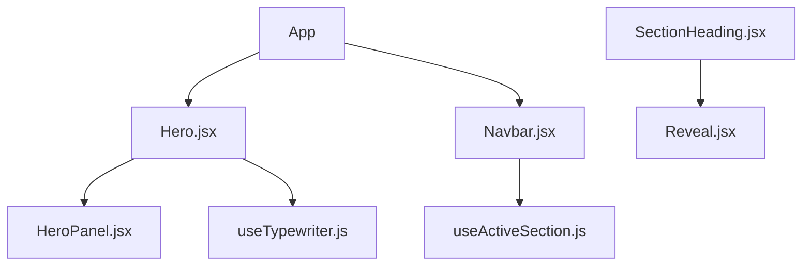
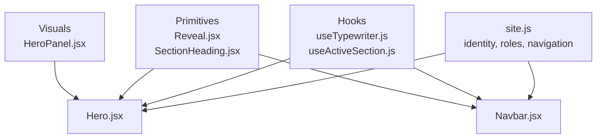
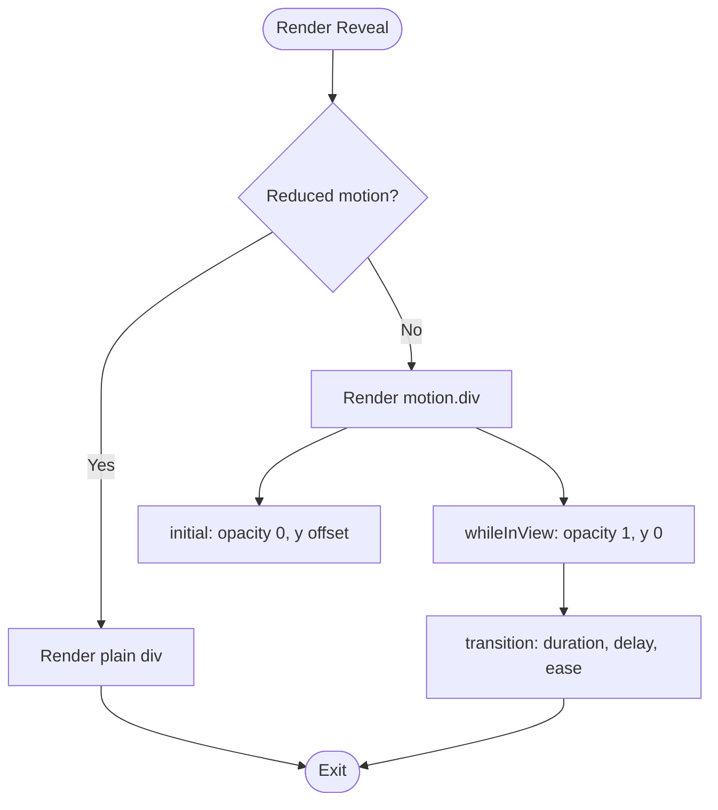
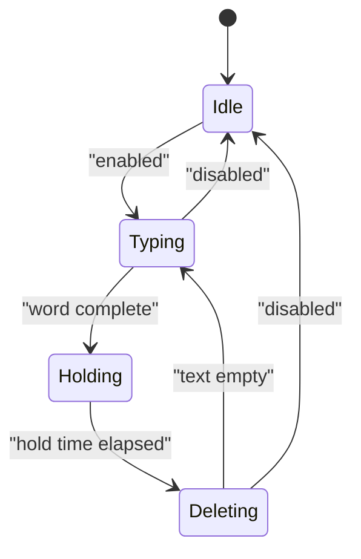
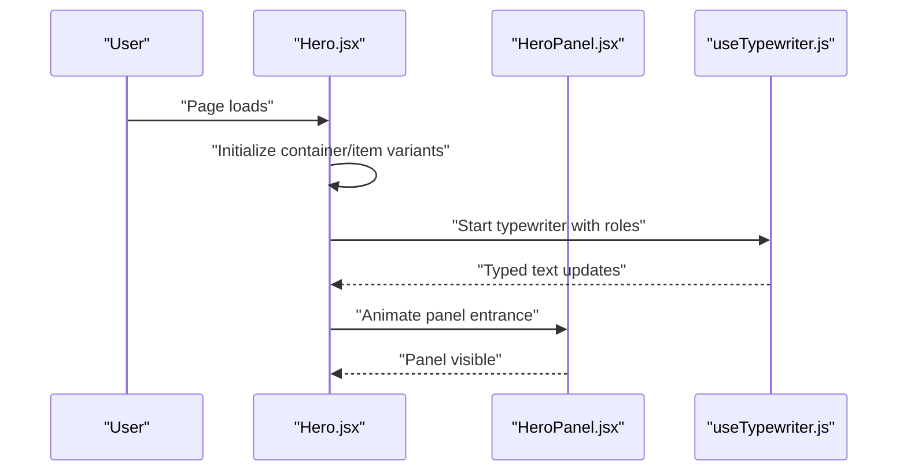
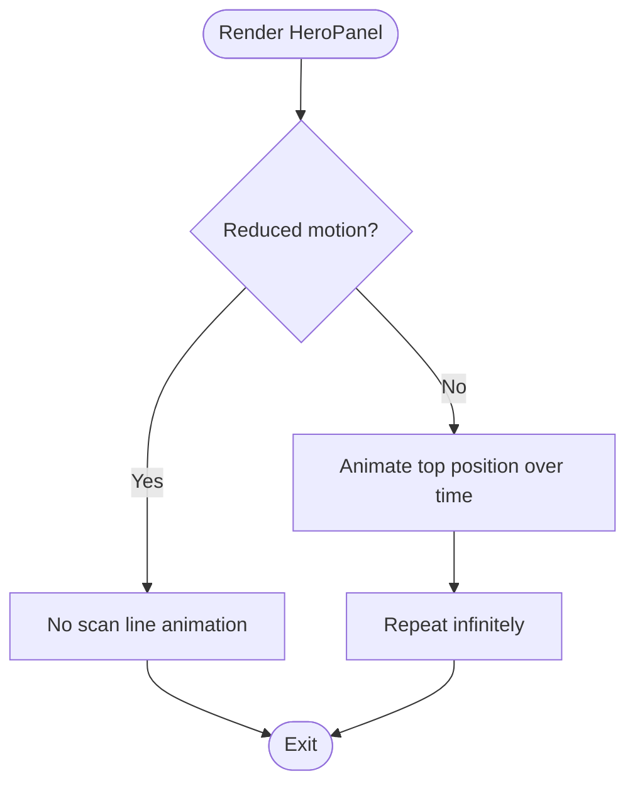
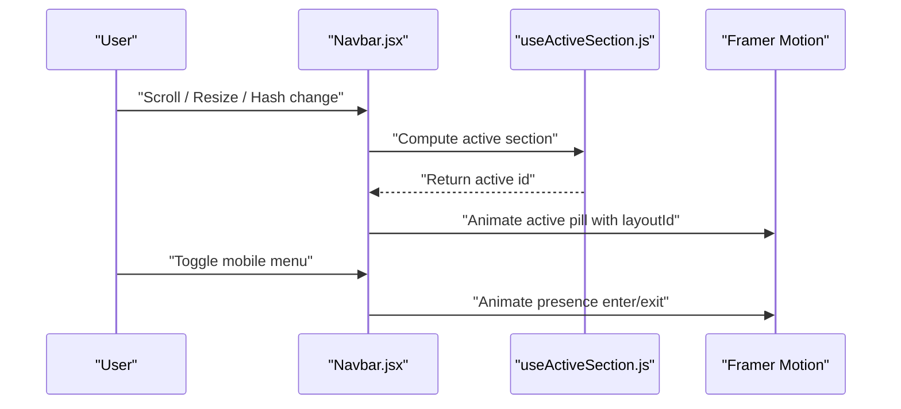
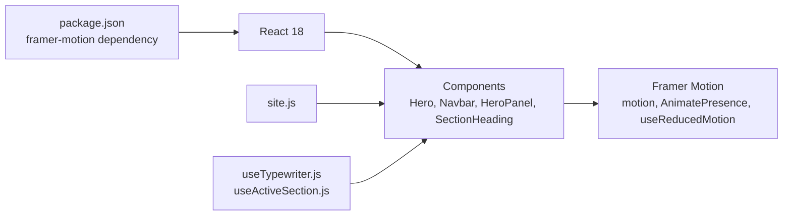

# Animation Framework & Motion

<cite>
**Referenced Files in This Document**
- [Reveal.jsx](file://src/components/ui/Reveal.jsx)
- [useTypewriter.js](file://src/hooks/useTypewriter.js)
- [HeroPanel.jsx](file://src/components/visuals/HeroPanel.jsx)
- [Navbar.jsx](file://src/components/Navbar.jsx)
- [Hero.jsx](file://src/components/Hero.jsx)
- [SectionHeading.jsx](file://src/components/ui/SectionHeading.jsx)
- [useActiveSection.js](file://src/hooks/useActiveSection.js)
- [site.js](file://src/data/site.js)
- [package.json](file://package.json)
</cite>

## Table of Contents
1. [Introduction](#introduction)
2. [Project Structure](#project-structure)
3. [Core Components](#core-components)
4. [Architecture Overview](#architecture-overview)
5. [Detailed Component Analysis](#detailed-component-analysis)
6. [Dependency Analysis](#dependency-analysis)
7. [Performance Considerations](#performance-considerations)
8. [Troubleshooting Guide](#troubleshooting-guide)
9. [Conclusion](#conclusion)

## Introduction
This document explains the animation framework built with Framer Motion across the portfolio application. It covers how subtle reveal animations, hero panel motion, typewriter text effects, and interactive navigation transitions are implemented. It also provides guidelines for creating performant animations, managing animation states, optimizing for mobile devices, following accessibility best practices, and debugging motion-related issues.

The project uses React 18, Vite, Tailwind CSS, and Framer Motion as its core animation library.

**Section sources**
- [package.json:12-16](file://package.json#L12-L16)

## Project Structure
The animation system is composed of reusable UI primitives, hooks, and page-level components that coordinate motion behavior:

- Reusable motion primitives:
  - Scroll-triggered reveal wrapper
  - Section heading composition using reveals
- Typing effect hook:
  - Rotating typewriter logic with reduced-motion support
- Hero section:
  - Staggered entrance animations
  - Integration of the typewriter effect
  - Hero panel visual with a continuous scanning line
- Navigation:
  - Active indicator with layout animation
  - Mobile menu open/close with AnimatePresence

**Diagram sources**
- [Hero.jsx:1-149](file://src/components/Hero.jsx#L1-L149)
- [Navbar.jsx:1-218](file://src/components/Navbar.jsx#L1-L218)
- [HeroPanel.jsx:1-92](file://src/components/visuals/HeroPanel.jsx#L1-L92)
- [SectionHeading.jsx:1-70](file://src/components/ui/SectionHeading.jsx#L1-L70)
- [Reveal.jsx:1-34](file://src/components/ui/Reveal.jsx#L1-L34)
- [useTypewriter.js:1-44](file://src/hooks/useTypewriter.js#L1-L44)
- [useActiveSection.js:1-46](file://src/hooks/useActiveSection.js#L1-L46)

**Section sources**
- [Hero.jsx:1-149](file://src/components/Hero.jsx#L1-L149)
- [Navbar.jsx:1-218](file://src/components/Navbar.jsx#L1-L218)
- [HeroPanel.jsx:1-92](file://src/components/visuals/HeroPanel.jsx#L1-L92)
- [SectionHeading.jsx:1-70](file://src/components/ui/SectionHeading.jsx#L1-L70)
- [Reveal.jsx:1-34](file://src/components/ui/Reveal.jsx#L1-L34)
- [useTypewriter.js:1-44](file://src/hooks/useTypewriter.js#L1-L44)
- [useActiveSection.js:1-46](file://src/hooks/useActiveSection.js#L1-L46)

## Core Components
This section summarizes the primary building blocks of the animation framework.

- Reveal component
  - Provides scroll-triggered fade-in and slide-up animations.
  - Respects user preferences by falling back to a plain element when reduced motion is enabled.
  - Configurable delay, vertical offset, duration, viewport trigger behavior, and one-shot visibility.

- Typewriter hook
  - Implements rotating text with typing, holding, and deleting phases.
  - Supports disabling animation for reduced-motion users by rendering static content.
  - Uses timers to control typing speed, deletion speed, and hold time between words.

- Hero section
  - Coordinates staggered child animations using container and item variants.
  - Integrates the typewriter hook for role labels.
  - Animates the hero panel entrance independently from the textual content.

- Hero panel
  - Displays an editorial index card with metadata.
  - Includes a continuously animated scanning line that respects reduced motion.

- Navbar
  - Highlights the active section using measured DOM positions.
  - Animates the active pill with spring physics.
  - Manages mobile menu open/close with AnimatePresence and motion properties.

**Section sources**
- [Reveal.jsx:1-34](file://src/components/ui/Reveal.jsx#L1-L34)
- [useTypewriter.js:1-44](file://src/hooks/useTypewriter.js#L1-L44)
- [Hero.jsx:1-149](file://src/components/Hero.jsx#L1-L149)
- [HeroPanel.jsx:1-92](file://src/components/visuals/HeroPanel.jsx#L1-L92)
- [Navbar.jsx:1-218](file://src/components/Navbar.jsx#L1-L218)

## Architecture Overview
The animation architecture follows a layered approach:

- Data layer
  - Centralized site configuration defines identity, roles, assets, and navigation items consumed by animated components.

- Hook layer
  - useTypewriter encapsulates text animation state and timing.
  - useActiveSection computes the current section based on scroll position and viewport metrics.

- Component layer
  - Reusable motion primitives (Reveal, SectionHeading) compose animations declaratively.
  - Page-level components (Hero, Navbar, HeroPanel) orchestrate complex sequences and interactions.

**Diagram sources**
- [site.js:6-69](file://src/data/site.js#L6-L69)
- [Hero.jsx:1-149](file://src/components/Hero.jsx#L1-L149)
- [Navbar.jsx:1-218](file://src/components/Navbar.jsx#L1-L218)
- [Reveal.jsx:1-34](file://src/components/ui/Reveal.jsx#L1-L34)
- [SectionHeading.jsx:1-70](file://src/components/ui/SectionHeading.jsx#L1-L70)
- [HeroPanel.jsx:1-92](file://src/components/visuals/HeroPanel.jsx#L1-L92)
- [useTypewriter.js:1-44](file://src/hooks/useTypewriter.js#L1-L44)
- [useActiveSection.js:1-46](file://src/hooks/useActiveSection.js#L1-L46)

## Detailed Component Analysis

### Reveal Component
Purpose:
- Provide consistent scroll-triggered reveal animations across sections.
- Respect reduced-motion preferences by rendering non-animated markup.

Key behaviors:
- Initial state hides content with opacity and vertical offset.
- While in view, animates to full opacity and zero offset.
- Viewport threshold controls when the animation triggers.
- One-shot mode prevents re-animation on subsequent scrolls.

Accessibility:
- Falls back to a plain div when reduced motion is detected, ensuring no unexpected movement for sensitive users.

**Diagram sources**
- [Reveal.jsx:1-34](file://src/components/ui/Reveal.jsx#L1-L34)

Usage patterns:
- Section headings wrap each textual element with staggered delays to create a cascading reveal.

**Section sources**
- [Reveal.jsx:1-34](file://src/components/ui/Reveal.jsx#L1-L34)
- [SectionHeading.jsx:18-66](file://src/components/ui/SectionHeading.jsx#L18-L66)

### Typewriter Hook
Purpose:
- Implement a rotating typewriter effect for dynamic role labels.
- Provide a static fallback when animations are disabled.

State model:
- wordIndex: tracks which word is currently displayed.
- text: current string being typed or deleted.
- phase: typing, deleting, or transitioning between words.

Animation lifecycle:
- If disabled, set initial text and skip timer setup.
- Otherwise, schedule timers to type characters, pause, delete characters, and rotate to the next word.

**Diagram sources**
- [useTypewriter.js:1-44](file://src/hooks/useTypewriter.js#L1-L44)

Integration:
- The Hero section passes the list of roles and disables the effect when reduced motion is preferred.

**Section sources**
- [useTypewriter.js:1-44](file://src/hooks/useTypewriter.js#L1-L44)
- [Hero.jsx:8-11](file://src/components/Hero.jsx#L8-L11)

### Hero Section
Purpose:
- Coordinate entrance animations for textual elements and the hero panel.
- Integrate the typewriter effect for role labels.

Animation strategy:
- Container variants define staggered children animations.
- Item variants define per-element fade and slide transitions.
- Hero panel entrance is animated independently with a slight delay.

**Diagram sources**
- [Hero.jsx:12-26](file://src/components/Hero.jsx#L12-L26)
- [Hero.jsx:43-143](file://src/components/Hero.jsx#L43-L143)
- [useTypewriter.js:1-44](file://src/hooks/useTypewriter.js#L1-L44)
- [HeroPanel.jsx:25-90](file://src/components/visuals/HeroPanel.jsx#L25-L90)

**Section sources**
- [Hero.jsx:1-149](file://src/components/Hero.jsx#L1-L149)

### Hero Panel
Purpose:
- Render an editorial index card with metadata and a decorative scanning line.

Motion details:
- Scanning line animates vertically across the panel with infinite looping.
- Reduced motion disables the animation entirely.

**Diagram sources**
- [HeroPanel.jsx:25-51](file://src/components/visuals/HeroPanel.jsx#L25-L51)

**Section sources**
- [HeroPanel.jsx:1-92](file://src/components/visuals/HeroPanel.jsx#L1-L92)

### Navbar
Purpose:
- Provide navigation with active section highlighting and mobile menu animations.

Active section tracking:
- useActiveSection calculates the current section based on scroll position and viewport metrics.
- The navbar applies aria-current to the active link.

Active pill animation:
- A layoutId-based motion span animates between active links using spring physics.
- Reduced motion sets transition duration to zero.

Mobile menu:
- AnimatePresence wraps the mobile menu container.
- Open/close transitions animate height and opacity.
- Reduced motion simplifies the exit state to opacity only.

**Diagram sources**
- [Navbar.jsx:12-44](file://src/components/Navbar.jsx#L12-L44)
- [Navbar.jsx:73-101](file://src/components/Navbar.jsx#L73-L101)
- [Navbar.jsx:144-214](file://src/components/Navbar.jsx#L144-L214)
- [useActiveSection.js:7-44](file://src/hooks/useActiveSection.js#L7-L44)

**Section sources**
- [Navbar.jsx:1-218](file://src/components/Navbar.jsx#L1-L218)
- [useActiveSection.js:1-46](file://src/hooks/useActiveSection.js#L1-L46)

### Section Heading
Purpose:
- Compose eyebrow, title, and subtitle with staggered reveal animations.

Behavior:
- Each textual element is wrapped in Reveal with incremental delays.
- Supports light/dark tone and alignment options.

**Section sources**
- [SectionHeading.jsx:1-70](file://src/components/ui/SectionHeading.jsx#L1-L70)

## Dependency Analysis
The animation system depends on Framer Motion for motion primitives and reduced-motion detection. Data flows from centralized site configuration into components and hooks.

**Diagram sources**
- [package.json:12-16](file://package.json#L12-L16)
- [site.js:6-69](file://src/data/site.js#L6-L69)
- [Hero.jsx:1-149](file://src/components/Hero.jsx#L1-L149)
- [Navbar.jsx:1-218](file://src/components/Navbar.jsx#L1-L218)
- [HeroPanel.jsx:1-92](file://src/components/visuals/HeroPanel.jsx#L1-L92)
- [SectionHeading.jsx:1-70](file://src/components/ui/SectionHeading.jsx#L1-L70)
- [useTypewriter.js:1-44](file://src/hooks/useTypewriter.js#L1-L44)
- [useActiveSection.js:1-46](file://src/hooks/useActiveSection.js#L1-L46)

**Section sources**
- [package.json:12-16](file://package.json#L12-L16)
- [site.js:6-69](file://src/data/site.js#L6-L69)
- [Hero.jsx:1-149](file://src/components/Hero.jsx#L1-L149)
- [Navbar.jsx:1-218](file://src/components/Navbar.jsx#L1-L218)
- [HeroPanel.jsx:1-92](file://src/components/visuals/HeroPanel.jsx#L1-L92)
- [SectionHeading.jsx:1-70](file://src/components/ui/SectionHeading.jsx#L1-L70)
- [useTypewriter.js:1-44](file://src/hooks/useTypewriter.js#L1-L44)
- [useActiveSection.js:1-46](file://src/hooks/useActiveSection.js#L1-L46)

## Performance Considerations
Guidelines derived from the codebase:

- Prefer GPU-accelerated properties
  - Use transform and opacity for smooth animations.
  - Avoid animating layout-affecting properties like width or height unless necessary.

- Respect reduced motion
  - Always check useReducedMotion before enabling animations.
  - Provide meaningful static fallbacks for critical content.

- Minimize reflows and repaints
  - Keep animations scoped to small, isolated nodes.
  - Avoid heavy computations inside animation callbacks.

- Optimize for mobile
  - Reduce animation complexity on smaller screens.
  - Use shorter durations and simpler easing curves where appropriate.

- Control animation frequency
  - Use once and amount in viewport-based animations to prevent repeated triggers.
  - Limit infinite loops to lightweight visuals.

- Manage state efficiently
  - Keep animation state local to components or hooks.
  - Avoid unnecessary re-renders by memoizing expensive data.

[No sources needed since this section provides general guidance]

## Troubleshooting Guide
Common motion-related issues and resolutions:

- Animations not triggering
  - Verify viewport thresholds and ensure the element is within the viewport.
  - Confirm that once and amount are configured correctly.

- Jittery or laggy animations
  - Replace layout-affecting properties with transform and opacity.
  - Simplify easing curves and reduce duration on low-power devices.

- Accessibility concerns
  - Ensure reduced motion is respected throughout the app.
  - Mark decorative animations with aria-hidden and provide screen-reader-friendly alternatives.

- Mobile menu not closing
  - Check event listeners for Escape key and resize handling.
  - Validate AnimatePresence usage and transition properties.

- Active section not updating
  - Inspect useActiveSection logic for scroll and hashchange events.
  - Ensure section IDs match the navigation configuration.

**Section sources**
- [Reveal.jsx:16-20](file://src/components/ui/Reveal.jsx#L16-L20)
- [Hero.jsx:8-11](file://src/components/Hero.jsx#L8-L11)
- [HeroPanel.jsx:25-51](file://src/components/visuals/HeroPanel.jsx#L25-L51)
- [Navbar.jsx:27-42](file://src/components/Navbar.jsx#L27-L42)
- [Navbar.jsx:144-214](file://src/components/Navbar.jsx#L144-L214)
- [useActiveSection.js:11-42](file://src/hooks/useActiveSection.js#L11-L42)

## Conclusion
The animation framework leverages Framer Motion to deliver accessible, performant, and visually engaging experiences. Reusable primitives like Reveal and SectionHeading standardize scroll-triggered animations, while hooks like useTypewriter encapsulate complex stateful behaviors. Page-level components such as Hero, Navbar, and HeroPanel orchestrate these primitives to create cohesive motion design. By respecting reduced motion, optimizing for mobile, and following best practices, the application maintains high performance and accessibility across devices.

[No sources needed since this section summarizes without analyzing specific files]