# Architecture & Technology Stack

<cite>
**Referenced Files in This Document**   
- [package.json](file://package.json)
- [vite.config.js](file://vite.config.js)
- [tailwind.config.js](file://tailwind.config.js)
- [src/main.jsx](file://src/main.jsx)
- [src/App.jsx](file://src/App.jsx)
- [src/index.css](file://src/index.css)
- [src/data/site.js](file://src/data/site.js)
- [src/data/skills.js](file://src/data/skills.js)
- [src/data/projects.js](file://src/data/projects.js)
- [src/data/certificates.js](file://src/data/certificates.js)
- [src/hooks/useActiveSection.js](file://src/hooks/useActiveSection.js)
- [src/hooks/useScrollLock.js](file://src/hooks/useScrollLock.js)
- [src/hooks/useTypewriter.js](file://src/hooks/useTypewriter.js)
- [src/lib/cn.js](file://src/lib/cn.js)
- [src/components/Navbar.jsx](file://src/components/Navbar.jsx)
- [src/components/Hero.jsx](file://src/components/Hero.jsx)
- [src/components/About.jsx](file://src/components/About.jsx)
- [src/components/Skills.jsx](file://src/components/Skills.jsx)
- [src/components/Projects.jsx](file://src/components/Projects.jsx)
- [src/components/Certificates.jsx](file://src/components/Certificates.jsx)
- [src/components/Contact.jsx](file://src/components/Contact.jsx)
- [src/components/Footer.jsx](file://src/components/Footer.jsx)
- [src/components/ui/Button.jsx](file://src/components/ui/Button.jsx)
- [src/components/ui/Chip.jsx](file://src/components/ui/Chip.jsx)
- [src/components/ui/Modal.jsx](file://src/components/ui/Modal.jsx)
- [src/components/ui/Reveal.jsx](file://src/components/ui/Reveal.jsx)
- [src/components/ui/SectionHeading.jsx](file://src/components/ui/SectionHeading.jsx)
- [src/components/visuals/HeroPanel.jsx](file://src/components/visuals/HeroPanel.jsx)
- [src/components/visuals/ProjectVisual.jsx](file://src/components/visuals/ProjectVisual.jsx)
- [src/components/ProjectModal.jsx](file://src/components/ProjectModal.jsx)
- [src/components/CertificateModal.jsx](file://src/components/CertificateModal.jsx)
</cite>

## Table of Contents
1. [Introduction](#introduction)
2. [Project Structure](#project-structure)
3. [Core Components](#core-components)
4. [Architecture Overview](#architecture-overview)
5. [Detailed Component Analysis](#detailed-component-analysis)
6. [Dependency Analysis](#dependency-analysis)
7. [Performance Considerations](#performance-considerations)
8. [Troubleshooting Guide](#troubleshooting-guide)
9. [Conclusion](#conclusion)

## Introduction
Portfolio_2 is a React-based personal portfolio application that presents sections for Hero, About, Skills, Projects, Certificates, and Contact. The application follows a component-based architecture where the root App component orchestrates page sections, while shared UI primitives, visual components, data modules, and custom hooks provide reusable behavior. Styling is handled by Tailwind CSS, animations are powered by Framer Motion, icons come from Lucide React, and the build pipeline uses Vite with the React plugin.

The technology stack includes:
- React 18.3.1 as the UI framework
- Vite 5.4.11 as the build tooling
- Tailwind CSS 3.4.17 for styling
- Framer Motion 11.11.17 for animations
- Lucide React for icons

This document explains how the system is organized, how data flows from centralized configuration files into components, and how external dependencies integrate into the application.

## Project Structure
The project is organized around clear boundaries:
- Configuration and build settings live at the repository root
- Application code lives under src
- Data is centralized under src/data
- Shared UI primitives live under src/components/ui
- Visual presentation components live under src/components/visuals
- Custom logic is encapsulated in src/hooks
- Utilities such as class-name composition helpers live under src/lib

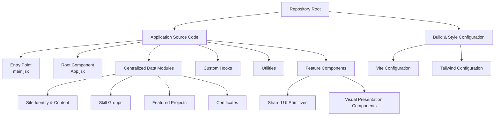

**Diagram sources**
- [vite.config.js:1-22](file://vite.config.js#L1-L22)
- [tailwind.config.js:1-89](file://tailwind.config.js#L1-L89)
- [src/main.jsx](file://src/main.jsx)
- [src/App.jsx:1-32](file://src/App.jsx#L1-L32)
- [src/data/site.js:1-116](file://src/data/site.js#L1-L116)
- [src/data/skills.js:1-62](file://src/data/skills.js#L1-L62)
- [src/data/projects.js:1-262](file://src/data/projects.js#L1-L262)
- [src/data/certificates.js:1-116](file://src/data/certificates.js#L1-L116)

**Section sources**
- [package.json:1-26](file://package.json#L1-L26)
- [vite.config.js:1-22](file://vite.config.js#L1-L22)
- [tailwind.config.js:1-89](file://tailwind.config.js#L1-L89)
- [src/App.jsx:1-32](file://src/App.jsx#L1-L32)

## Core Components
The application’s core user-facing sections are rendered by feature components:
- Hero introduces identity, roles, calls to action, and social links
- About shares background, interests, principles, and profile assets
- Skills organizes technologies into categories with animated transitions
- Projects showcases featured work with details and modals
- Certificates lists verified credentials with preview support
- Contact provides communication channels and a mail-to form

These components consume:
- Centralized content from src/data
- Shared UI primitives from src/components/ui
- Animation utilities from Framer Motion
- Icons from Lucide React
- Custom hooks for typewriter text, scroll locking, and active section tracking

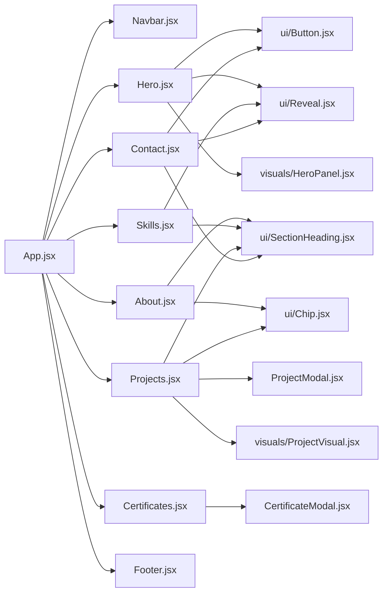

**Diagram sources**
- [src/App.jsx:1-32](file://src/App.jsx#L1-L32)
- [src/components/Hero.jsx:1-149](file://src/components/Hero.jsx#L1-L149)
- [src/components/About.jsx:1-148](file://src/components/About.jsx#L1-L148)
- [src/components/Skills.jsx:1-187](file://src/components/Skills.jsx#L1-L187)
- [src/components/Projects.jsx:1-143](file://src/components/Projects.jsx#L1-L143)
- [src/components/Certificates.jsx:1-153](file://src/components/Certificates.jsx#L1-L153)
- [src/components/Contact.jsx:1-343](file://src/components/Contact.jsx#L1-L343)
- [src/components/ui/Button.jsx](file://src/components/ui/Button.jsx)
- [src/components/ui/Chip.jsx](file://src/components/ui/Chip.jsx)
- [src/components/ui/Reveal.jsx](file://src/components/ui/Reveal.jsx)
- [src/components/ui/SectionHeading.jsx](file://src/components/ui/SectionHeading.jsx)
- [src/components/visuals/HeroPanel.jsx](file://src/components/visuals/HeroPanel.jsx)
- [src/components/visuals/ProjectVisual.jsx](file://src/components/visuals/ProjectVisual.jsx)
- [src/components/ProjectModal.jsx](file://src/components/ProjectModal.jsx)
- [src/components/CertificateModal.jsx](file://src/components/CertificateModal.jsx)

**Section sources**
- [src/App.jsx:10-31](file://src/App.jsx#L10-L31)
- [src/components/Hero.jsx:8-148](file://src/components/Hero.jsx#L8-L148)
- [src/components/About.jsx:7-147](file://src/components/About.jsx#L7-L147)
- [src/components/Skills.jsx:20-186](file://src/components/Skills.jsx#L20-L186)
- [src/components/Projects.jsx:12-142](file://src/components/Projects.jsx#L12-L142)
- [src/components/Certificates.jsx:20-152](file://src/components/Certificates.jsx#L20-L152)
- [src/components/Contact.jsx:108-342](file://src/components/Contact.jsx#L108-L342)

## Architecture Overview
Portfolio_2 follows a unidirectional data flow pattern:
- Centralized configuration files define site identity, navigation, about content, skills, projects, and certificates
- Feature components import this data and render it declaratively
- Shared UI primitives handle consistent interaction patterns and styling
- Custom hooks encapsulate cross-cutting concerns like animation timing, scroll behavior, and section tracking
- External libraries are integrated through imports: Framer Motion for motion, Lucide React for icons, Tailwind CSS for utility classes, and Vite for building

System boundaries:
- Build boundary: Vite compiles React code and applies the React plugin
- Style boundary: Tailwind processes utility classes and extends theme tokens
- Runtime boundary: React renders components; Framer Motion handles animations; Lucide provides icon elements
- Data boundary: Static JavaScript modules export structured content consumed by components

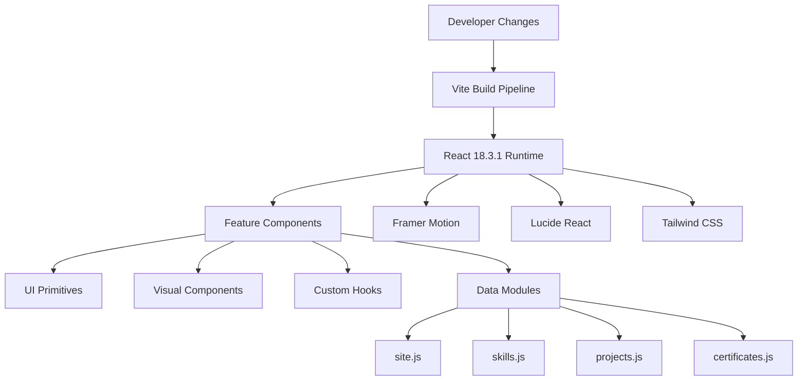

**Diagram sources**
- [package.json:12-23](file://package.json#L12-L23)
- [vite.config.js:1-22](file://vite.config.js#L1-L22)
- [tailwind.config.js:1-89](file://tailwind.config.js#L1-L89)
- [src/data/site.js:1-116](file://src/data/site.js#L1-L116)
- [src/data/skills.js:1-62](file://src/data/skills.js#L1-L62)
- [src/data/projects.js:1-262](file://src/data/projects.js#L1-L262)
- [src/data/certificates.js:1-116](file://src/data/certificates.js#L1-L116)

## Detailed Component Analysis

### App Component Orchestration
The App component composes the top-level layout and mounts all major sections. It also provides accessibility features such as a skip link and a main content region.

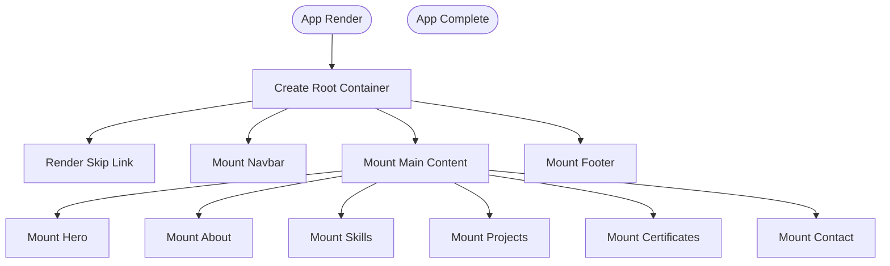

**Diagram sources**
- [src/App.jsx:10-31](file://src/App.jsx#L10-L31)

**Section sources**
- [src/App.jsx:1-32](file://src/App.jsx#L1-L32)

### Hero Component
The Hero component displays identity information, role rotation, availability status, calls to action, social links, and a visual panel. It integrates:
- Framer Motion for entrance animations and staggered children
- useReducedMotion for accessibility-aware animation control
- useTypewriter hook for rotating role labels
- Lucide React icons for actions and social links
- Centralized identity and asset data

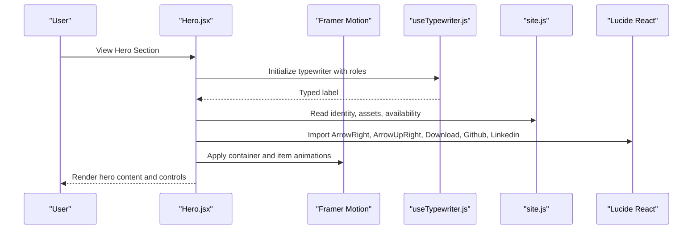

**Diagram sources**
- [src/components/Hero.jsx:1-149](file://src/components/Hero.jsx#L1-L149)
- [src/hooks/useTypewriter.js:1-44](file://src/hooks/useTypewriter.js#L1-L44)
- [src/data/site.js:1-116](file://src/data/site.js#L1-L116)

**Section sources**
- [src/components/Hero.jsx:1-149](file://src/components/Hero.jsx#L1-L149)

### About Component
The About component presents profile imagery, social links, narrative paragraphs, technical interests, and guiding principles. It uses:
- Reveal for scroll-triggered animations
- SectionHeading for consistent section titles
- Chip for interest tags
- Centralized about and identity data

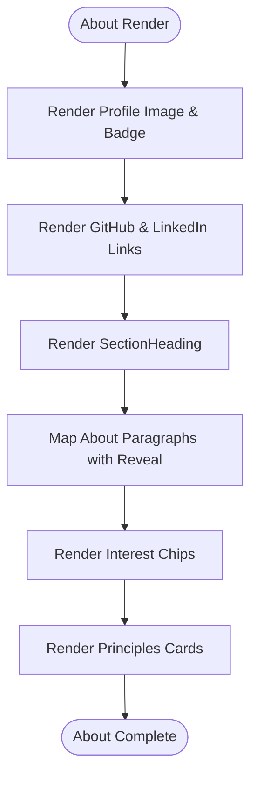

**Diagram sources**
- [src/components/About.jsx:1-148](file://src/components/About.jsx#L1-L148)
- [src/data/site.js:71-108](file://src/data/site.js#L71-L108)

**Section sources**
- [src/components/About.jsx:1-148](file://src/components/About.jsx#L1-L148)

### Skills Component
The Skills component organizes skill groups into an interactive list with animated transitions. It manages local state for the active category and uses AnimatePresence to transition between group contents.

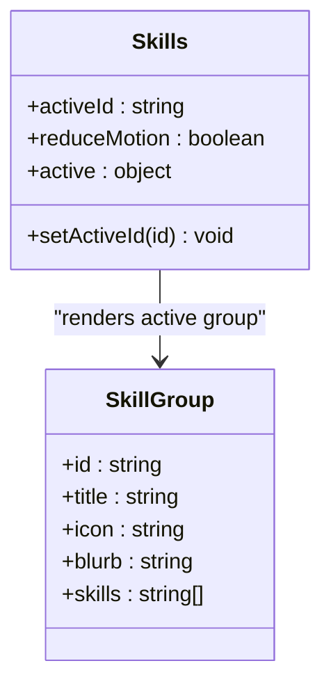

**Diagram sources**
- [src/components/Skills.jsx:1-187](file://src/components/Skills.jsx#L1-L187)
- [src/data/skills.js:1-62](file://src/data/skills.js#L1-L62)

**Section sources**
- [src/components/Skills.jsx:1-187](file://src/components/Skills.jsx#L1-L187)
- [src/data/skills.js:1-62](file://src/data/skills.js#L1-L62)

### Projects Component
The Projects component renders a list of featured projects with visuals, descriptions, stacks, and actions. It opens a modal for detailed views and supports external links.

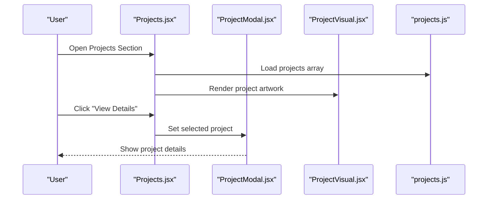

**Diagram sources**
- [src/components/Projects.jsx:1-143](file://src/components/Projects.jsx#L1-L143)
- [src/components/ProjectModal.jsx](file://src/components/ProjectModal.jsx)
- [src/components/visuals/ProjectVisual.jsx](file://src/components/visuals/ProjectVisual.jsx)
- [src/data/projects.js:1-262](file://src/data/projects.js#L1-L262)

**Section sources**
- [src/components/Projects.jsx:1-143](file://src/components/Projects.jsx#L1-L143)
- [src/data/projects.js:1-262](file://src/data/projects.js#L1-L262)

### Certificates Component
The Certificates component lists certificate cards with placeholders and preview states. It supports opening a modal when a certificate has an image, file, or verification URL.

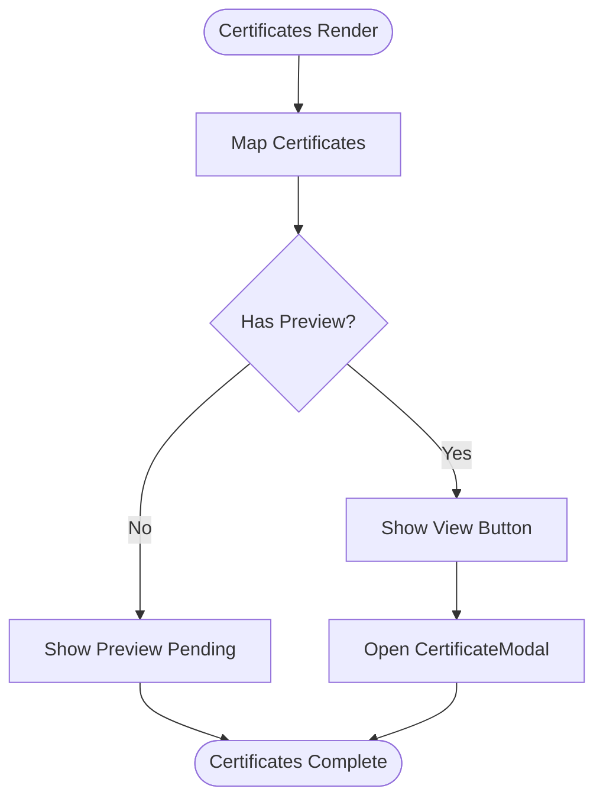

**Diagram sources**
- [src/components/Certificates.jsx:1-153](file://src/components/Certificates.jsx#L1-L153)
- [src/data/certificates.js:1-116](file://src/data/certificates.js#L1-L116)
- [src/components/CertificateModal.jsx](file://src/components/CertificateModal.jsx)

**Section sources**
- [src/components/Certificates.jsx:1-153](file://src/components/Certificates.jsx#L1-L153)
- [src/data/certificates.js:1-116](file://src/data/certificates.js#L1-L116)

### Contact Component
The Contact component provides multiple communication channels and a client-side validation form that opens the user’s email client with pre-filled content.

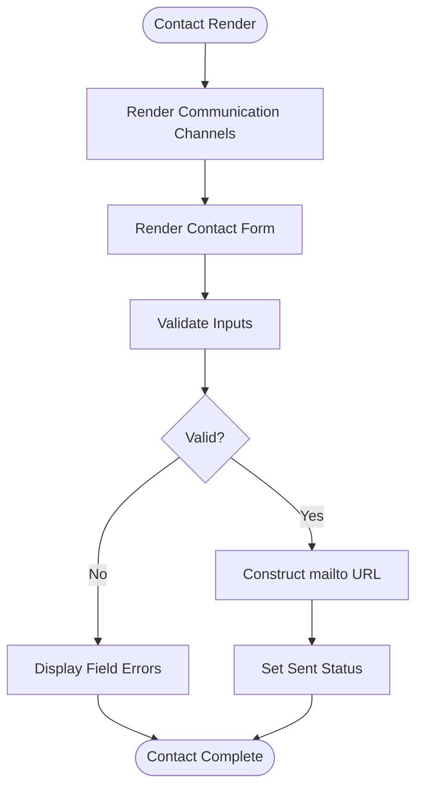

**Diagram sources**
- [src/components/Contact.jsx:1-343](file://src/components/Contact.jsx#L1-L343)
- [src/data/site.js:6-41](file://src/data/site.js#L6-L41)

**Section sources**
- [src/components/Contact.jsx:1-343](file://src/components/Contact.jsx#L1-L343)

### Custom Hooks
Custom hooks encapsulate reusable behaviors:
- useActiveSection tracks the currently visible section based on scroll position
- useScrollLock prevents body scrolling while overlays are open
- useTypewriter implements a rotating typewriter effect with reduced-motion support

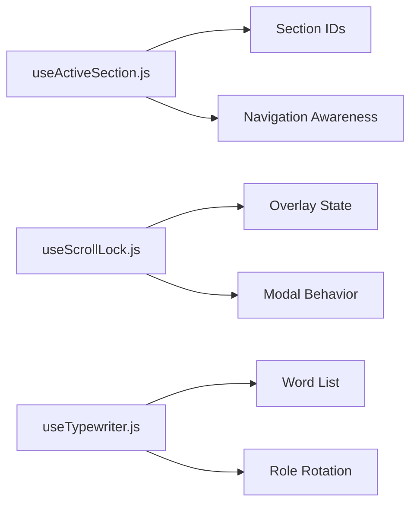

**Diagram sources**
- [src/hooks/useActiveSection.js:1-46](file://src/hooks/useActiveSection.js#L1-L46)
- [src/hooks/useScrollLock.js:1-24](file://src/hooks/useScrollLock.js#L1-L24)
- [src/hooks/useTypewriter.js:1-44](file://src/hooks/useTypewriter.js#L1-L44)

**Section sources**
- [src/hooks/useActiveSection.js:1-46](file://src/hooks/useActiveSection.js#L1-L46)
- [src/hooks/useScrollLock.js:1-24](file://src/hooks/useScrollLock.js#L1-L24)
- [src/hooks/useTypewriter.js:1-44](file://src/hooks/useTypewriter.js#L1-L44)

### Shared UI Primitives
Shared UI primitives provide consistent interaction patterns and styling:
- Button standardizes button variants, sizes, and accessibility attributes
- Chip renders small labeled tags with tone variants
- Modal provides overlay structure and focus management
- Reveal wraps content with scroll-triggered animations
- SectionHeading standardizes section titles, subtitles, and numbering

These primitives are composed by feature components to maintain consistency across the application.

**Section sources**
- [src/components/ui/Button.jsx](file://src/components/ui/Button.jsx)
- [src/components/ui/Chip.jsx](file://src/components/ui/Chip.jsx)
- [src/components/ui/Modal.jsx](file://src/components/ui/Modal.jsx)
- [src/components/ui/Reveal.jsx](file://src/components/ui/Reveal.jsx)
- [src/components/ui/SectionHeading.jsx](file://src/components/ui/SectionHeading.jsx)

### Visual Presentation Components
Visual presentation components abstract decorative or illustrative elements:
- HeroPanel renders the hero’s visual area
- ProjectVisual renders project-specific artwork based on a variant

These components keep feature components focused on content and interaction.

**Section sources**
- [src/components/visuals/HeroPanel.jsx](file://src/components/visuals/HeroPanel.jsx)
- [src/components/visuals/ProjectVisual.jsx](file://src/components/visuals/ProjectVisual.jsx)

## Dependency Analysis
External dependencies are declared in package.json and integrated throughout the application:
- React and ReactDOM provide the runtime
- Framer Motion enables declarative animations
- Lucide React supplies icons
- Tailwind CSS styles the application via utility classes
- Vite builds and serves the application

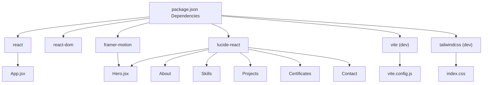

**Diagram sources**
- [package.json:12-23](file://package.json#L12-L23)
- [src/components/Hero.jsx:1-149](file://src/components/Hero.jsx#L1-L149)
- [src/components/About.jsx:1-148](file://src/components/About.jsx#L1-L148)
- [src/components/Skills.jsx:1-187](file://src/components/Skills.jsx#L1-L187)
- [src/components/Projects.jsx:1-143](file://src/components/Projects.jsx#L1-L143)
- [src/components/Certificates.jsx:1-153](file://src/components/Certificates.jsx#L1-L153)
- [src/components/Contact.jsx:1-343](file://src/components/Contact.jsx#L1-L343)
- [vite.config.js:1-22](file://vite.config.js#L1-L22)

**Section sources**
- [package.json:1-26](file://package.json#L1-L26)
- [vite.config.js:1-22](file://vite.config.js#L1-L22)

## Performance Considerations
- Prefer static data modules for content to avoid unnecessary re-renders
- Use Framer Motion’s reduced-motion detection to disable animations for users who prefer less motion
- Lazy-load heavy visuals if they are not immediately visible
- Keep Tailwind utility usage minimal per component to reduce style computation overhead
- Avoid excessive state updates in scroll handlers; debouncing may be considered if needed

[No sources needed since this section provides general guidance]

## Troubleshooting Guide
Common issues and resolutions:
- Missing assets: Ensure profile images and CV files exist under public/images and public/cv as referenced by site.js
- Broken social links: Verify identity.socials URLs in site.js
- Empty project links: Only include github or live links when real public URLs exist; empty strings hide buttons
- Certificate previews disabled: Add image, file, or url fields to certificates entries to enable preview
- Form validation errors: Check input values against the validator rules in Contact.jsx
- Animations not appearing: Confirm Framer Motion is installed and useReducedMotion is respected

**Section sources**
- [src/data/site.js:48-52](file://src/data/site.js#L48-L52)
- [src/data/site.js:29-41](file://src/data/site.js#L29-L41)
- [src/data/projects.js:1-7](file://src/data/projects.js#L1-L7)
- [src/data/certificates.js:1-11](file://src/data/certificates.js#L1-L11)
- [src/components/Contact.jsx:64-84](file://src/components/Contact.jsx#L64-L84)
- [src/components/Hero.jsx:9-10](file://src/components/Hero.jsx#L9-L10)

## Conclusion
Portfolio_2 demonstrates a clean, component-based architecture with centralized data, shared UI primitives, and well-scoped custom hooks. The integration of React, Vite, Tailwind CSS, Framer Motion, and Lucide React creates a modern, maintainable portfolio application. Unidirectional data flow ensures predictable rendering, while external dependencies are used purposefully to enhance interactivity and aesthetics.

[No sources needed since this section summarizes without analyzing specific files]