# Component Architecture

<cite>
**Referenced Files in This Document**
- [main.jsx](file://src/main.jsx)
- [App.jsx](file://src/App.jsx)
- [Navbar.jsx](file://src/components/Navbar.jsx)
- [Hero.jsx](file://src/components/Hero.jsx)
- [About.jsx](file://src/components/About.jsx)
- [Skills.jsx](file://src/components/Skills.jsx)
- [Projects.jsx](file://src/components/Projects.jsx)
- [Certificates.jsx](file://src/components/Certificates.jsx)
- [Contact.jsx](file://src/components/Contact.jsx)
- [Footer.jsx](file://src/components/Footer.jsx)
- [Button.jsx](file://src/components/ui/Button.jsx)
- [Chip.jsx](file://src/components/ui/Chip.jsx)
- [Reveal.jsx](file://src/components/ui/Reveal.jsx)
- [SectionHeading.jsx](file://src/components/ui/SectionHeading.jsx)
- [HeroPanel.jsx](file://src/components/visuals/HeroPanel.jsx)
- [ProjectVisual.jsx](file://src/components/visuals/ProjectVisual.jsx)
- [useActiveSection.js](file://src/hooks/useActiveSection.js)
- [useScrollLock.js](file://src/hooks/useScrollLock.js)
- [useTypewriter.js](file://src/hooks/useTypewriter.js)
- [site.js](file://src/data/site.js)
</cite>

## Table of Contents
1. [Introduction](#introduction)
2. [Project Structure](#project-structure)
3. [Core Components](#core-components)
4. [Architecture Overview](#architecture-overview)
5. [Detailed Component Analysis](#detailed-component-analysis)
6. [Dependency Analysis](#dependency-analysis)
7. [Performance Considerations](#performance-considerations)
8. [Troubleshooting Guide](#troubleshooting-guide)
9. [Conclusion](#conclusion)

## Introduction
This document explains the component-based architecture of Portfolio_2 and how the main App component orchestrates a cohesive user experience by composing page sections: Hero, About, Skills, Projects, Certificates, and Contact. It documents the component hierarchy, parent-child relationships, data flow patterns, separation of concerns between layout components, UI components, and visual components, and demonstrates composition, prop passing, and state management patterns. It also shows how custom hooks like useActiveSection integrate with components to provide shared functionality.

## Project Structure
Portfolio_2 follows a clear React + Vite structure:
- Entry point renders App inside StrictMode.
- App composes top-level layout (Navbar, Footer) and page sections.
- Page sections are feature components that compose reusable UI primitives and visual elements.
- Shared logic is extracted into hooks; shared configuration lives in data files.

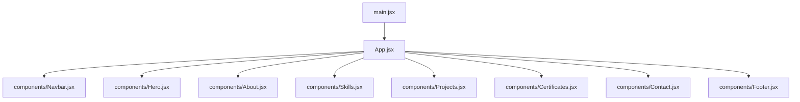

**Diagram sources**
- [main.jsx:6-10](file://src/main.jsx#L6-L10)
- [App.jsx:10-30](file://src/App.jsx#L10-L30)

**Section sources**
- [main.jsx:1-11](file://src/main.jsx#L1-L11)
- [App.jsx:1-32](file://src/App.jsx#L1-L32)

## Core Components
The application uses three layers of components:
- Layout components: Navbar, Footer, and App orchestrate global chrome and section order.
- Page components: Hero, About, Skills, Projects, Certificates, Contact render domain-specific content and interactions.
- UI components: Button, Chip, Reveal, SectionHeading provide consistent styling and behavior.
- Visual components: HeroPanel, ProjectVisual encapsulate artistic or diagrammatic visuals.

Data flows from centralized site configuration into page components via props and imports. State is mostly local to components, with shared behaviors provided by hooks.

Key responsibilities:
- App: root orchestrator, mounts all sections, provides accessibility skip link.
- Navbar: navigation, active section tracking, mobile menu, scroll lock.
- Hero: introduction, typewriter roles, CTAs, and hero panel visual.
- About: profile image, bio paragraphs, interests, principles.
- Skills: category tabs and animated skill list.
- Projects: project cards, modal detail view, external links.
- Certificates: certificate grid, preview modal.
- Contact: contact channels, copy-to-clipboard, form validation, mailto submission.
- Footer: navigation, social links, back-to-top.

**Section sources**
- [App.jsx:10-30](file://src/App.jsx#L10-L30)
- [Navbar.jsx:12-215](file://src/components/Navbar.jsx#L12-L215)
- [Hero.jsx:8-148](file://src/components/Hero.jsx#L8-L148)
- [About.jsx:7-147](file://src/components/About.jsx#L7-L147)
- [Skills.jsx:20-186](file://src/components/Skills.jsx#L20-L186)
- [Projects.jsx:12-142](file://src/components/Projects.jsx#L12-L142)
- [Certificates.jsx:20-152](file://src/components/Certificates.jsx#L20-L152)
- [Contact.jsx:108-342](file://src/components/Contact.jsx#L108-L342)
- [Footer.jsx:4-155](file://src/components/Footer.jsx#L4-L155)

## Architecture Overview
At runtime, the entrypoint renders App, which composes the full page. Each section is an independent component that consumes shared UI primitives and data. Navigation highlights the current section using a hook that observes scroll position.

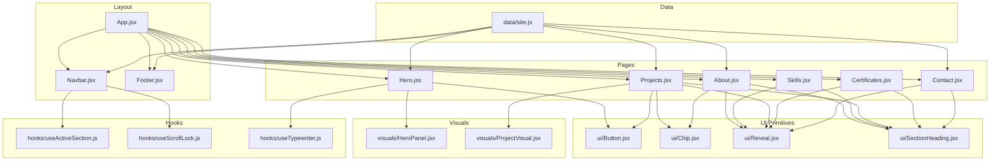

**Diagram sources**
- [App.jsx:10-30](file://src/App.jsx#L10-L30)
- [Navbar.jsx:12-215](file://src/components/Navbar.jsx#L12-L215)
- [Hero.jsx:8-148](file://src/components/Hero.jsx#L8-L148)
- [About.jsx:7-147](file://src/components/About.jsx#L7-L147)
- [Skills.jsx:20-186](file://src/components/Skills.jsx#L20-L186)
- [Projects.jsx:12-142](file://src/components/Projects.jsx#L12-L142)
- [Certificates.jsx:20-152](file://src/components/Certificates.jsx#L20-L152)
- [Contact.jsx:108-342](file://src/components/Contact.jsx#L108-L342)
- [Footer.jsx:4-155](file://src/components/Footer.jsx#L4-L155)
- [Button.jsx:25-37](file://src/components/ui/Button.jsx#L25-L37)
- [Chip.jsx:6-24](file://src/components/ui/Chip.jsx#L6-L24)
- [Reveal.jsx:7-32](file://src/components/ui/Reveal.jsx#L7-L32)
- [SectionHeading.jsx:4-68](file://src/components/ui/SectionHeading.jsx#L4-L68)
- [HeroPanel.jsx:25-90](file://src/components/visuals/HeroPanel.jsx#L25-L90)
- [ProjectVisual.jsx:6-256](file://src/components/visuals/ProjectVisual.jsx#L6-L256)
- [useActiveSection.js:7-44](file://src/hooks/useActiveSection.js#L7-L44)
- [useScrollLock.js:6-22](file://src/hooks/useScrollLock.js#L6-L22)
- [useTypewriter.js:7-42](file://src/hooks/useTypewriter.js#L7-L42)
- [site.js:6-115](file://src/data/site.js#L6-L115)

## Detailed Component Analysis

### App Orchestrator
App composes the entire page by rendering Navbar, the main content area with all sections, and Footer. It also provides a skip-link for accessibility and sets up the root container styles.

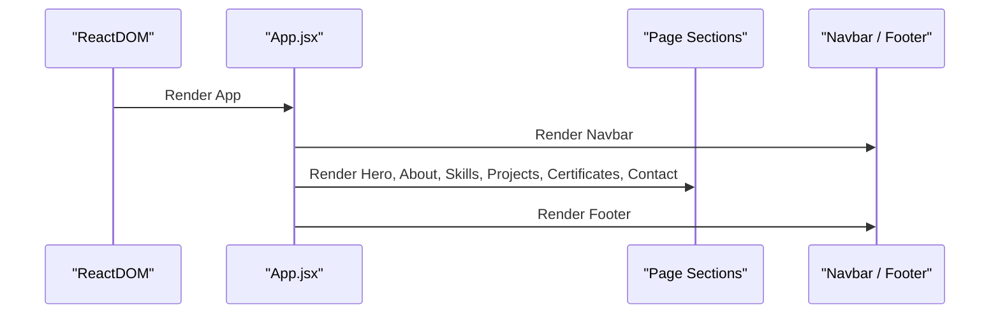

**Diagram sources**
- [App.jsx:10-30](file://src/App.jsx#L10-L30)

**Section sources**
- [App.jsx:10-30](file://src/App.jsx#L10-L30)

### Navbar and Active Section Tracking
Navbar drives navigation and highlights the active section using useActiveSection. It also manages mobile menu state, scroll lock, and reduced motion preferences.

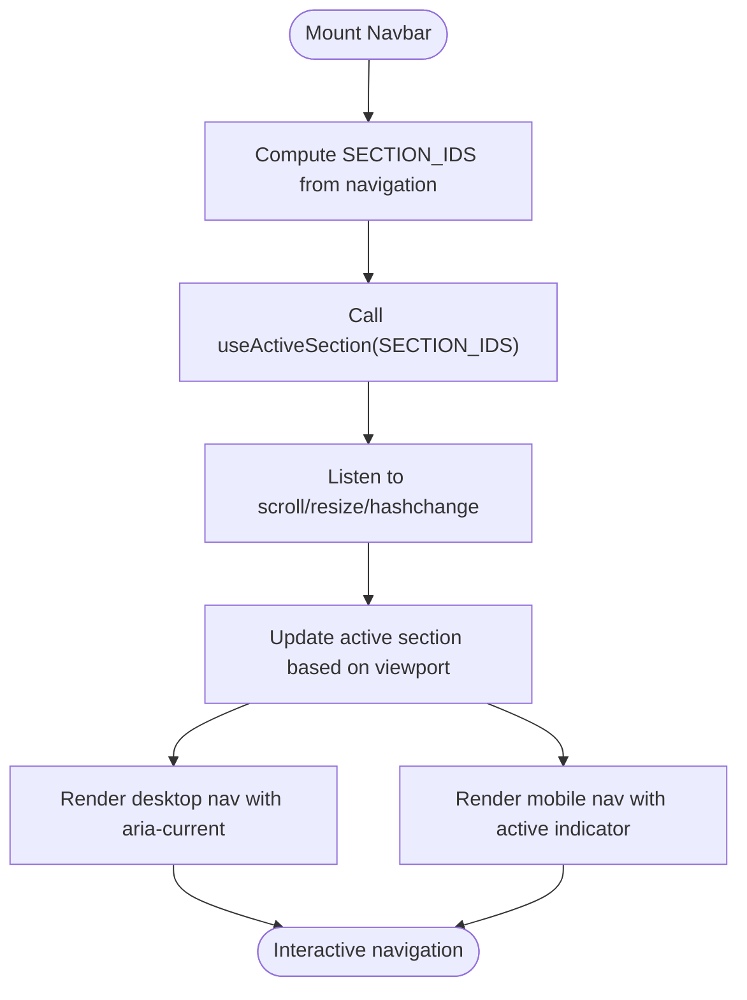

**Diagram sources**
- [Navbar.jsx:10-16](file://src/components/Navbar.jsx#L10-L16)
- [useActiveSection.js:7-44](file://src/hooks/useActiveSection.js#L7-L44)

**Section sources**
- [Navbar.jsx:12-215](file://src/components/Navbar.jsx#L12-L215)
- [useActiveSection.js:1-46](file://src/hooks/useActiveSection.js#L1-L46)
- [useScrollLock.js:1-24](file://src/hooks/useScrollLock.js#L1-L24)
- [site.js:62-69](file://src/data/site.js#L62-L69)

### Hero Composition and Typewriter
Hero composes text, CTAs, social links, and the HeroPanel visual. It uses useTypewriter to cycle through role labels and respects reduced motion.

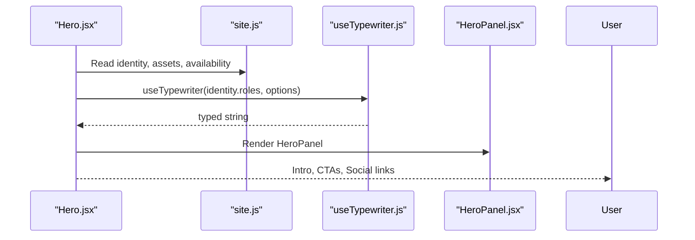

**Diagram sources**
- [Hero.jsx:8-148](file://src/components/Hero.jsx#L8-L148)
- [useTypewriter.js:7-42](file://src/hooks/useTypewriter.js#L7-L42)
- [HeroPanel.jsx:25-90](file://src/components/visuals/HeroPanel.jsx#L25-L90)
- [site.js:6-52](file://src/data/site.js#L6-L52)

**Section sources**
- [Hero.jsx:8-148](file://src/components/Hero.jsx#L8-L148)
- [useTypewriter.js:1-44](file://src/hooks/useTypewriter.js#L1-L44)
- [HeroPanel.jsx:1-92](file://src/components/visuals/HeroPanel.jsx#L1-L92)
- [site.js:6-52](file://src/data/site.js#L6-L52)

### About Section Composition
About composes a profile card, SectionHeading, Reveal animations, Chip tags, and principle cards. It reads content from site.js.

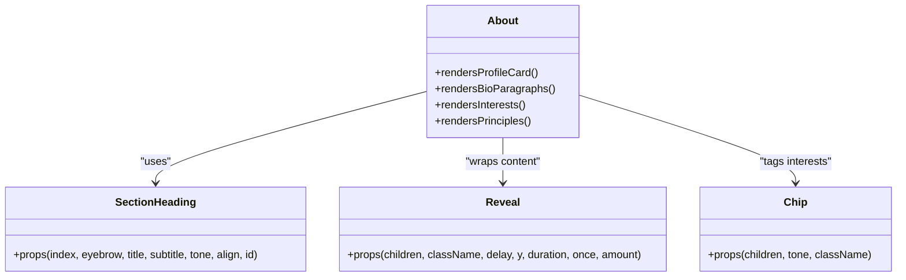

**Diagram sources**
- [About.jsx:7-147](file://src/components/About.jsx#L7-L147)
- [SectionHeading.jsx:4-68](file://src/components/ui/SectionHeading.jsx#L4-L68)
- [Reveal.jsx:7-32](file://src/components/ui/Reveal.jsx#L7-L32)
- [Chip.jsx:6-24](file://src/components/ui/Chip.jsx#L6-L24)

**Section sources**
- [About.jsx:7-147](file://src/components/About.jsx#L7-L147)
- [site.js:71-104](file://src/data/site.js#L71-L104)

### Skills Tabbed Interface
Skills maintains local state for the active category and animates transitions between categories. It uses SectionHeading and Reveal for consistent presentation.

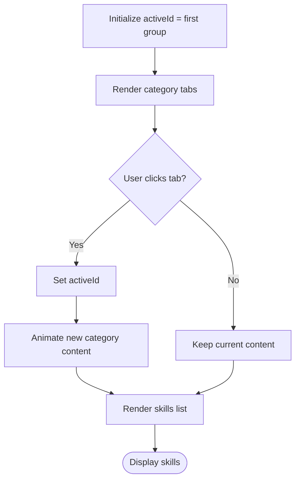

**Diagram sources**
- [Skills.jsx:20-186](file://src/components/Skills.jsx#L20-L186)

**Section sources**
- [Skills.jsx:1-187](file://src/components/Skills.jsx#L1-L187)

### Projects Grid and Modal Detail
Projects renders project cards with ProjectVisual, stacks, and actions. It lifts selected project state to open a modal.

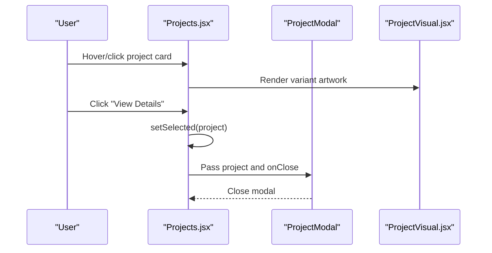

**Diagram sources**
- [Projects.jsx:12-142](file://src/components/Projects.jsx#L12-L142)
- [ProjectVisual.jsx:6-256](file://src/components/visuals/ProjectVisual.jsx#L6-L256)

**Section sources**
- [Projects.jsx:1-143](file://src/components/Projects.jsx#L1-L143)

### Certificates Grid and Preview Modal
Certificates displays a grid of certificates with optional previews and opens a modal when available.

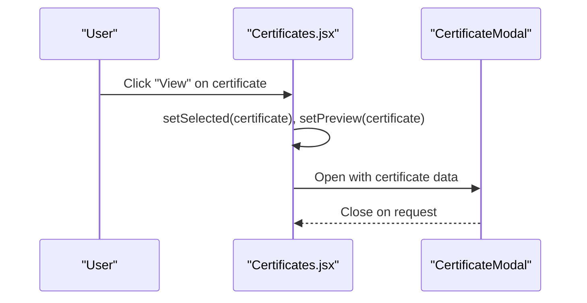

**Diagram sources**
- [Certificates.jsx:20-152](file://src/components/Certificates.jsx#L20-L152)

**Section sources**
- [Certificates.jsx:1-153](file://src/components/Certificates.jsx#L1-L153)

### Contact Form and Channels
Contact composes channel cards and a validated form that opens the user’s email client with pre-filled content.

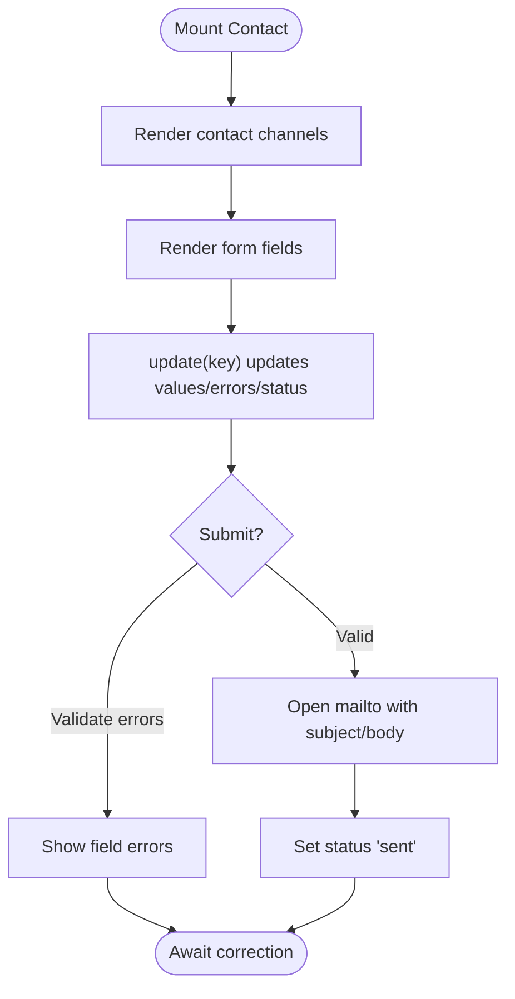

**Diagram sources**
- [Contact.jsx:64-138](file://src/components/Contact.jsx#L64-L138)

**Section sources**
- [Contact.jsx:1-343](file://src/components/Contact.jsx#L1-L343)

### Footer Navigation and Actions
Footer provides navigation links, social links, and a back-to-top action.

**Section sources**
- [Footer.jsx:4-155](file://src/components/Footer.jsx#L4-L155)

## Dependency Analysis
High-level dependencies:
- App depends on all page components and layout components.
- Page components depend on UI primitives and sometimes visual components.
- Navbar depends on useActiveSection and useScrollLock.
- Hero depends on useTypewriter and HeroPanel.
- Projects and Certificates manage local modal state.
- All pages consume site.js for identity, assets, and content.

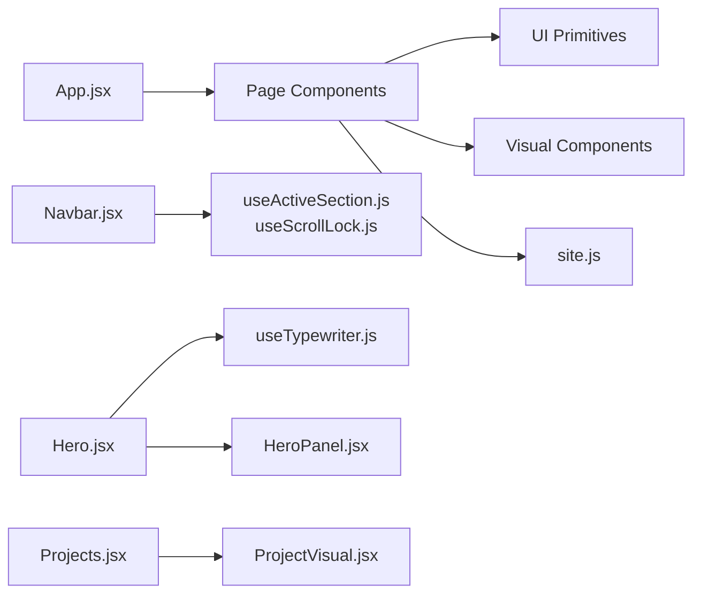

**Diagram sources**
- [App.jsx:10-30](file://src/App.jsx#L10-L30)
- [Navbar.jsx:12-215](file://src/components/Navbar.jsx#L12-L215)
- [Hero.jsx:8-148](file://src/components/Hero.jsx#L8-L148)
- [Projects.jsx:12-142](file://src/components/Projects.jsx#L12-L142)
- [useActiveSection.js:7-44](file://src/hooks/useActiveSection.js#L7-L44)
- [useScrollLock.js:6-22](file://src/hooks/useScrollLock.js#L6-L22)
- [useTypewriter.js:7-42](file://src/hooks/useTypewriter.js#L7-L42)
- [HeroPanel.jsx:25-90](file://src/components/visuals/HeroPanel.jsx#L25-L90)
- [ProjectVisual.jsx:6-256](file://src/components/visuals/ProjectVisual.jsx#L6-L256)
- [site.js:6-115](file://src/data/site.js#L6-L115)

**Section sources**
- [App.jsx:1-32](file://src/App.jsx#L1-L32)
- [site.js:6-115](file://src/data/site.js#L6-L115)

## Performance Considerations
- Reduced motion: Components check prefers-reduced-motion to disable animations where appropriate (e.g., Reveal, Hero, HeroPanel).
- Passive event listeners: Scroll and resize handlers use passive listeners to avoid blocking scrolling.
- Local state: Most interactive state is kept local to components to minimize re-renders across the app.
- Conditional rendering: Modals and overlays render only when needed.

[No sources needed since this section provides general guidance]

## Troubleshooting Guide
Common issues and resolutions:
- Active section not updating: Ensure each section has a matching id and that useActiveSection receives the correct ids array. Verify scroll events are firing and that sticky headers do not offset calculations unexpectedly.
- Mobile menu scroll lock: Confirm useScrollLock is called with the correct active state and that cleanup restores body overflow and padding.
- Typewriter not showing: Check enabled flag and reduced motion settings; ensure words array is non-empty.
- Modal not closing: Verify onClose callbacks are wired correctly and state is reset on close.

**Section sources**
- [useActiveSection.js:7-44](file://src/hooks/useActiveSection.js#L7-L44)
- [useScrollLock.js:6-22](file://src/hooks/useScrollLock.js#L6-L22)
- [useTypewriter.js:7-42](file://src/hooks/useTypewriter.js#L7-L42)

## Conclusion
Portfolio_2 implements a clean, layered component architecture. App acts as the orchestrator, composing page sections that rely on shared UI primitives and visual components. Custom hooks centralize cross-cutting concerns such as active section detection, scroll locking, and typewriter effects. The result is a maintainable, accessible, and performant portfolio with clear separation of concerns and predictable data flow.