# Data Flow & State Management

<cite>
**Referenced Files in This Document**
- [main.jsx](file://src/main.jsx)
- [App.jsx](file://src/App.jsx)
- [site.js](file://src/data/site.js)
- [projects.js](file://src/data/projects.js)
- [skills.js](file://src/data/skills.js)
- [certificates.js](file://src/data/certificates.js)
- [useActiveSection.js](file://src/hooks/useActiveSection.js)
- [useScrollLock.js](file://src/hooks/useScrollLock.js)
- [useTypewriter.js](file://src/hooks/useTypewriter.js)
- [Navbar.jsx](file://src/components/Navbar.jsx)
- [Hero.jsx](file://src/components/Hero.jsx)
- [About.jsx](file://src/components/About.jsx)
- [Skills.jsx](file://src/components/Skills.jsx)
- [Projects.jsx](file://src/components/Projects.jsx)
- [Certificates.jsx](file://src/components/Certificates.jsx)
- [Contact.jsx](file://src/components/Contact.jsx)
- [Footer.jsx](file://src/components/Footer.jsx)
</cite>

## Table of Contents
1. [Introduction](#introduction)
2. [Project Structure](#project-structure)
3. [Core Components](#core-components)
4. [Architecture Overview](#architecture-overview)
5. [Detailed Component Analysis](#detailed-component-analysis)
6. [Dependency Analysis](#dependency-analysis)
7. [Performance Considerations](#performance-considerations)
8. [Troubleshooting Guide](#troubleshooting-guide)
9. [Conclusion](#conclusion)

## Introduction
This document explains the data flow and state management patterns in Portfolio_2. The application follows a configuration-driven architecture: centralized JavaScript files under `src/data` are the single source of truth for site identity, navigation, projects, skills, and certificates. Components consume this data as immutable inputs and render UI accordingly. User interactions update local component state only when necessary, while global behavior such as active section detection, scroll locking, and typewriter animations is encapsulated in custom hooks.

The result is a unidirectional data flow:
- Configuration files export static data.
- Components import that data and render it.
- Hooks provide reusable behavior without mixing business logic into presentation.
- Modal-like features keep selection state close to the feature they control.

## Project Structure
Portfolio_2 is organized by responsibility:
- Entry points mount React and render the page shell.
- `src/data` holds all content and links.
- `src/hooks` encapsulates side effects and animation logic.
- `src/components` contains presentational and feature components.
- Shared UI primitives live under `src/components/ui`.

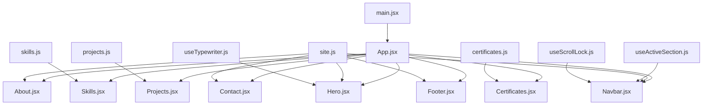

**Diagram sources**
- [main.jsx:1-11](file://src/main.jsx#L1-L11)
- [App.jsx:1-32](file://src/App.jsx#L1-L32)
- [site.js:1-116](file://src/data/site.js#L1-L116)
- [projects.js:1-262](file://src/data/projects.js#L1-L262)
- [skills.js:1-62](file://src/data/skills.js#L1-L62)
- [certificates.js:1-116](file://src/data/certificates.js#L1-L116)
- [useActiveSection.js:1-46](file://src/hooks/useActiveSection.js#L1-L46)
- [useScrollLock.js:1-24](file://src/hooks/useScrollLock.js#L1-L24)
- [useTypewriter.js:1-44](file://src/hooks/useTypewriter.js#L1-L44)
- [Navbar.jsx:1-218](file://src/components/Navbar.jsx#L1-L218)
- [Hero.jsx:1-149](file://src/components/Hero.jsx#L1-L149)
- [About.jsx:1-148](file://src/components/About.jsx#L1-L148)
- [Skills.jsx:1-187](file://src/components/Skills.jsx#L1-L187)
- [Projects.jsx:1-143](file://src/components/Projects.jsx#L1-L143)
- [Certificates.jsx:1-153](file://src/components/Certificates.jsx#L1-L153)
- [Contact.jsx:1-343](file://src/components/Contact.jsx#L1-L343)
- [Footer.jsx:1-156](file://src/components/Footer.jsx#L1-L156)

**Section sources**
- [main.jsx:1-11](file://src/main.jsx#L1-L11)
- [App.jsx:1-32](file://src/App.jsx#L1-L32)

## Core Components
The core data boundary is the `src/data` directory. Each file exports a stable contract:
- `site.js`: identity, assets, availability, navigation, about text, footer sign-off, and contact copy.
- `projects.js`: project cards with metadata, stack tags, visual variants, links, and detailed sections.
- `skills.js`: skill groups with titles, icons, blurbs, and technology lists.
- `certificates.js`: certificate records plus a helper to determine preview availability.

Components treat these exports as read-only inputs. For example:
- `Navbar` reads `navigation`, `identity`, and `assets`.
- `Hero` reads `identity`, `assets`, and `availability`.
- `About` reads `about`, `assets`, and `identity`.
- `Skills` reads `skillGroups`.
- `Projects` reads `projects` and `identity`.
- `Certificates` reads `certificates` and `hasPreview`.
- `Contact` reads `contact` and `identity`.
- `Footer` reads `footer`, `identity`, and `navigation`.

This separation keeps content changes isolated from rendering logic. Updating a label, link, or project description requires editing only the relevant data file.

**Section sources**
- [site.js:1-116](file://src/data/site.js#L1-L116)
- [projects.js:1-262](file://src/data/projects.js#L1-L262)
- [skills.js:1-62](file://src/data/skills.js#L1-L62)
- [certificates.js:1-116](file://src/data/certificates.js#L1-L116)
- [Navbar.jsx:1-218](file://src/components/Navbar.jsx#L1-L218)
- [Hero.jsx:1-149](file://src/components/Hero.jsx#L1-L149)
- [About.jsx:1-148](file://src/components/About.jsx#L1-L148)
- [Skills.jsx:1-187](file://src/components/Skills.jsx#L1-L187)
- [Projects.jsx:1-143](file://src/components/Projects.jsx#L1-L143)
- [Certificates.jsx:1-153](file://src/components/Certificates.jsx#L1-L153)
- [Contact.jsx:1-343](file://src/components/Contact.jsx#L1-L343)
- [Footer.jsx:1-156](file://src/components/Footer.jsx#L1-L156)

## Architecture Overview
The application uses a simple, predictable architecture:

- Mounting: `main.jsx` renders `App.jsx` inside React Strict Mode.
- Shell: `App.jsx` composes top-level sections and provides accessibility anchors.
- Content: each section component imports its own data module.
- Behavior: shared behaviors are implemented as hooks and reused across components.

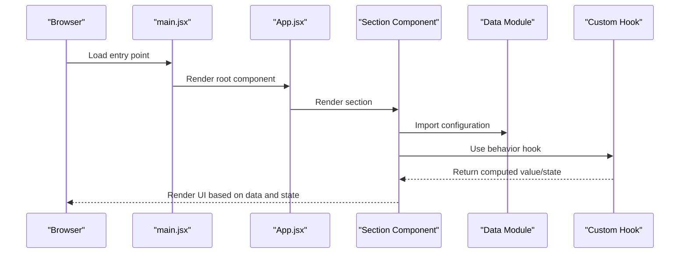

**Diagram sources**
- [main.jsx:1-11](file://src/main.jsx#L1-L11)
- [App.jsx:1-32](file://src/App.jsx#L1-L32)
- [site.js:1-116](file://src/data/site.js#L1-L116)
- [useActiveSection.js:1-46](file://src/hooks/useActiveSection.js#L1-L46)
- [useScrollLock.js:1-24](file://src/hooks/useScrollLock.js#L1-L24)
- [useTypewriter.js:1-44](file://src/hooks/useTypewriter.js#L1-L44)

## Detailed Component Analysis

### Configuration-Driven Data Model
The data model is intentionally flat and declarative:
- `site.js` centralizes identity, assets, availability, navigation, about content, footer text, and contact copy.
- `projects.js` defines structured project entries with consistent fields for display, detail, and external links.
- `skills.js` organizes technologies into categories with descriptive blurbs and icon keys.
- `certificates.js` defines certificate records and includes a helper function to determine whether a preview can be shown.

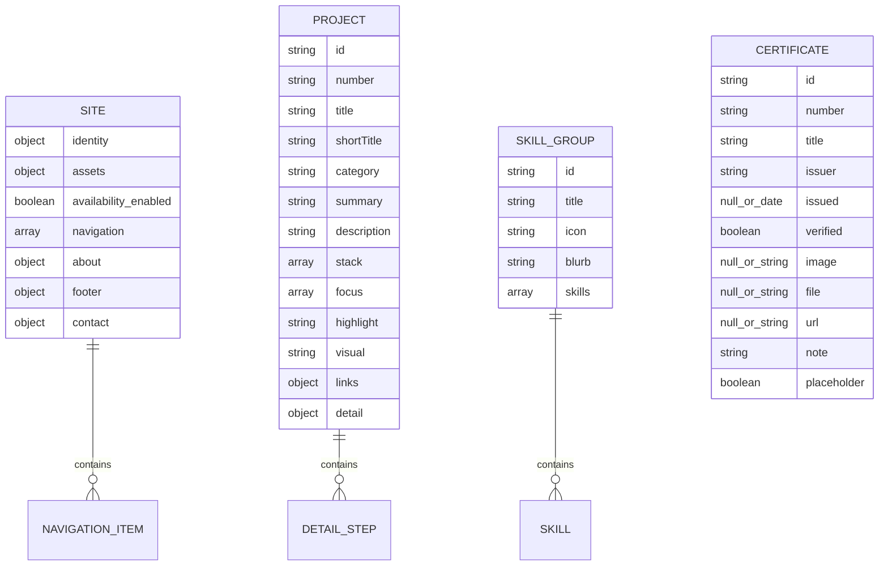

**Diagram sources**
- [site.js:1-116](file://src/data/site.js#L1-L116)
- [projects.js:1-262](file://src/data/projects.js#L1-L262)
- [skills.js:1-62](file://src/data/skills.js#L1-L62)
- [certificates.js:1-116](file://src/data/certificates.js#L1-L116)

**Section sources**
- [site.js:1-116](file://src/data/site.js#L1-L116)
- [projects.js:1-262](file://src/data/projects.js#L1-L262)
- [skills.js:1-62](file://src/data/skills.js#L1-L62)
- [certificates.js:1-116](file://src/data/certificates.js#L1-L116)

### Unidirectional Data Flow Through Components
Each section consumes its data once and renders it directly. There is no global store; instead, state is kept local where needed:
- `Navbar` derives active navigation from `useActiveSection` and renders both desktop and mobile menus.
- `Hero` computes the typed role label through `useTypewriter` and displays identity and social links.
- `About` renders profile information, paragraphs, interests, and principles from `site.js`.
- `Skills` manages an active category locally and animates transitions between groups.
- `Projects` manages a selected project for modal details and conditionally renders GitHub/Live buttons.
- `Certificates` manages selected and preview states and disables preview actions when no asset exists.
- `Contact` manages form values, validation errors, submission status, and clipboard feedback.
- `Footer` renders navigation, social links, and a back-to-top action.

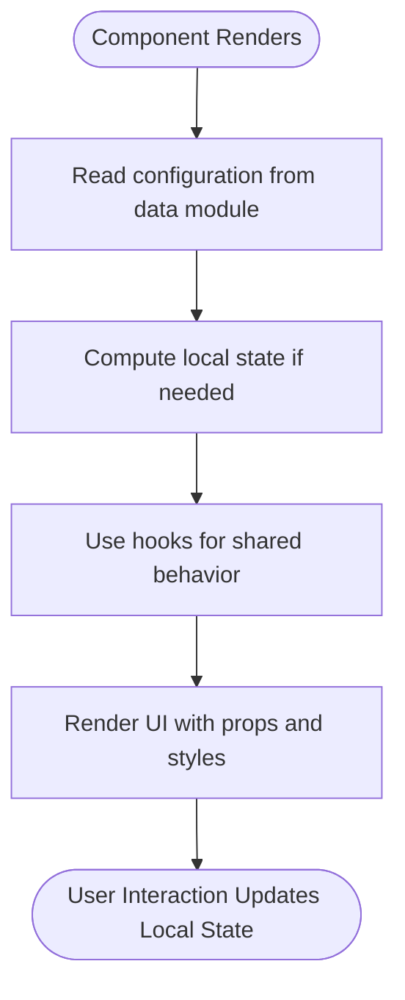

**Diagram sources**
- [Navbar.jsx:1-218](file://src/components/Navbar.jsx#L1-L218)
- [Hero.jsx:1-149](file://src/components/Hero.jsx#L1-L149)
- [About.jsx:1-148](file://src/components/About.jsx#L1-L148)
- [Skills.jsx:1-187](file://src/components/Skills.jsx#L1-L187)
- [Projects.jsx:1-143](file://src/components/Projects.jsx#L1-L143)
- [Certificates.jsx:1-153](file://src/components/Certificates.jsx#L1-L153)
- [Contact.jsx:1-343](file://src/components/Contact.jsx#L1-L343)
- [Footer.jsx:1-156](file://src/components/Footer.jsx#L1-L156)

**Section sources**
- [Navbar.jsx:1-218](file://src/components/Navbar.jsx#L1-L218)
- [Hero.jsx:1-149](file://src/components/Hero.jsx#L1-L149)
- [About.jsx:1-148](file://src/components/About.jsx#L1-L148)
- [Skills.jsx:1-187](file://src/components/Skills.jsx#L1-L187)
- [Projects.jsx:1-143](file://src/components/Projects.jsx#L1-L143)
- [Certificates.jsx:1-153](file://src/components/Certificates.jsx#L1-L153)
- [Contact.jsx:1-343](file://src/components/Contact.jsx#L1-L343)
- [Footer.jsx:1-156](file://src/components/Footer.jsx#L1-L156)

### Custom Hooks Encapsulating Complex Logic

#### Active Section Detection
`useActiveSection` tracks which section is currently visible by measuring element positions relative to the viewport. It listens to scroll, resize, and hash change events, updates the active ID, and cleans up listeners.

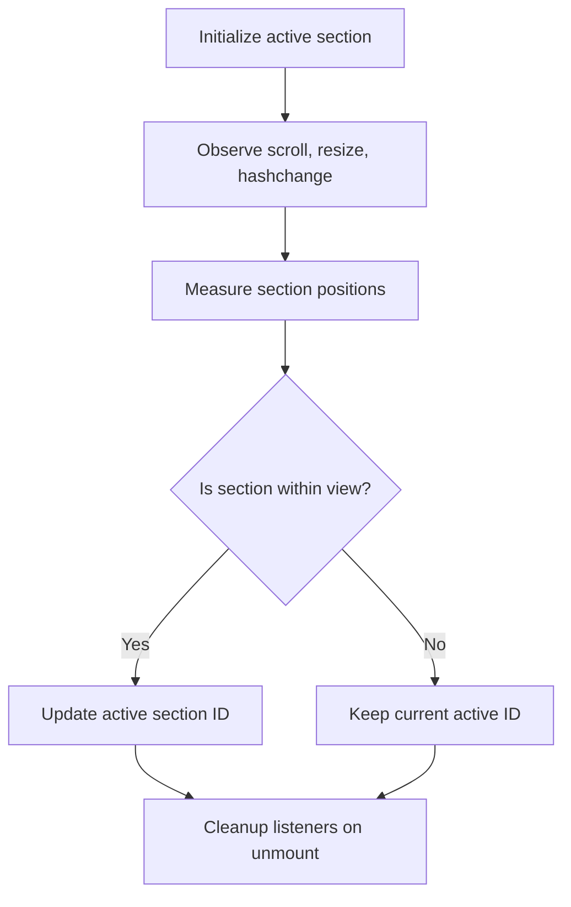

**Diagram sources**
- [useActiveSection.js:1-46](file://src/hooks/useActiveSection.js#L1-L46)

**Section sources**
- [useActiveSection.js:1-46](file://src/hooks/useActiveSection.js#L1-L46)
- [Navbar.jsx:10-16](file://src/components/Navbar.jsx#L10-L16)

#### Scroll Locking
`useScrollLock` prevents background scrolling while overlays are open. It saves previous overflow and padding, calculates scrollbar width, applies lock styles, and restores them on cleanup.

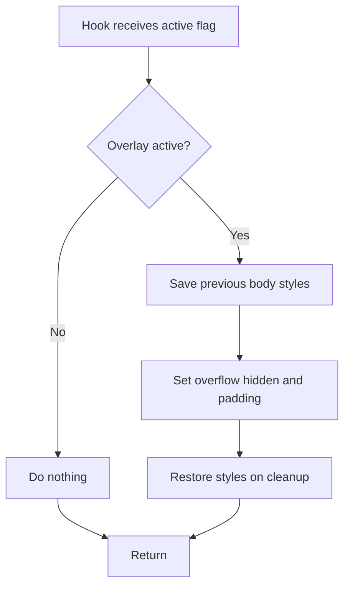

**Diagram sources**
- [useScrollLock.js:1-24](file://src/hooks/useScrollLock.js#L1-L24)

**Section sources**
- [useScrollLock.js:1-24](file://src/hooks/useScrollLock.js#L1-L24)
- [Navbar.jsx:18-18](file://src/components/Navbar.jsx#L18-L18)

#### Typewriter Animation
`useTypewriter` cycles through words with typing, holding, deleting, and rotating phases. It respects reduced motion preferences by disabling animation and showing the first word statically.

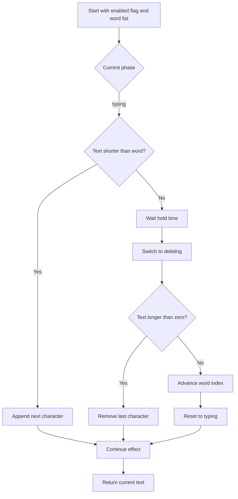

**Diagram sources**
- [useTypewriter.js:1-44](file://src/hooks/useTypewriter.js#L1-L44)

**Section sources**
- [useTypewriter.js:1-44](file://src/hooks/useTypewriter.js#L1-L44)
- [Hero.jsx:9-11](file://src/components/Hero.jsx#L9-L11)

### Example: How Components Consume Data and Propagate State

#### Navbar Navigation and Active Section
`Navbar` builds section IDs from `navigation`, computes the active section using `useActiveSection`, and highlights the matching item. When the mobile menu opens, `useScrollLock` locks the page background.

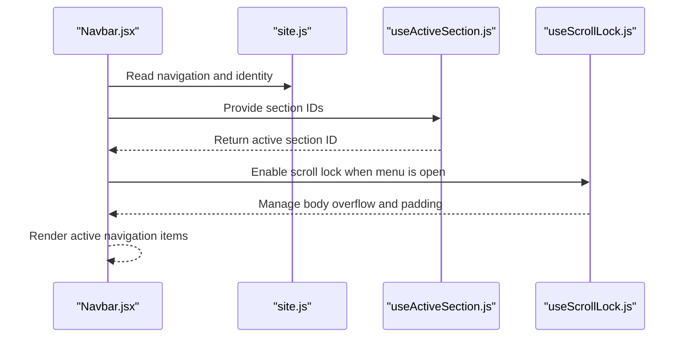

**Diagram sources**
- [Navbar.jsx:1-218](file://src/components/Navbar.jsx#L1-L218)
- [site.js:62-69](file://src/data/site.js#L62-L69)
- [useActiveSection.js:1-46](file://src/hooks/useActiveSection.js#L1-L46)
- [useScrollLock.js:1-24](file://src/hooks/useScrollLock.js#L1-L24)

**Section sources**
- [Navbar.jsx:1-218](file://src/components/Navbar.jsx#L1-L218)
- [site.js:62-69](file://src/data/site.js#L62-L69)

#### Hero Typewriter Role Label
`Hero` passes `identity.roles` to `useTypewriter`. If reduced motion is detected, the animation is disabled and the first role is displayed statically.

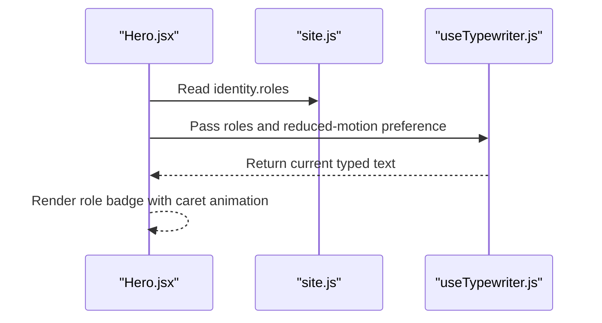

**Diagram sources**
- [Hero.jsx:1-149](file://src/components/Hero.jsx#L1-L149)
- [site.js:6-17](file://src/data/site.js#L6-L17)
- [useTypewriter.js:1-44](file://src/hooks/useTypewriter.js#L1-L44)

**Section sources**
- [Hero.jsx:1-149](file://src/components/Hero.jsx#L1-L149)
- [site.js:6-17](file://src/data/site.js#L6-L17)
- [useTypewriter.js:1-44](file://src/hooks/useTypewriter.js#L1-L44)

#### Projects Selection and Modal
`Projects` maintains a selected project in local state. Clicking “View Details” sets the selected project, and `ProjectModal` receives it as a prop. External links are rendered only when present in the project data.

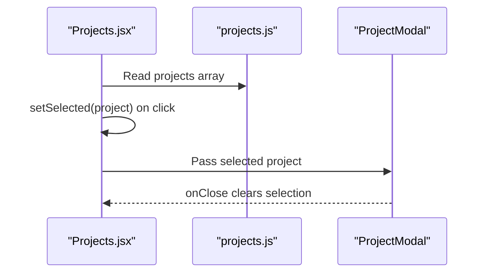

**Diagram sources**
- [Projects.jsx:1-143](file://src/components/Projects.jsx#L1-L143)
- [projects.js:1-262](file://src/data/projects.js#L1-L262)

**Section sources**
- [Projects.jsx:1-143](file://src/components/Projects.jsx#L1-L143)
- [projects.js:1-262](file://src/data/projects.js#L1-L262)

#### Certificates Preview Control
`Certificates` determines whether a certificate has a preview using `hasPreview`. If not, the card shows a pending state and disables preview actions.

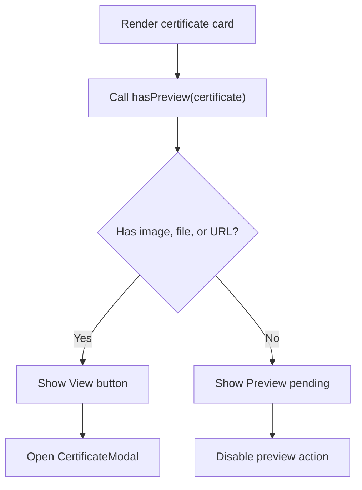

**Diagram sources**
- [Certificates.jsx:1-153](file://src/components/Certificates.jsx#L1-L153)
- [certificates.js:113-115](file://src/data/certificates.js#L113-L115)

**Section sources**
- [Certificates.jsx:1-153](file://src/components/Certificates.jsx#L1-L153)
- [certificates.js:113-115](file://src/data/certificates.js#L113-L115)

#### Contact Form Validation and Submission
`Contact` validates user input locally, updates error state, and opens the email client with pre-filled subject and body. Clipboard copy operations include error handling and temporary feedback.

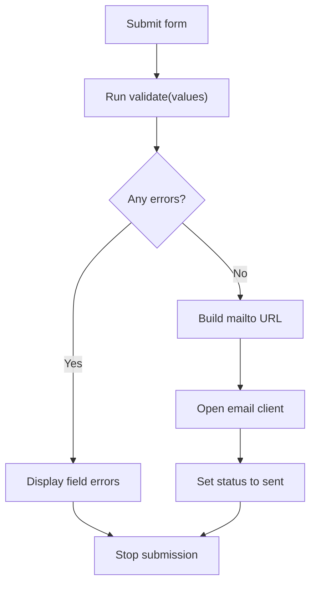

**Diagram sources**
- [Contact.jsx:64-84](file://src/components/Contact.jsx#L64-L84)
- [Contact.jsx:121-138](file://src/components/Contact.jsx#L121-L138)

**Section sources**
- [Contact.jsx:64-84](file://src/components/Contact.jsx#L64-L84)
- [Contact.jsx:121-138](file://src/components/Contact.jsx#L121-L138)

## Dependency Analysis
The dependency graph emphasizes clean boundaries:
- Data modules have no React dependencies.
- Hooks encapsulate browser APIs and lifecycle concerns.
- Components depend on data modules and hooks but do not mutate configuration.
- Feature-specific modals receive minimal props to reduce coupling.

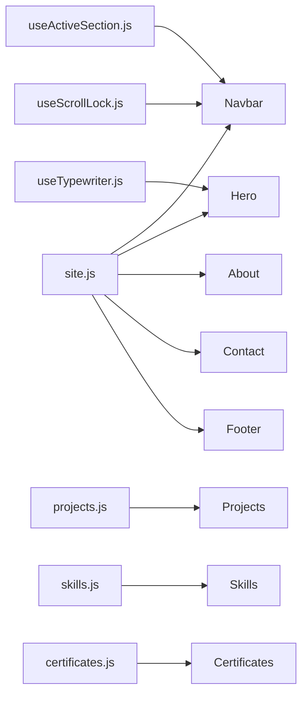

**Diagram sources**
- [site.js:1-116](file://src/data/site.js#L1-L116)
- [projects.js:1-262](file://src/data/projects.js#L1-L262)
- [skills.js:1-62](file://src/data/skills.js#L1-L62)
- [certificates.js:1-116](file://src/data/certificates.js#L1-L116)
- [useActiveSection.js:1-46](file://src/hooks/useActiveSection.js#L1-L46)
- [useScrollLock.js:1-24](file://src/hooks/useScrollLock.js#L1-L24)
- [useTypewriter.js:1-44](file://src/hooks/useTypewriter.js#L1-L44)
- [Navbar.jsx:1-218](file://src/components/Navbar.jsx#L1-L218)
- [Hero.jsx:1-149](file://src/components/Hero.jsx#L1-L149)
- [About.jsx:1-148](file://src/components/About.jsx#L1-L148)
- [Skills.jsx:1-187](file://src/components/Skills.jsx#L1-L187)
- [Projects.jsx:1-143](file://src/components/Projects.jsx#L1-L143)
- [Certificates.jsx:1-153](file://src/components/Certificates.jsx#L1-L153)
- [Contact.jsx:1-343](file://src/components/Contact.jsx#L1-L343)
- [Footer.jsx:1-156](file://src/components/Footer.jsx#L1-L156)

**Section sources**
- [site.js:1-116](file://src/data/site.js#L1-L116)
- [projects.js:1-262](file://src/data/projects.js#L1-L262)
- [skills.js:1-62](file://src/data/skills.js#L1-L62)
- [certificates.js:1-116](file://src/data/certificates.js#L1-L116)
- [useActiveSection.js:1-46](file://src/hooks/useActiveSection.js#L1-L46)
- [useScrollLock.js:1-24](file://src/hooks/useScrollLock.js#L1-L24)
- [useTypewriter.js:1-44](file://src/hooks/useTypewriter.js#L1-L44)
- [Navbar.jsx:1-218](file://src/components/Navbar.jsx#L1-L218)
- [Hero.jsx:1-149](file://src/components/Hero.jsx#L1-L149)
- [About.jsx:1-148](file://src/components/About.jsx#L1-L148)
- [Skills.jsx:1-187](file://src/components/Skills.jsx#L1-L187)
- [Projects.jsx:1-143](file://src/components/Projects.jsx#L1-L143)
- [Certificates.jsx:1-153](file://src/components/Certificates.jsx#L1-L153)
- [Contact.jsx:1-343](file://src/components/Contact.jsx#L1-L343)
- [Footer.jsx:1-156](file://src/components/Footer.jsx#L1-L156)

## Performance Considerations
- Prefer immutable configuration: keep data files pure and avoid runtime mutations.
- Keep local state minimal: only store what a component needs to render or respond to user actions.
- Avoid heavy computations during render: compute derived values outside render loops where possible.
- Respect reduced motion: use hooks like `useReducedMotion` to disable animations for users who prefer less motion.
- Debounce or throttle expensive event handlers if you add frequent scroll-based calculations.
- Use conditional rendering for optional features, such as availability badges and external links.
- Keep modal state close to the feature that owns it to prevent unnecessary re-renders elsewhere.

[No sources needed since this section provides general guidance]

## Troubleshooting Guide
Common issues and how to diagnose them:

- Active section does not update:
  - Verify that section IDs exist in the DOM and match the navigation IDs.
  - Confirm that `useActiveSection` receives the correct ID list.
  - Check for sticky headers or dynamic content that may shift measured positions.

- Background scrolls while a menu or modal is open:
  - Ensure the scroll-lock hook is called with the correct active flag.
  - Verify that cleanup restores previous body styles when the overlay closes.

- Typewriter animation not appearing:
  - Check reduced motion preferences and confirm the hook’s enabled flag.
  - Ensure the word list is non-empty and passed correctly.

- Certificate preview button disabled unexpectedly:
  - Confirm that at least one of image, file, or URL is provided.
  - Use the helper function to verify preview availability.

- Contact form submits empty or malformed messages:
  - Inspect validation rules and ensure required fields are filled.
  - Confirm that the mailto URL is constructed with proper encoding.

**Section sources**
- [useActiveSection.js:1-46](file://src/hooks/useActiveSection.js#L1-L46)
- [useScrollLock.js:1-24](file://src/hooks/useScrollLock.js#L1-L24)
- [useTypewriter.js:1-44](file://src/hooks/useTypewriter.js#L1-L44)
- [certificates.js:113-115](file://src/data/certificates.js#L113-L115)
- [Contact.jsx:64-84](file://src/components/Contact.jsx#L64-L84)
- [Contact.jsx:121-138](file://src/components/Contact.jsx#L121-L138)

## Conclusion
Portfolio_2 demonstrates a clean, configuration-driven architecture. Centralized data files act as the single source of truth, while components remain focused on rendering and small pieces of local state. Custom hooks encapsulate complex browser interactions, keeping components readable and testable. This approach makes content updates safe, reduces coupling, and improves maintainability. By following these patterns—immutable configuration, localized state, and reusable hooks—you can extend the portfolio confidently while preserving performance and clarity.

[No sources needed since this section summarizes without analyzing specific files]