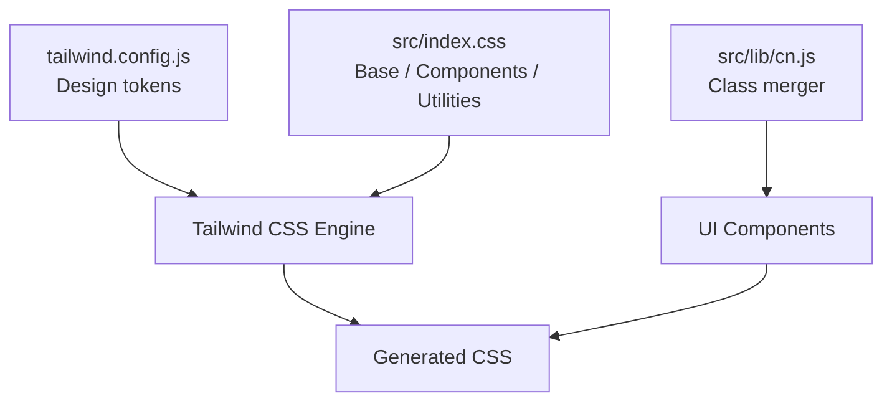
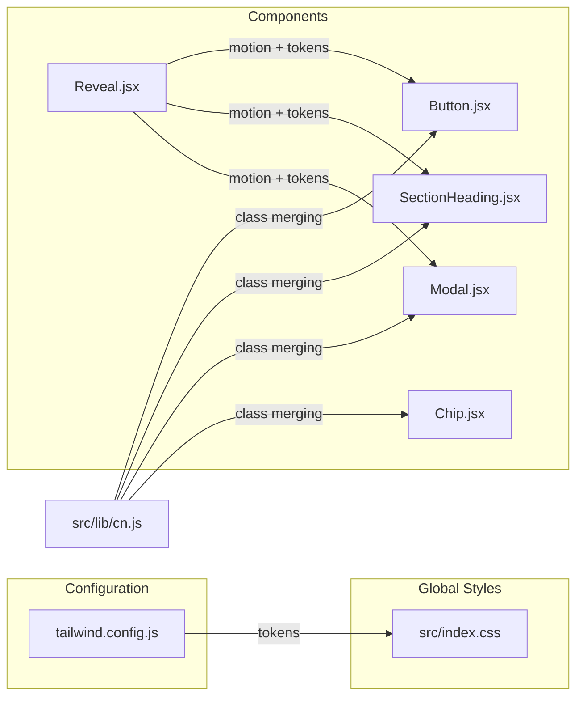
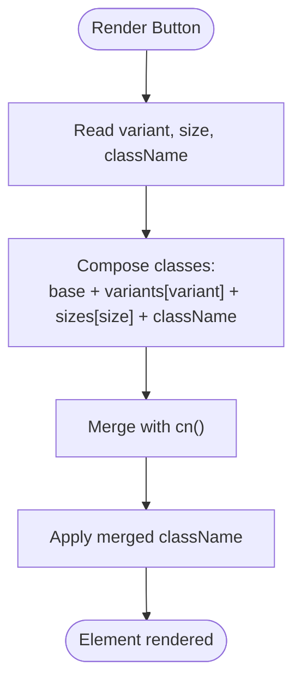
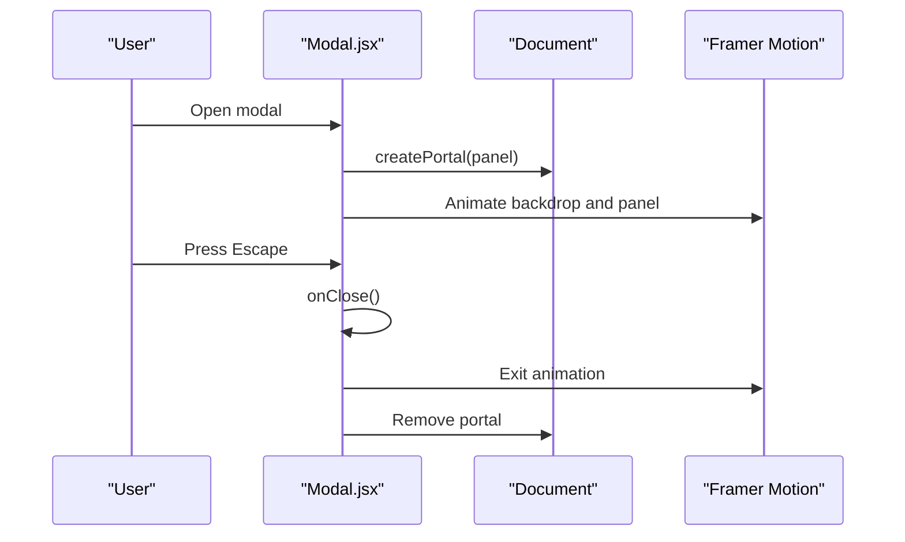
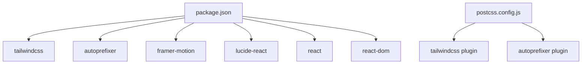

# Styling System & Design Tokens

<cite>
**Referenced Files in This Document**
- [tailwind.config.js](file://tailwind.config.js)
- [index.css](file://src/index.css)
- [cn.js](file://src/lib/cn.js)
- [Button.jsx](file://src/components/ui/Button.jsx)
- [Chip.jsx](file://src/components/ui/Chip.jsx)
- [Modal.jsx](file://src/components/ui/Modal.jsx)
- [Reveal.jsx](file://src/components/ui/Reveal.jsx)
- [SectionHeading.jsx](file://src/components/ui/SectionHeading.jsx)
- [postcss.config.js](file://postcss.config.js)
- [package.json](file://package.json)
</cite>

## Table of Contents
1. [Introduction](#introduction)
2. [Project Structure](#project-structure)
3. [Core Components](#core-components)
4. [Architecture Overview](#architecture-overview)
5. [Detailed Component Analysis](#detailed-component-analysis)
6. [Dependency Analysis](#dependency-analysis)
7. [Performance Considerations](#performance-considerations)
8. [Troubleshooting Guide](#troubleshooting-guide)
9. [Conclusion](#conclusion)

## Introduction
This document explains the styling system built with Tailwind CSS for the portfolio application. It covers design tokens defined in the configuration, the utility-first approach, custom class merging via a small utility function, and global styles. It also provides guidelines for responsive patterns, custom component styling, maintaining consistency, and optimizing CSS generation performance.

## Project Structure
The styling system is centered around three layers:
- Configuration layer: design tokens (colors, typography, spacing, animations) are declared in the Tailwind configuration.
- Global layer: base styles, reusable components, and utilities live in the main stylesheet.
- Component layer: UI components compose Tailwind classes and use a helper to merge conditional classes safely.

**Diagram sources**
- [tailwind.config.js:10-88](file://tailwind.config.js#L10-L88)
- [index.css:1-154](file://src/index.css#L1-L154)
- [cn.js:1-7](file://src/lib/cn.js#L1-L7)

**Section sources**
- [tailwind.config.js:10-88](file://tailwind.config.js#L10-L88)
- [index.css:1-154](file://src/index.css#L1-L154)
- [cn.js:1-7](file://src/lib/cn.js#L1-L7)

## Core Components
This section documents the design tokens and how they are applied across the app.

### Design Tokens
- Color palette
  - Neutral tones: ink, paper, haze, mist.
  - Brand scale: brand with DEFAULT and 50–900 steps.
  - Accent scale: accent with DEFAULT and 50–900 steps.
- Typography
  - display font stack for headings.
  - sans font stack for body text.
  - mono font stack for code-like labels.
- Border radius
  - Extended radii beyond defaults: 4xl and 5xl.
- Shadows
  - soft, lift, brand, panel shadows for depth and elevation.
- Transitions and timing
  - premium easing curve used consistently for smooth motion.
- Animations
  - fade-up, caret, drift keyframes and animation presets.
- Opacity scale
  - Full 0–100 opacity scale to avoid arbitrary brackets when using modifiers like /xx.

These tokens are extended under theme.extend so they integrate seamlessly with Tailwind’s default scales.

**Section sources**
- [tailwind.config.js:5-88](file://tailwind.config.js#L5-L88)

### Global Styles
- Base layer
  - CSS variables mirror token colors for runtime access.
  - Body applies background, font, color, and antialiasing.
  - Headings apply display font and balanced wrapping.
  - Paragraphs use pretty text wrapping.
  - Focus-visible outlines use brand color for accessibility.
  - Scrollbar styling is customized for Firefox and WebKit.
- Components layer
  - container-page: responsive page container with consistent padding.
  - skip-link: accessible skip-to-content link with focus behavior.
- Utilities layer
  - grid-lines and grid-lines-dark: subtle background grids.
  - dot-grid: dot pattern background.
  - mask-fade-bottom and mask-fade-x: gradient masks for content edges.
  - no-scrollbar: hide scrollbars cross-browser.
  - text-gradient-brand: gradient text using brand/accent colors.
- Reduced motion
  - Disables smooth scrolling and drastically reduces animation durations when users prefer reduced motion.

**Section sources**
- [index.css:5-80](file://src/index.css#L5-L80)
- [index.css:82-138](file://src/index.css#L82-L138)
- [index.css:140-154](file://src/index.css#L140-L154)

### Class Merging Utility
- The cn utility joins class name arguments while ignoring falsy values.
- It enables safe composition of base, variant, size, and user-provided className strings.

Usage examples can be found in UI components that accept className props and combine them with internal style sets.

**Section sources**
- [cn.js:1-7](file://src/lib/cn.js#L1-L7)
- [Button.jsx:1-41](file://src/components/ui/Button.jsx#L1-L41)
- [Chip.jsx:1-26](file://src/components/ui/Chip.jsx#L1-L26)
- [Modal.jsx:104-107](file://src/components/ui/Modal.jsx#L104-L107)
- [SectionHeading.jsx:17-67](file://src/components/ui/SectionHeading.jsx#L17-L67)

## Architecture Overview
The styling architecture follows a clear separation of concerns:
- Tailwind configuration defines tokens and extends defaults.
- Global CSS establishes base behaviors, reusable components, and visual utilities.
- React components compose Tailwind classes and leverage the cn utility for conditional styling.
- Motion libraries integrate with the design tokens for consistent transitions and animations.

**Diagram sources**
- [tailwind.config.js:10-88](file://tailwind.config.js#L10-L88)
- [index.css:1-154](file://src/index.css#L1-L154)
- [cn.js:1-7](file://src/lib/cn.js#L1-L7)
- [Button.jsx:1-41](file://src/components/ui/Button.jsx#L1-L41)
- [SectionHeading.jsx:1-70](file://src/components/ui/SectionHeading.jsx#L1-L70)
- [Modal.jsx:1-131](file://src/components/ui/Modal.jsx#L1-L131)
- [Reveal.jsx:1-34](file://src/components/ui/Reveal.jsx#L1-L34)
- [Chip.jsx:1-26](file://src/components/ui/Chip.jsx#L1-L26)

## Detailed Component Analysis

### Button Component
- Purpose: Primary interactive element with multiple variants and sizes.
- Styling approach:
  - Base class set defines shared layout, transition, focus ring, and disabled states.
  - Variants define color, hover, shadow, and contrast differences.
  - Sizes control padding and typography scaling.
  - Uses cn to merge base, variant, size, and external className.
- Accessibility:
  - Focus-visible ring uses brand color with offset for visibility.
  - Disabled state prevents pointer events and reduces opacity.

**Diagram sources**
- [Button.jsx:3-23](file://src/components/ui/Button.jsx#L3-L23)
- [Button.jsx:25-38](file://src/components/ui/Button.jsx#L25-L38)
- [cn.js:1-7](file://src/lib/cn.js#L1-L7)

**Section sources**
- [Button.jsx:1-41](file://src/components/ui/Button.jsx#L1-L41)

### Chip Component
- Purpose: Small label or technology badge.
- Styling approach:
  - Tone variants map to border/background/text combinations.
  - Monospace typography and tight tracking for technical feel.
  - Uses cn to merge tone and external className.

**Section sources**
- [Chip.jsx:1-26](file://src/components/ui/Chip.jsx#L1-L26)

### Modal Component
- Purpose: Accessible dialog with portal rendering, focus management, and motion.
- Styling approach:
  - Backdrop uses dark overlay with blur.
  - Panel uses rounded corners, borders, and deep shadow from design tokens.
  - Uses cn to allow external customization of panel classes.
- Accessibility:
  - Focus trap within modal.
  - Escape to close.
  - aria-modal, labelledBy, describedBy attributes.
  - Respects reduced motion preference.

**Diagram sources**
- [Modal.jsx:31-74](file://src/components/ui/Modal.jsx#L31-L74)
- [Modal.jsx:80-129](file://src/components/ui/Modal.jsx#L80-L129)

**Section sources**
- [Modal.jsx:1-131](file://src/components/ui/Modal.jsx#L1-L131)

### Reveal Component
- Purpose: Scroll-triggered reveal wrapper with graceful fallback.
- Styling approach:
  - When reduced motion is preferred, renders a plain div with provided className.
  - Otherwise animates opacity and vertical translation with consistent easing.

**Section sources**
- [Reveal.jsx:1-34](file://src/components/ui/Reveal.jsx#L1-L34)

### SectionHeading Component
- Purpose: Consistent section header with eyebrow, title, and optional subtitle.
- Styling approach:
  - Uses cn to conditionally center and adjust colors based on tone.
  - Integrates Reveal for entrance animations.
  - Responsive typography via clamp and breakpoint-specific sizing.

**Section sources**
- [SectionHeading.jsx:1-70](file://src/components/ui/SectionHeading.jsx#L1-L70)

## Dependency Analysis
- Tailwind engine
  - PostCSS pipeline includes tailwindcss and autoprefixer.
  - Vite build process compiles assets and optimizes output.
- Dependencies
  - framer-motion powers motion and reduced motion detection.
  - lucide-react provides icons used in modals and other UI elements.
  - react and react-dom provide component framework.

**Diagram sources**
- [package.json:12-24](file://package.json#L12-L24)
- [postcss.config.js:1-7](file://postcss.config.js#L1-L7)

**Section sources**
- [package.json:12-24](file://package.json#L12-L24)
- [postcss.config.js:1-7](file://postcss.config.js#L1-L7)

## Performance Considerations
- CSS generation
  - Tailwind scans configured content paths to generate only used utilities, minimizing bundle size.
  - Autoprefixer adds vendor prefixes during build; ensure it remains enabled.
- Content scanning
  - Keep content globs precise to avoid unnecessary scanning overhead.
- Animation performance
  - Respect prefers-reduced-motion by disabling heavy animations and transitions.
  - Use transform and opacity for animations where possible to leverage GPU acceleration.
- Build optimization
  - Use production builds to enable minification and tree-shaking of unused CSS.
  - Avoid arbitrary values in templates; prefer design tokens to keep generated CSS predictable.

[No sources needed since this section provides general guidance]

## Troubleshooting Guide
- Classes not applying
  - Verify that files are included in Tailwind content paths.
  - Ensure className is passed through and merged with cn to avoid falsy values breaking composition.
- Colors or tokens missing
  - Confirm tokens are defined in theme.extend and referenced correctly (e.g., brand-600).
  - Check CSS variables if relying on runtime color access.
- Animations not respecting preferences
  - Ensure reduced motion checks are present in components and CSS media queries.
- Focus and accessibility issues
  - Verify focus-visible styles are active and outline offsets are sufficient.
  - For modals, confirm focus trapping and Escape handling are implemented.

**Section sources**
- [tailwind.config.js:10-88](file://tailwind.config.js#L10-L88)
- [index.css:48-52](file://src/index.css#L48-L52)
- [index.css:140-154](file://src/index.css#L140-L154)
- [Modal.jsx:31-74](file://src/components/ui/Modal.jsx#L31-L74)

## Conclusion
The styling system combines a robust set of design tokens with a utility-first workflow. Global styles establish baseline behaviors and reusable patterns, while components compose Tailwind classes and leverage a simple class merger for flexible styling. Animations and motion respect user preferences, and the build pipeline ensures efficient CSS generation. Following the guidelines here will help maintain consistency, improve performance, and deliver an accessible, polished interface.

[No sources needed since this section summarizes without analyzing specific files]