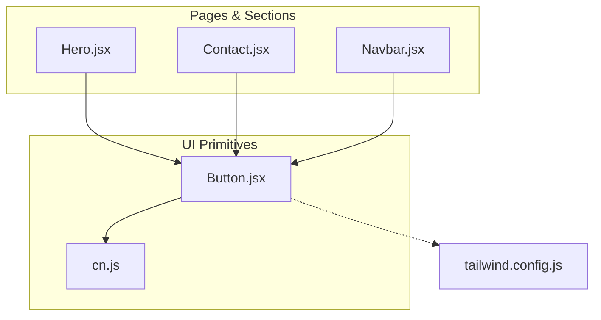
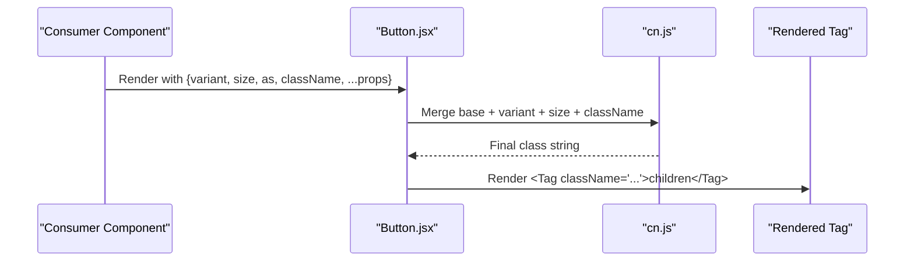
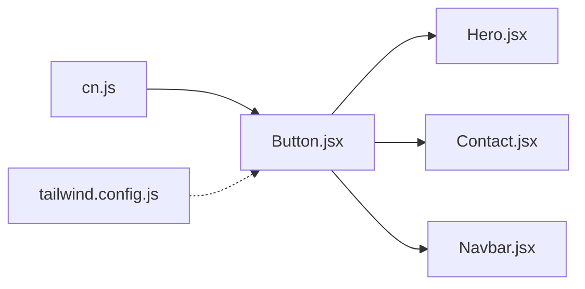

# Button Component

<cite>
**Referenced Files in This Document**
- [Button.jsx](file://src/components/ui/Button.jsx)
- [cn.js](file://src/lib/cn.js)
- [tailwind.config.js](file://tailwind.config.js)
- [Hero.jsx](file://src/components/Hero.jsx)
- [Contact.jsx](file://src/components/Contact.jsx)
- [Navbar.jsx](file://src/components/Navbar.jsx)
</cite>

## Table of Contents
1. [Introduction](#introduction)
2. [Project Structure](#project-structure)
3. [Core Components](#core-components)
4. [Architecture Overview](#architecture-overview)
5. [Detailed Component Analysis](#detailed-component-analysis)
6. [Dependency Analysis](#dependency-analysis)
7. [Performance Considerations](#performance-considerations)
8. [Troubleshooting Guide](#troubleshooting-guide)
9. [Conclusion](#conclusion)

## Introduction
This document provides comprehensive documentation for the Button component used across the portfolio. It covers all available props, variants, sizes, accessibility features, disabled behavior, and how to customize styling via className. It also explains the underlying CSS classes, Tailwind integration, and how the cn utility merges class names. Finally, it includes usage examples from real components and best practices for consistent, accessible, and performant button usage.

## Project Structure
The Button component lives under the UI primitives folder and is reused by multiple pages and interactive areas:
- Button implementation: src/components/ui/Button.jsx
- Class merging utility: src/lib/cn.js
- Tailwind theme configuration: tailwind.config.js
- Usage examples: Hero.jsx, Contact.jsx, Navbar.jsx

**Diagram sources**
- [Button.jsx:1-40](file://src/components/ui/Button.jsx#L1-L40)
- [cn.js:1-7](file://src/lib/cn.js#L1-L7)
- [tailwind.config.js:10-88](file://tailwind.config.js#L10-L88)
- [Hero.jsx:5-5](file://src/components/Hero.jsx#L5-L5)
- [Contact.jsx:16-16](file://src/components/Contact.jsx#L16-L16)
- [Navbar.jsx:8-8](file://src/components/Navbar.jsx#L8-L8)

**Section sources**
- [Button.jsx:1-40](file://src/components/ui/Button.jsx#L1-L40)
- [cn.js:1-7](file://src/lib/cn.js#L1-L7)
- [tailwind.config.js:10-88](file://tailwind.config.js#L10-L88)
- [Hero.jsx:5-5](file://src/components/Hero.jsx#L5-L5)
- [Contact.jsx:16-16](file://src/components/Contact.jsx#L16-L16)
- [Navbar.jsx:8-8](file://src/components/Navbar.jsx#L8-L8)

## Core Components
- Button component: A flexible, styled button that supports different variants, sizes, and can render as any HTML element via the as prop. It composes base styles, variant styles, size styles, and user-provided className using a simple class merger.
- cn utility: A minimal function that joins class name strings while ignoring falsy values.
- Tailwind theme: Defines brand colors, shadows, transitions, and other tokens referenced by Button’s styles.

Key responsibilities:
- Provide consistent visual design through predefined variants and sizes.
- Ensure accessibility defaults (focus ring, disabled state).
- Allow composition with any tag via the as prop.
- Enable custom overrides via className.

**Section sources**
- [Button.jsx:1-40](file://src/components/ui/Button.jsx#L1-L40)
- [cn.js:1-7](file://src/lib/cn.js#L1-L7)
- [tailwind.config.js:10-88](file://tailwind.config.js#L10-L88)

## Architecture Overview
The Button component integrates with Tailwind CSS and the project’s design tokens. It composes styles at runtime and renders the chosen tag with merged classes. Consumers import Button and pass props like variant, size, as, and className.

**Diagram sources**
- [Button.jsx:25-38](file://src/components/ui/Button.jsx#L25-L38)
- [cn.js:4-6](file://src/lib/cn.js#L4-L6)

## Detailed Component Analysis

### Props API
- as: The HTML element to render. Defaults to button. Can be set to anchor or any valid element.
- variant: Visual style preset. Options: primary, outline, dark, ghostDark, quiet, quietDark. Default: primary.
- size: Size preset. Options: sm, md, lg, icon. Default: md.
- className: Additional Tailwind classes to merge on top of built-in styles.
- children: Content inside the button.
- ...props: Any additional attributes are forwarded to the rendered tag (e.g., href, download, type, onClick).

Usage patterns observed in the codebase:
- Navigation links rendered as anchors: as="a", href, optional download.
- Form submission: type="submit".
- Icon-only buttons: size="icon".

Examples from the codebase:
- Primary link button in hero section: uses as="a", variant="primary", size="lg".
- Outline link button in hero section: uses as="a", variant="outline", size="lg".
- Submit button in contact form: uses type="submit", variant="primary", size="md".
- Download CV button in navbar: uses as="a", href, download, variant="primary", size="sm".

**Section sources**
- [Button.jsx:25-38](file://src/components/ui/Button.jsx#L25-L38)
- [Hero.jsx:89-102](file://src/components/Hero.jsx#L89-L102)
- [Contact.jsx:311-315](file://src/components/Contact.jsx#L311-L315)
- [Navbar.jsx:115-125](file://src/components/Navbar.jsx#L115-L125)
- [Navbar.jsx:185-188](file://src/components/Navbar.jsx#L185-L188)

### Variants
Available variants and their intended use:
- primary: Solid brand color with shadow; suitable for primary actions.
- outline: Outlined style with subtle background and hover effects; good for secondary actions.
- dark: Dark solid background; useful on light surfaces where contrast is needed.
- ghostDark: Transparent dark mode-friendly style with subtle borders and hover states.
- quiet: Low-emphasis text style; ideal for inline or subtle actions.
- quietDark: Low-emphasis white-on-dark style.

These variants are defined as Tailwind class strings and composed with base and size classes.

**Section sources**
- [Button.jsx:6-16](file://src/components/ui/Button.jsx#L6-L16)

### Sizes
Available sizes:
- sm: Compact padding and smaller font.
- md: Medium default size.
- lg: Larger padding and responsive typography.
- icon: Square icon-sized button with no text padding.

Size classes define padding, height/width, and font size.

**Section sources**
- [Button.jsx:18-23](file://src/components/ui/Button.jsx#L18-L23)

### Styling Customization with className
- The component merges base, variant, size, and user-provided className using cn.
- This allows overriding or extending styles without breaking internal classes.
- Example: Adding w-full to make a button span full width in mobile navigation.

Best practice:
- Prefer adding utility classes via className rather than modifying the component internals.
- Use conditional classes based on context (e.g., screen size, active state).

**Section sources**
- [Button.jsx:33-36](file://src/components/ui/Button.jsx#L33-L36)
- [Navbar.jsx:185-188](file://src/components/Navbar.jsx#L185-L188)

### Accessibility Features
- Focus management:
  - Uses focus-visible to provide a visible ring when focused via keyboard.
  - Removes default outlines and applies a themed ring with offset.
- Disabled state:
  - Disables pointer events and reduces opacity to indicate non-interactivity.
- Semantic rendering:
  - Renders as a native button by default, ensuring correct semantics and keyboard behavior.
  - When used as an anchor (as="a"), ensure href is provided for proper semantics.
- Icons:
  - Decorative icons should have aria-hidden="true" to avoid redundant announcements.

Notes:
- If you need to disable a link-style button (as="a"), consider using a button instead or managing disabled behavior at the parent level since anchors do not support disabled natively.

**Section sources**
- [Button.jsx:3-4](file://src/components/ui/Button.jsx#L3-L4)
- [Hero.jsx:89-102](file://src/components/Hero.jsx#L89-L102)

### Underlying CSS Classes and Tailwind Integration
- Base classes include layout, spacing, typography, transitions, focus-visible ring, and disabled styles.
- Variants and sizes are composed into the final className.
- Tailwind theme defines:
  - Brand palette (brand-50..brand-900) and ink/paper/mist/haze colors.
  - Custom shadows (soft, lift, brand, panel).
  - Custom transition timing (premium).
  - Extended opacity scale for precise alpha modifiers.

How they are used:
- Variant classes reference brand colors and shadows.
- Transition utilities leverage the premium timing function.
- Opacity modifiers rely on the extended opacity scale.

**Section sources**
- [Button.jsx:3-16](file://src/components/ui/Button.jsx#L3-L16)
- [tailwind.config.js:10-88](file://tailwind.config.js#L10-L88)

### How cn Utility Works
- cn(...values) filters out falsy values and joins the rest with spaces.
- This enables safe composition of conditional classes and ensures no extra whitespace or undefined values leak into the DOM.

Example usage pattern:
- Merging base, variant, size, and className into one string before applying to the element.

**Section sources**
- [cn.js:1-7](file://src/lib/cn.js#L1-L7)
- [Button.jsx:33-36](file://src/components/ui/Button.jsx#L33-L36)

### Code Examples Demonstrating Variants and Sizes
- Primary large link button in hero:
  - Props: as="a", variant="primary", size="lg"
  - Purpose: Prominent call-to-action linking to projects.
- Outline large link button in hero:
  - Props: as="a", variant="outline", size="lg"
  - Purpose: Secondary call-to-action linking to contact.
- Submit button in contact form:
  - Props: type="submit", variant="primary", size="md"
  - Purpose: Triggers form submission flow.
- Download CV button in navbar:
  - Props: as="a", href, download, variant="primary", size="sm"
  - Purpose: Downloads CV file.

References:
- Hero.jsx:89-102
- Contact.jsx:311-315
- Navbar.jsx:115-125
- Navbar.jsx:185-188

**Section sources**
- [Hero.jsx:89-102](file://src/components/Hero.jsx#L89-L102)
- [Contact.jsx:311-315](file://src/components/Contact.jsx#L311-L315)
- [Navbar.jsx:115-125](file://src/components/Navbar.jsx#L115-L125)
- [Navbar.jsx:185-188](file://src/components/Navbar.jsx#L185-L188)

### Using Different Tags via the 'as' Prop
- Anchor links: as="a" with href and optional download.
- Native buttons: default as="button" with type and event handlers.
- Other elements: You can pass any valid tag name or component if needed, but ensure appropriate semantics and attributes.

Observed usages:
- Hero.jsx uses as="a" for navigation links.
- Navbar.jsx uses as="a" for CV download.
- Contact.jsx uses default button for form submission.

**Section sources**
- [Hero.jsx:89-102](file://src/components/Hero.jsx#L89-L102)
- [Navbar.jsx:115-125](file://src/components/Navbar.jsx#L115-L125)
- [Contact.jsx:311-315](file://src/components/Contact.jsx#L311-L315)

## Dependency Analysis
Button depends on:
- cn utility for class merging.
- Tailwind theme tokens for colors, shadows, and transitions.

Consumers depend on Button for consistent UI controls.

**Diagram sources**
- [Button.jsx:1-40](file://src/components/ui/Button.jsx#L1-L40)
- [cn.js:1-7](file://src/lib/cn.js#L1-L7)
- [tailwind.config.js:10-88](file://tailwind.config.js#L10-L88)
- [Hero.jsx:5-5](file://src/components/Hero.jsx#L5-L5)
- [Contact.jsx:16-16](file://src/components/Contact.jsx#L16-L16)
- [Navbar.jsx:8-8](file://src/components/Navbar.jsx#L8-L8)

**Section sources**
- [Button.jsx:1-40](file://src/components/ui/Button.jsx#L1-L40)
- [cn.js:1-7](file://src/lib/cn.js#L1-L7)
- [tailwind.config.js:10-88](file://tailwind.config.js#L10-L88)
- [Hero.jsx:5-5](file://src/components/Hero.jsx#L5-L5)
- [Contact.jsx:16-16](file://src/components/Contact.jsx#L16-L16)
- [Navbar.jsx:8-8](file://src/components/Navbar.jsx#L8-L8)

## Performance Considerations
- Minimal runtime overhead: Button composes a small number of class strings and renders a single element.
- No heavy dependencies: Only relies on a tiny class merger utility.
- Efficient Tailwind usage: Styles are precompiled; runtime cost is negligible.
- Best practices:
  - Avoid passing overly complex expressions in className; keep them simple and memoized if necessary.
  - Reuse variant and size presets to maintain consistency and reduce style churn.
  - Prefer semantic tags (button vs. div) for better performance and accessibility.

[No sources needed since this section provides general guidance]

## Troubleshooting Guide
Common issues and resolutions:
- Link-style buttons not disabling:
  - Anchors do not support disabled. If you need a disabled state, wrap the anchor in a container that prevents interaction or switch to a button element.
- Focus ring not visible:
  - Ensure focus-visible styles are applied and that the element is focusable. For anchors, verify href is present.
- Styles not overriding:
  - Check className order and specificity. Since cn merges classes, your custom classes will be appended last and can override defaults.
- Inconsistent sizing:
  - Confirm size prop matches expected options (sm, md, lg, icon).
- Incorrect variant:
  - Verify variant prop matches one of the supported options.

**Section sources**
- [Button.jsx:3-4](file://src/components/ui/Button.jsx#L3-L4)
- [Button.jsx:6-16](file://src/components/ui/Button.jsx#L6-L16)
- [Button.jsx:18-23](file://src/components/ui/Button.jsx#L18-L23)

## Conclusion
The Button component provides a robust, accessible, and customizable foundation for interactive elements across the portfolio. By leveraging predefined variants and sizes, composing styles with Tailwind, and using the cn utility for safe class merging, it ensures consistent visuals and behavior. Follow the documented props and best practices to maintain accessibility, performance, and design system integrity throughout the application.

[No sources needed since this section summarizes without analyzing specific files]