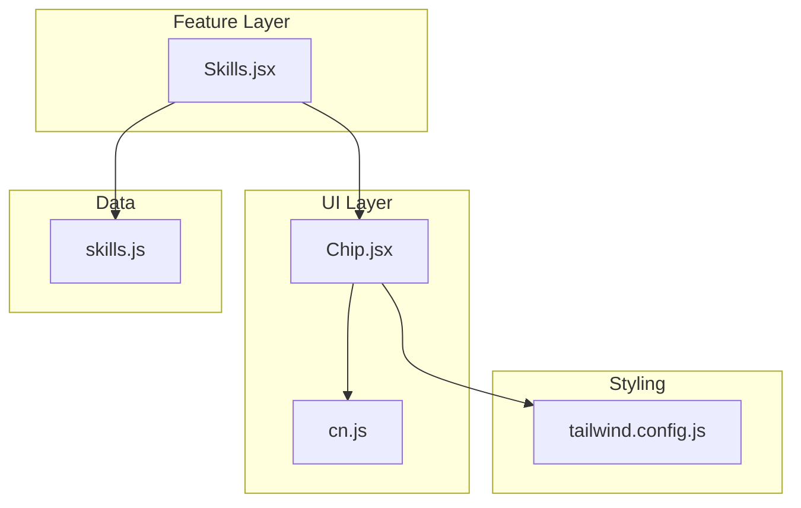
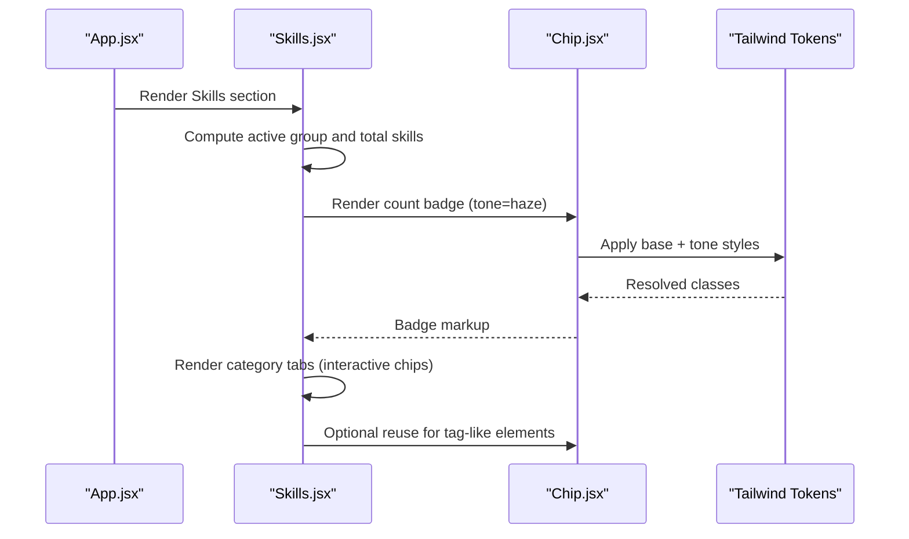
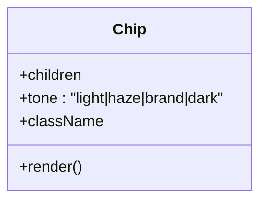
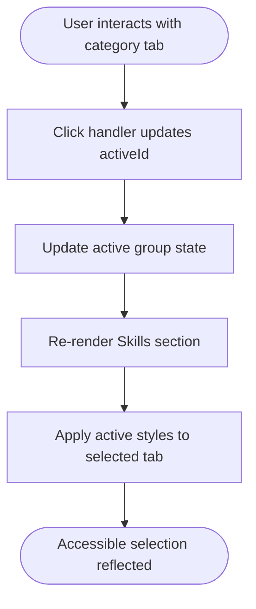
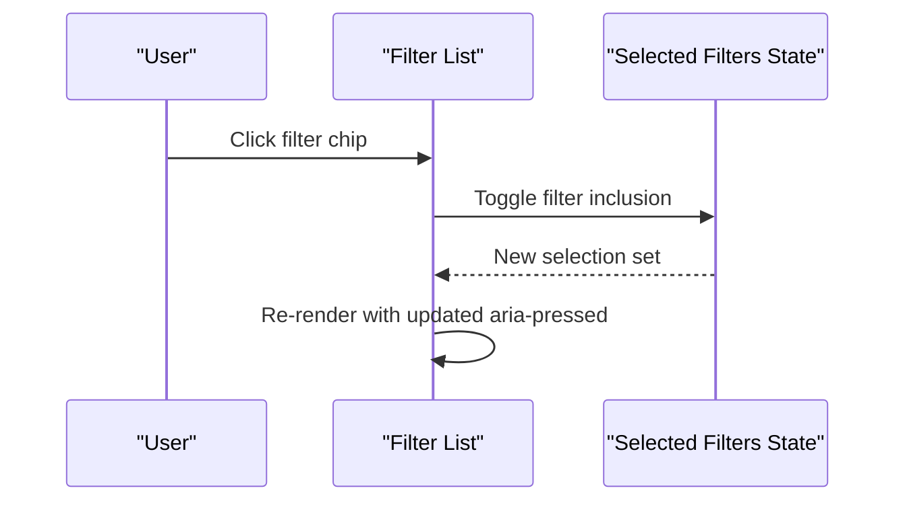
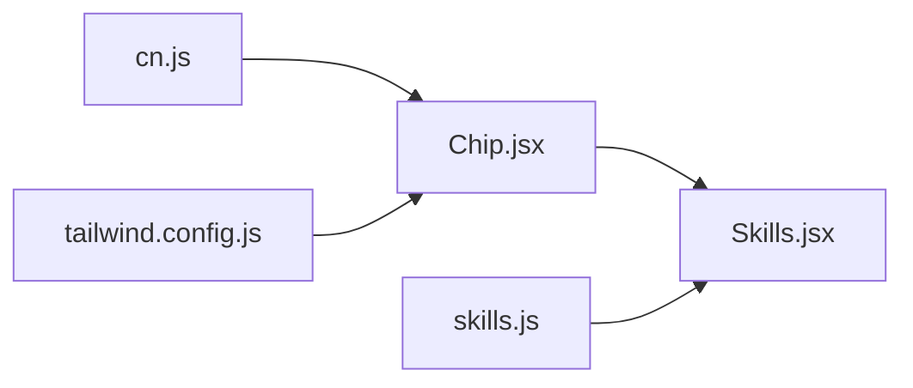

# Chip Component

<cite>
**Referenced Files in This Document**
- [Chip.jsx](file://src/components/ui/Chip.jsx)
- [cn.js](file://src/lib/cn.js)
- [tailwind.config.js](file://tailwind.config.js)
- [skills.js](file://src/data/skills.js)
- [Skills.jsx](file://src/components/Skills.jsx)
</cite>

## Table of Contents
1. [Introduction](#introduction)
2. [Project Structure](#project-structure)
3. [Core Components](#core-components)
4. [Architecture Overview](#architecture-overview)
5. [Detailed Component Analysis](#detailed-component-analysis)
6. [Dependency Analysis](#dependency-analysis)
7. [Performance Considerations](#performance-considerations)
8. [Troubleshooting Guide](#troubleshooting-guide)
9. [Conclusion](#conclusion)
10. [Appendices](#appendices)

## Introduction
This document explains the Chip component used to render small labels, technology badges, and compact tags across the portfolio application. It covers styling variants, interactive behaviors, responsive behavior, hover states, selection patterns, accessibility considerations, keyboard navigation, and integration examples with skills lists and filter-like UIs.

The Chip component is intentionally minimal: it renders a styled inline badge that can be reused for tags, labels, or as part of larger interactive components such as category tabs and skill lists.

## Project Structure
The Chip component lives under the shared UI layer and is consumed by feature components. The project uses Tailwind CSS for styling and a utility function to merge class names safely.

**Diagram sources**
- [Chip.jsx:1-26](file://src/components/ui/Chip.jsx#L1-L26)
- [cn.js](file://src/lib/cn.js)
- [Skills.jsx:1-187](file://src/components/Skills.jsx#L1-L187)
- [skills.js:1-62](file://src/data/skills.js#L1-L62)
- [tailwind.config.js:1-89](file://tailwind.config.js#L1-L89)

**Section sources**
- [Chip.jsx:1-26](file://src/components/ui/Chip.jsx#L1-L26)
- [tailwind.config.js:1-89](file://tailwind.config.js#L1-L89)

## Core Components
- Chip: A presentational badge component that accepts children and optional props to control tone and additional classes.
- cn utility: Merges multiple class name strings into a single className string, enabling conditional and variant-based styling.
- Skills section: Demonstrates how chips are used in practice (inline badges and category tabs).

Key responsibilities:
- Render a consistent, compact label style.
- Provide visual variants through a tone prop.
- Allow custom overrides via className.
- Integrate cleanly with Tailwind design tokens.

**Section sources**
- [Chip.jsx:1-26](file://src/components/ui/Chip.jsx#L1-L26)
- [cn.js](file://src/lib/cn.js)

## Architecture Overview
The Chip component is a leaf UI primitive. It does not manage state; instead, it composes with parent components that handle interactivity. In this project, the Skills section demonstrates two usage patterns:
- Inline badges for counts and metadata.
- Category tabs that act like selectable chips using buttons with aria-pressed.

**Diagram sources**
- [Skills.jsx:1-187](file://src/components/Skills.jsx#L1-L187)
- [Chip.jsx:1-26](file://src/components/ui/Chip.jsx#L1-L26)
- [tailwind.config.js:1-89](file://tailwind.config.js#L1-L89)

## Detailed Component Analysis

### Chip Component
The Chip component renders a span with rounded-full shape, border, padding, monospace font, and small text size. It supports four tones: light, haze, brand, and dark. Each tone maps to a specific combination of background, border, and text color using Tailwind theme tokens.

Props:
- children: Required content inside the chip.
- tone: Variant selector among light, haze, brand, dark. Defaults to light.
- className: Additional classes to override or extend default styles.

Behavior:
- Presentational only; no internal state or event handlers.
- Fully customizable via className.
- Uses cn to merge default and user-provided classes.

Accessibility:
- As a presentational badge, it does not require role attributes.
- If used as an interactive element (e.g., filter), wrap in a button and add appropriate ARIA attributes at the parent level.

Responsive behavior:
- The chip itself is not responsive beyond standard text sizing and spacing.
- Parent containers typically control layout wrapping and stacking.

Hover states:
- No built-in hover effects. Add hover classes via className when needed.

Selection capabilities:
- Not implemented in Chip. Use a parent component (e.g., a button acting as a selectable chip) to manage selection state and provide aria-pressed.

**Diagram sources**
- [Chip.jsx:1-26](file://src/components/ui/Chip.jsx#L1-L26)

**Section sources**
- [Chip.jsx:1-26](file://src/components/ui/Chip.jsx#L1-L26)

### Styling Variants
Tones map to Tailwind theme colors defined in the configuration:
- light: subtle border and white background with muted ink text.
- haze: slightly tinted background with softer border and text.
- brand: brand-colored border and background with brand text.
- dark: translucent white on dark backgrounds with light text.

These rely on the custom color palette and opacity scale configured in Tailwind.

**Section sources**
- [Chip.jsx:6-12](file://src/components/ui/Chip.jsx#L6-L12)
- [tailwind.config.js:15-46](file://tailwind.config.js#L15-L46)

### Interactive Behaviors and Selection Patterns
While Chip itself is non-interactive, the Skills section shows how to build selectable chips:
- Mobile horizontal scrollable tabs rendered as buttons with aria-pressed.
- Desktop sidebar list items also rendered as buttons with hover and focus transitions.

These patterns demonstrate:
- Using buttons for keyboard and screen reader support.
- Applying aria-pressed to indicate selected state.
- Adding hover and active styles via Tailwind classes.

**Diagram sources**
- [Skills.jsx:51-70](file://src/components/Skills.jsx#L51-L70)
- [Skills.jsx:73-127](file://src/components/Skills.jsx#L73-L127)

**Section sources**
- [Skills.jsx:51-70](file://src/components/Skills.jsx#L51-L70)
- [Skills.jsx:73-127](file://src/components/Skills.jsx#L73-L127)

### Responsive Behavior
- On mobile, category tabs are horizontally scrollable and use compact chip-like buttons.
- On desktop, the sidebar expands into a vertical list with richer visuals.
- The chip’s intrinsic size remains small and consistent; layout changes occur at the container level.

**Section sources**
- [Skills.jsx:51-70](file://src/components/Skills.jsx#L51-L70)
- [Skills.jsx:73-127](file://src/components/Skills.jsx#L73-L127)

### Hover States
- Chip has no default hover effect.
- For interactive chips (buttons), hover states are applied via Tailwind classes in the parent component.

**Section sources**
- [Skills.jsx:83-88](file://src/components/Skills.jsx#L83-L88)

### Accessibility Features
- Non-interactive chips do not need roles.
- Interactive chips should be buttons with aria-pressed to communicate selection.
- Decorative icons and counters should use aria-hidden where appropriate.

**Section sources**
- [Skills.jsx:55-68](file://src/components/Skills.jsx#L55-L68)
- [Skills.jsx:78-88](file://src/components/Skills.jsx#L78-L88)

### Keyboard Navigation
- Buttons are natively keyboard-focusable and operable with Enter/Space.
- Ensure visible focus indicators if you customize button styles.

**Section sources**
- [Skills.jsx:55-68](file://src/components/Skills.jsx#L55-L68)
- [Skills.jsx:78-88](file://src/components/Skills.jsx#L78-L88)

### Integration Patterns

#### Skill Tags
Use Chip to display technology tags within cards or lists. Combine with data from skills.js to render consistent labels.

Example pattern:
- Map over skillGroups[].skills and render each item as a Chip with tone=haze or tone=light.
- Wrap in a flex-wrap container to allow wrapping on smaller screens.

**Section sources**
- [skills.js:5-61](file://src/data/skills.js#L5-L61)
- [Chip.jsx:6-24](file://src/components/ui/Chip.jsx#L6-L24)

#### Filter Options
Build filter chips by rendering buttons styled like chips:
- Maintain a set of selected filters in state.
- Toggle selection on click.
- Apply aria-pressed to reflect current state.
- Use tone=brand for active filters and tone=light for inactive ones.

[No sources needed since this diagram shows conceptual workflow, not actual code structure]

#### Interactive Lists
For lists where each row acts like a selectable chip:
- Render rows as buttons.
- Highlight the active row with a distinct tone.
- Provide clear focus and hover feedback.

**Section sources**
- [Skills.jsx:73-127](file://src/components/Skills.jsx#L73-L127)

### Data Display Examples
- Count badges: Render a Chip showing the number of items in a category.
- Metadata labels: Use Chip to show status or type labels in tables and cards.

**Section sources**
- [Skills.jsx:154-156](file://src/components/Skills.jsx#L154-L156)

## Dependency Analysis
The Chip component depends on:
- cn utility for class merging.
- Tailwind theme tokens for colors and typography.

Consumers:
- Skills section uses both direct Chip instances and button-based selectable chips.

**Diagram sources**
- [Chip.jsx:1-26](file://src/components/ui/Chip.jsx#L1-L26)
- [cn.js](file://src/lib/cn.js)
- [tailwind.config.js:1-89](file://tailwind.config.js#L1-L89)
- [Skills.jsx:1-187](file://src/components/Skills.jsx#L1-L187)
- [skills.js:1-62](file://src/data/skills.js#L1-L62)

**Section sources**
- [Chip.jsx:1-26](file://src/components/ui/Chip.jsx#L1-L26)
- [Skills.jsx:1-187](file://src/components/Skills.jsx#L1-L187)

## Performance Considerations
- Chip is lightweight and stateless, making it cheap to render repeatedly.
- Avoid excessive re-renders by memoizing parent lists when necessary.
- Keep tone values static to prevent unnecessary class recomputation.

[No sources needed since this section provides general guidance]

## Troubleshooting Guide
Common issues and resolutions:
- Tone not applying:
  - Verify tone prop matches one of the supported values: light, haze, brand, dark.
  - Ensure Tailwind config includes the referenced color tokens.
- Custom styles overridden:
  - Check className order; ensure your custom classes come after defaults or use more specific selectors.
- Interactive chips not accessible:
  - Use buttons for clickable chips and include aria-pressed to reflect selection state.
  - Ensure focus styles remain visible when overriding button styles.

**Section sources**
- [Chip.jsx:6-12](file://src/components/ui/Chip.jsx#L6-L12)
- [tailwind.config.js:15-46](file://tailwind.config.js#L15-L46)
- [Skills.jsx:55-68](file://src/components/Skills.jsx#L55-L68)

## Conclusion
The Chip component provides a simple, flexible badge primitive for displaying tags, labels, and metadata. While it is non-interactive by design, it integrates seamlessly with parent components that implement selection, filtering, and list interactions. Its styling relies on Tailwind theme tokens, ensuring consistency across the application. For accessibility and keyboard support, wrap interactive chips in buttons and manage selection state with aria-pressed.

[No sources needed since this section summarizes without analyzing specific files]

## Appendices

### Props Reference
- children: Content to display inside the chip.
- tone: One of light, haze, brand, dark. Controls color scheme.
- className: Additional Tailwind classes to customize appearance.

**Section sources**
- [Chip.jsx:6-24](file://src/components/ui/Chip.jsx#L6-L24)

### Theme Tokens Used by Chip
- Colors: ink, paper, haze, mist, brand.*
- Font family: mono
- Border radius: full
- Typography: small monospace text with tight tracking

**Section sources**
- [tailwind.config.js:15-50](file://tailwind.config.js#L15-L50)
- [Chip.jsx:14-23](file://src/components/ui/Chip.jsx#L14-L23)