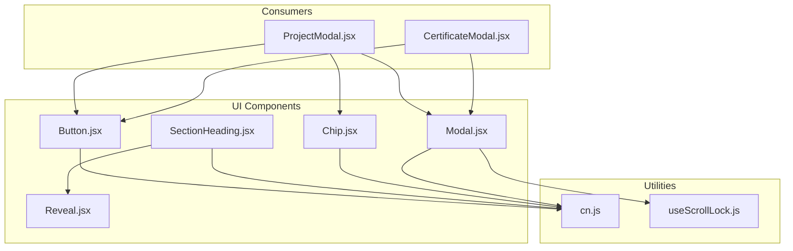
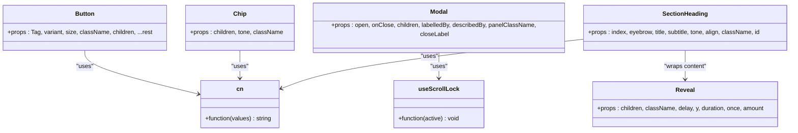
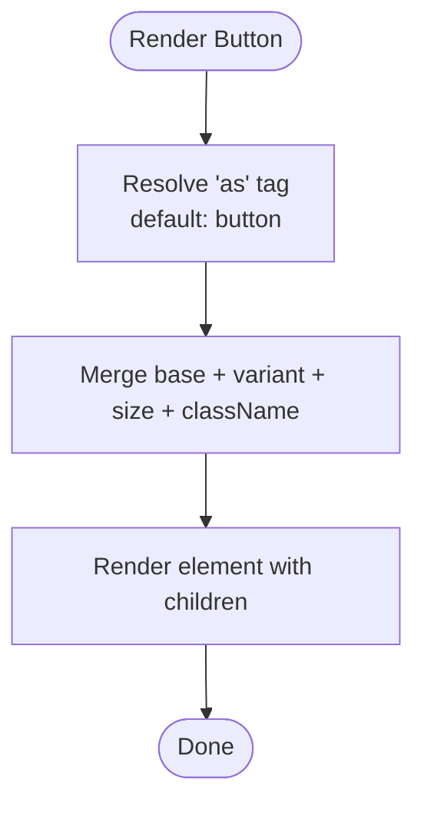
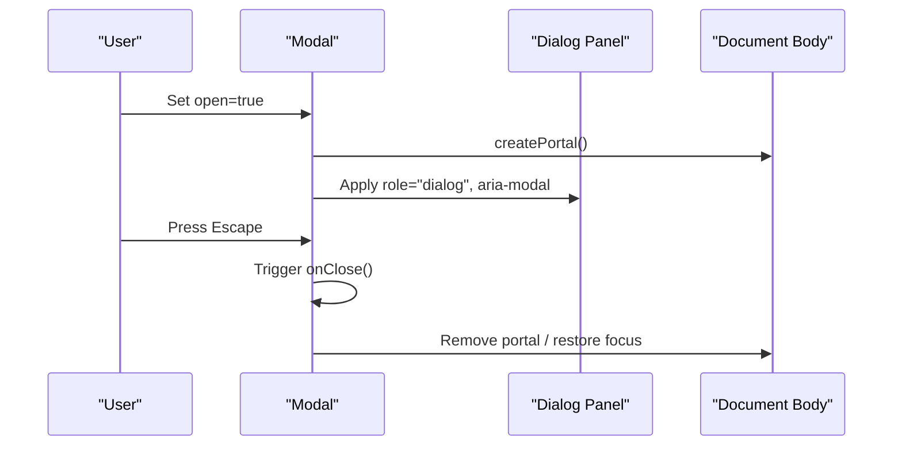
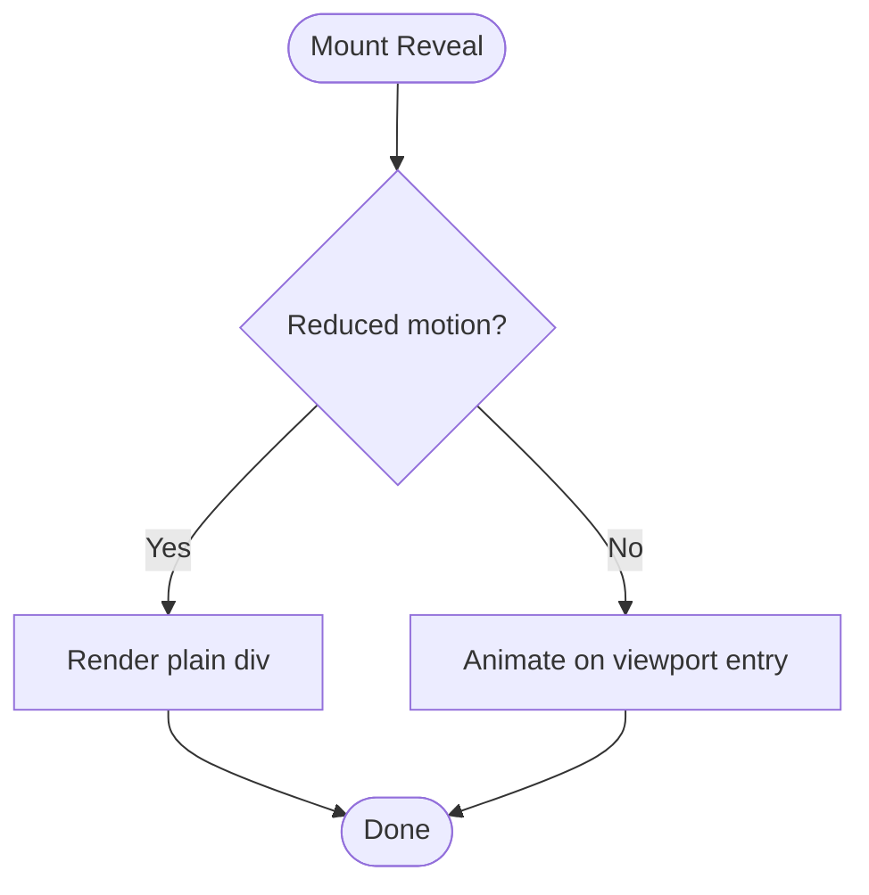
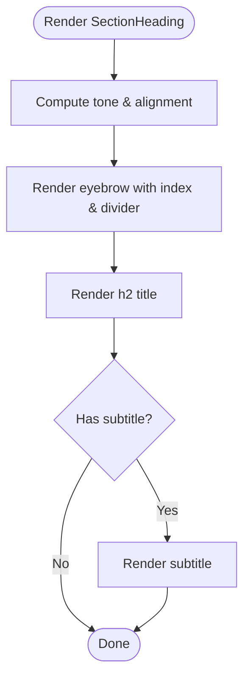
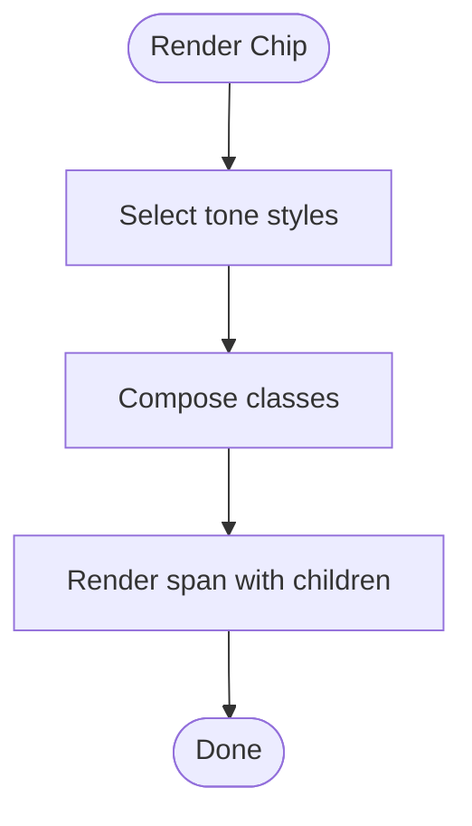
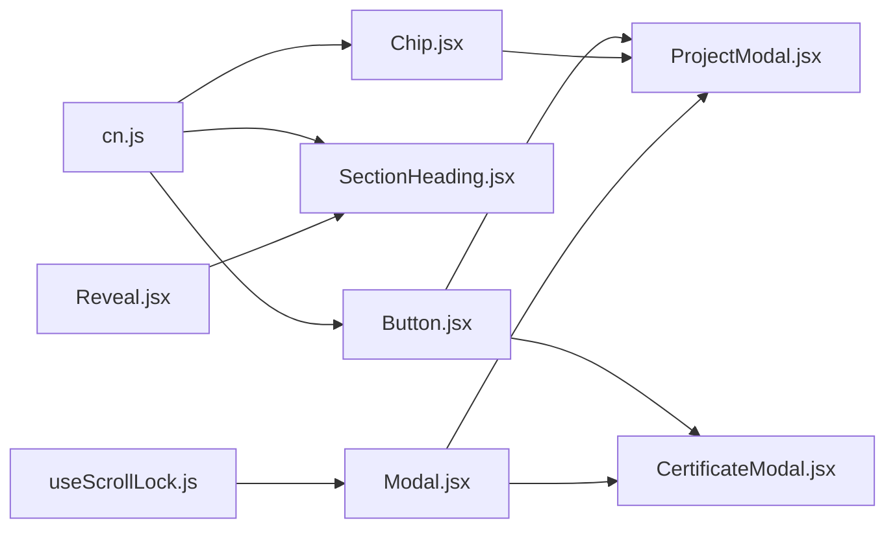

# Component Library

<cite>
**Referenced Files in This Document**
- [Button.jsx](file://src/components/ui/Button.jsx)
- [Modal.jsx](file://src/components/ui/Modal.jsx)
- [Reveal.jsx](file://src/components/ui/Reveal.jsx)
- [SectionHeading.jsx](file://src/components/ui/SectionHeading.jsx)
- [Chip.jsx](file://src/components/ui/Chip.jsx)
- [cn.js](file://src/lib/cn.js)
- [useScrollLock.js](file://src/hooks/useScrollLock.js)
- [ProjectModal.jsx](file://src/components/ProjectModal.jsx)
- [CertificateModal.jsx](file://src/components/CertificateModal.jsx)
</cite>

## Table of Contents
1. [Introduction](#introduction)
2. [Project Structure](#project-structure)
3. [Core Components](#core-components)
4. [Architecture Overview](#architecture-overview)
5. [Detailed Component Analysis](#detailed-component-analysis)
6. [Dependency Analysis](#dependency-analysis)
7. [Performance Considerations](#performance-considerations)
8. [Troubleshooting Guide](#troubleshooting-guide)
9. [Conclusion](#conclusion)

## Introduction
This document describes the reusable UI component library used across the portfolio site. It covers the Button, Modal, Reveal, SectionHeading, and Chip components with their props, events, styling options, accessibility features, responsive behavior, and performance considerations. It also explains design system principles that maintain visual consistency and provides usage patterns and integration examples via existing consumers (ProjectModal and CertificateModal).

## Project Structure
The component library is organized under src/components/ui and leverages shared utilities:
- ui: Button, Modal, Reveal, SectionHeading, Chip
- lib: cn utility for conditional class composition
- hooks: useScrollLock for modal scroll management
- Consumers: ProjectModal and CertificateModal demonstrate integration patterns

**Diagram sources**
- [Button.jsx:1-41](file://src/components/ui/Button.jsx#L1-L41)
- [Modal.jsx:1-131](file://src/components/ui/Modal.jsx#L1-L131)
- [Reveal.jsx:1-34](file://src/components/ui/Reveal.jsx#L1-L34)
- [SectionHeading.jsx:1-70](file://src/components/ui/SectionHeading.jsx#L1-L70)
- [Chip.jsx:1-26](file://src/components/ui/Chip.jsx#L1-L26)
- [cn.js:1-7](file://src/lib/cn.js#L1-L7)
- [useScrollLock.js:1-24](file://src/hooks/useScrollLock.js#L1-L24)
- [ProjectModal.jsx:1-172](file://src/components/ProjectModal.jsx#L1-L172)
- [CertificateModal.jsx:1-117](file://src/components/CertificateModal.jsx#L1-L117)

**Section sources**
- [Button.jsx:1-41](file://src/components/ui/Button.jsx#L1-L41)
- [Modal.jsx:1-131](file://src/components/ui/Modal.jsx#L1-L131)
- [Reveal.jsx:1-34](file://src/components/ui/Reveal.jsx#L1-L34)
- [SectionHeading.jsx:1-70](file://src/components/ui/SectionHeading.jsx#L1-L70)
- [Chip.jsx:1-26](file://src/components/ui/Chip.jsx#L1-L26)
- [cn.js:1-7](file://src/lib/cn.js#L1-L7)
- [useScrollLock.js:1-24](file://src/hooks/useScrollLock.js#L1-L24)
- [ProjectModal.jsx:1-172](file://src/components/ProjectModal.jsx#L1-L172)
- [CertificateModal.jsx:1-117](file://src/components/CertificateModal.jsx#L1-L117)

## Core Components
- Button: A versatile, accessible button with variants, sizes, and composable classes. Supports rendering as different HTML elements via a prop.
- Modal: An accessible dialog with portal rendering, focus trap, keyboard navigation, reduced motion support, and scroll lock.
- Reveal: A scroll-triggered reveal animation using viewport detection with graceful fallback for reduced motion preferences.
- SectionHeading: A section header with eyebrow, title, subtitle, tone, alignment, and built-in reveal animations.
- Chip: A small label/badge with multiple tones for consistent tagging.

Key shared utilities:
- cn: Joins class names conditionally to avoid runtime overhead.
- useScrollLock: Locks page scrolling without layout shift when overlays are open.

**Section sources**
- [Button.jsx:1-41](file://src/components/ui/Button.jsx#L1-L41)
- [Modal.jsx:1-131](file://src/components/ui/Modal.jsx#L1-L131)
- [Reveal.jsx:1-34](file://src/components/ui/Reveal.jsx#L1-L34)
- [SectionHeading.jsx:1-70](file://src/components/ui/SectionHeading.jsx#L1-L70)
- [Chip.jsx:1-26](file://src/components/ui/Chip.jsx#L1-L26)
- [cn.js:1-7](file://src/lib/cn.js#L1-L7)
- [useScrollLock.js:1-24](file://src/hooks/useScrollLock.js#L1-L24)

## Architecture Overview
The component library follows a layered architecture:
- Presentation layer: Button, Chip, SectionHeading provide visual primitives.
- Interaction layer: Modal encapsulates complex interactions (focus management, portal, animations).
- Animation layer: Reveal provides declarative scroll-based animations.
- Utility layer: cn and useScrollLock provide cross-cutting concerns.

**Diagram sources**
- [Button.jsx:25-38](file://src/components/ui/Button.jsx#L25-L38)
- [Modal.jsx:15-23](file://src/components/ui/Modal.jsx#L15-L23)
- [Reveal.jsx:7-15](file://src/components/ui/Reveal.jsx#L7-L15)
- [SectionHeading.jsx:4-13](file://src/components/ui/SectionHeading.jsx#L4-L13)
- [Chip.jsx:6-6](file://src/components/ui/Chip.jsx#L6-L6)
- [cn.js:4-6](file://src/lib/cn.js#L4-L6)
- [useScrollLock.js:6-23](file://src/hooks/useScrollLock.js#L6-L23)

## Detailed Component Analysis

### Button
Purpose:
- Provide a consistent, accessible button with multiple visual variants and sizes.

Props:
- as: Underlying element tag (default: button). Allows rendering as anchor or other elements.
- variant: Visual style preset. Options include primary, outline, dark, ghostDark, quiet, quietDark.
- size: Size preset. Options include sm, md, lg, icon.
- className: Additional Tailwind classes for customization.
- children: Button content.
- ...rest: Spread to underlying element (e.g., href, onClick, type).

Events:
- Inherits standard DOM events from the underlying element (e.g., onClick, onKeyDown).

Styling:
- Base styles include rounded corners, spacing, transitions, focus ring, disabled state.
- Variants define background, text color, hover effects, and shadows.
- Sizes control padding and font size; responsive sizing included for larger breakpoints.

Accessibility:
- Focus-visible ring ensures keyboard users see focus.
- Disabled state sets pointer-events and opacity.
- When rendered as an anchor, pass href and target attributes appropriately.

Responsive behavior:
- Larger sizes scale typography on medium screens.

Usage patterns:
- Use as="a" for external links with rel="noreferrer noopener".
- Combine with icons by placing them inside children.

Integration examples:
- See usage in [ProjectModal.jsx:133-146](file://src/components/ProjectModal.jsx#L133-L146) and [CertificateModal.jsx:88-101](file://src/components/CertificateModal.jsx#L88-L101).

**Diagram sources**
- [Button.jsx:25-38](file://src/components/ui/Button.jsx#L25-L38)

**Section sources**
- [Button.jsx:1-41](file://src/components/ui/Button.jsx#L1-L41)

### Modal
Purpose:
- Provide an accessible, animated dialog with robust focus management and scroll locking.

Props:
- open: Controls visibility.
- onClose: Callback invoked on close actions.
- children: Dialog content.
- labelledBy: ID of element labeling the dialog.
- describedBy: ID of element describing the dialog.
- panelClassName: Additional classes for the dialog panel.
- closeLabel: Accessible label for the close button.

Events:
- onClose triggered by Escape key, backdrop click, and close button.

Accessibility:
- role="dialog", aria-modal="true", aria-labelledby, aria-describedby.
- Focus trap within the dialog; restores previous focus on close.
- Keyboard support: Escape closes; Tab cycles through focusable elements.
- Reduced motion preference respected for animations.

Behavior:
- Portal renders into document.body.
- Backdrop overlay dismisses on click.
- Scroll lock prevents background scrolling while open.

Animation:
- Framer Motion handles entrance/exit transitions.
- Duration adapts based on user motion preferences.

Usage patterns:
- Wrap content in a container with max height and overflow handling.
- Provide labelledBy/describedBy for screen readers.

Integration examples:
- See usage in [ProjectModal.jsx:26-33](file://src/components/ProjectModal.jsx#L26-L33) and [CertificateModal.jsx:17-23](file://src/components/CertificateModal.jsx#L17-L23).

**Diagram sources**
- [Modal.jsx:31-74](file://src/components/ui/Modal.jsx#L31-L74)
- [Modal.jsx:80-129](file://src/components/ui/Modal.jsx#L80-L129)

**Section sources**
- [Modal.jsx:1-131](file://src/components/ui/Modal.jsx#L1-L131)
- [useScrollLock.js:1-24](file://src/hooks/useScrollLock.js#L1-L24)

### Reveal
Purpose:
- Provide scroll-triggered reveal animations with graceful fallback for reduced motion.

Props:
- children: Content to reveal.
- className: Container classes.
- delay: Transition delay.
- y: Initial vertical offset.
- duration: Animation duration.
- once: Whether animation triggers only once.
- amount: Viewport intersection threshold.

Behavior:
- Uses viewport detection to animate when entering view.
- Falls back to a plain div when reduced motion is preferred.

Accessibility:
- No interactive elements; purely presentational.

Usage patterns:
- Wrap headings, paragraphs, or cards to introduce subtle motion.

Integration examples:
- Used internally by [SectionHeading.jsx:19-66](file://src/components/ui/SectionHeading.jsx#L19-L66).

**Diagram sources**
- [Reveal.jsx:7-33](file://src/components/ui/Reveal.jsx#L7-L33)

**Section sources**
- [Reveal.jsx:1-34](file://src/components/ui/Reveal.jsx#L1-L34)

### SectionHeading
Purpose:
- Provide a consistent section header with eyebrow, title, subtitle, tone, and alignment.

Props:
- index: Optional numeric index displayed before the eyebrow.
- eyebrow: Small uppercase label above the title.
- title: Main heading text.
- subtitle: Optional descriptive paragraph.
- tone: Visual tone ("light" or "dark").
- align: Alignment ("left" or "center").
- className: Additional classes.
- id: Heading id for linking and accessibility.

Behavior:
- Wraps content with Reveal animations for staggered entrance.
- Applies tone-aware colors and divider styles.
- Responsive typography for the title.

Accessibility:
- Exposes id for programmatic linking.
- Semantic h2 element for proper heading hierarchy.

Usage patterns:
- Use at the top of sections like About, Projects, Skills, Certificates, Contact.

Integration examples:
- See usage in [About.jsx](file://src/components/About.jsx), [Projects.jsx](file://src/components/Projects.jsx), [Skills.jsx](file://src/components/Skills.jsx), [Certificates.jsx](file://src/components/Certificates.jsx), [Contact.jsx](file://src/components/Contact.jsx).

**Diagram sources**
- [SectionHeading.jsx:4-67](file://src/components/ui/SectionHeading.jsx#L4-L67)

**Section sources**
- [SectionHeading.jsx:1-70](file://src/components/ui/SectionHeading.jsx#L1-L70)

### Chip
Purpose:
- Provide small labels or technology badges with consistent styling.

Props:
- children: Label text.
- tone: Visual tone preset. Options include light, haze, brand, dark.
- className: Additional classes.

Behavior:
- Inline-flex badge with rounded corners and monospace typography.
- Tone affects border, background, and text color.

Accessibility:
- Presentational; no interactive semantics required.

Usage patterns:
- Display technologies, categories, or tags in lists and cards.

Integration examples:
- See usage in [ProjectModal.jsx:57-63](file://src/components/ProjectModal.jsx#L57-L63).

**Diagram sources**
- [Chip.jsx:6-24](file://src/components/ui/Chip.jsx#L6-L24)

**Section sources**
- [Chip.jsx:1-26](file://src/components/ui/Chip.jsx#L1-L26)

## Dependency Analysis
Component dependencies:
- Button depends on cn for class composition.
- SectionHeading depends on Reveal and cn.
- Modal depends on useScrollLock and cn.
- Chip depends on cn.
- Consumers (ProjectModal, CertificateModal) depend on Button, Chip, and Modal.

**Diagram sources**
- [Button.jsx:1-41](file://src/components/ui/Button.jsx#L1-L41)
- [SectionHeading.jsx:1-70](file://src/components/ui/SectionHeading.jsx#L1-L70)
- [Reveal.jsx:1-34](file://src/components/ui/Reveal.jsx#L1-L34)
- [Modal.jsx:1-131](file://src/components/ui/Modal.jsx#L1-L131)
- [Chip.jsx:1-26](file://src/components/ui/Chip.jsx#L1-L26)
- [cn.js:1-7](file://src/lib/cn.js#L1-L7)
- [useScrollLock.js:1-24](file://src/hooks/useScrollLock.js#L1-L24)
- [ProjectModal.jsx:1-172](file://src/components/ProjectModal.jsx#L1-L172)
- [CertificateModal.jsx:1-117](file://src/components/CertificateModal.jsx#L1-L117)

**Section sources**
- [Button.jsx:1-41](file://src/components/ui/Button.jsx#L1-L41)
- [SectionHeading.jsx:1-70](file://src/components/ui/SectionHeading.jsx#L1-L70)
- [Reveal.jsx:1-34](file://src/components/ui/Reveal.jsx#L1-L34)
- [Modal.jsx:1-131](file://src/components/ui/Modal.jsx#L1-L131)
- [Chip.jsx:1-26](file://src/components/ui/Chip.jsx#L1-L26)
- [cn.js:1-7](file://src/lib/cn.js#L1-L7)
- [useScrollLock.js:1-24](file://src/hooks/useScrollLock.js#L1-L24)
- [ProjectModal.jsx:1-172](file://src/components/ProjectModal.jsx#L1-L172)
- [CertificateModal.jsx:1-117](file://src/components/CertificateModal.jsx#L1-L117)

## Performance Considerations
- Class composition: The cn utility filters falsy values and joins strings, minimizing runtime overhead and avoiding unnecessary re-renders due to dynamic class construction.
- Animations: Reveal uses viewport detection; ensure once=true to avoid repeated animations. Modal respects reduced motion preferences to minimize jank.
- Portals: Modal renders via createPortal to avoid DOM tree depth issues and improve stacking context management.
- Focus management: Modal’s focus trap avoids unnecessary reflows by querying visible focusables efficiently.
- Scroll lock: useScrollLock preserves previous overflow and padding to prevent layout shifts and repaints.

[No sources needed since this section provides general guidance]

## Troubleshooting Guide
Common issues and resolutions:
- Modal not closing on Escape: Ensure onClose is passed and not overridden; verify keydown listener is attached when open=true.
- Focus not trapped: Confirm panel contains focusable elements and that tabindex is not set to -1 on interactive items.
- Background scrolling still enabled: Verify useScrollLock is called with open state and that body styles are restored on close.
- Button not acting as link: Pass as="a" along with href and appropriate rel attributes.
- Reveal not animating: Check viewport configuration and reduce-motion settings; confirm the element enters the viewport.

**Section sources**
- [Modal.jsx:31-74](file://src/components/ui/Modal.jsx#L31-L74)
- [useScrollLock.js:6-23](file://src/hooks/useScrollLock.js#L6-L23)
- [Button.jsx:25-38](file://src/components/ui/Button.jsx#L25-L38)
- [Reveal.jsx:16-33](file://src/components/ui/Reveal.jsx#L16-L33)

## Conclusion
The component library provides a cohesive, accessible, and performant foundation for building consistent UI experiences. By adhering to clear props, events, and styling conventions, and by leveraging shared utilities and hooks, the components maintain visual harmony and predictable behavior across the portfolio. Consumers such as ProjectModal and CertificateModal illustrate practical integration patterns, demonstrating how to compose these primitives into feature-rich interfaces.

[No sources needed since this section summarizes without analyzing specific files]