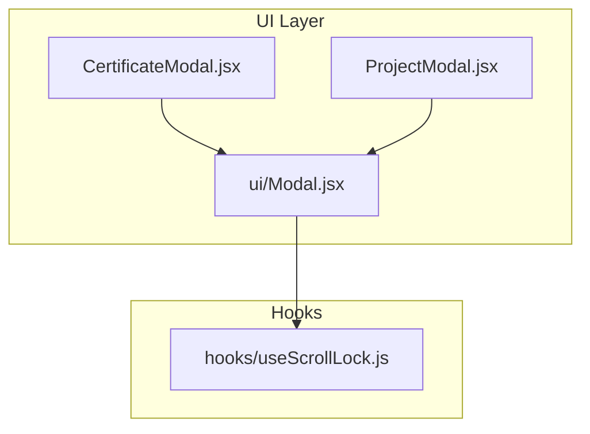
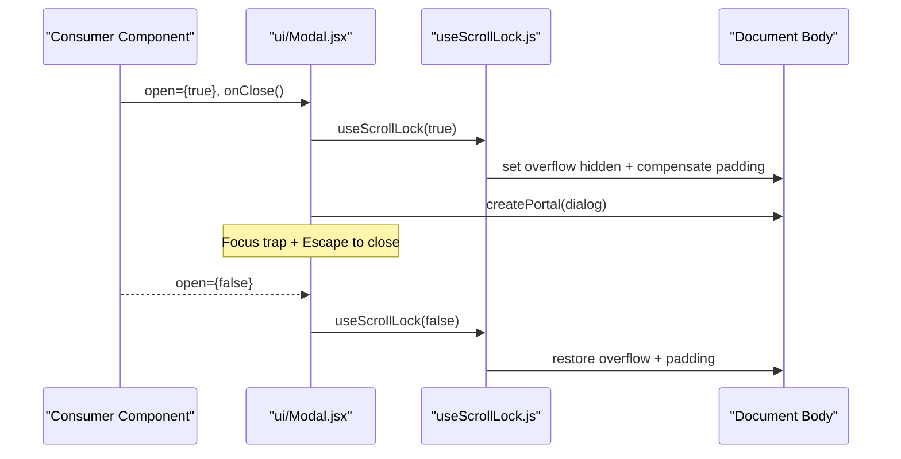
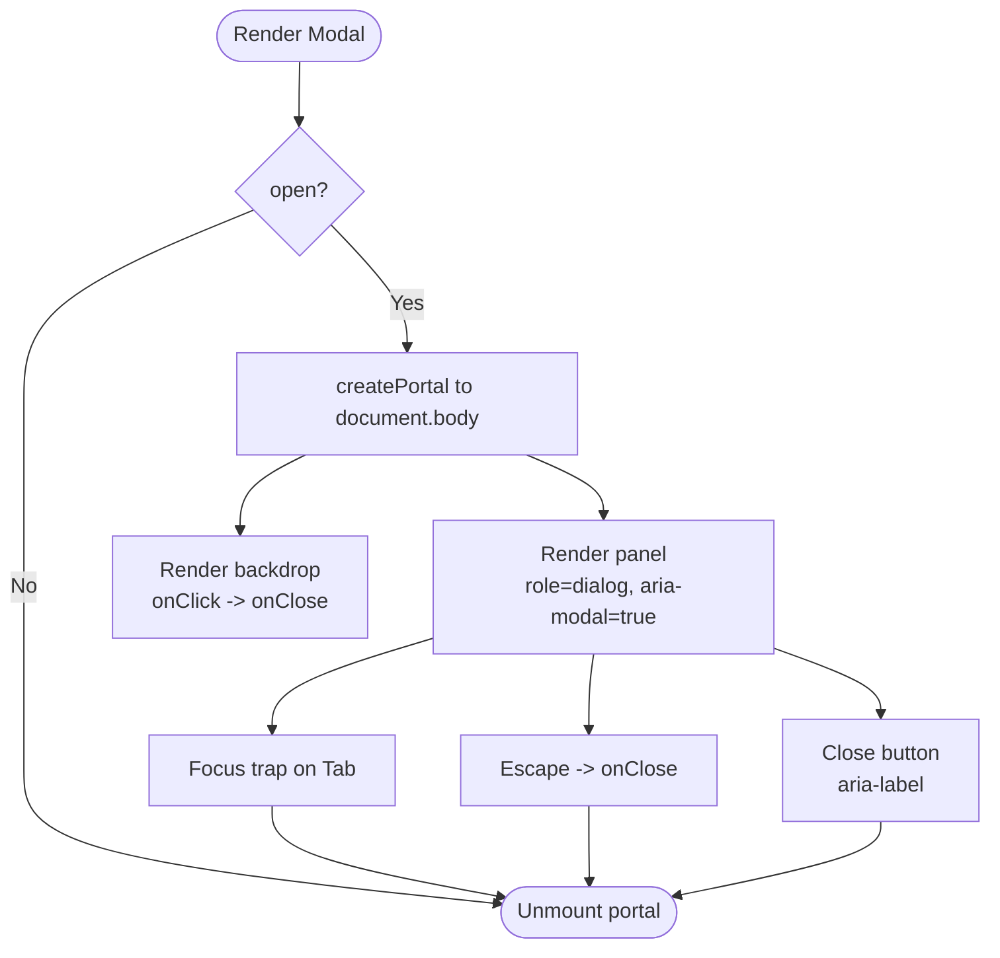
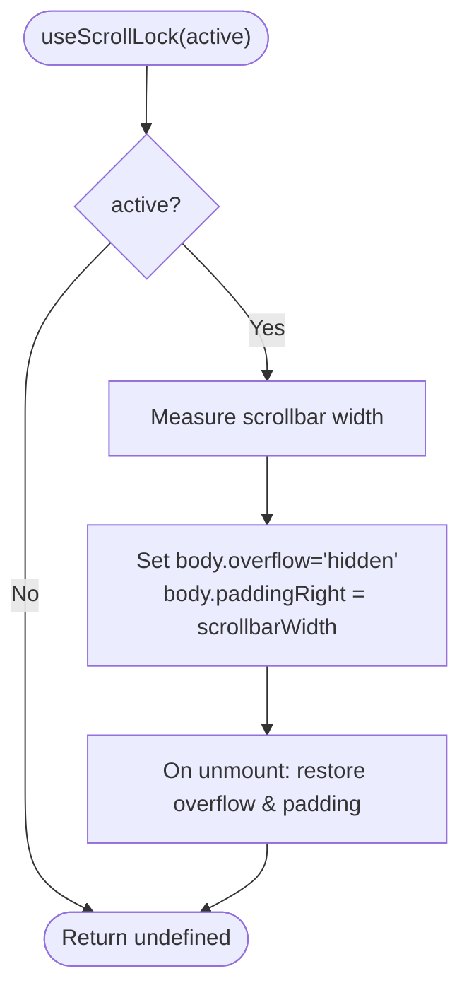
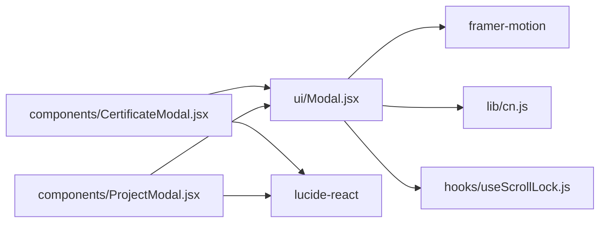

# Modal Component

<cite>
**Referenced Files in This Document**
- [Modal.jsx](file://src/components/ui/Modal.jsx)
- [useScrollLock.js](file://src/hooks/useScrollLock.js)
- [CertificateModal.jsx](file://src/components/CertificateModal.jsx)
- [ProjectModal.jsx](file://src/components/ProjectModal.jsx)
- [package.json](file://package.json)
</cite>

## Table of Contents
1. [Introduction](#introduction)
2. [Project Structure](#project-structure)
3. [Core Components](#core-components)
4. [Architecture Overview](#architecture-overview)
5. [Detailed Component Analysis](#detailed-component-analysis)
6. [Dependency Analysis](#dependency-analysis)
7. [Performance Considerations](#performance-considerations)
8. [Troubleshooting Guide](#troubleshooting-guide)
9. [Conclusion](#conclusion)

## Introduction
This document explains the Modal component used across the portfolio application. It covers props for controlling open/close states, backdrop interactions, keyboard navigation, scroll locking, animations powered by Framer Motion, accessibility features such as focus trapping and ARIA attributes, responsive behavior, z-index management, overlay styling, and performance optimizations. It also provides examples of implementing custom modals, handling user interactions, and integrating with other components.

## Project Structure
The modal system is implemented as a reusable base component with two domain-specific modal implementations:
- Base modal: src/components/ui/Modal.jsx
- Scroll lock hook: src/hooks/useScrollLock.js
- Domain modals: src/components/CertificateModal.jsx and src/components/ProjectModal.jsx
- Dependencies declared in package.json

**Diagram sources**
- [Modal.jsx:1-131](file://src/components/ui/Modal.jsx#L1-L131)
- [useScrollLock.js:1-24](file://src/hooks/useScrollLock.js#L1-L24)
- [CertificateModal.jsx:1-117](file://src/components/CertificateModal.jsx#L1-L117)
- [ProjectModal.jsx:1-172](file://src/components/ProjectModal.jsx#L1-L172)

**Section sources**
- [Modal.jsx:1-131](file://src/components/ui/Modal.jsx#L1-L131)
- [useScrollLock.js:1-24](file://src/hooks/useScrollLock.js#L1-L24)
- [CertificateModal.jsx:1-117](file://src/components/CertificateModal.jsx#L1-L117)
- [ProjectModal.jsx:1-172](file://src/components/ProjectModal.jsx#L1-L172)
- [package.json:12-16](file://package.json#L12-L16)

## Core Components
- Modal (base): Provides portal rendering, backdrop click-to-close, Escape key to close, focus trap within the dialog panel, scroll lock, reduced-motion support, and accessible markup.
- useScrollLock (hook): Prevents background page scrolling while the modal is open without causing layout shift.
- CertificateModal and ProjectModal: Example consumers that render rich content inside the base modal.

Key behaviors:
- Open/close state controlled via props.
- Backdrop dismisses on click.
- Keyboard: Escape closes; Tab cycles focus within the modal panel.
- Accessibility: role="dialog", aria-modal, aria-labelledby, aria-describedby, aria-label on close button.
- Animations: Framer Motion AnimatePresence with fade/scale/translate transitions; respects prefers-reduced-motion.
- Responsive: Full-width on small screens, centered with padding on larger screens; max widths set by consumers.
- Z-index: Overlay at a high stacking context level to ensure it appears above app content.
- Scroll lock: Locks body scroll when active and restores previous styles on close.

**Section sources**
- [Modal.jsx:15-130](file://src/components/ui/Modal.jsx#L15-L130)
- [useScrollLock.js:6-22](file://src/hooks/useScrollLock.js#L6-L22)

## Architecture Overview
The modal architecture separates concerns between presentation and behavior:
- Consumers pass open, onClose, labelledBy, describedBy, panelClassName, and closeLabel to Modal.
- Modal renders a portal to document.body, manages focus and keyboard events, and applies motion transitions.
- The scroll lock hook toggles body overflow and compensates for scrollbar width to avoid layout shifts.

**Diagram sources**
- [Modal.jsx:29-74](file://src/components/ui/Modal.jsx#L29-L74)
- [Modal.jsx:80-129](file://src/components/ui/Modal.jsx#L80-L129)
- [useScrollLock.js:6-22](file://src/hooks/useScrollLock.js#L6-L22)

## Detailed Component Analysis

### Base Modal Props and Behavior
Props:
- open: boolean controlling visibility.
- onClose: function invoked on backdrop click, Escape key, or close button.
- children: ReactNode rendered inside the dialog panel.
- labelledBy: string id for aria-labelledby.
- describedBy: string id for aria-describedby.
- panelClassName: additional classes applied to the dialog panel container.
- closeLabel: string for the close button’s aria-label.

Behavior highlights:
- Portal: Renders into document.body using React portals.
- Backdrop: Semi-transparent overlay with blur; clicking invokes onClose.
- Keyboard:
  - Escape triggers onClose.
  - Tab wraps focus within the modal panel.
- Focus management:
  - On open, focuses the close button after a short delay.
  - On close, returns focus to the previously focused element.
- Reduced motion: Uses Framer Motion’s useReducedMotion to disable non-essential animations.
- Animation:
  - Backdrop fades in/out.
  - Panel scales and translates slightly on open/close.
  - Duration adapts based on reduced motion preference.
- Accessibility:
  - role="dialog" and aria-modal="true".
  - aria-labelledby and aria-describedby wired from props.
  - Close button has aria-label.
- Styling:
  - Fixed overlay with high z-index.
  - Centered panel with rounded corners, border, and shadow.
  - Responsive padding and sizing.

**Diagram sources**
- [Modal.jsx:35-74](file://src/components/ui/Modal.jsx#L35-L74)
- [Modal.jsx:80-129](file://src/components/ui/Modal.jsx#L80-L129)

**Section sources**
- [Modal.jsx:15-130](file://src/components/ui/Modal.jsx#L15-L130)

### Scroll Lock Hook
Responsibilities:
- When active is true, sets body overflow to hidden and adds paddingRight equal to the native scrollbar width to prevent layout shift.
- Restores previous overflow and paddingRight on cleanup.

Usage:
- Called internally by Modal with open state.

**Diagram sources**
- [useScrollLock.js:6-22](file://src/hooks/useScrollLock.js#L6-L22)

**Section sources**
- [useScrollLock.js:1-24](file://src/hooks/useScrollLock.js#L1-L24)

### CertificateModal
Purpose:
- Displays certificate details including title, issuer, verification status, optional image/PDF preview, and actions to open the document or verify with the issuer.

Integration with Modal:
- Passes open, onClose, labelledBy, panelClassName, and closeLabel.
- Uses an internal snapshot pattern to keep the last data during exit animation.

Accessibility:
- Sets labelledBy to an h2 id inside the modal.
- Images have descriptive alt text; icons are marked aria-hidden where appropriate.

Responsive considerations:
- Max width constrained by panelClassName.
- Content scrolls vertically if needed.

**Section sources**
- [CertificateModal.jsx:6-116](file://src/components/CertificateModal.jsx#L6-L116)

### ProjectModal
Purpose:
- Shows detailed project information including overview, problem statement, technical approach, architecture blocks, challenges, learnings, and links to repository/live demo.

Integration with Modal:
- Passes open derived from project presence, onClose, labelledBy, panelClassName, and closeLabel.
- Uses a snapshot pattern to preserve data during exit animation.

Accessibility:
- labelledBy points to an h2 id inside the modal.
- Decorative icons are aria-hidden.

Responsive considerations:
- Larger max width via panelClassName.
- Grid layouts adapt on larger screens.

**Section sources**
- [ProjectModal.jsx:16-171](file://src/components/ProjectModal.jsx#L16-L171)

## Dependency Analysis
External dependencies relevant to the modal:
- framer-motion: Used for AnimatePresence, motion, and useReducedMotion.
- lucide-react: Used for icon components in consumer modals.
- react/react-dom: For component model and createPortal.

**Diagram sources**
- [Modal.jsx:1-6](file://src/components/ui/Modal.jsx#L1-L6)
- [package.json:12-16](file://package.json#L12-L16)

**Section sources**
- [package.json:12-16](file://package.json#L12-L16)
- [Modal.jsx:1-6](file://src/components/ui/Modal.jsx#L1-L6)

## Performance Considerations
- Reduced motion: Disables non-essential animations when the user prefers reduced motion, improving comfort and performance.
- Portal rendering: Keeps the modal outside the main DOM tree to avoid reflows in parent components.
- Minimal re-renders: Modal only renders its portal when open is true.
- Efficient focus management: Focus trap queries visible focusable elements once per event and avoids unnecessary work.
- Scroll lock without layout shift: Compensates for scrollbar width to prevent jank when opening/closing.

[No sources needed since this section provides general guidance]

## Troubleshooting Guide
Common issues and resolutions:
- Modal does not close on Escape:
  - Ensure the modal is mounted and open is true so the keydown listener is attached.
  - Verify onClose is passed and invoked by the close button/backdrop.
- Focus not trapped:
  - Confirm the panel contains focusable elements and that the focus trap logic runs when open.
- Background still scrolls:
  - Verify useScrollLock(open) is called and active reflects the modal’s open state.
- Animations feel choppy:
  - Check for heavy content inside the panel; consider lazy loading images or deferring heavy computations until the modal opens.
- Z-index conflicts:
  - The overlay uses a high z-index; ensure no sibling components override stacking contexts unexpectedly.

**Section sources**
- [Modal.jsx:35-74](file://src/components/ui/Modal.jsx#L35-L74)
- [Modal.jsx:80-129](file://src/components/ui/Modal.jsx#L80-L129)
- [useScrollLock.js:6-22](file://src/hooks/useScrollLock.js#L6-L22)

## Conclusion
The Modal component offers a robust, accessible, and animated dialog implementation suitable for complex content. It integrates seamlessly with consumer components through simple props, handles critical UX concerns like focus management and scroll locking, and leverages Framer Motion for smooth transitions while respecting user preferences. The provided examples demonstrate how to build domain-specific modals with clear structure and strong accessibility.

[No sources needed since this section summarizes without analyzing specific files]