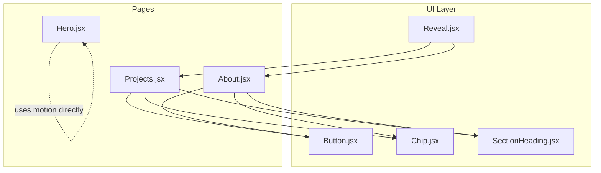
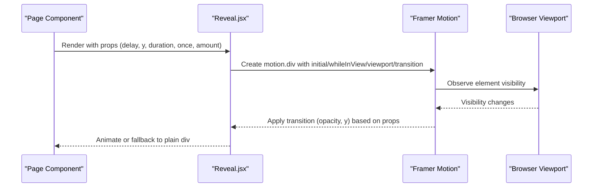
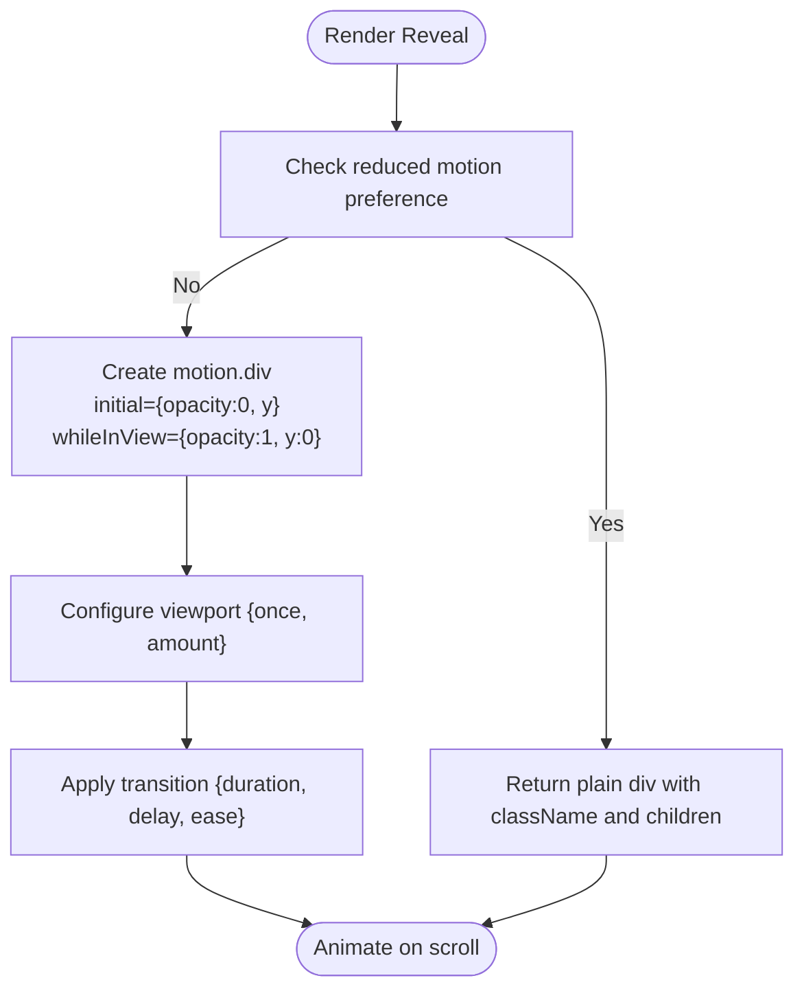
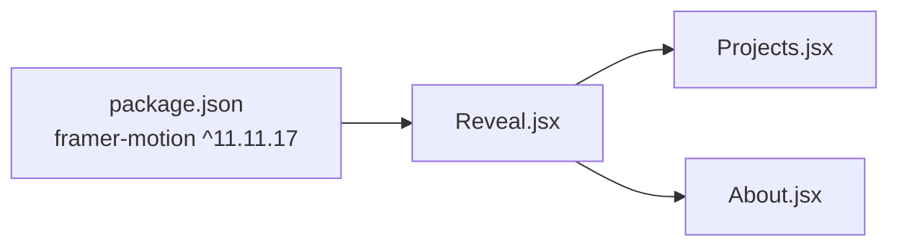

# Reveal Animation Component

<cite>
**Referenced Files in This Document**
- [Reveal.jsx](file://src/components/ui/Reveal.jsx)
- [Projects.jsx](file://src/components/Projects.jsx)
- [About.jsx](file://src/components/About.jsx)
- [Hero.jsx](file://src/components/Hero.jsx)
- [package.json](file://package.json)
</cite>

## Table of Contents
1. [Introduction](#introduction)
2. [Project Structure](#project-structure)
3. [Core Components](#core-components)
4. [Architecture Overview](#architecture-overview)
5. [Detailed Component Analysis](#detailed-component-analysis)
6. [Dependency Analysis](#dependency-analysis)
7. [Performance Considerations](#performance-considerations)
8. [Troubleshooting Guide](#troubleshooting-guide)
9. [Conclusion](#conclusion)

## Introduction
This document explains the Reveal animation component used across the portfolio site. It covers how Framer Motion is integrated, how scroll-triggered reveals work, and how to configure timing, easing, direction, and viewport detection. It also includes examples for customizing animations, combining multiple reveals, and optimizing performance for large content sections.

## Project Structure
The Reveal component lives under the UI layer and is reused by page-level components such as Projects and About. The project uses Vite, React 18, Tailwind CSS, and Framer Motion for animations.

**Diagram sources**
- [Reveal.jsx:1-34](file://src/components/ui/Reveal.jsx#L1-L34)
- [Projects.jsx:1-143](file://src/components/Projects.jsx#L1-L143)
- [About.jsx:1-148](file://src/components/About.jsx#L1-L148)
- [Hero.jsx:1-149](file://src/components/Hero.jsx#L1-L149)

**Section sources**
- [package.json:12-16](file://package.json#L12-L16)
- [Reveal.jsx:1-34](file://src/components/ui/Reveal.jsx#L1-L34)

## Core Components
- Reveal: A lightweight wrapper around Framer Motion’s motion.div that animates elements when they enter the viewport. It respects user accessibility preferences by disabling animations when reduced motion is preferred.

Key behaviors:
- Uses Framer Motion’s whileInView to trigger animations on viewport entry.
- Respects reduced motion via useReducedMotion; falls back to a plain div when animations are disabled.
- Provides configurable props for delay, vertical offset (y), duration, once, and amount.

Props summary:
- children: Content to animate.
- className: Additional CSS classes.
- delay: Transition delay in seconds.
- y: Initial vertical offset for the reveal animation.
- duration: Animation duration in seconds.
- once: Whether to animate only once per mount.
- amount: Threshold controlling when the element enters the viewport (0–1).

Accessibility:
- When reduced motion is detected, the component renders a non-animated div with the same className and children, ensuring consistent layout and semantics.

**Section sources**
- [Reveal.jsx:1-34](file://src/components/ui/Reveal.jsx#L1-L34)

## Architecture Overview
The Reveal component integrates with Framer Motion’s viewport-based animation system. It does not implement IntersectionObserver manually; instead, it relies on Framer Motion’s internal observer to detect when elements come into view.

**Diagram sources**
- [Reveal.jsx:1-34](file://src/components/ui/Reveal.jsx#L1-L34)

## Detailed Component Analysis

### Reveal Component Internals
- Animation states:
  - initial: opacity 0 and vertical offset y.
  - whileInView: opacity 1 and y returns to 0.
- Viewport configuration:
  - viewport.once: controls whether the animation runs only once.
  - viewport.amount: threshold for triggering the animation.
- Transition:
  - duration and delay control timing.
  - ease uses a custom cubic-bezier curve for smooth motion.
- Reduced motion:
  - useReducedMotion disables animations and returns a plain div.

**Diagram sources**
- [Reveal.jsx:1-34](file://src/components/ui/Reveal.jsx#L1-L34)

**Section sources**
- [Reveal.jsx:1-34](file://src/components/ui/Reveal.jsx#L1-L34)

### Usage Patterns Across the Site

#### Projects Section
- Wraps each project card with Reveal to stagger entries using index-based delays.
- Wraps the “All repositories” link with Reveal to introduce a subtle entrance.

Examples:
- Staggered cards: delay computed from item index.
- Single link reveal: small fixed delay.

**Section sources**
- [Projects.jsx:38-52](file://src/components/Projects.jsx#L38-L52)
- [Projects.jsx:56-135](file://src/components/Projects.jsx#L56-L135)

#### About Section
- Wraps profile image block with Reveal and a larger vertical offset for a distinct entrance.
- Wraps paragraphs with incremental delays to create a cascading effect.
- Wraps interest tags and call-to-action links with small delays.

Examples:
- Image block reveal with increased y offset.
- Paragraph cascade using position-based delay.
- Interest tags and links revealed with slight delays.

**Section sources**
- [About.jsx:20-78](file://src/components/About.jsx#L20-L78)
- [About.jsx:90-110](file://src/components/About.jsx#L90-L110)
- [About.jsx:112-125](file://src/components/About.jsx#L112-L125)
- [About.jsx:130-142](file://src/components/About.jsx#L130-L142)

#### Hero Section
- Does not use Reveal; instead, it uses Framer Motion directly with variants and reduced motion handling.
- Demonstrates consistent easing and timing patterns similar to Reveal.

**Section sources**
- [Hero.jsx:1-26](file://src/components/Hero.jsx#L1-L26)
- [Hero.jsx:43-143](file://src/components/Hero.jsx#L43-L143)

### Customization Examples

- Change animation direction:
  - Adjust the y prop to control vertical movement. Positive values move up into place; negative values move down into place.
  - For horizontal reveals, consider adding x offsets via inline styles or extending the component to accept x.

- Combine multiple animations:
  - Wrap nested elements with Reveal and apply staggered delays to create cascading effects.
  - Use different durations and amounts to emphasize hierarchy.

- Control viewport sensitivity:
  - Increase amount to trigger earlier (closer to the edge).
  - Decrease amount to require more of the element to be visible before animating.

- Respect reduced motion:
  - The component automatically falls back to a non-animated state when users prefer reduced motion.

[No sources needed since this section provides general guidance]

## Dependency Analysis
- External dependencies:
  - framer-motion: Provides motion components, useReducedMotion, and viewport-based animations.
- Internal dependencies:
  - Used by Projects and About to animate content blocks.
  - Not used by Hero, which implements its own motion logic.

**Diagram sources**
- [package.json:12-16](file://package.json#L12-L16)
- [Reveal.jsx:1-34](file://src/components/ui/Reveal.jsx#L1-L34)
- [Projects.jsx:1-143](file://src/components/Projects.jsx#L1-L143)
- [About.jsx:1-148](file://src/components/About.jsx#L1-L148)

**Section sources**
- [package.json:12-16](file://package.json#L12-L16)
- [Reveal.jsx:1-34](file://src/components/ui/Reveal.jsx#L1-L34)
- [Projects.jsx:1-143](file://src/components/Projects.jsx#L1-L143)
- [About.jsx:1-148](file://src/components/About.jsx#L1-L148)

## Performance Considerations
- Prefer once: true for most scroll reveals to avoid re-running animations on repeated scrolls.
- Keep duration modest (e.g., 0.5–0.8s) to maintain responsiveness.
- Use staggered delays sparingly; excessive staggering can cause jank on low-end devices.
- Avoid animating heavy DOM trees inside Reveal; keep animated nodes minimal.
- Combine lazy loading for images and media outside of Reveal to reduce initial render cost.
- If many elements animate simultaneously, consider batching or reducing the number of active observers by limiting viewport.amount.

[No sources needed since this section provides general guidance]

## Troubleshooting Guide
- Animations do not trigger:
  - Ensure the element is within the viewport and not clipped by overflow-hidden parents that prevent intersection detection.
  - Verify viewport settings (once, amount) match your intended behavior.
- Animations run too early or too late:
  - Adjust amount to change the threshold at which the animation triggers.
- No animation on some devices:
  - Check if reduced motion is enabled; the component will fall back to a plain div.
- Layout shifts during animation:
  - Avoid animating properties that affect layout (e.g., width/height); prefer transform and opacity.

**Section sources**
- [Reveal.jsx:1-34](file://src/components/ui/Reveal.jsx#L1-L34)

## Conclusion
The Reveal component offers a simple, accessible, and configurable way to add scroll-triggered animations across the portfolio. By leveraging Framer Motion’s viewport detection and respecting reduced motion preferences, it provides a consistent experience. Use the provided props to fine-tune timing, direction, and sensitivity, and follow the performance guidelines to ensure smooth interactions even on large pages.

[No sources needed since this section summarizes without analyzing specific files]