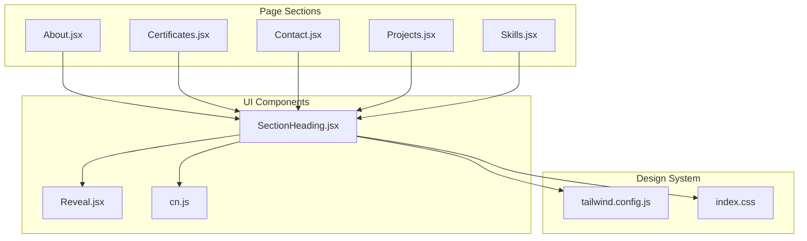
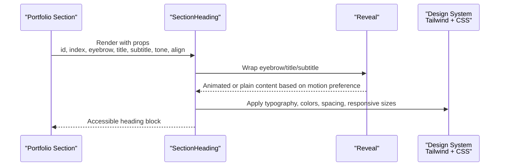
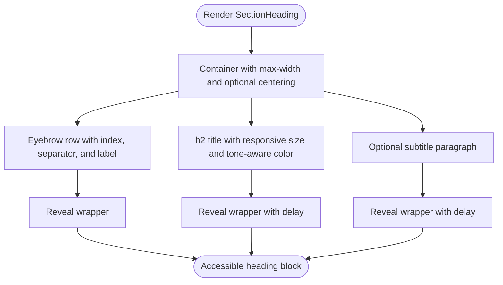
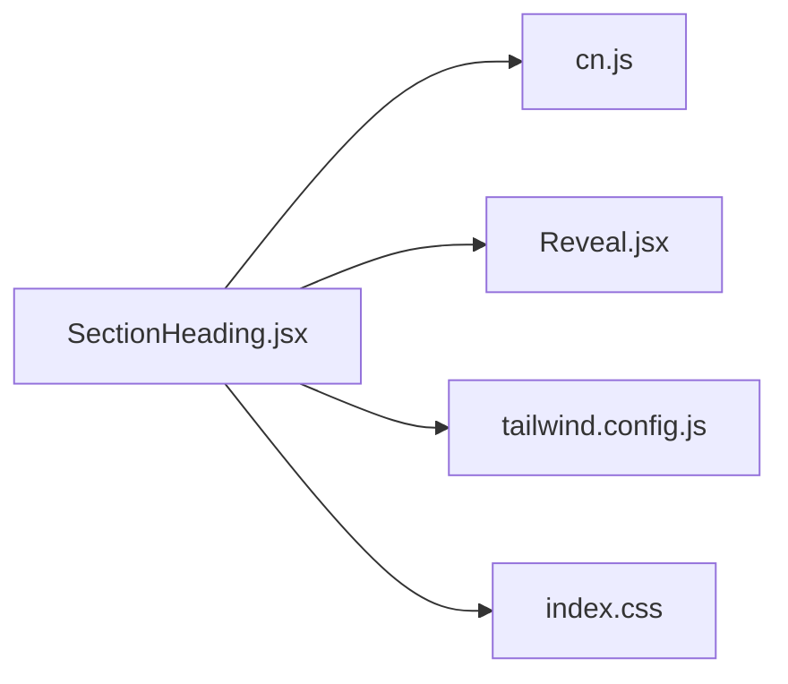

# SectionHeading Component

<cite>
**Referenced Files in This Document**
- [SectionHeading.jsx](file://src/components/ui/SectionHeading.jsx)
- [Reveal.jsx](file://src/components/ui/Reveal.jsx)
- [cn.js](file://src/lib/cn.js)
- [tailwind.config.js](file://tailwind.config.js)
- [index.css](file://src/index.css)
- [About.jsx](file://src/components/About.jsx)
- [Certificates.jsx](file://src/components/Certificates.jsx)
- [Contact.jsx](file://src/components/Contact.jsx)
- [Projects.jsx](file://src/components/Projects.jsx)
- [Skills.jsx](file://src/components/Skills.jsx)
</cite>

## Table of Contents
1. [Introduction](#introduction)
2. [Project Structure](#project-structure)
3. [Core Components](#core-components)
4. [Architecture Overview](#architecture-overview)
5. [Detailed Component Analysis](#detailed-component-analysis)
6. [Dependency Analysis](#dependency-analysis)
7. [Performance Considerations](#performance-considerations)
8. [Troubleshooting Guide](#troubleshooting-guide)
9. [Conclusion](#conclusion)
10. [Appendices](#appendices)

## Introduction
The SectionHeading component is the shared section title system used across portfolio sections. It renders a consistent, accessible heading block with an optional index marker, eyebrow label, main title, and subtitle. It integrates with the design system through Tailwind CSS, uses responsive typography, supports light and dark tones, and provides subtle reveal animations for visual polish.

Its primary responsibilities are:
- Presenting a predictable section header structure
- Maintaining visual consistency across pages
- Supporting responsive text sizing
- Integrating with the site’s color, font, and animation systems
- Providing accessibility-friendly markup for screen readers

## Project Structure
SectionHeading lives under the UI components folder and is reused by multiple page sections. The relevant files are:

**Diagram sources**
- [SectionHeading.jsx:1-70](file://src/components/ui/SectionHeading.jsx#L1-L70)
- [About.jsx:81-87](file://src/components/About.jsx#L81-L87)
- [Certificates.jsx:42-48](file://src/components/Certificates.jsx#L42-L48)
- [Contact.jsx:163-168](file://src/components/Contact.jsx#L163-L168)
- [Projects.jsx:30-37](file://src/components/Projects.jsx#L30-L37)
- [Skills.jsx:33-39](file://src/components/Skills.jsx#L33-L39)

**Section sources**
- [SectionHeading.jsx:1-70](file://src/components/ui/SectionHeading.jsx#L1-L70)
- [About.jsx:81-87](file://src/components/About.jsx#L81-L87)
- [Certificates.jsx:42-48](file://src/components/Certificates.jsx#L42-L48)
- [Contact.jsx:163-168](file://src/components/Contact.jsx#L163-L168)
- [Projects.jsx:30-37](file://src/components/Projects.jsx#L30-L37)
- [Skills.jsx:33-39](file://src/components/Skills.jsx#L33-L39)

## Core Components
This section documents how SectionHeading works and how it fits into the broader system.

### Typography System
- Main title uses a display font family from the design system and applies responsive sizing via a clamp-based scale.
- Eyebrow and index use a monospace font with uppercase styling and wide letter spacing.
- Subtitle uses a readable paragraph style with relaxed line height and responsive base sizing.

These styles align with global defaults that set display fonts for headings and improve text wrapping behavior.

**Section sources**
- [SectionHeading.jsx:21-66](file://src/components/ui/SectionHeading.jsx#L21-L66)
- [tailwind.config.js:47-51](file://tailwind.config.js#L47-L51)
- [index.css:29-41](file://src/index.css#L29-L41)

### Heading Levels Support
- SectionHeading renders its main title as an h2 element.
- This establishes a clear hierarchy when combined with page-level h1 elements elsewhere in the application.
- Each usage passes a unique id to support anchor linking and assistive technology labeling.

**Section sources**
- [SectionHeading.jsx:43-52](file://src/components/ui/SectionHeading.jsx#L43-L52)
- [About.jsx:81-87](file://src/components/About.jsx#L81-L87)
- [Certificates.jsx:42-48](file://src/components/Certificates.jsx#L42-L48)
- [Contact.jsx:163-168](file://src/components/Contact.jsx#L163-L168)
- [Projects.jsx:30-37](file://src/components/Projects.jsx#L30-L37)
- [Skills.jsx:33-39](file://src/components/Skills.jsx#L33-L39)

### Styling Variations
- Tone controls light versus dark presentation.
  - Light tone uses ink-based colors and brand accents.
  - Dark tone switches to white and lighter brand variants for contrast on dark backgrounds.
- Alignment supports left or center layout.
- A container class allows additional custom styling through className.

**Section sources**
- [SectionHeading.jsx:9-18](file://src/components/ui/SectionHeading.jsx#L9-L18)
- [SectionHeading.jsx:21-66](file://src/components/ui/SectionHeading.jsx#L21-L66)
- [Projects.jsx:30-37](file://src/components/Projects.jsx#L30-L37)

### Responsive Text Sizing
- The main title uses a clamp-based responsive scale so it scales smoothly between small and large viewports.
- The subtitle adapts at the small breakpoint to maintain readability.
- Global utilities ensure smooth scrolling and reduced motion preferences are respected.

**Section sources**
- [SectionHeading.jsx:46-60](file://src/components/ui/SectionHeading.jsx#L46-L60)
- [index.css:20-22](file://src/index.css#L20-L22)
- [index.css:140-153](file://src/index.css#L140-L153)

### Animation and Reveal Integration
- Each part of the heading is wrapped in a reveal wrapper.
- The reveal component animates content into view when scrolled into the viewport.
- When users prefer reduced motion, animations are disabled and plain elements are rendered instead.

**Section sources**
- [SectionHeading.jsx:19-66](file://src/components/ui/SectionHeading.jsx#L19-L66)
- [Reveal.jsx:1-34](file://src/components/ui/Reveal.jsx#L1-L34)

### Accessibility Considerations
- The main heading has an id prop passed through for semantic linking and screen reader navigation.
- Decorative elements such as the index number and separator line are visually styled but do not interfere with reading order.
- The component respects reduced motion preferences through its child reveal wrapper.
- Page sections using SectionHeading also provide aria-labelledby attributes pointing to the same ids, improving landmark semantics.

**Section sources**
- [SectionHeading.jsx:43-52](file://src/components/ui/SectionHeading.jsx#L43-L52)
- [Reveal.jsx:16-20](file://src/components/ui/Reveal.jsx#L16-L20)
- [About.jsx:9-12](file://src/components/About.jsx#L9-L12)
- [Certificates.jsx:31-34](file://src/components/Certificates.jsx#L31-L34)
- [Contact.jsx:151-154](file://src/components/Contact.jsx#L151-L154)
- [Projects.jsx:17-20](file://src/components/Projects.jsx#L17-L20)
- [Skills.jsx:26-29](file://src/components/Skills.jsx#L26-L29)

## Architecture Overview
SectionHeading is a presentational component that composes smaller concerns: conditional styling, typography, and scroll-triggered reveal. It depends on the design system for colors, fonts, and spacing, and it is consumed by page sections to keep section headers uniform.

**Diagram sources**
- [SectionHeading.jsx:4-67](file://src/components/ui/SectionHeading.jsx#L4-L67)
- [Reveal.jsx:7-32](file://src/components/ui/Reveal.jsx#L7-L32)
- [tailwind.config.js:12-51](file://tailwind.config.js#L12-L51)
- [index.css:5-27](file://src/index.css#L5-L27)

## Detailed Component Analysis

### Props and Behavior
| Prop | Type | Default | Description |
|---|---|---:|---|
| index | string or number | undefined | Optional numbered marker shown before the eyebrow |
| eyebrow | string | undefined | Small uppercase label above the title |
| title | string | required | Main section title rendered as h2 |
| subtitle | string | undefined | Optional descriptive paragraph below the title |
| tone | string | "light" | Visual theme; "dark" switches to high-contrast colors |
| align | string | "left" | Layout alignment; "center" centers the header block |
| className | string | undefined | Additional classes for customization |
| id | string | undefined | Semantic id for the h2 element |

**Section sources**
- [SectionHeading.jsx:4-13](file://src/components/ui/SectionHeading.jsx#L4-L13)

### Rendering Structure
SectionHeading renders:
- A container div with max width and optional centering
- An eyebrow row containing:
  - Optional index marker
  - A decorative separator line
  - The eyebrow label
- The main h2 title
- An optional subtitle paragraph

Each visible layer is wrapped in a reveal wrapper with staggered delays for a polished entrance effect.

**Diagram sources**
- [SectionHeading.jsx:17-67](file://src/components/ui/SectionHeading.jsx#L17-L67)
- [Reveal.jsx:7-32](file://src/components/ui/Reveal.jsx#L7-L32)

### Design System Integration
- Colors: Uses ink, paper, haze, mist, brand, and accent tokens defined in the Tailwind configuration and CSS variables.
- Fonts: Uses display, sans, and mono families configured in Tailwind.
- Spacing and layout: Uses Tailwind utility classes for margins, gaps, widths, and alignment.
- Motion: Uses Framer Motion through the Reveal component, respecting user motion preferences.

**Section sources**
- [tailwind.config.js:15-51](file://tailwind.config.js#L15-L51)
- [index.css:6-14](file://src/index.css#L6-L14)
- [SectionHeading.jsx:21-66](file://src/components/ui/SectionHeading.jsx#L21-L66)
- [Reveal.jsx:1-34](file://src/components/ui/Reveal.jsx#L1-L34)

### Usage Examples Across the Portfolio
- About section: Uses default light tone with data-driven index, eyebrow, title, and subtitle.
- Certificates section: Uses a fixed index and includes a subtitle.
- Contact section: Uses data-driven index and eyebrow without a subtitle.
- Projects section: Uses tone="dark" for a dark background section.
- Skills section: Uses a fixed index and includes a subtitle.

**Section sources**
- [About.jsx:81-87](file://src/components/About.jsx#L81-L87)
- [Certificates.jsx:42-48](file://src/components/Certificates.jsx#L42-L48)
- [Contact.jsx:163-168](file://src/components/Contact.jsx#L163-L168)
- [Projects.jsx:30-37](file://src/components/Projects.jsx#L30-L37)
- [Skills.jsx:33-39](file://src/components/Skills.jsx#L33-L39)

## Dependency Analysis
SectionHeading has minimal internal dependencies and relies on shared utilities and the design system.

**Diagram sources**
- [SectionHeading.jsx:1-2](file://src/components/ui/SectionHeading.jsx#L1-L2)
- [cn.js:1-7](file://src/lib/cn.js#L1-L7)
- [Reveal.jsx:1-34](file://src/components/ui/Reveal.jsx#L1-L34)
- [tailwind.config.js:1-89](file://tailwind.config.js#L1-L89)
- [index.css:1-154](file://src/index.css#L1-L154)

**Section sources**
- [SectionHeading.jsx:1-70](file://src/components/ui/SectionHeading.jsx#L1-L70)
- [cn.js:1-7](file://src/lib/cn.js#L1-L7)
- [Reveal.jsx:1-34](file://src/components/ui/Reveal.jsx#L1-L34)
- [tailwind.config.js:1-89](file://tailwind.config.js#L1-L89)
- [index.css:1-154](file://src/index.css#L1-L154)

## Performance Considerations
- The component is lightweight and declarative, with no heavy state or side effects.
- Animations are handled by the Reveal component, which falls back to static rendering when reduced motion is preferred.
- Conditional class names are joined efficiently through the cn utility.
- Responsive typography avoids layout thrashing by using clamp-based scaling rather than JavaScript-driven resizing.

[No sources needed since this section provides general guidance]

## Troubleshooting Guide
Common issues and resolutions:

- Title not visible on dark backgrounds
  - Ensure tone="dark" is passed when the parent section has a dark background.
  - Verify that the section itself does not override text colors with conflicting classes.

- Centered heading misaligned
  - Confirm align="center" is passed and that the parent container allows centered content.

- Screen reader cannot find the heading id
  - Pass a unique id prop and ensure the parent section references the same id in aria-labelledby.

- Animations feel too fast or distracting
  - Users with reduced motion preferences will see no animation automatically.
  - If animations still appear, check browser settings and framer-motion reduced motion detection.

- Custom styling not applied
  - Use the className prop to add or override styles.
  - Avoid overriding core semantic elements like h2 unless necessary.

**Section sources**
- [SectionHeading.jsx:9-18](file://src/components/ui/SectionHeading.jsx#L9-L18)
- [SectionHeading.jsx:43-52](file://src/components/ui/SectionHeading.jsx#L43-L52)
- [Reveal.jsx:16-20](file://src/components/ui/Reveal.jsx#L16-L20)

## Conclusion
SectionHeading provides a consistent, accessible, and responsive way to label portfolio sections. By centralizing typography, tone handling, alignment, and reveal animations, it keeps the portfolio visually coherent while remaining flexible enough for custom styling. Its integration with the design system ensures that changes to colors, fonts, or motion behavior propagate consistently across all sections.

[No sources needed since this section summarizes without analyzing specific files]

## Appendices

### Proper Heading Hierarchy Guidance
- Use one h1 per page for the primary page title.
- Use SectionHeading for major section titles, which render as h2.
- Within section content, use lower-level headings only where semantically appropriate.
- Keep ids unique and reference them in aria-labelledby for better navigation.

**Section sources**
- [SectionHeading.jsx:43-52](file://src/components/ui/SectionHeading.jsx#L43-L52)
- [About.jsx:9-12](file://src/components/About.jsx#L9-L12)
- [Certificates.jsx:31-34](file://src/components/Certificates.jsx#L31-L34)
- [Contact.jsx:151-154](file://src/components/Contact.jsx#L151-L154)
- [Projects.jsx:17-20](file://src/components/Projects.jsx#L17-L20)
- [Skills.jsx:26-29](file://src/components/Skills.jsx#L26-L29)

### Custom Styling Options
- Override container width or padding through className.
- Adjust eyebrow or subtitle appearance by extending the component or wrapping it in a styled container.
- Combine with other UI components such as chips or buttons alongside the heading.

**Section sources**
- [SectionHeading.jsx:11-18](file://src/components/ui/SectionHeading.jsx#L11-L18)
- [About.jsx:81-87](file://src/components/About.jsx#L81-L87)
- [Skills.jsx:33-39](file://src/components/Skills.jsx#L33-L39)