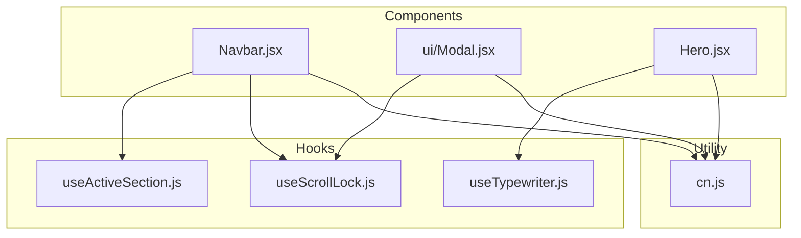
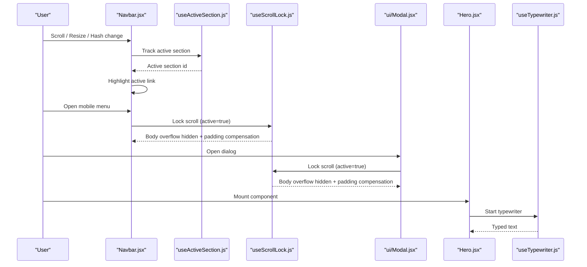
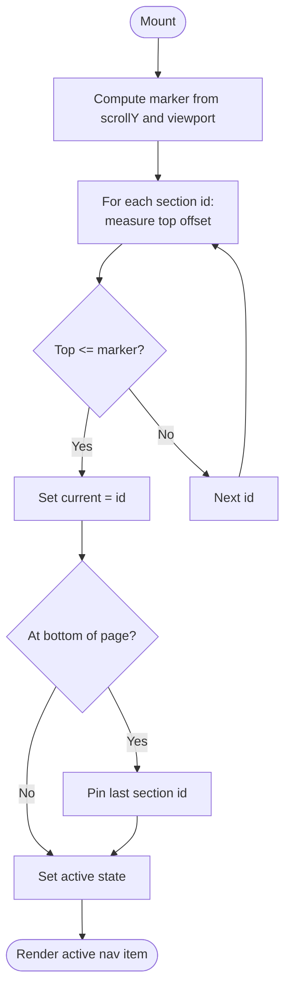
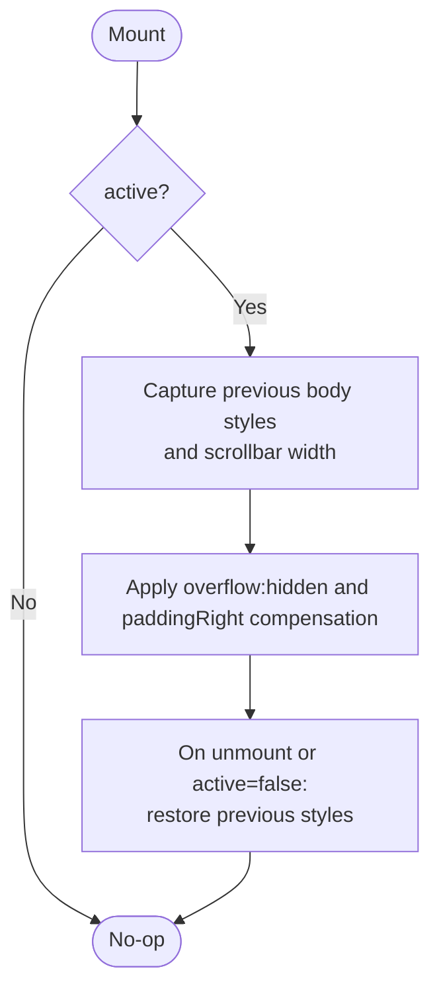
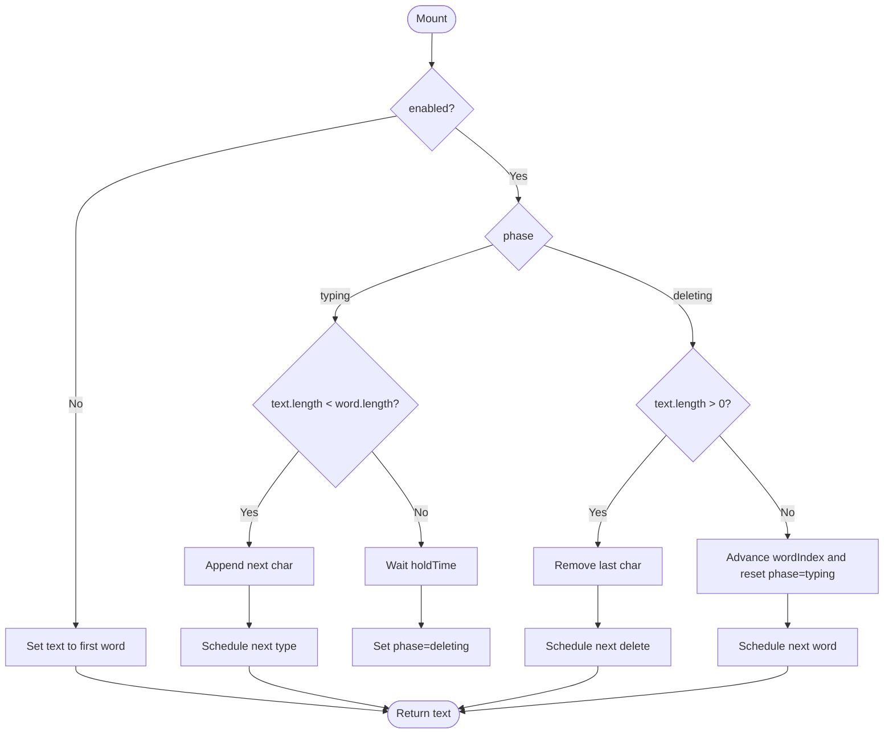
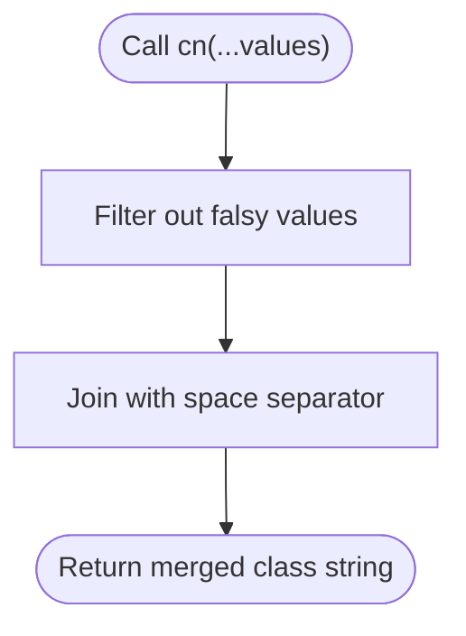
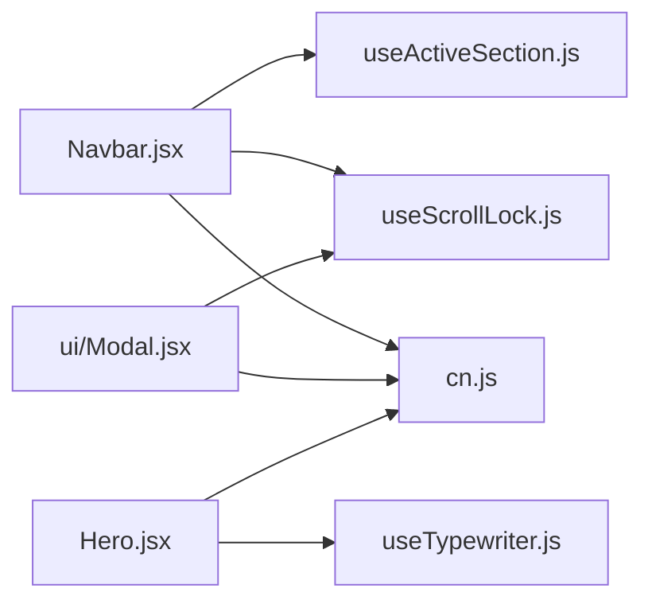

# Custom Hooks & Utilities

<cite>
**Referenced Files in This Document**
- [useActiveSection.js](file://src/hooks/useActiveSection.js)
- [useScrollLock.js](file://src/hooks/useScrollLock.js)
- [useTypewriter.js](file://src/hooks/useTypewriter.js)
- [cn.js](file://src/lib/cn.js)
- [Navbar.jsx](file://src/components/Navbar.jsx)
- [Modal.jsx](file://src/components/ui/Modal.jsx)
- [Hero.jsx](file://src/components/Hero.jsx)
</cite>

## Table of Contents
1. [Introduction](#introduction)
2. [Project Structure](#project-structure)
3. [Core Components](#core-components)
4. [Architecture Overview](#architecture-overview)
5. [Detailed Component Analysis](#detailed-component-analysis)
6. [Dependency Analysis](#dependency-analysis)
7. [Performance Considerations](#performance-considerations)
8. [Troubleshooting Guide](#troubleshooting-guide)
9. [Conclusion](#conclusion)

## Introduction
This document explains the custom React hooks and utility functions that power navigation state, modal behavior, text animations, and class name composition across the application:
- useActiveSection: Tracks the currently visible section for navigation highlighting.
- useScrollLock: Locks page scrolling while overlays or modals are open without layout shift.
- useTypewriter: Provides a rotating typewriter effect with accessibility-friendly reduced motion support.
- cn: A small utility to join conditional class names safely.

These utilities encapsulate common UI behaviors, improve code reusability, and keep components focused on presentation and user interactions.

## Project Structure
The hooks live under src/hooks, the utility under src/lib, and they are consumed by presentational components such as Navbar, Modal, and Hero.

**Diagram sources**
- [useActiveSection.js:1-46](file://src/hooks/useActiveSection.js#L1-L46)
- [useScrollLock.js:1-24](file://src/hooks/useScrollLock.js#L1-L24)
- [useTypewriter.js:1-44](file://src/hooks/useTypewriter.js#L1-L44)
- [cn.js:1-7](file://src/lib/cn.js#L1-L7)
- [Navbar.jsx:1-218](file://src/components/Navbar.jsx#L1-L218)
- [Modal.jsx:1-131](file://src/components/ui/Modal.jsx#L1-L131)
- [Hero.jsx:1-149](file://src/components/Hero.jsx#L1-L149)

**Section sources**
- [useActiveSection.js:1-46](file://src/hooks/useActiveSection.js#L1-L46)
- [useScrollLock.js:1-24](file://src/hooks/useScrollLock.js#L1-L24)
- [useTypewriter.js:1-44](file://src/hooks/useTypewriter.js#L1-L44)
- [cn.js:1-7](file://src/lib/cn.js#L1-L7)
- [Navbar.jsx:1-218](file://src/components/Navbar.jsx#L1-L218)
- [Modal.jsx:1-131](file://src/components/ui/Modal.jsx#L1-L131)
- [Hero.jsx:1-149](file://src/components/Hero.jsx#L1-L149)

## Core Components
- useActiveSection(sectionIds): Returns the id of the section currently in view based on measured positions. Used to highlight active navigation items.
- useScrollLock(active): Disables body scrolling when an overlay is open and preserves layout by compensating for scrollbar width.
- useTypewriter(words, options): Produces a rotating typewriter effect; supports reduced motion via enabled flag.
- cn(...values): Joins truthy values into a single space-separated string for safe Tailwind class composition.

**Section sources**
- [useActiveSection.js:1-46](file://src/hooks/useActiveSection.js#L1-L46)
- [useScrollLock.js:1-24](file://src/hooks/useScrollLock.js#L1-L24)
- [useTypewriter.js:1-44](file://src/hooks/useTypewriter.js#L1-L44)
- [cn.js:1-7](file://src/lib/cn.js#L1-L7)

## Architecture Overview
The hooks provide reusable behaviors that components compose together:
- Navbar uses useActiveSection to compute active links and useScrollLock to prevent background scrolling when the mobile menu is open.
- Modal uses useScrollLock to lock scrolling behind the dialog and provides focus management and keyboard handling.
- Hero uses useTypewriter to animate role titles and respects reduced motion preferences.

**Diagram sources**
- [Navbar.jsx:10-18](file://src/components/Navbar.jsx#L10-L18)
- [useActiveSection.js:11-42](file://src/hooks/useActiveSection.js#L11-L42)
- [useScrollLock.js:7-22](file://src/hooks/useScrollLock.js#L7-L22)
- [Modal.jsx:29-74](file://src/components/ui/Modal.jsx#L29-L74)
- [Hero.jsx:9-10](file://src/components/Hero.jsx#L9-L10)
- [useTypewriter.js:15-40](file://src/hooks/useTypewriter.js#L15-L40)

## Detailed Component Analysis

### useActiveSection
Purpose
- Highlights the current section in navigation by measuring element positions relative to the viewport. It also pins the last section at the bottom of the page.

API
- Parameters: ids (string[]): IDs of sections to track.
- Returns: string: The currently active section id.

Behavior
- Computes a marker using scroll position and viewport height.
- Iterates through provided ids, measures each element’s top offset, and updates the active id when the element crosses the marker.
- Pins the final section when scrolled to the very bottom.
- Subscribes to scroll, resize, and hashchange events with passive listeners where appropriate.
- Cleans up event listeners on unmount.

Usage Example
- In Navbar, pass the list of navigation section ids to derive the active link style.

Implementation Notes
- Uses getBoundingClientRect combined with window.scrollY for accurate measurements even with sticky headers.
- Avoids unnecessary work by recomputing only when the key changes.

Performance Considerations
- Event handlers are passive to minimize main-thread blocking during scroll.
- Recomputation runs on scroll/resize/hashchange; consider debouncing if performance becomes critical.

Best Practices
- Ensure all referenced ids exist in the DOM.
- Keep the ids array stable to avoid unnecessary recalculations.

**Diagram sources**
- [useActiveSection.js:11-42](file://src/hooks/useActiveSection.js#L11-L42)

**Section sources**
- [useActiveSection.js:1-46](file://src/hooks/useActiveSection.js#L1-L46)
- [Navbar.jsx:10-18](file://src/components/Navbar.jsx#L10-L18)

### useScrollLock
Purpose
- Prevents background page scrolling when an overlay or modal is open, while avoiding layout shifts caused by disappearing scrollbars.

API
- Parameters: active (boolean): Whether the overlay/modal is open.
- Returns: void (side-effect hook).

Behavior
- When active is true:
  - Stores previous body styles for overflow and paddingRight.
  - Sets body.overflow to 'hidden'.
  - Compensates for scrollbar width by setting body.paddingRight to match the lost width.
- On cleanup or when active becomes false:
  - Restores previous overflow and paddingRight values.

Usage Example
- Call inside Navbar when the mobile menu is open.
- Call inside Modal whenever it is opened.

Implementation Notes
- Measures scrollbar width by comparing innerWidth with clientWidth.
- Ensures restoration of original styles even on unmount.

Performance Considerations
- Minimal DOM writes; only runs when active changes.

Best Practices
- Always pair with a component that controls the open state to ensure proper cleanup.
- Use alongside focus management for accessible overlays.

**Diagram sources**
- [useScrollLock.js:7-22](file://src/hooks/useScrollLock.js#L7-L22)

**Section sources**
- [useScrollLock.js:1-24](file://src/hooks/useScrollLock.js#L1-L24)
- [Navbar.jsx:18](file://src/components/Navbar.jsx#L18)
- [Modal.jsx:29](file://src/components/ui/Modal.jsx#L29)

### useTypewriter
Purpose
- Creates a rotating typewriter effect for a set of words, with support for reduced motion preferences.

API
- Parameters:
  - words (string[]): Array of words/phrases to cycle through.
  - options (object, optional):
    - typeSpeed (number, default ~62ms): Speed of typing characters.
    - deleteSpeed (number, default ~28ms): Speed of deleting characters.
    - holdTime (number, default ~1500ms): Pause before deleting.
    - enabled (boolean, default true): If false, renders the first word statically.
- Returns: string: The currently displayed text.

Behavior
- Manages three phases: typing, holding, and deleting.
- Cycles through words and updates state via timers.
- Clears timers on cleanup to prevent memory leaks.
- When disabled, sets text to the first word immediately.

Usage Example
- In Hero, pass roles data and disable animation when reduced motion is preferred.

Implementation Notes
- Uses setTimeout-based scheduling for smooth character-by-character updates.
- Resets index and phase after deletion completes.

Performance Considerations
- Frequent setState calls per character; acceptable for short strings.
- Consider memoizing heavy computations around this hook if used extensively.

Best Practices
- Provide reasonable timing values to balance readability and performance.
- Respect reduced motion by disabling the effect when needed.

**Diagram sources**
- [useTypewriter.js:15-40](file://src/hooks/useTypewriter.js#L15-L40)

**Section sources**
- [useTypewriter.js:1-44](file://src/hooks/useTypewriter.js#L1-L44)
- [Hero.jsx:9-10](file://src/components/Hero.jsx#L9-L10)

### cn Utility
Purpose
- Safely joins conditional class names by filtering out falsy values and joining them with spaces.

API
- Parameters: ...values (any[]): Any number of class name strings or expressions that resolve to strings or falsy values.
- Returns: string: Space-separated class names.

Usage Example
- Compose dynamic classes in components like Button, Chip, Modal, SectionHeading, Navbar, Contact, Skills, and Certificates.

Implementation Notes
- Simple filter-and-join approach; no dependencies.

Performance Considerations
- Extremely lightweight; negligible overhead.

Best Practices
- Prefer passing static strings and boolean conditions rather than computed objects to keep usage clear.

**Diagram sources**
- [cn.js:4-5](file://src/lib/cn.js#L4-L5)

**Section sources**
- [cn.js:1-7](file://src/lib/cn.js#L1-L7)
- [Navbar.jsx:48-82](file://src/components/Navbar.jsx#L48-L82)
- [Modal.jsx:104-106](file://src/components/ui/Modal.jsx#L104-L106)

## Dependency Analysis
The following diagram shows how components depend on hooks and the utility:

**Diagram sources**
- [Navbar.jsx:5-7](file://src/components/Navbar.jsx#L5-L7)
- [Modal.jsx:5-6](file://src/components/ui/Modal.jsx#L5-L6)
- [Hero.jsx:4-5](file://src/components/Hero.jsx#L4-L5)
- [useActiveSection.js:1-46](file://src/hooks/useActiveSection.js#L1-L46)
- [useScrollLock.js:1-24](file://src/hooks/useScrollLock.js#L1-L24)
- [useTypewriter.js:1-44](file://src/hooks/useTypewriter.js#L1-L44)
- [cn.js:1-7](file://src/lib/cn.js#L1-L7)

**Section sources**
- [Navbar.jsx:1-218](file://src/components/Navbar.jsx#L1-L218)
- [Modal.jsx:1-131](file://src/components/ui/Modal.jsx#L1-L131)
- [Hero.jsx:1-149](file://src/components/Hero.jsx#L1-L149)

## Performance Considerations
- useActiveSection:
  - Uses passive scroll listeners to reduce jank.
  - Recomputes on scroll, resize, and hashchange; consider throttling/debouncing if many sections cause heavy layouts.
- useScrollLock:
  - Minimal DOM mutations; ensure it is only toggled when necessary.
- useTypewriter:
  - Frequent state updates per character; keep word lists short and timings reasonable.
  - Disable animation for users with reduced motion preferences.
- cn:
  - Negligible cost; safe to use liberally.

[No sources needed since this section provides general guidance]

## Troubleshooting Guide
- Active section not updating:
  - Verify that all section ids passed to useActiveSection exist in the DOM.
  - Ensure elements have unique ids matching the provided array.
  - Check for dynamic content that may render after initial mount; confirm that ids are available before tracking starts.
- Background scrolling still occurs with modals:
  - Confirm useScrollLock(open) is called with the correct open state.
  - Ensure no other code overrides body.style.overflow or paddingRight.
- Typewriter not animating:
  - Check the enabled flag; when false, the hook renders the first word statically.
  - Validate that words array is non-empty.
- Class names not applied:
  - Ensure you pass strings or boolean expressions to cn; arrays or objects will be filtered out.
  - Inspect the rendered className to verify merging behavior.

**Section sources**
- [useActiveSection.js:11-42](file://src/hooks/useActiveSection.js#L11-L42)
- [useScrollLock.js:7-22](file://src/hooks/useScrollLock.js#L7-L22)
- [useTypewriter.js:15-40](file://src/hooks/useTypewriter.js#L15-L40)
- [cn.js:4-5](file://src/lib/cn.js#L4-L5)

## Conclusion
These hooks and the cn utility encapsulate core UI behaviors—navigation state tracking, scroll locking for overlays, animated text, and robust class composition—into reusable, testable units. By centralizing these concerns, components remain declarative and focused on presentation, improving maintainability and consistency across the application.

[No sources needed since this section summarizes without analyzing specific files]