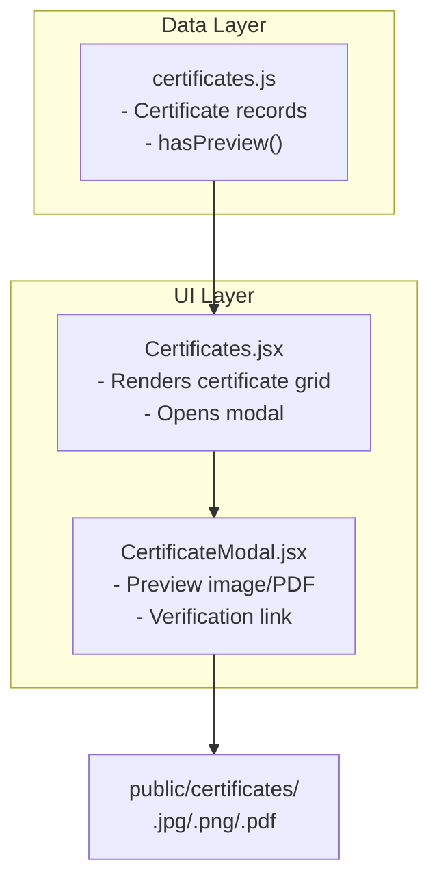
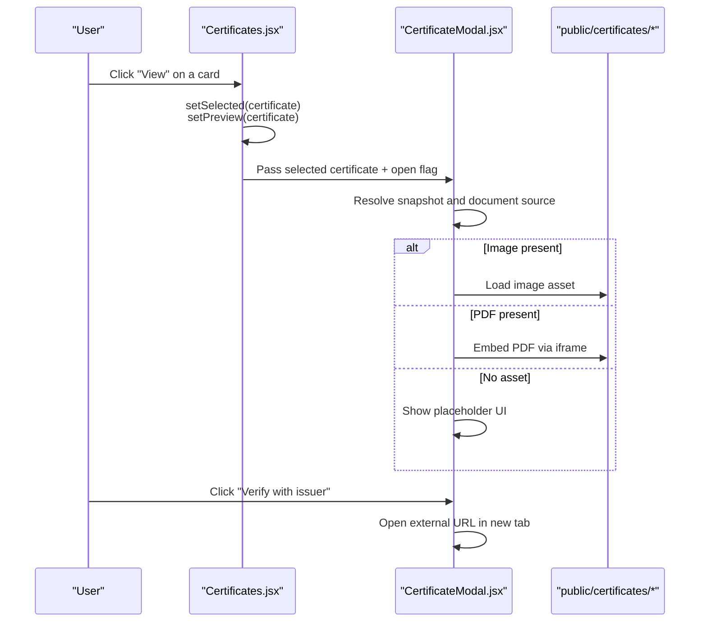
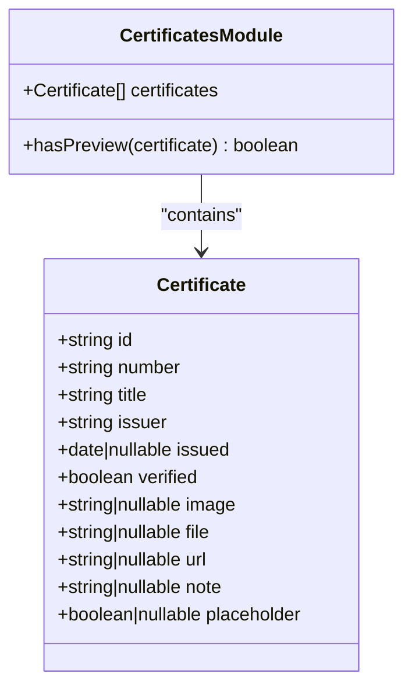
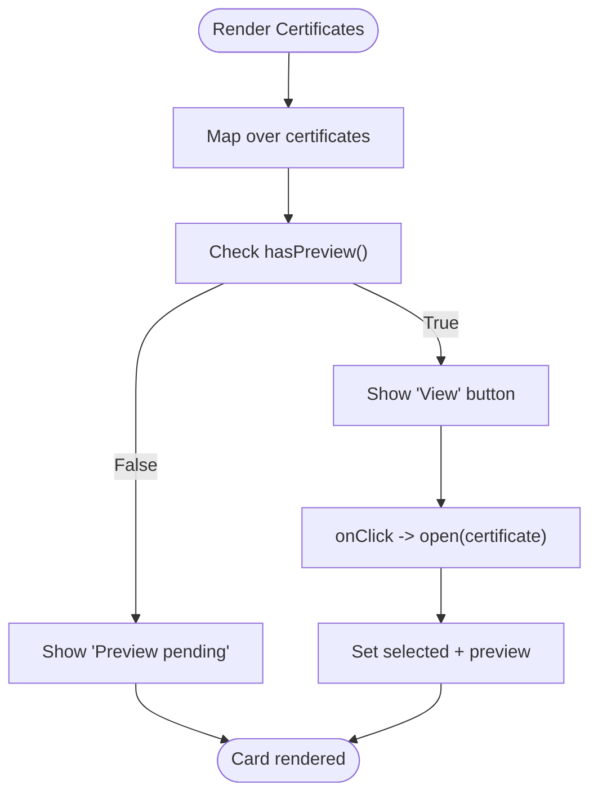
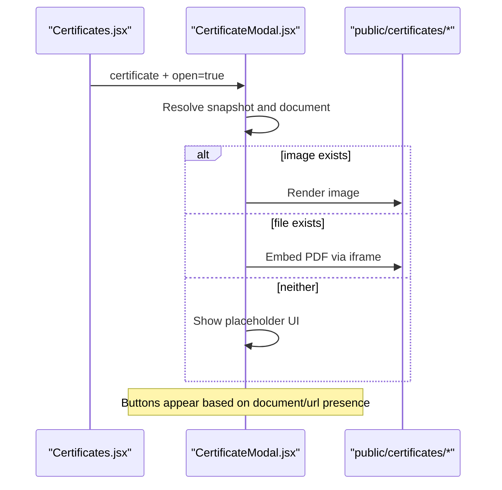
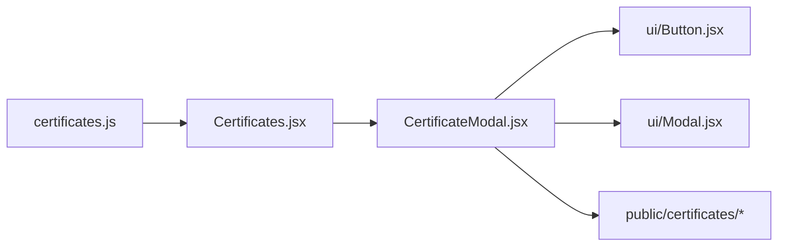

# Certificates Management

<cite>
**Referenced Files in This Document**
- [certificates.js](file://src/data/certificates.js)
- [Certificates.jsx](file://src/components/Certificates.jsx)
- [CertificateModal.jsx](file://src/components/CertificateModal.jsx)
- [README.txt](file://public/certificates/README.txt)
</cite>

## Table of Contents
1. [Introduction](#introduction)
2. [Project Structure](#project-structure)
3. [Core Components](#core-components)
4. [Architecture Overview](#architecture-overview)
5. [Detailed Component Analysis](#detailed-component-analysis)
6. [Dependency Analysis](#dependency-analysis)
7. [Performance Considerations](#performance-considerations)
8. [Troubleshooting Guide](#troubleshooting-guide)
9. [Conclusion](#conclusion)
10. [Appendices](#appendices)

## Introduction
This document explains the certificates management system used to display and verify credentials on the portfolio site. It covers the certificate data model, how certificates are organized and filtered, how the gallery renders cards, and how preview modals handle images, PDFs, and verification links. It also provides practical guidance for adding new certificates, updating verification information, managing lifecycle states, and ensuring accessibility.

## Project Structure
The certificates feature is implemented with a small, focused set of files:
- Data model and helper utilities live in a single data file.
- The gallery component renders the certificate grid and opens the modal.
- The modal component handles preview rendering and external verification links.
- Static assets (images and PDFs) are stored under a public directory and referenced by path.

**Diagram sources**
- [certificates.js:1-116](file://src/data/certificates.js#L1-L116)
- [Certificates.jsx:1-153](file://src/components/Certificates.jsx#L1-L153)
- [CertificateModal.jsx:1-117](file://src/components/CertificateModal.jsx#L1-L117)
- [README.txt:1-9](file://public/certificates/README.txt#L1-L9)

**Section sources**
- [certificates.js:1-116](file://src/data/certificates.js#L1-L116)
- [Certificates.jsx:1-153](file://src/components/Certificates.jsx#L1-L153)
- [CertificateModal.jsx:1-117](file://src/components/CertificateModal.jsx#L1-L117)
- [README.txt:1-9](file://public/certificates/README.txt#L1-L9)

## Core Components
- Certificate data model: A structured array of certificate objects plus a helper function that determines whether a certificate can be previewed.
- Gallery component: Renders a responsive grid of certificate cards, filters out placeholders, and controls modal state.
- Modal component: Displays certificate details, previews attached media, and exposes verification actions.

Key responsibilities:
- Data layer defines the shape of each certificate and whether it has previewable content.
- Gallery layer maps over certificates, computes preview availability, and manages selection state.
- Modal layer renders either an image or embedded PDF and provides buttons to open documents or verify externally.

**Section sources**
- [certificates.js:1-116](file://src/data/certificates.js#L1-L116)
- [Certificates.jsx:1-153](file://src/components/Certificates.jsx#L1-L153)
- [CertificateModal.jsx:1-117](file://src/components/CertificateModal.jsx#L1-L117)

## Architecture Overview
The system follows a simple unidirectional flow:
- The gallery reads from the static certificate data.
- User interaction selects a certificate and opens the modal.
- The modal renders available assets and optional verification links.

**Diagram sources**
- [Certificates.jsx:20-28](file://src/components/Certificates.jsx#L20-L28)
- [Certificates.jsx:57-138](file://src/components/Certificates.jsx#L57-L138)
- [CertificateModal.jsx:6-14](file://src/components/CertificateModal.jsx#L6-L14)
- [CertificateModal.jsx:61-101](file://src/components/CertificateModal.jsx#L61-L101)

## Detailed Component Analysis

### Certificate Data Model
The certificate object includes fields for identification, presentation, verification, and assets:
- id: Unique identifier for the certificate entry.
- number: Display order or badge number.
- title: Human-readable certificate name.
- issuer: Organization or program that issued the credential.
- issued: Issue date; may be null if not listed.
- verified: Boolean indicating whether the details are verified.
- image: Path to an image asset for preview.
- file: Path to a PDF asset for preview.
- url: External verification link provided by the issuer.
- note: Optional description or context.
- placeholder: Reserved slot marker; these entries are visually distinct and not interactive.

A helper function determines whether a certificate has any previewable content by checking for image, file, or url.

Complexity considerations:
- Reading and filtering certificates is O(n) where n is the number of entries.
- hasPreview is O(1).

Error handling:
- Missing assets result in disabled preview or placeholder UI.
- Null issue dates render a friendly fallback label.

Optimization opportunities:
- Precompute previewability at data load time if performance becomes critical.
- Lazy-load large images and PDFs only when the modal is opened.

Accessibility:
- Placeholder slots use visual distinction and non-interactive labels.
- Verified badges and status text provide clear context.

**Section sources**
- [certificates.js:1-116](file://src/data/certificates.js#L1-L116)

#### Class-like Data Model Diagram

**Diagram sources**
- [certificates.js:12-115](file://src/data/certificates.js#L12-L115)

### Gallery Component
Responsibilities:
- Render a responsive grid of certificate cards.
- Compute preview availability using the helper function.
- Distinguish placeholder slots from real certificates.
- Manage modal state (selected certificate and open flag).
- Provide accessible labels and screen-reader-only text for view actions.

Rendering logic:
- Each card shows the issuer initials or a placeholder indicator, the certificate number, title, issuer, and issue date.
- If previewable, a “View” button opens the modal; otherwise, a “Preview pending” label is shown.
- Cards animate into view with staggered delays.

State management:
- selected holds the currently chosen certificate for potential future use.
- preview controls the modal’s visibility.

Accessibility:
- Section uses aria-labelledby.
- View buttons include sr-only text describing the target certificate.
- Decorative elements use aria-hidden.

Performance:
- Rendering is straightforward mapping over a small dataset.
- Staggered reveal animations add minimal overhead.

**Section sources**
- [Certificates.jsx:1-153](file://src/components/Certificates.jsx#L1-L153)

#### Gallery Flowchart

**Diagram sources**
- [Certificates.jsx:57-138](file://src/components/Certificates.jsx#L57-L138)
- [Certificates.jsx:25-28](file://src/components/Certificates.jsx#L25-L28)

### Modal Component
Responsibilities:
- Display certificate details including title, issuer, issue date, and note.
- Render an image or embed a PDF based on available assets.
- Provide buttons to open the document or verify externally.
- Maintain accessibility through proper labeling and focus behavior delegated to the base Modal.

Preview resolution:
- Resolves the active data from props or internal snapshot.
- Chooses between image and PDF; otherwise shows a placeholder explaining that no file is attached yet.

Verification link handling:
- If a url is present, displays a “Verify with issuer” button that opens the link in a new tab with safe attributes.

Accessibility:
- Uses labelledBy for the modal header.
- Provides descriptive alt text for images and titles for iframes.
- Close action is explicit and keyboard-friendly via the base Modal.

Performance:
- Only loads assets when the modal is open.
- Uses lazy loading for images.

**Section sources**
- [CertificateModal.jsx:1-117](file://src/components/CertificateModal.jsx#L1-L117)

#### Modal Sequence Diagram

**Diagram sources**
- [CertificateModal.jsx:6-14](file://src/components/CertificateModal.jsx#L6-L14)
- [CertificateModal.jsx:61-101](file://src/components/CertificateModal.jsx#L61-L101)

## Dependency Analysis
- Certificates.jsx imports the certificate data and helper function.
- CertificateModal.jsx depends on shared UI primitives (Button, Modal).
- Both components rely on static assets under public/certificates.

**Diagram sources**
- [Certificates.jsx:1-7](file://src/components/Certificates.jsx#L1-L7)
- [CertificateModal.jsx:1-4](file://src/components/CertificateModal.jsx#L1-L4)
- [certificates.js:1-116](file://src/data/certificates.js#L1-L116)

**Section sources**
- [Certificates.jsx:1-7](file://src/components/Certificates.jsx#L1-L7)
- [CertificateModal.jsx:1-4](file://src/components/CertificateModal.jsx#L1-L4)
- [certificates.js:1-116](file://src/data/certificates.js#L1-L116)

## Performance Considerations
- Keep the certificate dataset small and precomputed; current implementation is efficient for typical portfolio sizes.
- Use lazy loading for images and avoid embedding large PDFs unless necessary; consider linking to external hosted versions for heavy assets.
- Avoid unnecessary re-renders by keeping modal state minimal and stable.

[No sources needed since this section provides general guidance]

## Troubleshooting Guide
Common issues and resolutions:
- Preview not opening: Ensure the certificate has at least one of image, file, or url. Cards without previewable content show “Preview pending.”
- Blank modal: Verify that the referenced asset path exists under public/certificates and matches the path in the certificate record.
- Verification link not working: Confirm that the url field points to a valid issuer verification page.
- Placeholder slots appearing interactive: Placeholder entries are intentionally non-interactive; remove placeholder flags once real data is added.

Operational checks:
- Confirm that hasPreview returns true for certificates intended to be previewable.
- Validate that all asset paths are absolute relative to the public folder root.

**Section sources**
- [certificates.js:113-115](file://src/data/certificates.js#L113-L115)
- [Certificates.jsx:118-132](file://src/components/Certificates.jsx#L118-L132)
- [CertificateModal.jsx:61-101](file://src/components/CertificateModal.jsx#L61-L101)

## Conclusion
The certificates management system provides a clean, accessible way to showcase verified credentials. The data model separates identity, metadata, verification, and assets, while the gallery and modal components render and interact with those records efficiently. By following the guidelines below, you can confidently extend and maintain the system as new credentials are added.

[No sources needed since this section summarizes without analyzing specific files]

## Appendices

### How to Add a New Certificate
Steps:
1. Place the certificate image or PDF under public/certificates.
2. Add a new entry to the certificates array with:
   - id: unique string
   - number: two-digit sequence
   - title: certificate name
   - issuer: issuing organization
   - issued: issue date or null
   - verified: true if details are confirmed
   - image or file: path to the asset
   - url: optional verification link
   - note: optional description
3. Remove placeholder flags if replacing a reserved slot.
4. Test the gallery card and modal preview.

Asset references example format:
- image: '/certificates/python-essentials-1.jpg'
- file: '/certificates/python-essentials-1.pdf'
- url: 'https://www.credly.com/badges/...'

Supported formats:
- image: .jpg, .jpeg, .png, .webp
- file: .pdf

**Section sources**
- [README.txt:1-9](file://public/certificates/README.txt#L1-L9)
- [certificates.js:1-116](file://src/data/certificates.js#L1-L116)

### Updating Verification Information
To update verification details:
- Update the url field with the issuer’s verification link.
- Mark verified as true if the details have been confirmed.
- Optionally add a note explaining the verification process.

Behavior:
- When url is present, the modal shows a “Verify with issuer” button.
- The gallery indicates that only verified details are listed.

**Section sources**
- [CertificateModal.jsx:96-101](file://src/components/CertificateModal.jsx#L96-L101)
- [Certificates.jsx:49-54](file://src/components/Certificates.jsx#L49-L54)

### Managing Certificate Lifecycle
Lifecycle states:
- Reserved: placeholder entries marked with placeholder; not interactive.
- Pending: real entries without assets; show “Preview pending.”
- Active: entries with image/file/url; show “View” and open modal.
- Verified: entries with verified flag; displayed with verification indicators.

Recommendations:
- Start with placeholder slots for upcoming credentials.
- Move to pending once details are known but assets are missing.
- Activate when assets or verification links are available.
- Mark verified after confirming authenticity.

**Section sources**
- [certificates.js:1-116](file://src/data/certificates.js#L1-L116)
- [Certificates.jsx:57-138](file://src/components/Certificates.jsx#L57-L138)
- [CertificateModal.jsx:35-40](file://src/components/CertificateModal.jsx#L35-L40)

### Accessibility Considerations
- Use semantic headings and aria-labelledby for sections and modals.
- Provide descriptive alt text for certificate images and titles for embedded PDFs.
- Include sr-only text for icon-only actions like “View”.
- Ensure decorative elements are hidden from assistive technologies.
- Keep focus management handled by the base Modal component.

**Section sources**
- [Certificates.jsx:31-34](file://src/components/Certificates.jsx#L31-L34)
- [Certificates.jsx:118-127](file://src/components/Certificates.jsx#L118-L127)
- [CertificateModal.jsx:17-23](file://src/components/CertificateModal.jsx#L17-L23)
- [CertificateModal.jsx:63-74](file://src/components/CertificateModal.jsx#L63-L74)