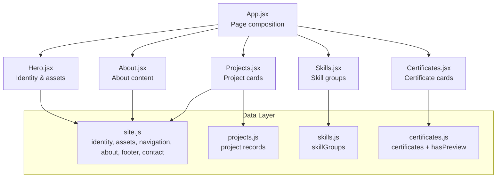
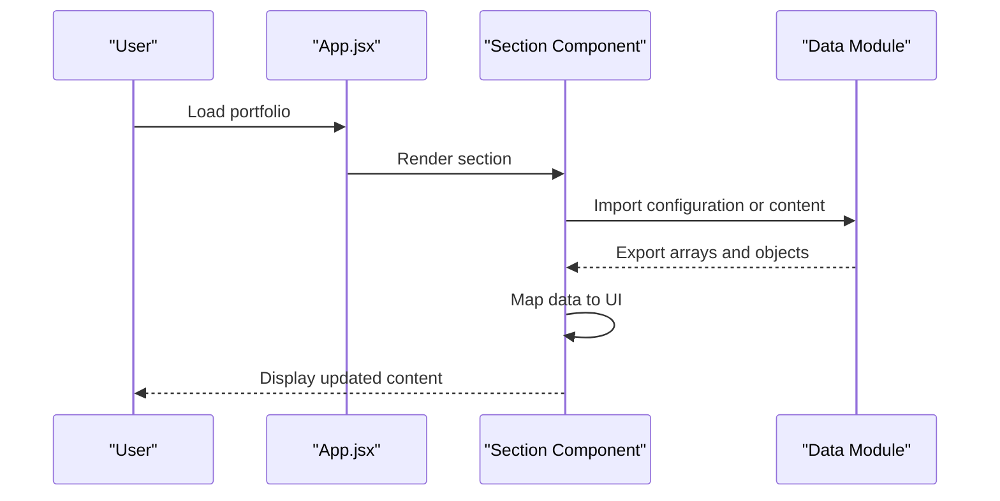
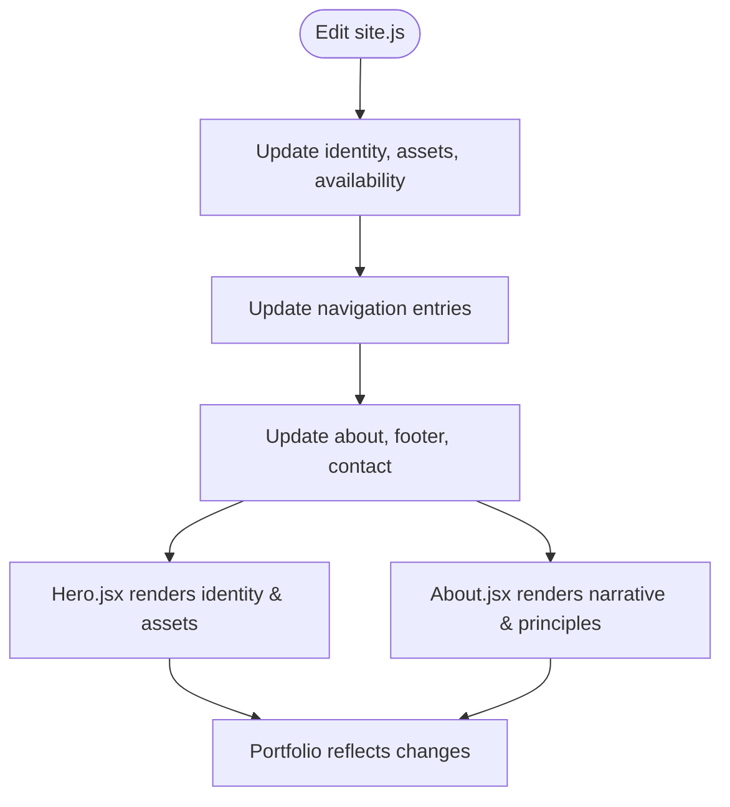
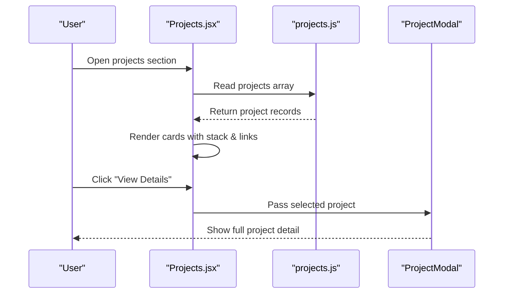
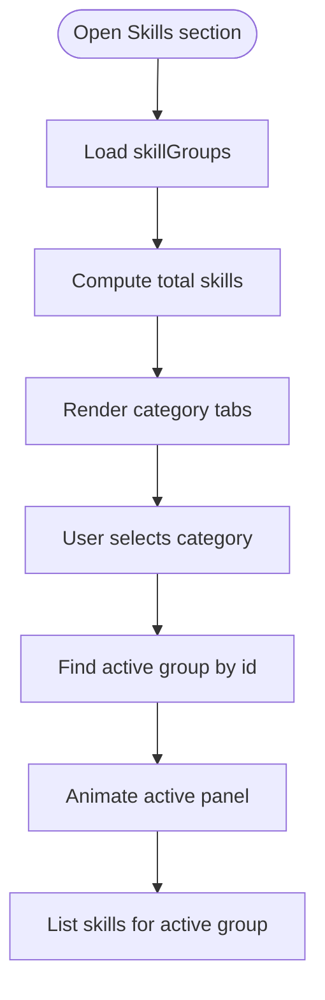
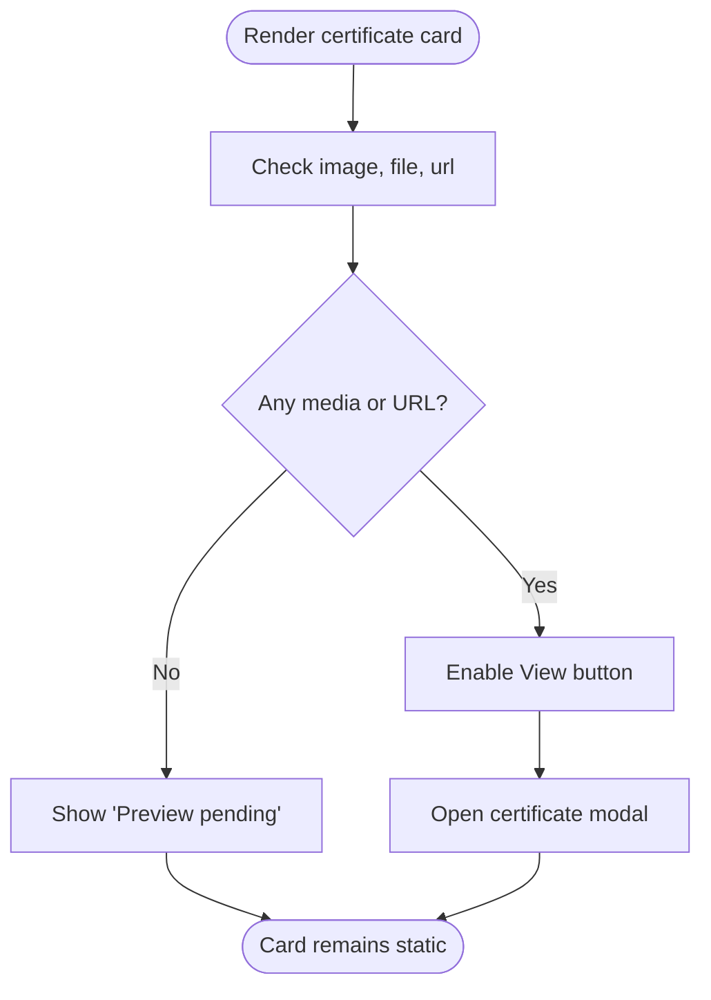
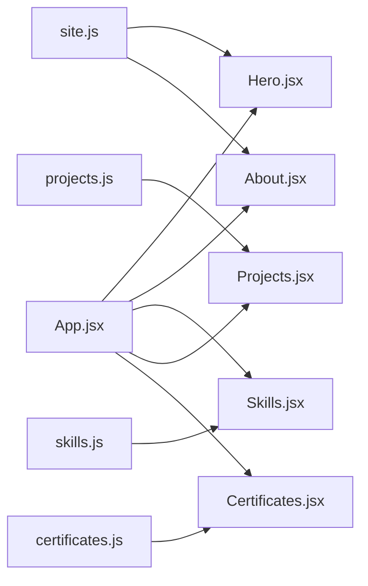

# Data Management

<cite>
**Referenced Files in This Document**
- [site.js](file://src/data/site.js)
- [projects.js](file://src/data/projects.js)
- [skills.js](file://src/data/skills.js)
- [certificates.js](file://src/data/certificates.js)
- [App.jsx](file://src/App.jsx)
- [Hero.jsx](file://src/components/Hero.jsx)
- [About.jsx](file://src/components/About.jsx)
- [Projects.jsx](file://src/components/Projects.jsx)
- [Skills.jsx](file://src/components/Skills.jsx)
- [Certificates.jsx](file://src/components/Certificates.jsx)
</cite>

## Table of Contents
1. [Introduction](#introduction)
2. [Project Structure](#project-structure)
3. [Core Components](#core-components)
4. [Architecture Overview](#architecture-overview)
5. [Detailed Component Analysis](#detailed-component-analysis)
6. [Dependency Analysis](#dependency-analysis)
7. [Performance Considerations](#performance-considerations)
8. [Troubleshooting Guide](#troubleshooting-guide)
9. [Guidelines for Updating Content Without Code Changes](#guidelines-for-updating-content-without-code-changes)
10. [Conclusion](#conclusion)

## Introduction
This portfolio uses a configuration-driven architecture: most visible content is stored in plain JavaScript data files under `src/data`, and React components read that data at render time. The main benefit is that updating identity, branding, navigation, projects, skills, or certificates usually requires editing only the relevant data file, not component logic.

The central data areas are:
- Site configuration: identity, assets, availability, navigation, about section, footer, and contact text.
- Projects: case studies with metadata, descriptions, stack tags, links, and detailed sections.
- Skills: categories, icons, blurbs, and technology lists without proficiency percentages.
- Certificates: verification status, optional image/file/url, placeholder slots, and preview support.

## Project Structure
The data layer lives in `src/data`. Each major content area has its own module:
- `site.js` holds site-wide configuration.
- `projects.js` exports an array of project records.
- `skills.js` exports grouped skill categories.
- `certificates.js` exports certificate records and a helper to determine whether a certificate can be previewed.

Components import these modules and render the data declaratively. The root application component composes the page sections but does not contain business content itself.

**Diagram sources**
- [App.jsx:1-32](file://src/App.jsx#L1-L32)
- [Hero.jsx:1-149](file://src/components/Hero.jsx#L1-L149)
- [About.jsx:1-148](file://src/components/About.jsx#L1-L148)
- [Projects.jsx:1-143](file://src/components/Projects.jsx#L1-L143)
- [Skills.jsx:1-187](file://src/components/Skills.jsx#L1-L187)
- [Certificates.jsx:1-153](file://src/components/Certificates.jsx#L1-L153)
- [site.js:1-116](file://src/data/site.js#L1-L116)
- [projects.js:1-262](file://src/data/projects.js#L1-L262)
- [skills.js:1-62](file://src/data/skills.js#L1-L62)
- [certificates.js:1-116](file://src/data/certificates.js#L1-L116)

**Section sources**
- [App.jsx:1-32](file://src/App.jsx#L1-L32)
- [site.js:1-116](file://src/data/site.js#L1-L116)
- [projects.js:1-262](file://src/data/projects.js#L1-L262)
- [skills.js:1-62](file://src/data/skills.js#L1-L62)
- [certificates.js:1-116](file://src/data/certificates.js#L1-L116)

## Core Components
The data management approach centers on four data modules and their corresponding UI consumers.

### Site Configuration (`site.js`)
`site.js` is the single source of truth for identity, branding, assets, availability, navigation, about content, footer, and contact copy. Key responsibilities:
- Identity: name, monogram, logo text, role, headline, roles list, intro text, email, phone, WhatsApp, and social links.
- Assets: profile image path and alt text, CV path.
- Availability: optional badge controlling whether the “available for opportunities” indicator is shown.
- Navigation: ordered menu entries used by the navbar.
- About: index, eyebrow, title, subtitle, paragraphs, interests, and principles.
- Footer: sign-off text.
- Contact: index, eyebrow, title, and copy.

Components such as `Hero.jsx` and `About.jsx` import from this module to display personal information, social links, profile images, and narrative content.

**Section sources**
- [site.js:6-41](file://src/data/site.js#L6-L41)
- [site.js:48-60](file://src/data/site.js#L48-L60)
- [site.js:62-69](file://src/data/site.js#L62-L69)
- [site.js:71-104](file://src/data/site.js#L71-L104)
- [site.js:106-115](file://src/data/site.js#L106-L115)
- [Hero.jsx:1-149](file://src/components/Hero.jsx#L1-L149)
- [About.jsx:1-148](file://src/components/About.jsx#L1-L148)

### Projects Data Model (`projects.js`)
`projects.js` exports an array of project records. Each record includes:
- Identification: `id`, `number`, `title`, `shortTitle`, `category`.
- Summary and description: short overview and longer explanation.
- Stack and focus: technology tags and focused topics.
- Highlight: a concise statement about the project’s emphasis.
- Visual selection: one of the supported abstract visuals.
- Links: GitHub and live demo URLs; empty strings hide buttons.
- Detail object: structured documentation including overview, problem, approach, architecture steps, challenges, and learnings.

The `Projects.jsx` component maps over this array, renders cards, conditionally shows GitHub/Live buttons based on link presence, and opens a modal with full details.

**Section sources**
- [projects.js:1-7](file://src/data/projects.js#L1-L7)
- [projects.js:8-88](file://src/data/projects.js#L8-L88)
- [projects.js:89-174](file://src/data/projects.js#L89-L174)
- [projects.js:175-261](file://src/data/projects.js#L175-L261)
- [Projects.jsx:1-143](file://src/components/Projects.jsx#L1-L143)

### Skills Organization (`skills.js`)
`skills.js` exports `skillGroups`, an array of category objects. Each group contains:
- `id`: stable identifier.
- `title`: displayed category name.
- `icon`: Lucide icon key mapped inside `Skills.jsx`.
- `blurb`: descriptive summary.
- `skills`: array of technologies or capabilities.

There are no proficiency percentages. The design intentionally describes capabilities rather than scoring them. `Skills.jsx` computes totals, renders category tabs, and displays the active group’s skills.

**Section sources**
- [skills.js:1-62](file://src/data/skills.js#L1-L62)
- [Skills.jsx:1-187](file://src/components/Skills.jsx#L1-L187)

### Certificates Management (`certificates.js`)
`certificates.js` exports exactly eight certificate slots plus a `hasPreview` helper. Each certificate record supports:
- Identification: `id`, `number`, `title`, `issuer`.
- Status: `issued` date (nullable), `verified` boolean, and optional `placeholder` flag.
- Media and verification: `image`, `file`, and `url`.
- Note: human-readable context.

The `hasPreview` function returns true when any of `image`, `file`, or `url` exists. `Certificates.jsx` uses this to enable or disable the preview button and to show “Preview pending” when no preview is available. Placeholder slots are visually distinct and reserved for future certificates.

**Section sources**
- [certificates.js:1-11](file://src/data/certificates.js#L1-L11)
- [certificates.js:12-111](file://src/data/certificates.js#L12-L111)
- [certificates.js:113-115](file://src/data/certificates.js#L113-L115)
- [Certificates.jsx:1-153](file://src/components/Certificates.jsx#L1-L153)

## Architecture Overview
The data flow is straightforward:
1. Data modules export plain JavaScript structures.
2. Components import those structures.
3. Components map over arrays and render UI elements.
4. Conditional rendering handles missing or optional fields, such as empty links or absent certificate previews.

**Diagram sources**
- [App.jsx:10-29](file://src/App.jsx#L10-L29)
- [Hero.jsx:8-149](file://src/components/Hero.jsx#L8-L149)
- [About.jsx:7-148](file://src/components/About.jsx#L7-L148)
- [Projects.jsx:12-143](file://src/components/Projects.jsx#L12-L143)
- [Skills.jsx:20-187](file://src/components/Skills.jsx#L20-L187)
- [Certificates.jsx:20-153](file://src/components/Certificates.jsx#L20-L153)

## Detailed Component Analysis

### Site Configuration Flow
Site configuration flows into multiple sections:
- `Hero.jsx` reads identity, assets, and availability to display the introduction, social links, CV download, and optional availability badge.
- `About.jsx` reads identity and about content to display the profile image, name, social links, narrative paragraphs, interests, and principles.
- Navigation is defined centrally so menu items can be updated without changing component logic.

**Diagram sources**
- [site.js:6-41](file://src/data/site.js#L6-L41)
- [site.js:48-60](file://src/data/site.js#L48-L60)
- [site.js:62-69](file://src/data/site.js#L62-L69)
- [site.js:71-115](file://src/data/site.js#L71-L115)
- [Hero.jsx:1-149](file://src/components/Hero.jsx#L1-L149)
- [About.jsx:1-148](file://src/components/About.jsx#L1-L148)

**Section sources**
- [site.js:6-115](file://src/data/site.js#L6-L115)
- [Hero.jsx:1-149](file://src/components/Hero.jsx#L1-L149)
- [About.jsx:1-148](file://src/components/About.jsx#L1-L148)

### Projects Rendering and Detail Flow
The projects section demonstrates conditional rendering and structured detail presentation:
- Cards are rendered from the `projects` array.
- GitHub and Live Demo buttons are conditionally rendered only when the corresponding link is non-empty.
- A modal receives the selected project and displays the full detail object.

**Diagram sources**
- [Projects.jsx:1-143](file://src/components/Projects.jsx#L1-L143)
- [projects.js:8-261](file://src/data/projects.js#L8-L261)

**Section sources**
- [Projects.jsx:1-143](file://src/components/Projects.jsx#L1-L143)
- [projects.js:1-262](file://src/data/projects.js#L1-L262)

### Skills Tab Interaction Flow
The skills section organizes technologies into categories:
- The component calculates total skills across all groups.
- Users switch between categories using mobile chips or desktop sidebar buttons.
- The active group is animated and its skills are listed.

**Diagram sources**
- [Skills.jsx:1-187](file://src/components/Skills.jsx#L1-L187)
- [skills.js:1-62](file://src/data/skills.js#L1-L62)

**Section sources**
- [Skills.jsx:1-187](file://src/components/Skills.jsx#L1-L187)
- [skills.js:1-62](file://src/data/skills.js#L1-L62)

### Certificates Preview Decision Flow
Certificates use a clear preview decision rule:
- If any of `image`, `file`, or `url` exists, the card shows a clickable preview.
- Otherwise, it shows “Preview pending”.
- Placeholder slots are visually distinct and reserved for future additions.

**Diagram sources**
- [certificates.js:113-115](file://src/data/certificates.js#L113-L115)
- [Certificates.jsx:58-132](file://src/components/Certificates.jsx#L58-L132)

**Section sources**
- [certificates.js:1-116](file://src/data/certificates.js#L1-116)
- [Certificates.jsx:1-153](file://src/components/Certificates.jsx#L1-L153)

## Dependency Analysis
The dependency relationships are intentionally shallow:
- Components depend on data modules.
- Data modules do not depend on components.
- The root app composes sections but does not hold content state.

**Diagram sources**
- [App.jsx:1-32](file://src/App.jsx#L1-L32)
- [Hero.jsx:1-149](file://src/components/Hero.jsx#L1-L149)
- [About.jsx:1-148](file://src/components/About.jsx#L1-L148)
- [Projects.jsx:1-143](file://src/components/Projects.jsx#L1-L143)
- [Skills.jsx:1-187](file://src/components/Skills.jsx#L1-L187)
- [Certificates.jsx:1-153](file://src/components/Certificates.jsx#L1-L153)
- [site.js:1-116](file://src/data/site.js#L1-L116)
- [projects.js:1-262](file://src/data/projects.js#L1-L262)
- [skills.js:1-62](file://src/data/skills.js#L1-L62)
- [certificates.js:1-116](file://src/data/certificates.js#L1-L116)

**Section sources**
- [App.jsx:1-32](file://src/App.jsx#L1-L32)
- [site.js:1-116](file://src/data/site.js#L1-L116)
- [projects.js:1-262](file://src/data/projects.js#L1-L262)
- [skills.js:1-62](file://src/data/skills.js#L1-L62)
- [certificates.js:1-116](file://src/data/certificates.js#L1-L116)

## Performance Considerations
- Data modules export plain arrays and objects, which are lightweight and easy to iterate.
- Rendering is driven by mapping over small datasets: typically a handful of projects, six skill groups, and eight certificate slots.
- Conditional rendering avoids unnecessary UI elements when links or media are missing.
- Animations are controlled by reduced-motion preferences where applicable.

[No sources needed since this section provides general guidance]

## Troubleshooting Guide
Common issues and how to resolve them:

- Missing profile image or CV:
  - Ensure asset paths in `site.js` match actual files under `/public/images` and `/public/cv`.
  - Verify that the referenced filenames exist and are accessible.

- Social links not appearing or opening incorrectly:
  - Confirm that `identity.socials` contains valid URLs.
  - Empty or malformed URLs may break external links.

- Project buttons not showing:
  - GitHub and Live Demo buttons are hidden when their corresponding link values are empty strings.
  - Add real public URLs to `links.github` or `links.live` to reveal the buttons.

- Certificate preview disabled:
  - The preview button is enabled only when `image`, `file`, or `url` exists.
  - Add a certificate image, PDF, or verification URL to enable preview.

- Placeholder certificate still visible:
  - Remove or replace placeholder entries once real certificate data is available.
  - Placeholders are intended for reserved slots, not permanent content.

**Section sources**
- [site.js:48-52](file://src/data/site.js#L48-L52)
- [site.js:29-40](file://src/data/site.js#L29-L40)
- [projects.js:1-7](file://src/data/projects.js#L1-L7)
- [projects.js:30-33](file://src/data/projects.js#L30-L33)
- [projects.js:111-114](file://src/data/projects.js#L111-L114)
- [projects.js:197-200](file://src/data/projects.js#L197-L200)
- [certificates.js:1-11](file://src/data/certificates.js#L1-L11)
- [certificates.js:113-115](file://src/data/certificates.js#L113-L115)
- [Certificates.jsx:58-132](file://src/components/Certificates.jsx#L58-L132)

## Guidelines for Updating Content Without Code Changes
Follow these patterns to update content safely and consistently.

### Update Site Identity, Branding, or Navigation
- Edit `site.js`.
- Change `identity.name`, `identity.role`, `identity.intro`, or `identity.socials`.
- Replace `assets.profileImage` and `assets.cv` with new file paths.
- Toggle `availability.enabled` to show or hide the availability badge.
- Update `navigation` to add, remove, or reorder menu items.
- Update `about`, `footer`, and `contact` text as needed.

**Section sources**
- [site.js:6-41](file://src/data/site.js#L6-L41)
- [site.js:48-60](file://src/data/site.js#L48-L60)
- [site.js:62-69](file://src/data/site.js#L62-L69)
- [site.js:71-115](file://src/data/site.js#L71-L115)

### Add a New Project
- Open `projects.js`.
- Append a new object to the `projects` array following the existing structure.
- Provide required identification fields: `id`, `number`, `title`, `shortTitle`, `category`.
- Fill `summary`, `description`, `stack`, and `focus`.
- Set `visual` to one of the supported values.
- Add real `links.github` or `links.live` only when public URLs exist; otherwise leave them empty to hide buttons.
- Populate the `detail` object with `overview`, `problem`, `approach`, `architecture`, `challenges`, and `learnings`.

**Section sources**
- [projects.js:1-7](file://src/data/projects.js#L1-L7)
- [projects.js:8-88](file://src/data/projects.js#L8-L88)

### Add a New Skill Category or Technology
- Open `skills.js`.
- Add a new group to `skillGroups` with `id`, `title`, `icon`, `blurb`, and `skills`.
- Use an icon key already mapped in `Skills.jsx`, such as `server`, `brain`, `database`, `monitor`, `workflow`, or `compass`.
- Add individual technologies to an existing group’s `skills` array.

**Section sources**
- [skills.js:1-62](file://src/data/skills.js#L1-L62)
- [Skills.jsx:9-16](file://src/components/Skills.jsx#L9-L16)

### Add or Update a Certificate
- Open `certificates.js`.
- Replace a placeholder entry or add a new record within the eight-slot structure.
- Fill `id`, `number`, `title`, `issuer`, `note`, and set `verified` appropriately.
- Add `image`, `file`, or `url` to enable preview.
- Keep unknown fields as `null`; do not invent verification details.
- Remove `placeholder: true` once the certificate is real and verified.

**Section sources**
- [certificates.js:1-11](file://src/data/certificates.js#L1-L11)
- [certificates.js:12-111](file://src/data/certificates.js#L12-L111)
- [certificates.js:113-115](file://src/data/certificates.js#L113-L115)

## Conclusion
This portfolio’s data management strategy separates content from presentation. Centralized configuration in `src/data` makes the site easier to maintain, review, and extend. Components remain focused on rendering and interaction, while editors can update identity, projects, skills, and certificates by editing plain data files. Following the established patterns ensures consistent behavior, predictable UI, and safer updates without touching component logic.

[No sources needed since this section summarizes without analyzing specific files]