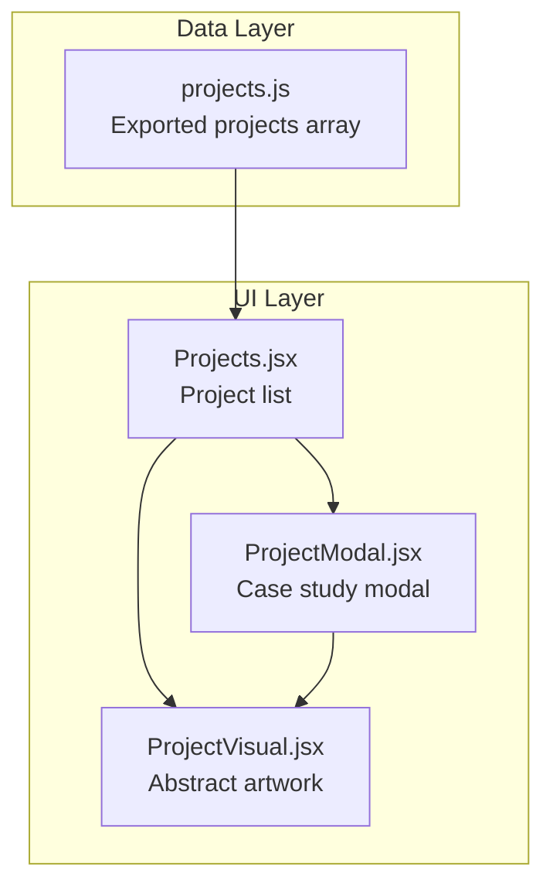
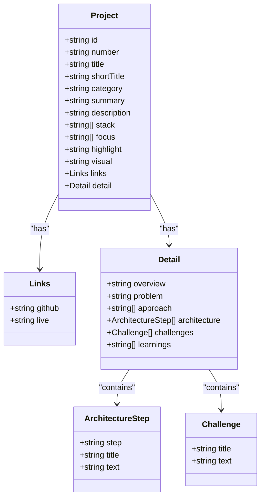
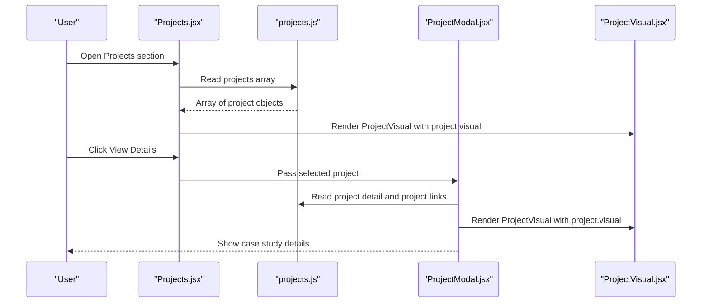
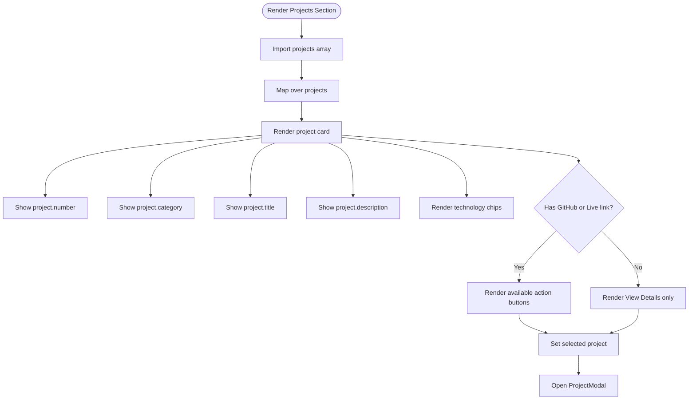
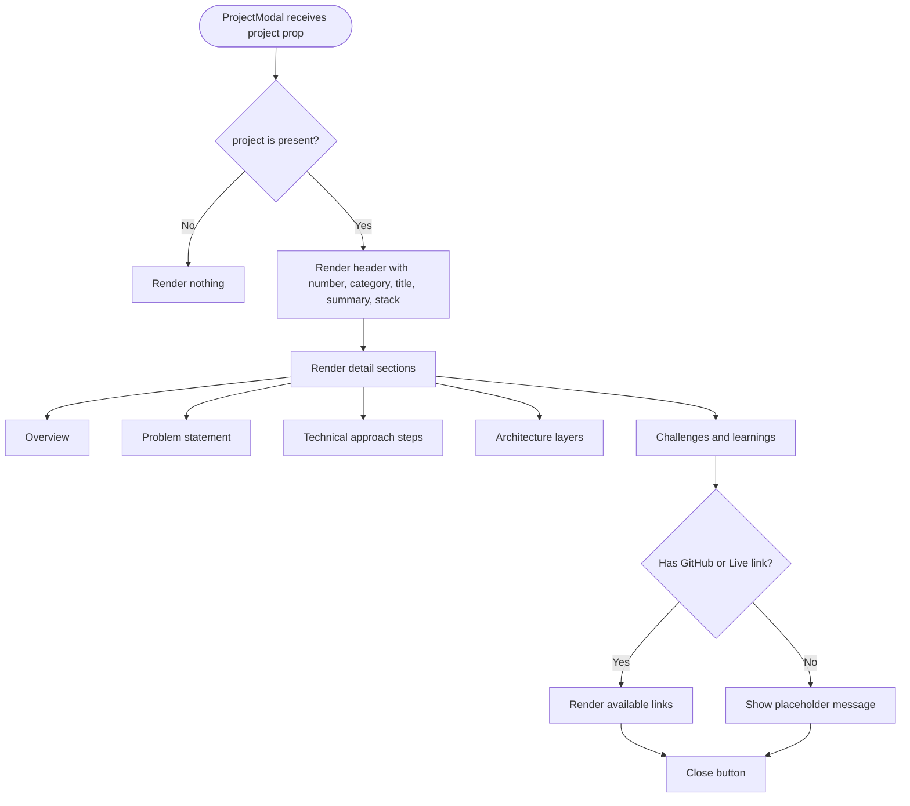
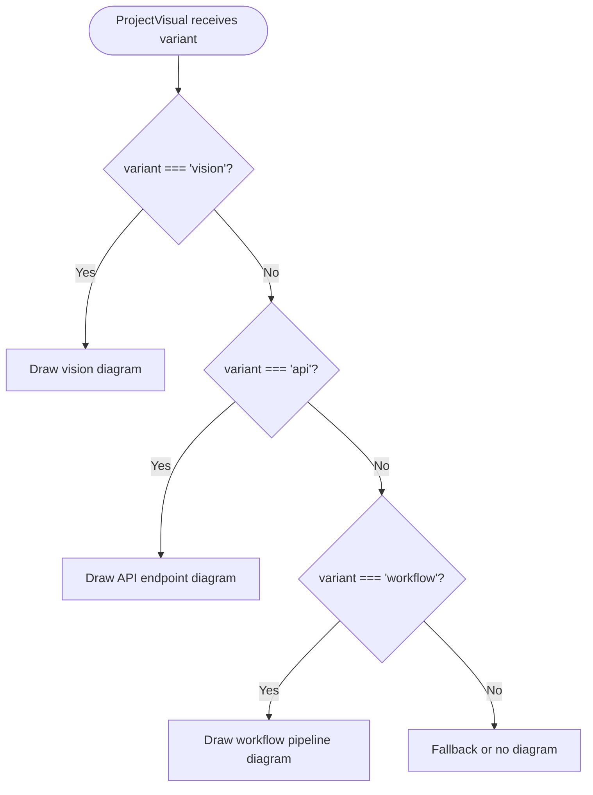
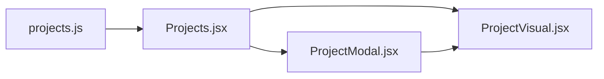

# Projects Data Model

<cite>
**Referenced Files in This Document**
- [projects.js](file://src/data/projects.js)
- [Projects.jsx](file://src/components/Projects.jsx)
- [ProjectModal.jsx](file://src/components/ProjectModal.jsx)
- [ProjectVisual.jsx](file://src/components/visuals/ProjectVisual.jsx)
</cite>

## Table of Contents
1. [Introduction](#introduction)
2. [Project Structure](#project-structure)
3. [Core Components](#core-components)
4. [Architecture Overview](#architecture-overview)
5. [Detailed Component Analysis](#detailed-component-analysis)
6. [Dependency Analysis](#dependency-analysis)
7. [Performance Considerations](#performance-considerations)
8. [Troubleshooting Guide](#troubleshooting-guide)
9. [Conclusion](#conclusion)
10. [Appendices](#appendices)

## Introduction
This document explains the projects data model used by the portfolio application to represent portfolio project entries. It covers the shape of each project object, how projects are organized and categorized, how they are displayed in the list view and detail modal, and how visual assets are handled. It also provides practical guidance for adding new projects, updating existing ones, and maintaining consistent metadata across the application.

The current implementation uses a static JavaScript array as the source of truth for project content. There is no database or external API; instead, the UI components consume this data directly.

## Project Structure
The projects feature is centered around one data file and three main UI components:

- `src/data/projects.js` defines the exported `projects` array containing all portfolio project entries.
- `src/components/Projects.jsx` renders the project list, including titles, summaries, technology chips, category labels, and action buttons.
- `src/components/ProjectModal.jsx` renders the detailed case study view when a project is selected.
- `src/components/visuals/ProjectVisual.jsx` renders an abstract SVG illustration based on the project’s `visual` field.

**Diagram sources**
- [projects.js:8-261](file://src/data/projects.js#L8-L261)
- [Projects.jsx:3-10](file://src/components/Projects.jsx#L3-L10)
- [ProjectModal.jsx:1-6](file://src/components/ProjectModal.jsx#L1-L6)
- [ProjectVisual.jsx:1-6](file://src/components/visuals/ProjectVisual.jsx#L1-L6)

**Section sources**
- [projects.js:1-261](file://src/data/projects.js#L1-L261)
- [Projects.jsx:1-143](file://src/components/Projects.jsx#L1-L143)
- [ProjectModal.jsx:1-172](file://src/components/ProjectModal.jsx#L1-L172)
- [ProjectVisual.jsx:1-257](file://src/components/visuals/ProjectVisual.jsx#L1-L257)

## Core Components
The core data model lives in `projects.js`. Each project entry is an object with a consistent schema. The most important properties are:

| Property | Type | Required | Purpose | Notes |
|---|---|---:|---|---|
| `id` | string | Yes | Stable identifier for the project | Used as a React key and internal reference |
| `number` | string | Yes | Display order label | Rendered as a badge such as `01`, `02`, `03` |
| `title` | string | Yes | Full project title | Shown in the list and modal header |
| `shortTitle` | string | No | Shortened title | Available but not currently rendered by the main UI |
| `category` | string | Yes | High-level categorization | Rendered as a monospace category label |
| `summary` | string | Yes | One-line overview | Shown in the modal header under the title |
| `description` | string | Yes | List-view description | Rendered as the short paragraph in the card |
| `stack` | string[] | Yes | Technologies and skills | Rendered as technology chips |
| `focus` | string[] | Yes | Focused topics | Present in the data model but not currently rendered by the UI |
| `highlight` | string | Yes | Key takeaway | Present in the data model but not currently rendered by the UI |
| `visual` | string | Yes | Selects generated artwork variant | Allowed values: `'vision'`, `'api'`, `'workflow'` |
| `links.github` | string | No | GitHub repository URL | Empty string hides the button |
| `links.live` | string | No | Live demo URL | Empty string hides the button |
| `detail.overview` | string | Yes | Case study overview | Modal section |
| `detail.problem` | string | Yes | Problem statement | Modal section |
| `detail.approach` | string[] | Yes | Technical approach steps | Modal numbered list |
| `detail.architecture` | object[] | Yes | Architecture layers | Each item has `step`, `title`, and `text` |
| `detail.challenges` | object[] | Yes | Challenges faced | Each item has `title` and `text` |
| `detail.learnings` | string[] | Yes | Lessons learned | Modal bullet list |

### Project Object Schema

**Diagram sources**
- [projects.js:8-261](file://src/data/projects.js#L8-L261)

**Section sources**
- [projects.js:8-261](file://src/data/projects.js#L8-L261)

## Architecture Overview
The projects feature follows a simple data-driven flow:

1. `Projects.jsx` imports the `projects` array from `projects.js`.
2. It maps over the array to render each project card.
3. Clicking **View Details** sets the selected project into component state.
4. `ProjectModal.jsx` receives the selected project and renders the full case study.
5. Both the list and modal use `ProjectVisual.jsx` to display an abstract diagram based on the project’s `visual` value.

**Diagram sources**
- [Projects.jsx:3-10](file://src/components/Projects.jsx#L3-L10)
- [projects.js:8-261](file://src/data/projects.js#L8-L261)
- [ProjectModal.jsx:16-172](file://src/components/ProjectModal.jsx#L16-L172)
- [ProjectVisual.jsx:6-257](file://src/components/visuals/ProjectVisual.jsx#L6-L257)

## Detailed Component Analysis

### Projects Data File
`projects.js` exports a single `projects` array. Each entry follows the schema described above. The file comment clarifies important conventions:

- Only add `links.github` or `links.live` when a real public URL exists.
- Empty strings hide the corresponding button rather than inventing fake links.
- `visual` selects the generated abstract artwork using one of the allowed variants.

The current dataset includes three projects:

| id | number | title | category | visual |
|---|---|---|---|---|
| `isop` | `01` | iSOP — Industrial Safety AI | Artificial Intelligence / Computer Vision | `vision` |
| `flight-management` | `02` | Flight Management System | Backend Development / API Engineering | `api` |
| `document-agent` | `03` | AI Document Processing Agent | AI Automation / Workflow Engineering | `workflow` |

Each project contains rich case study content under `detail`, including overview, problem statement, approach steps, architecture layers, challenges, and learnings.

**Section sources**
- [projects.js:1-261](file://src/data/projects.js#L1-L261)

### Projects List Component
`Projects.jsx` is responsible for:

- Rendering the section heading and external link to the author’s GitHub repositories.
- Mapping over `projects` to render each project card.
- Displaying the project number, category, title, description, and technology chips.
- Showing conditional GitHub and Live Demo buttons only when the corresponding link is non-empty.
- Opening `ProjectModal.jsx` with the selected project.

Key rendering behavior:

- The project number is shown as a small badge.
- The category is displayed as a monospace label.
- Technology items are wrapped in a reusable chip component.
- The list uses staggered reveal animations through a shared animation component.
- The modal receives the selected project via props.

**Diagram sources**
- [Projects.jsx:12-143](file://src/components/Projects.jsx#L12-L143)

**Section sources**
- [Projects.jsx:1-143](file://src/components/Projects.jsx#L1-L143)

### Project Detail Modal
`ProjectModal.jsx` renders the full case study for a selected project. It:

- Accepts `project` and `onClose` props.
- Keeps a snapshot of the last project to support exit animations.
- Renders the modal header with project number, category, title, summary, and technology chips.
- Displays structured sections: overview, problem statement, technical approach, architecture, challenges, and learnings.
- Conditionally renders GitHub and Live Demo buttons based on `project.links`.
- Shows a placeholder message when neither link is provided.

Important behaviors:

- If `project` is null, the modal does not render content.
- The modal uses a reusable modal wrapper component.
- The modal scrolls internally when content exceeds viewport height.
- The close action is exposed both via a close button and the modal wrapper.

**Diagram sources**
- [ProjectModal.jsx:16-172](file://src/components/ProjectModal.jsx#L16-L172)

**Section sources**
- [ProjectModal.jsx:1-172](file://src/components/ProjectModal.jsx#L1-L172)

### Project Visual Component
`ProjectVisual.jsx` renders an abstract SVG illustration instead of screenshots. It accepts a `variant` prop that controls which diagram is drawn. The supported variants are:

- `vision`: Represents computer-vision-style detection diagrams.
- `api`: Represents REST API endpoints and response codes.
- `workflow`: Represents pipeline stages such as intake, extraction, AI processing, and JSON output.

The component:

- Uses inline styles for background dot patterns.
- Wraps the SVG in a responsive container.
- Adds subtle hover scaling.
- Does not load external images.

Because the current UI passes `project.visual` into this component, changing the `visual` field changes the illustration without requiring image assets.

**Diagram sources**
- [ProjectVisual.jsx:6-257](file://src/components/visuals/ProjectVisual.jsx#L6-L257)

**Section sources**
- [ProjectVisual.jsx:1-257](file://src/components/visuals/ProjectVisual.jsx#L1-L257)

## Dependency Analysis
The following diagram shows how the data and UI components depend on each other:

**Diagram sources**
- [projects.js:8-261](file://src/data/projects.js#L8-L261)
- [Projects.jsx:3-10](file://src/components/Projects.jsx#L3-L10)
- [ProjectModal.jsx:1-6](file://src/components/ProjectModal.jsx#L1-L6)
- [ProjectVisual.jsx:1-6](file://src/components/visuals/ProjectVisual.jsx#L1-L6)

### Coupling and Cohesion
- `projects.js` is decoupled from UI logic and can be edited independently.
- `Projects.jsx` depends on the exact shape of the project object.
- `ProjectModal.jsx` depends on `project.detail` and `project.links`.
- `ProjectVisual.jsx` depends only on the `visual` string value.

There are no circular dependencies among these files. The main coupling point is the contract between `projects.js` and the two UI components that read its fields.

**Section sources**
- [projects.js:8-261](file://src/data/projects.js#L8-L261)
- [Projects.jsx:3-10](file://src/components/Projects.jsx#L3-L10)
- [ProjectModal.jsx:16-172](file://src/components/ProjectModal.jsx#L16-L172)
- [ProjectVisual.jsx:6-257](file://src/components/visuals/ProjectVisual.jsx#L6-L257)

## Performance Considerations
- The project data is a static array, so there is no runtime network cost for loading projects.
- Rendering performance depends mainly on the number of projects and the complexity of the SVG illustrations.
- The current SVG illustrations are lightweight and do not require external image downloads.
- Staggered reveal animations are applied per project card; keep the total number of projects reasonable to avoid layout thrashing.
- Avoid adding heavy images to the project data model unless necessary; the current design intentionally avoids screenshots.

[No sources needed since this section provides general guidance]

## Troubleshooting Guide

### Common Issues When Adding or Updating Projects

| Symptom | Likely Cause | Resolution |
|---|---|---|
| GitHub or Live Demo button does not appear | `links.github` or `links.live` is an empty string | Add a valid public URL, or intentionally leave it empty if the link should remain hidden |
| Modal shows no content after clicking View Details | Selected project is null or undefined | Ensure the project object is passed correctly from `Projects.jsx` to `ProjectModal.jsx` |
| Wrong illustration appears | `visual` value does not match expected variants | Use one of `'vision'`, `'api'`, or `'workflow'` |
| Category or technology chips look inconsistent | Missing or malformed arrays | Ensure `category` is a string and `stack` is an array of strings |
| Modal crashes while rendering architecture | `detail.architecture` is missing or malformed | Provide an array where each item has `step`, `title`, and `text` |
| Modal crashes while rendering challenges | `detail.challenges` is missing or malformed | Provide an array where each item has `title` and `text` |
| Modal crashes while rendering approach or learnings | `detail.approach` or `detail.learnings` is missing or malformed | Provide arrays of strings |

### Validation Checklist Before Publishing a New Project

1. Assign a unique `id`.
2. Set a display `number`.
3. Provide a clear `title` and `shortTitle`.
4. Set a meaningful `category`.
5. Write a concise `summary` and a fuller `description`.
6. Populate `stack` with relevant technologies.
7. Populate `focus` with focused topics.
8. Write a useful `highlight`.
9. Choose a valid `visual` variant.
10. Add real URLs to `links.github` and `links.live` only when they exist.
11. Fill out `detail.overview`, `detail.problem`, `detail.approach`, `detail.architecture`, `detail.challenges`, and `detail.learnings`.
12. Verify that the project appears in the list and opens correctly in the modal.

**Section sources**
- [projects.js:1-7](file://src/data/projects.js#L1-L7)
- [projects.js:8-261](file://src/data/projects.js#L8-L261)
- [Projects.jsx:104-130](file://src/components/Projects.jsx#L104-L130)
- [ProjectModal.jsx:133-152](file://src/components/ProjectModal.jsx#L133-L152)

## Conclusion
The projects data model is a straightforward, schema-driven structure designed for clarity and maintainability. The separation between static data and UI components makes it easy to update project information without touching presentation logic. The current implementation favors descriptive case study content and abstract visuals over screenshots, which keeps the portfolio lightweight and consistent.

When extending the model, follow the established property conventions, validate required fields, and ensure that any new UI usage matches the data shape. This approach preserves consistency across the list view, modal view, and generated artwork.

[No sources needed since this section summarizes without analyzing specific files]

## Appendices

### How to Add a New Project
1. Open `src/data/projects.js`.
2. Add a new object to the `projects` array following the documented schema.
3. Choose a unique `id`, a display `number`, and a suitable `visual` variant.
4. Provide complete case study content under `detail`.
5. Add real URLs to `links.github` and `links.live` only when available.
6. Save the file and verify that the project appears in the list and opens in the modal.

**Section sources**
- [projects.js:8-261](file://src/data/projects.js#L8-L261)

### How to Update Existing Project Information
- Edit the matching project object by `id` in `projects.js`.
- Update `title`, `description`, `stack`, `category`, or any `detail` fields as needed.
- If the project’s technical focus changes, update `visual` to match the new illustration type.
- If a repository or live demo becomes available, replace the empty string with a real URL.

**Section sources**
- [projects.js:8-261](file://src/data/projects.js#L8-L261)
- [Projects.jsx:56-135](file://src/components/Projects.jsx#L56-L135)
- [ProjectModal.jsx:34-166](file://src/components/ProjectModal.jsx#L34-L166)

### Image Handling Strategy
- The current design does not embed project screenshots in the data model.
- `ProjectVisual.jsx` renders abstract SVG diagrams based on the `visual` field.
- This strategy avoids external image dependencies and keeps the portfolio fast and consistent.
- If future requirements need screenshots, consider adding an `images` array to the project schema and updating both `Projects.jsx` and `ProjectModal.jsx` to render them safely.

**Section sources**
- [ProjectVisual.jsx:1-257](file://src/components/visuals/ProjectVisual.jsx#L1-L257)