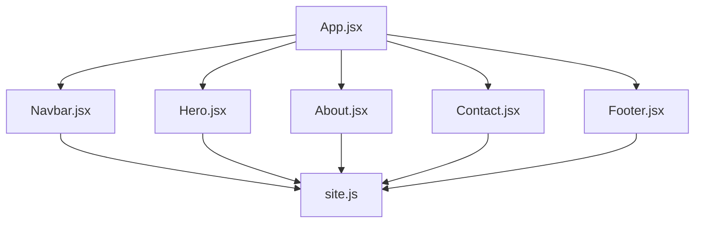
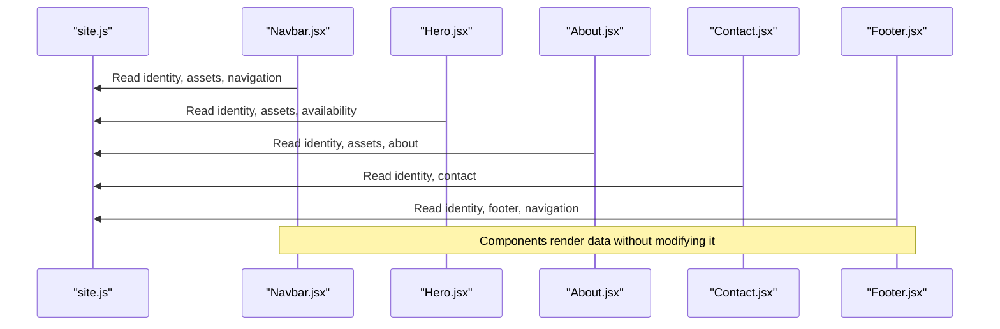
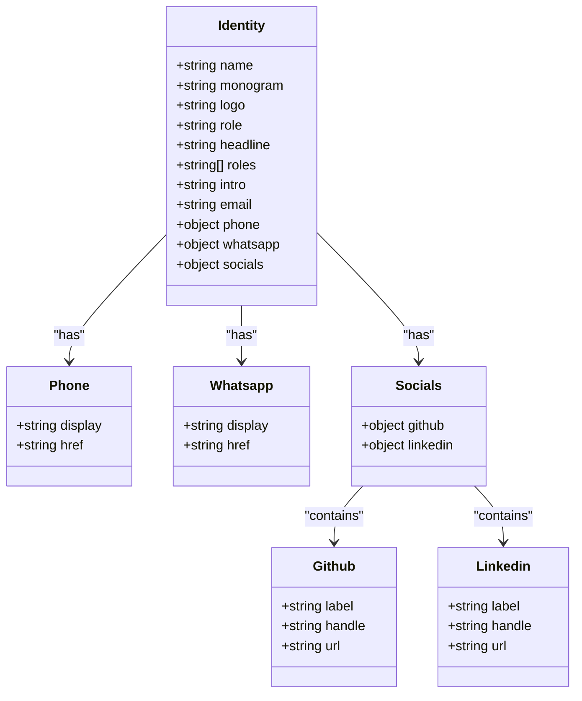
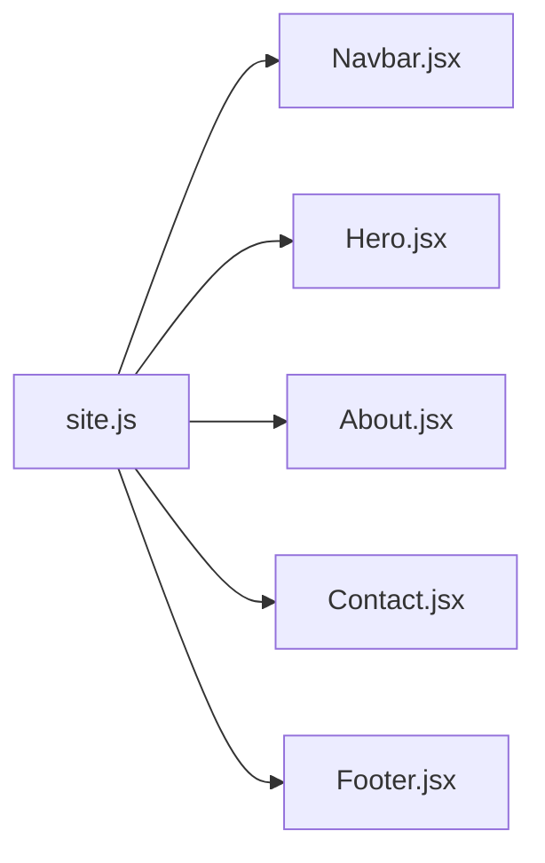

# Site Configuration

<cite>
**Referenced Files in This Document**
- [site.js](file://src/data/site.js)
- [App.jsx](file://src/App.jsx)
- [Navbar.jsx](file://src/components/Navbar.jsx)
- [Hero.jsx](file://src/components/Hero.jsx)
- [About.jsx](file://src/components/About.jsx)
- [Contact.jsx](file://src/components/Contact.jsx)
- [Footer.jsx](file://src/components/Footer.jsx)
</cite>

## Table of Contents
1. [Introduction](#introduction)
2. [Project Structure](#project-structure)
3. [Core Components](#core-components)
4. [Architecture Overview](#architecture-overview)
5. [Detailed Component Analysis](#detailed-component-analysis)
6. [Dependency Analysis](#dependency-analysis)
7. [Performance Considerations](#performance-considerations)
8. [Troubleshooting Guide](#troubleshooting-guide)
9. [Conclusion](#conclusion)
10. [Appendices](#appendices)

## Introduction
This document explains the site configuration system that acts as the central source of truth for portfolio identity, branding, and content. All personal information, assets, navigation items, section text, and contact details are defined in a single configuration file. Components read from this configuration instead of hardcoding values, which means you can update your portfolio without editing component code.

The configuration covers:
- Identity: name, monogram, logo, role definitions, introduction, email, phone, WhatsApp, and social media links.
- Assets: profile image path and alt text, CV document path.
- Availability badge: whether to show an availability indicator and its label.
- Navigation: top-level menu structure.
- About section: index number, eyebrow, title, subtitle, paragraphs, interests, and principles.
- Footer: sign-off message.
- Contact section: index number, eyebrow, title, and introductory copy.

## Project Structure
The configuration lives under `src/data/site.js`. Components import specific configuration objects and render them directly. The application root composes sections such as Hero, About, Skills, Projects, Certificates, Contact, and Footer.

**Diagram sources**
- [App.jsx:1-32](file://src/App.jsx#L1-L32)
- [Navbar.jsx:1-218](file://src/components/Navbar.jsx#L1-L218)
- [Hero.jsx:1-149](file://src/components/Hero.jsx#L1-L149)
- [About.jsx:1-148](file://src/components/About.jsx#L1-L148)
- [Contact.jsx:1-343](file://src/components/Contact.jsx#L1-L343)
- [Footer.jsx:1-156](file://src/components/Footer.jsx#L1-L156)
- [site.js:1-116](file://src/data/site.js#L1-L116)

**Section sources**
- [App.jsx:1-32](file://src/App.jsx#L1-L32)
- [site.js:1-116](file://src/data/site.js#L1-L116)

## Core Components
The configuration is organized into clear, focused exports:

- `identity`: Personal identity, roles, headline, introduction, email, phone, WhatsApp, and social profiles.
- `assets`: Profile image path, alt text, and CV document path.
- `availability`: Badge visibility flag and label.
- `navigation`: Array of navigation items with stable IDs and labels.
- `about`: Section metadata, narrative paragraphs, technical interests, and principles.
- `footer`: Sign-off message.
- `contact`: Section metadata and introductory copy.

Key responsibilities:
- Provide a single place to update personal information.
- Keep UI components free of hardcoded strings and paths.
- Ensure consistent rendering across multiple pages and sections.

**Section sources**
- [site.js:6-41](file://src/data/site.js#L6-L41)
- [site.js:48-52](file://src/data/site.js#L48-L52)
- [site.js:57-60](file://src/data/site.js#L57-L60)
- [site.js:62-69](file://src/data/site.js#L62-L69)
- [site.js:71-104](file://src/data/site.js#L71-L104)
- [site.js:106-108](file://src/data/site.js#L106-L108)
- [site.js:110-115](file://src/data/site.js#L110-L115)

## Architecture Overview
Components consume configuration through imports. There is no runtime configuration loader; values are static at build time. This design keeps the app simple and predictable.

**Diagram sources**
- [site.js:1-116](file://src/data/site.js#L1-L116)
- [Navbar.jsx:1-218](file://src/components/Navbar.jsx#L1-L218)
- [Hero.jsx:1-149](file://src/components/Hero.jsx#L1-L149)
- [About.jsx:1-148](file://src/components/About.jsx#L1-L148)
- [Contact.jsx:1-343](file://src/components/Contact.jsx#L1-L343)
- [Footer.jsx:1-156](file://src/components/Footer.jsx#L1-L156)

## Detailed Component Analysis

### Identity Object
The identity object defines who you are and how the portfolio represents you. It includes:

- Name: Displayed in hero, about, footer, and accessibility labels.
- Monogram: Used as a short brand mark.
- Logo: A textual or markup-based logo used in header and footer branding.
- Role and Headline: Short professional positioning shown in hero and meta context.
- Roles: Array used by the typewriter animation in the hero section.
- Intro: Short biography shown in the hero section.
- Email: Used for mailto links and contact form behavior.
- Phone: Display value and href for calling.
- WhatsApp: Display value and href for messaging.
- Socials: GitHub and LinkedIn entries with label, handle, and URL.

How components use identity:
- Navbar uses social links and displays the monogram-style branding.
- Hero uses roles, intro, and social links.
- About shows name and social links.
- Contact builds channel cards from identity fields.
- Footer renders email, WhatsApp, and social links.

**Diagram sources**
- [site.js:6-41](file://src/data/site.js#L6-L41)

**Section sources**
- [site.js:6-41](file://src/data/site.js#L6-L41)
- [Navbar.jsx:1-218](file://src/components/Navbar.jsx#L1-L218)
- [Hero.jsx:1-149](file://src/components/Hero.jsx#L1-L149)
- [About.jsx:1-148](file://src/components/About.jsx#L1-L148)
- [Contact.jsx:1-343](file://src/components/Contact.jsx#L1-L343)
- [Footer.jsx:1-156](file://src/components/Footer.jsx#L1-L156)

### Assets Configuration
Assets define where images and documents live:

- Profile image path: Points to `/public/images/profile-placeholder.svg` by default.
- Profile image alt text: Accessibility description for the portrait.
- CV path: Points to `/public/cv/M-Faizan-Hassan-CV.pdf` by default.

Where assets are used:
- Hero and Navbar include a “Download CV” link using the CV path.
- About displays the profile image using the configured path and alt text.

Practical guidance:
- Replace the placeholder image with your own portrait in `/public/images`.
- Update the CV path if you rename or move your PDF.
- Keep the alt text descriptive and concise.

**Section sources**
- [site.js:48-52](file://src/data/site.js#L48-L52)
- [Hero.jsx:105-133](file://src/components/Hero.jsx#L105-L133)
- [Navbar.jsx:115-125](file://src/components/Navbar.jsx#L115-L125)
- [About.jsx:28-36](file://src/components/About.jsx#L28-L36)

### Availability Badge
The availability badge is optional and hidden by default. Enable it only when accurate.

- Enabled: Boolean flag controlling visibility.
- Label: Text displayed next to the status dot.

Usage:
- Hero conditionally renders the badge based on the enabled flag.

Best practice:
- Set enabled to true only when you are actively available for opportunities.
- Keep the label concise and professional.

**Section sources**
- [site.js:57-60](file://src/data/site.js#L57-L60)
- [Hero.jsx:76-81](file://src/components/Hero.jsx#L76-L81)

### Navigation Structure
Navigation is an array of items with stable IDs and human-readable labels.

Structure:
- id: Stable anchor target matching section IDs.
- label: Display text for each menu item.

Usage:
- Navbar renders desktop and mobile menus from this array.
- Footer renders a secondary navigation list.
- Active section highlighting depends on these IDs.

Guidelines:
- Use lowercase, hyphen-safe IDs.
- Keep labels short and meaningful.
- Maintain order to control menu sequence.

**Section sources**
- [site.js:62-69](file://src/data/site.js#L62-L69)
- [Navbar.jsx:71-101](file://src/components/Navbar.jsx#L71-L101)
- [Navbar.jsx:159-181](file://src/components/Navbar.jsx#L159-L181)
- [Footer.jsx:69-83](file://src/components/Footer.jsx#L69-L83)

### About Section Content
The about configuration controls the narrative and visual structure of the About section.

Fields:
- index: Section numbering.
- eyebrow: Small uppercase label above the title.
- title: Main heading.
- subtitle: Supporting line below the title.
- paragraphs: Narrative blocks describing background and focus.
- interests: Technical interests rendered as chips.
- principles: Values or working principles with title and text.

Usage:
- About reads all fields to render headings, paragraphs, interest chips, and principle cards.

Maintenance tips:
- Keep paragraphs concise and scannable.
- Use interests to highlight current technical focus areas.
- Principles should reflect your engineering philosophy.

**Section sources**
- [site.js:71-104](file://src/data/site.js#L71-L104)
- [About.jsx:81-87](file://src/components/About.jsx#L81-L87)
- [About.jsx:89-110](file://src/components/About.jsx#L89-L110)
- [About.jsx:129-143](file://src/components/About.jsx#L129-L143)

### Footer Text
Footer contains a short sign-off message.

Usage:
- Footer renders the sign-off beneath the branding.

Guidelines:
- Keep the message memorable and aligned with your brand voice.
- Avoid including sensitive information here.

**Section sources**
- [site.js:106-108](file://src/data/site.js#L106-L108)
- [Footer.jsx:36-38](file://src/components/Footer.jsx#L36-L38)

### Contact Section Content
Contact configuration provides section metadata and introductory copy.

Fields:
- index: Section numbering.
- eyebrow: Small uppercase label above the title.
- title: Main heading.
- copy: Paragraph introducing the contact experience.

Usage:
- Contact renders the heading and copy before the contact channels and form.

Guidelines:
- Make the copy inviting and clear about what happens after submission.
- Keep the tone consistent with the rest of the portfolio.

**Section sources**
- [site.js:110-115](file://src/data/site.js#L110-L115)
- [Contact.jsx:163-174](file://src/components/Contact.jsx#L163-L174)

## Dependency Analysis
Configuration is consumed by multiple components. This creates a one-way dependency: components depend on configuration, but configuration does not depend on components.

**Diagram sources**
- [site.js:1-116](file://src/data/site.js#L1-L116)
- [Navbar.jsx:1-218](file://src/components/Navbar.jsx#L1-L218)
- [Hero.jsx:1-149](file://src/components/Hero.jsx#L1-L149)
- [About.jsx:1-148](file://src/components/About.jsx#L1-L148)
- [Contact.jsx:1-343](file://src/components/Contact.jsx#L1-L343)
- [Footer.jsx:1-156](file://src/components/Footer.jsx#L1-L156)

**Section sources**
- [site.js:1-116](file://src/data/site.js#L1-L116)
- [Navbar.jsx:1-218](file://src/components/Navbar.jsx#L1-L218)
- [Hero.jsx:1-149](file://src/components/Hero.jsx#L1-L149)
- [About.jsx:1-148](file://src/components/About.jsx#L1-L148)
- [Contact.jsx:1-343](file://src/components/Contact.jsx#L1-L343)
- [Footer.jsx:1-156](file://src/components/Footer.jsx#L1-L156)

## Performance Considerations
- Static configuration avoids runtime loading overhead.
- Image paths should point to optimized assets in `/public/images`.
- CV downloads use direct file paths; ensure the PDF is reasonably sized.
- Avoid large arrays in configuration unless they are intentionally dynamic.

[No sources needed since this section provides general guidance]

## Troubleshooting Guide

Common issues and resolutions:

- Profile image not showing:
  - Verify the profile image path in assets points to an existing file under `/public/images`.
  - Confirm the alt text is set appropriately.

- CV download link broken:
  - Check that the CV path in assets matches the actual PDF location under `/public/cv`.
  - Ensure the filename and extension are correct.

- Availability badge not visible:
  - Confirm the enabled flag is set to true.
  - Review the label text for clarity.

- Navigation items missing or misordered:
  - Add or reorder entries in the navigation array.
  - Ensure each item has a unique id and a readable label.

- Social links not updating:
  - Update the corresponding entry under identity.socials.
  - If adding a new platform, extend the socials object and update components that render additional links.

- Contact channels not reflecting changes:
  - Update identity.email, identity.phone, identity.whatsapp, and identity.socials.
  - Remember that Contact.jsx builds channel cards from identity fields.

- Footer links outdated:
  - Update identity.socials and identity.email.
  - Footer renders email, WhatsApp, and social links from identity.

**Section sources**
- [site.js:6-41](file://src/data/site.js#L6-L41)
- [site.js:48-52](file://src/data/site.js#L48-L52)
- [site.js:57-60](file://src/data/site.js#L57-L60)
- [site.js:62-69](file://src/data/site.js#L62-L69)
- [Hero.jsx:76-81](file://src/components/Hero.jsx#L76-L81)
- [Contact.jsx:20-60](file://src/components/Contact.jsx#L20-L60)
- [Footer.jsx:40-66](file://src/components/Footer.jsx#L40-L66)

## Conclusion
The site configuration system centralizes all portfolio identity, branding, and content. By editing `src/data/site.js`, you can update personal information, add social profiles, modify navigation, and customize content sections without touching component code. This approach improves maintainability, consistency, and developer experience.

[No sources needed since this section summarizes without analyzing specific files]

## Appendices

### Practical Examples

- Update personal information:
  - Change name, headline, roles, intro, email, phone, and WhatsApp in the identity object.
  - Verify that contact channels and footer references remain consistent.

- Add a new social media profile:
  - Add a new entry under identity.socials with label, handle, and url.
  - Extend any component that renders social links to include the new platform.

- Modify navigation items:
  - Add, remove, or reorder entries in the navigation array.
  - Ensure ids match section anchors used elsewhere.

- Customize content sections:
  - Edit about.paragraphs, about.interests, and about.principles for the About section.
  - Update contact.copy for the Contact section.
  - Adjust footer.signOff for the footer message.

- Replace assets:
  - Swap the profile image in `/public/images` and update assets.profileImage.
  - Replace the CV PDF in `/public/cv` and update assets.cv.

- Toggle availability badge:
  - Set availability.enabled to true and adjust the label.

**Section sources**
- [site.js:6-41](file://src/data/site.js#L6-L41)
- [site.js:48-52](file://src/data/site.js#L48-L52)
- [site.js:57-60](file://src/data/site.js#L57-L60)
- [site.js:62-69](file://src/data/site.js#L62-L69)
- [site.js:71-104](file://src/data/site.js#L71-L104)
- [site.js:106-108](file://src/data/site.js#L106-L108)
- [site.js:110-115](file://src/data/site.js#L110-L115)