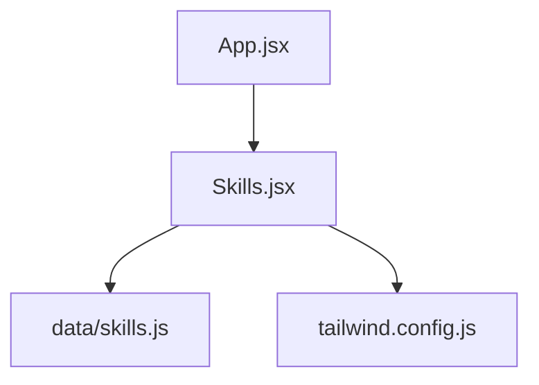
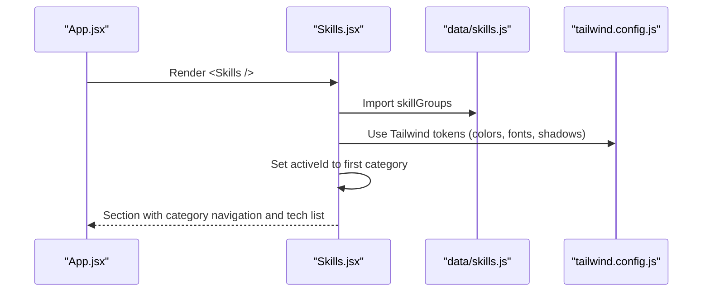
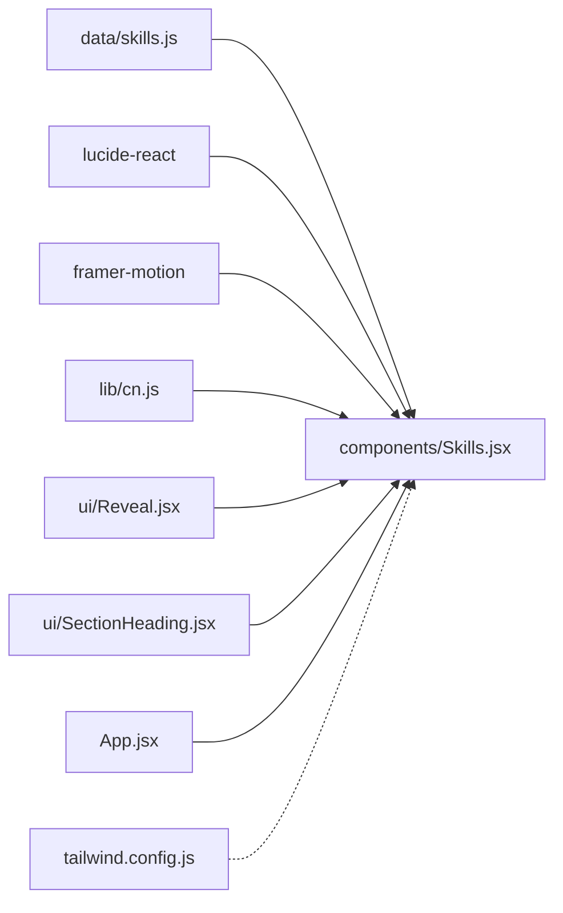

# Skills Organization

<cite>
**Referenced Files in This Document**
- [skills.js](file://src/data/skills.js)
- [Skills.jsx](file://src/components/Skills.jsx)
- [App.jsx](file://src/App.jsx)
- [tailwind.config.js](file://tailwind.config.js)
</cite>

## Table of Contents
1. [Introduction](#introduction)
2. [Project Structure](#project-structure)
3. [Core Components](#core-components)
4. [Architecture Overview](#architecture-overview)
5. [Detailed Component Analysis](#detailed-component-analysis)
6. [Dependency Analysis](#dependency-analysis)
7. [Performance Considerations](#performance-considerations)
8. [Troubleshooting Guide](#troubleshooting-guide)
9. [Conclusion](#conclusion)
10. [Appendices](#appendices)

## Introduction
This document explains the skills organization system used to categorize and display technical competencies across the portfolio application. It covers:
- The structure of skill categories and how technologies are listed within each category
- How proficiency is represented (capability descriptions rather than numeric scores)
- How the Skills component renders categories, navigation, and technology lists
- Styling considerations, responsive behavior, and accessibility
- Practical guidance for adding new skills, creating new categories, and updating descriptions

The design emphasizes clarity, maintainability, and a smooth user experience by grouping related technologies under meaningful categories with concise blurbs that explain their purpose.

## Project Structure
The skills system spans two primary locations:
- Data source: `src/data/skills.js` defines skill groups and their technologies
- UI rendering: `src/components/Skills.jsx` consumes the data and renders the interactive section
- App integration: `src/App.jsx` includes the Skills section in the main content flow
- Styling: `tailwind.config.js` provides custom colors, typography, shadows, and transitions used by the Skills UI

**Diagram sources**
- [App.jsx:1-32](file://src/App.jsx#L1-L32)
- [Skills.jsx:1-187](file://src/components/Skills.jsx#L1-L187)
- [skills.js:1-62](file://src/data/skills.js#L1-L62)
- [tailwind.config.js:1-89](file://tailwind.config.js#L1-L89)

**Section sources**
- [App.jsx:1-32](file://src/App.jsx#L1-L32)
- [Skills.jsx:1-187](file://src/components/Skills.jsx#L1-L187)
- [skills.js:1-62](file://src/data/skills.js#L1-L62)
- [tailwind.config.js:1-89](file://tailwind.config.js#L1-L89)

## Core Components
- Skill data model (`skillGroups`)
  - Each group has an id, title, icon key, blurb, and an array of skill names
  - No proficiency percentages; capabilities are described through the blurb and the curated list
- Skills component
  - Renders a two-column layout on desktop: left sidebar for category navigation, right panel for the active category’s details and technology list
  - Uses state to track the active category and animates transitions between categories
  - Provides mobile-friendly horizontal scrolling tabs for quick switching

Key responsibilities:
- Data-driven rendering from `skillGroups`
- Category selection and active state management
- Responsive presentation (mobile tabs vs. desktop sidebar)
- Accessibility attributes for navigation buttons and headings
- Consistent styling via Tailwind classes and theme tokens

**Section sources**
- [skills.js:1-62](file://src/data/skills.js#L1-L62)
- [Skills.jsx:1-187](file://src/components/Skills.jsx#L1-L187)

## Architecture Overview
The Skills feature follows a simple data-to-view pattern:
- Data layer: `skillGroups` exports structured arrays of categories and technologies
- View layer: `Skills.jsx` reads the data, manages local state for the active category, and renders the UI
- Styling layer: Tailwind configuration supplies consistent color tokens, fonts, shadows, and motion timing

**Diagram sources**
- [App.jsx:1-32](file://src/App.jsx#L1-L32)
- [Skills.jsx:1-187](file://src/components/Skills.jsx#L1-L187)
- [skills.js:1-62](file://src/data/skills.js#L1-L62)
- [tailwind.config.js:1-89](file://tailwind.config.js#L1-L89)

## Detailed Component Analysis

### Data Model: Skill Groups
- Structure
  - id: unique identifier for the category
  - title: human-readable category name
  - icon: key mapped to a Lucide icon inside the component
  - blurb: short description explaining the category’s focus
  - skills: array of technology or capability names
- Proficiency indicators
  - Not included; the design intentionally avoids numeric proficiency scores
  - Capability emphasis is conveyed through curated lists and descriptive blurbs

Benefits of this structure:
- Maintainable: Adding or removing skills is a single edit in one place
- Extensible: New categories can be added without changing the component logic
- Clear semantics: Each category has a focused narrative via its blurb

**Section sources**
- [skills.js:1-62](file://src/data/skills.js#L1-L62)

### Rendering Logic: Skills Component
- State and active category
  - Tracks the currently selected category id
  - Derives the active group object from the data array
- Navigation
  - Mobile: horizontally scrollable pill-style tabs
  - Desktop: vertical sidebar with icons, titles, counts, and subtle numbering
- Content panel
  - Displays the active category’s title, blurb, and item count
  - Lists technologies with numbered entries and hover effects
- Animations
  - Uses Framer Motion to animate entry/exit when switching categories
  - Respects reduced motion preferences

Accessibility highlights:
- Semantic section and heading elements
- aria-labelledby linking the section to its heading
- aria-pressed on navigation buttons to indicate active state
- aria-hidden on decorative elements

Responsive behavior:
- On small screens, category navigation becomes a horizontally scrollable row
- On medium and larger screens, a sticky sidebar appears alongside the content panel
- Grid layout adapts from single column to multi-column for the technology list

Styling approach:
- Uses Tailwind utility classes for spacing, typography, borders, and colors
- Leverages custom theme tokens defined in the Tailwind config for brand consistency

**Section sources**
- [Skills.jsx:1-187](file://src/components/Skills.jsx#L1-L187)

### Integration: App Entry Point
- The Skills section is rendered as part of the main content flow
- It sits after About and before Projects, Certificates, Contact, and Footer

**Section sources**
- [App.jsx:1-32](file://src/App.jsx#L1-L32)

### Styling and Theme Tokens
- Colors
  - ink, paper, haze, mist, brand, accent provide a cohesive palette
- Typography
  - display, sans, mono font families ensure visual hierarchy and readability
- Shadows and transitions
  - soft, lift, brand, panel shadows add depth
  - premium easing improves perceived quality of interactions
- Border radius
  - extended radii support rounded cards and panels

These tokens are applied throughout the Skills component to achieve consistent visuals and accessible contrast.

**Section sources**
- [tailwind.config.js:1-89](file://tailwind.config.js#L1-L89)

## Dependency Analysis
The Skills feature has minimal coupling:
- Skills.jsx depends on:
  - data/skills.js for content
  - lucide-react for icons
  - framer-motion for animations
  - lib/cn for conditional class composition
  - ui components for shared patterns (Reveal, SectionHeading)
- App.jsx composes the Skills section into the page layout
- tailwind.config.js provides global style tokens consumed by the component

**Diagram sources**
- [Skills.jsx:1-187](file://src/components/Skills.jsx#L1-L187)
- [skills.js:1-62](file://src/data/skills.js#L1-L62)
- [App.jsx:1-32](file://src/App.jsx#L1-L32)
- [tailwind.config.js:1-89](file://tailwind.config.js#L1-L89)

**Section sources**
- [Skills.jsx:1-187](file://src/components/Skills.jsx#L1-L187)
- [skills.js:1-62](file://src/data/skills.js#L1-L62)
- [App.jsx:1-32](file://src/App.jsx#L1-L32)
- [tailwind.config.js:1-89](file://tailwind.config.js#L1-L89)

## Performance Considerations
- Data size
  - The dataset is small; rendering performance is not a concern at current scale
- Animation cost
  - Framer Motion animations run only on category changes
  - Reduced motion preference is respected to avoid unnecessary work
- Layout stability
  - Sticky sidebar on desktop reduces reflow during interaction
- Optimization opportunities
  - Memoize derived values if the dataset grows significantly
  - Consider lazy-loading heavy icon sets if the number of categories expands substantially

[No sources needed since this section provides general guidance]

## Troubleshooting Guide
Common issues and resolutions:
- Category does not appear
  - Ensure the new category is added to `skillGroups` in the data file
  - Verify the icon key exists in the component’s icon mapping
- Icon not showing
  - Confirm the icon key matches one of the imported Lucide icons
  - Check that the ICONS map includes the key
- Active category not switching
  - Validate that each category has a unique id
  - Ensure onClick handlers update the active id state
- Styling inconsistencies
  - Verify Tailwind theme tokens exist (e.g., brand, mist, haze)
  - Confirm the component uses the correct utility classes
- Accessibility concerns
  - Ensure aria-pressed is set on navigation buttons
  - Verify headings and labels are present for screen readers

**Section sources**
- [skills.js:1-62](file://src/data/skills.js#L1-L62)
- [Skills.jsx:1-187](file://src/components/Skills.jsx#L1-L187)

## Conclusion
The skills organization system provides a clear, maintainable way to showcase technical competencies. By grouping technologies into focused categories with descriptive blurbs, it improves both user comprehension and long-term maintainability. The Skills component renders these categories responsively, with accessible navigation and polished animations. Adding new skills or categories is straightforward, requiring updates only in the data file and, when necessary, the icon mapping.

[No sources needed since this section summarizes without analyzing specific files]

## Appendices

### Adding a New Skill to an Existing Category
- Open the data file and locate the target category
- Add the new skill string to the category’s skills array
- Save and verify the new item appears in the corresponding category panel

**Section sources**
- [skills.js:1-62](file://src/data/skills.js#L1-L62)

### Creating a New Category
- Add a new object to the skillGroups array with:
  - A unique id
  - A descriptive title
  - An icon key that maps to an imported Lucide icon
  - A concise blurb describing the category’s focus
  - A skills array listing relevant technologies or capabilities
- If using a new icon, import it and add it to the ICONS mapping in the component

**Section sources**
- [skills.js:1-62](file://src/data/skills.js#L1-L62)
- [Skills.jsx:1-187](file://src/components/Skills.jsx#L1-L187)

### Updating a Skill Description
- Edit the blurb field of the relevant category to reflect updated context or goals
- Keep the blurb concise and focused on the value or problem area the category addresses

**Section sources**
- [skills.js:1-62](file://src/data/skills.js#L1-L62)

### Responsive Display Patterns
- Mobile: Horizontal scrollable tabs for category selection
- Desktop: Sticky sidebar with icons and counts, plus a content panel with a grid of technologies
- The component adapts gracefully across breakpoints using Tailwind utilities

**Section sources**
- [Skills.jsx:1-187](file://src/components/Skills.jsx#L1-L187)