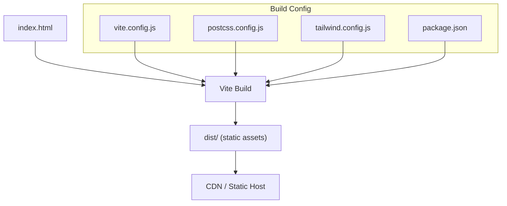
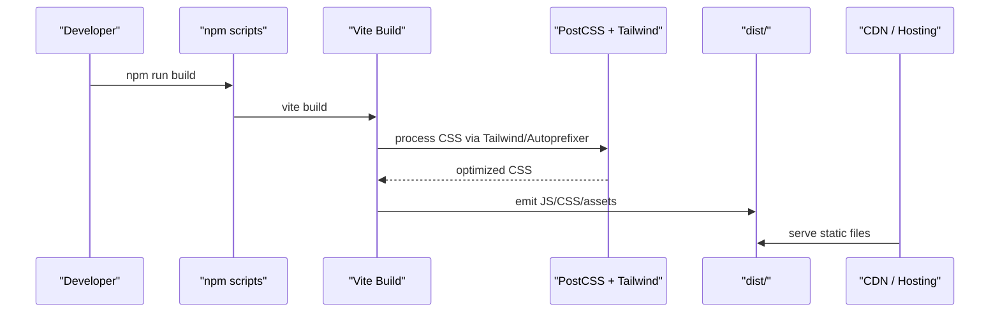
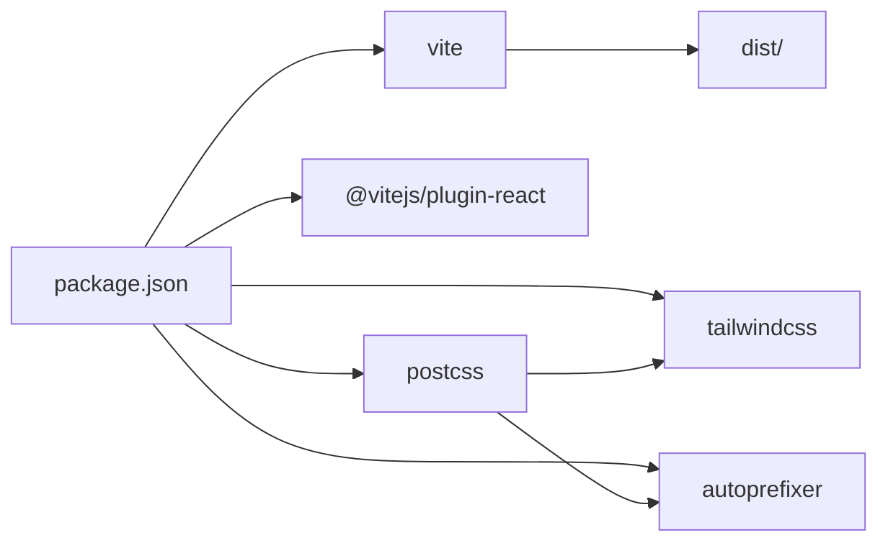

# Deployment & Production

<cite>
**Referenced Files in This Document**
- [vite.config.js](file://vite.config.js)
- [postcss.config.js](file://postcss.config.js)
- [tailwind.config.js](file://tailwind.config.js)
- [package.json](file://package.json)
- [index.html](file://index.html)
- [src/main.jsx](file://src/main.jsx)
</cite>

## Table of Contents
1. [Introduction](#introduction)
2. [Project Structure](#project-structure)
3. [Core Components](#core-components)
4. [Architecture Overview](#architecture-overview)
5. [Detailed Component Analysis](#detailed-component-analysis)
6. [Dependency Analysis](#dependency-analysis)
7. [Performance Considerations](#performance-considerations)
8. [Troubleshooting Guide](#troubleshooting-guide)
9. [Conclusion](#conclusion)
10. [Appendices](#appendices)

## Introduction
This document provides comprehensive deployment and production guidance for the portfolio application. It covers Vite build configuration, PostCSS processing, asset optimization strategies, bundle analysis techniques, environment variable configuration, SEO and meta tags, caching and CDN setup, monitoring/analytics integration, and platform-specific deployment options (GitHub Pages, Netlify, Vercel, traditional hosting). The goal is to ensure a fast, reliable, and search-engine-friendly production experience.

## Project Structure
The project uses Vite with React, Tailwind CSS, and PostCSS. The build outputs static assets into a dist directory suitable for any static hosting or CDN.

**Diagram sources**
- [vite.config.js:1-22](file://vite.config.js#L1-L22)
- [postcss.config.js:1-7](file://postcss.config.js#L1-L7)
- [tailwind.config.js:1-89](file://tailwind.config.js#L1-L89)
- [package.json:1-26](file://package.json#L1-L26)
- [index.html:1-72](file://index.html#L1-L72)

**Section sources**
- [vite.config.js:1-22](file://vite.config.js#L1-L22)
- [postcss.config.js:1-7](file://postcss.config.js#L1-L7)
- [tailwind.config.js:1-89](file://tailwind.config.js#L1-L89)
- [package.json:1-26](file://package.json#L1-L26)
- [index.html:1-72](file://index.html#L1-L72)

## Core Components
- Vite build pipeline: React plugin, output directory, target ES version, CSS code splitting, and sourcemap control.
- PostCSS pipeline: Tailwind CSS and Autoprefixer.
- Tailwind configuration: content scanning, theme extensions, fonts, colors, animations.
- HTML entry: SEO metadata, Open Graph/Twitter cards, preconnects, JSON-LD schema.
- App bootstrap: React root rendering and global styles import.

Key responsibilities:
- vite.config.js controls build output and optimizations.
- postcss.config.js wires Tailwind and Autoprefixer.
- tailwind.config.js defines design tokens and content scanning.
- index.html sets SEO and social sharing metadata.
- src/main.jsx initializes the app and imports global CSS.

**Section sources**
- [vite.config.js:1-22](file://vite.config.js#L1-L22)
- [postcss.config.js:1-7](file://postcss.config.js#L1-L7)
- [tailwind.config.js:1-89](file://tailwind.config.js#L1-L89)
- [index.html:1-72](file://index.html#L1-L72)
- [src/main.jsx:1-11](file://src/main.jsx#L1-L11)

## Architecture Overview
The production build transforms source files into optimized static assets served by a CDN or static host.

**Diagram sources**
- [package.json:7-10](file://package.json#L7-L10)
- [vite.config.js:15-20](file://vite.config.js#L15-L20)
- [postcss.config.js:1-7](file://postcss.config.js#L1-L7)

## Detailed Component Analysis

### Vite Build Configuration and Optimization
- Plugins: React plugin is enabled for JSX/TSX support.
- Server and preview ports are configured for development; not relevant to production builds.
- Build settings:
  - outDir: dist
  - target: es2019
  - cssCodeSplit: true
  - sourcemap: false

Optimization implications:
- CSS code splitting reduces initial payload by splitting styles per route/component when applicable.
- Disabling sourcemaps in production reduces bundle size and avoids exposing source details.
- Targeting es2019 ensures compatibility while allowing modern optimizations.

Recommended enhancements:
- Enable rollupOptions.output.manualChunks to split vendor libraries (e.g., react, framer-motion) for better caching.
- Configure build.rollupOptions.output.assetFileNames and chunkFileNames for cache-busting patterns if needed.
- Add build.minify to explicitly enable minification (default in production).
- Use build.sourcemap = 'hidden' only if you need error stack traces in production without downloading full sources.

**Section sources**
- [vite.config.js:1-22](file://vite.config.js#L1-L22)

### PostCSS and Tailwind Processing
- PostCSS plugins:
  - tailwindcss: generates utility classes based on usage.
  - autoprefixer: adds vendor prefixes for broad browser support.

Tailwind configuration:
- content scanning includes index.html and all JS/JSX under src to purge unused styles.
- Theme extensions define custom colors, fonts, border radii, shadows, transitions, keyframes, and animations.

Production considerations:
- Ensure content paths remain accurate so Tailwind purges unused CSS effectively.
- Keep third-party font links in index.html to avoid blocking critical rendering.

**Section sources**
- [postcss.config.js:1-7](file://postcss.config.js#L1-L7)
- [tailwind.config.js:1-89](file://tailwind.config.js#L1-L89)

### Asset Optimization Strategies
- Fonts:
  - Preconnect to Google Fonts domains to reduce connection latency.
  - Use display=swap to prevent invisible text during font loading.
- Images and other assets:
  - Prefer modern formats (WebP/AVIF) where supported.
  - Lazy-load offscreen images using loading="lazy".
  - Provide responsive images with srcset and sizes attributes.
- Scripts and modules:
  - Keep third-party libraries externalized via manualChunks to leverage long-term caching.
  - Defer non-critical analytics scripts.

**Section sources**
- [index.html:31-36](file://index.html#L31-L36)

### Bundle Analysis Techniques
To analyze bundle composition and identify large dependencies:
- Install a Vite analyzer plugin (for example, vite-bundle-analyzer).
- Add it to the plugins array in vite.config.js.
- Run an analysis command (for example, npm run build -- --analyze).
- Review the generated report to find oversized chunks and optimize accordingly.

Note: This step requires adding a plugin; no changes are present in the current repository.

[No sources needed since this section provides general guidance]

### Environment Variable Configuration
Current state:
- No .env files are present.
- No runtime references to process.env or import.meta.env were found in the codebase.

Recommendations:
- Create .env.production for production-only variables (for example, API base URLs, feature flags).
- Reference variables in code via import.meta.env.VITE_*.
- Avoid committing secrets; use your hosting provider’s secret management.
- If using GitHub Pages with a subpath, set base in vite.config.js or via environment variables.

**Section sources**
- [package.json:1-26](file://package.json#L1-L26)

### SEO and Meta Tags
The HTML entry includes:
- Title and description.
- Robots directive.
- Open Graph and Twitter Card metadata.
- JSON-LD structured data for person schema.
- Preconnect hints for fonts.

Best practices:
- Keep title concise and descriptive.
- Ensure og:image and twitter:image exist and are optimized.
- Validate structured data with Google Rich Results Test.
- Maintain canonical link tag pointing to the production URL.

**Section sources**
- [index.html:1-72](file://index.html#L1-L72)

### Monitoring and Analytics Integration
- Add lightweight analytics (for example, Plausible or Umami) via a script tag in index.html head or body.
- For privacy-first solutions, consider server-side analytics or self-hosted dashboards.
- Implement performance monitoring using Web Vitals (CLS, LCP, FID/INP) and send metrics to your analytics backend.
- Set up uptime and error tracking (for example, Sentry) if needed.

[No sources needed since this section provides general guidance]

### Caching Strategies and CDN Setup
- Cache headers:
  - Static assets (JS/CSS/images): cache for a long duration with immutable/cache-control: public, max-age=31536000, immutable.
  - index.html: cache with short TTL or no-store to ensure users get updated shell.
- Versioning:
  - Vite already hashes filenames for cache busting.
- CDN:
  - Serve from a CDN edge network for low-latency delivery.
  - Enable gzip/brotli compression at the CDN level.
- Security:
  - Enforce HTTPS.
  - Set security headers (HSTS, X-Content-Type-Options, Referrer-Policy, Permissions-Policy).

[No sources needed since this section provides general guidance]

### Platform-Specific Deployment Options

#### GitHub Pages
- Build: npm run build produces dist/.
- Deploy:
  - Option A: Use gh-pages or a CI workflow to publish dist/ to the gh-pages branch.
  - Option B: Use GitHub Actions to build and deploy to Pages.
- Base path:
  - If deploying to a user/org site (username.github.io), set base to "/" in vite.config.js.
  - If deploying to a project site (username.github.io/project), set base to "/project/" and update routing accordingly.
- SPA routing:
  - Configure a redirect rule to index.html for client-side routes.

[No sources needed since this section provides general guidance]

#### Netlify
- Build command: npm run build
- Publish directory: dist
- SPA redirects:
  - Add a netlify.toml or _redirects file to route all paths to index.html.
- Environment variables:
  - Configure in Netlify UI under Site settings > Environment variables.
- Custom domain and HTTPS:
  - Configure in Netlify DNS settings.

[No sources needed since this section provides general guidance]

#### Vercel
- Framework preset: Vite
- Build command: npm run build
- Output directory: dist
- Environment variables:
  - Configure in Vercel project settings.
- Routing:
  - Vercel handles SPA routing automatically.

[No sources needed since this section provides general guidance]

#### Traditional Hosting (Apache/Nginx)
- Upload dist/ contents to the web root.
- Configure rewrites to serve index.html for unknown routes.
- Apache example:
  - Use mod_rewrite to forward requests to index.html.
- Nginx example:
  - Use try_files $uri $uri/ /index.html;

[No sources needed since this section provides general guidance]

### Performance Monitoring and Metrics
- Track Core Web Vitals (LCP, CLS, INP) and send to analytics.
- Use browser dev tools and Lighthouse CI to audit performance regularly.
- Monitor real-user metrics (RUM) via analytics providers.

[No sources needed since this section provides general guidance]

## Dependency Analysis
The build depends on Vite, React plugin, PostCSS, Tailwind, and Autoprefixer.

**Diagram sources**
- [package.json:18-24](file://package.json#L18-L24)
- [postcss.config.js:1-7](file://postcss.config.js#L1-L7)

**Section sources**
- [package.json:1-26](file://package.json#L1-L26)
- [postcss.config.js:1-7](file://postcss.config.js#L1-L7)

## Performance Considerations
- Minimize JavaScript bundle size:
  - Split vendor libraries via manualChunks.
  - Remove unused dependencies.
- Optimize CSS:
  - Rely on Tailwind’s purge to remove unused styles.
  - Avoid heavy animations on low-end devices.
- Image optimization:
  - Use next-gen formats and lazy loading.
- Font loading:
  - Preconnect and preload critical fonts.
- Network efficiency:
  - Enable Brotli/Gzip compression.
  - Leverage CDN caching and HTTP/2 or HTTP/3.

[No sources needed since this section provides general guidance]

## Troubleshooting Guide
Common issues and resolutions:
- Blank page after deployment:
  - Verify base path for GitHub Pages project sites.
  - Ensure SPA routing rules are configured on the host.
- Missing styles:
  - Confirm Tailwind content paths include all templates/components.
  - Check that PostCSS is running and Tailwind is installed.
- Assets not loading:
  - Verify asset paths and CDN configuration.
  - Ensure correct MIME types and CORS settings for fonts/images.
- Slow first paint:
  - Analyze bundle with a bundle analyzer.
  - Defer non-critical scripts and optimize fonts.

[No sources needed since this section provides general guidance]

## Conclusion
By leveraging Vite’s build optimizations, PostCSS with Tailwind, and proper SEO and caching strategies, the portfolio can be deployed efficiently across multiple platforms. Follow the recommended enhancements for bundle splitting, environment variables, and CDN configuration to achieve optimal performance and reliability in production.

[No sources needed since this section summarizes without analyzing specific files]

## Appendices

### Build Commands
- Development: npm run dev
- Production build: npm run build
- Preview production build: npm run preview

**Section sources**
- [package.json:7-10](file://package.json#L7-L10)

### HTML Entry Points and App Bootstrap
- HTML entry: index.html
- App bootstrap: src/main.jsx

**Section sources**
- [index.html:1-72](file://index.html#L1-L72)
- [src/main.jsx:1-11](file://src/main.jsx#L1-L11)