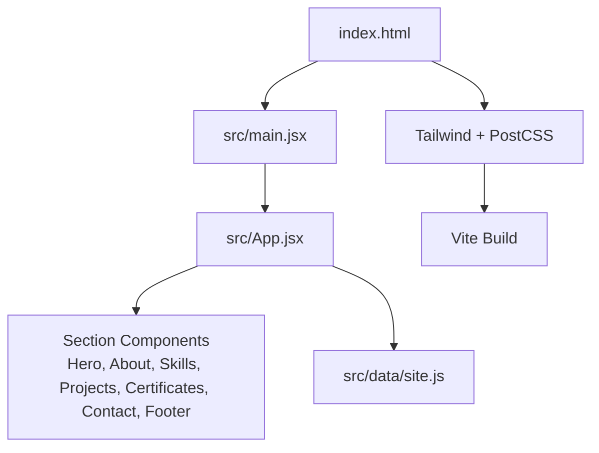
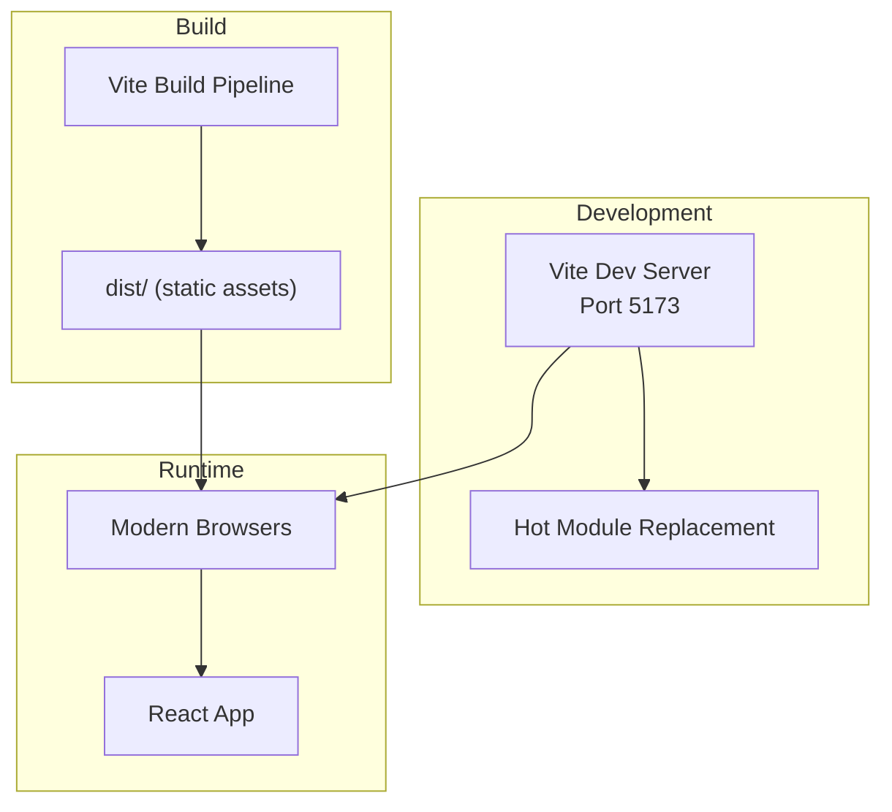
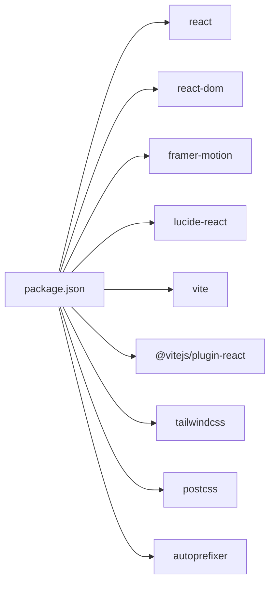

# Getting Started

<cite>
**Referenced Files in This Document**
- [package.json](file://package.json)
- [vite.config.js](file://vite.config.js)
- [tailwind.config.js](file://tailwind.config.js)
- [postcss.config.js](file://postcss.config.js)
- [index.html](file://index.html)
- [src/main.jsx](file://src/main.jsx)
- [src/App.jsx](file://src/App.jsx)
- [src/data/site.js](file://src/data/site.js)
</cite>

## Table of Contents
1. [Introduction](#introduction)
2. [Project Structure](#project-structure)
3. [Core Components](#core-components)
4. [Architecture Overview](#architecture-overview)
5. [Detailed Component Analysis](#detailed-component-analysis)
6. [Dependency Analysis](#dependency-analysis)
7. [Performance Considerations](#performance-considerations)
8. [Troubleshooting Guide](#troubleshooting-guide)
9. [Conclusion](#conclusion)

## Introduction
This guide helps you set up, run, and customize the Portfolio_2 project quickly. It covers Node.js requirements, installing dependencies, starting the development server, building for production, previewing the built site, configuring environment options, and basic customization steps.

## Project Structure
Portfolio_2 is a React + Vite application styled with Tailwind CSS. The main entry point renders the App component, which composes page sections such as Hero, About, Skills, Projects, Certificates, Contact, and Footer. Site content and identity are centralized in data files to make customization straightforward.

**Diagram sources**
- [index.html:62-70](file://index.html#L62-L70)
- [src/main.jsx:1-11](file://src/main.jsx#L1-L11)
- [src/App.jsx:1-32](file://src/App.jsx#L1-L32)
- [tailwind.config.js:1-89](file://tailwind.config.js#L1-L89)
- [postcss.config.js:1-7](file://postcss.config.js#L1-L7)

**Section sources**
- [index.html:1-72](file://index.html#L1-L72)
- [src/main.jsx:1-11](file://src/main.jsx#L1-L11)
- [src/App.jsx:1-32](file://src/App.jsx#L1-L32)

## Core Components
- Entry point: index.html loads the module script that mounts the React app into the root element.
- Application bootstrap: src/main.jsx creates the React root and renders App inside StrictMode.
- App shell: src/App.jsx composes top-level layout and section components.
- Content configuration: src/data/site.js centralizes identity, assets, navigation, about text, and contact details.

Key responsibilities:
- Rendering pipeline: index.html → main.jsx → App.jsx → section components.
- Styling pipeline: Tailwind CSS configured via tailwind.config.js and postcss.config.js.
- Build tooling: Vite configured in vite.config.js for dev server, preview, and build outputs.

**Section sources**
- [index.html:62-70](file://index.html#L62-L70)
- [src/main.jsx:1-11](file://src/main.jsx#L1-L11)
- [src/App.jsx:1-32](file://src/App.jsx#L1-L32)
- [src/data/site.js:1-116](file://src/data/site.js#L1-L116)

## Architecture Overview
The project uses a modern frontend stack:
- React for UI components
- Vite for fast development and optimized builds
- Tailwind CSS for utility-first styling with custom theme extensions
- PostCSS and Autoprefixer for CSS processing

**Diagram sources**
- [vite.config.js:5-21](file://vite.config.js#L5-L21)
- [package.json:7-10](file://package.json#L7-L10)

## Detailed Component Analysis

### Installation and Setup
- Requirements:
  - Node.js (recommended latest LTS).
  - npm or yarn package manager.
- Install dependencies:
  - Using npm: `npm install`
  - Using yarn: `yarn install`
- Start the development server:
  - Command: `npm run dev`
  - The server runs on port 5173 by default and does not auto-open the browser.
- Preview the built site locally:
  - First build: `npm run build`
  - Then preview: `npm run preview`
  - The preview server runs on port 4173 by default.

Notes:
- Scripts are defined in package.json.
- Vite configuration sets dev server port, preview port, and build output directory.

**Section sources**
- [package.json:7-10](file://package.json#L7-L10)
- [vite.config.js:7-14](file://vite.config.js#L7-L14)

### Development Workflow
- Run the development server:
  - `npm run dev`
- Hot reload is enabled automatically by Vite during development.
- If port 5173 is in use, Vite will try another available port because strictPort is disabled.

**Section sources**
- [vite.config.js:7-11](file://vite.config.js#L7-L11)

### Building for Production
- Build command:
  - `npm run build`
- Build settings:
  - Output directory: dist
  - Target: es2019
  - CSS code splitting: enabled
  - Source maps: disabled

After building, deploy the contents of the dist folder to your hosting provider.

**Section sources**
- [package.json:9](file://package.json#L9)
- [vite.config.js:15-20](file://vite.config.js#L15-L20)

### Environment Configuration Options
- Vite server and preview ports:
  - Dev server port: 5173
  - Preview server port: 4173
- Build target and output:
  - Build target: es2019
  - Output directory: dist
- CSS processing:
  - Tailwind CSS and Autoprefixer are active through PostCSS.

To change these values, edit vite.config.js accordingly.

**Section sources**
- [vite.config.js:7-20](file://vite.config.js#L7-L20)
- [postcss.config.js:1-7](file://postcss.config.js#L1-L7)

### Basic Customization Steps
- Update personal information and links:
  - Edit src/data/site.js to change name, role, social links, email, phone, WhatsApp, and other content.
- Replace profile image and CV:
  - Place your profile image at /public/images/profile-placeholder.svg (or update the path in src/data/site.js).
  - Place your CV PDF at /public/cv/M-Faizan-Hassan-CV.pdf (or update the path in src/data/site.js).
- Adjust branding and styles:
  - Modify colors, fonts, animations, and spacing in tailwind.config.js.
- SEO and metadata:
  - Update title, description, Open Graph, Twitter card, and JSON-LD schema in index.html.

Example paths to modify:
- Identity and content: [src/data/site.js:6-41](file://src/data/site.js#L6-L41), [src/data/site.js:62-116](file://src/data/site.js#L62-L116)
- Assets references: [src/data/site.js:48-52](file://src/data/site.js#L48-L52)
- Theme and design tokens: [tailwind.config.js:12-85](file://tailwind.config.js#L12-L85)
- Page metadata: [index.html:9-36](file://index.html#L9-L36)

**Section sources**
- [src/data/site.js:6-116](file://src/data/site.js#L6-L116)
- [tailwind.config.js:12-85](file://tailwind.config.js#L12-L85)
- [index.html:9-36](file://index.html#L9-L36)

## Dependency Analysis
Portfolio_2 depends on React and Vite for runtime and build-time tooling, with Tailwind CSS for styling.

**Diagram sources**
- [package.json:12-24](file://package.json#L12-L24)

**Section sources**
- [package.json:1-26](file://package.json#L1-L26)

## Performance Considerations
- Use the production build for deployment to benefit from code splitting and asset optimization.
- Keep images and PDFs optimized; place them under public and reference them via src/data/site.js.
- Avoid heavy third-party libraries unless necessary; this project already includes framer-motion for animations.

[No sources needed since this section provides general guidance]

## Troubleshooting Guide
- Port conflicts:
  - If port 5173 is occupied, Vite will attempt another port because strictPort is false. You can also manually adjust the port in vite.config.js.
- Missing dependencies:
  - Ensure you ran npm install or yarn install before starting the dev server.
- CSS not applying:
  - Confirm Tailwind and PostCSS are configured correctly in postcss.config.js and tailwind.config.js.
- Build errors:
  - Verify Node.js version compatibility and ensure all dependencies are installed.
- Preview not loading:
  - Run npm run build first, then npm run preview. The preview server defaults to port 4173.

**Section sources**
- [vite.config.js:7-14](file://vite.config.js#L7-L14)
- [postcss.config.js:1-7](file://postcss.config.js#L1-L7)
- [tailwind.config.js:1-89](file://tailwind.config.js#L1-L89)

## Conclusion
You now have everything needed to install, run, build, and customize Portfolio_2. Start with npm install and npm run dev to begin development, then use npm run build and npm run preview to validate the production output. Customize content via src/data/site.js and styling via tailwind.config.js to match your brand and goals.

[No sources needed since this section summarizes without analyzing specific files]