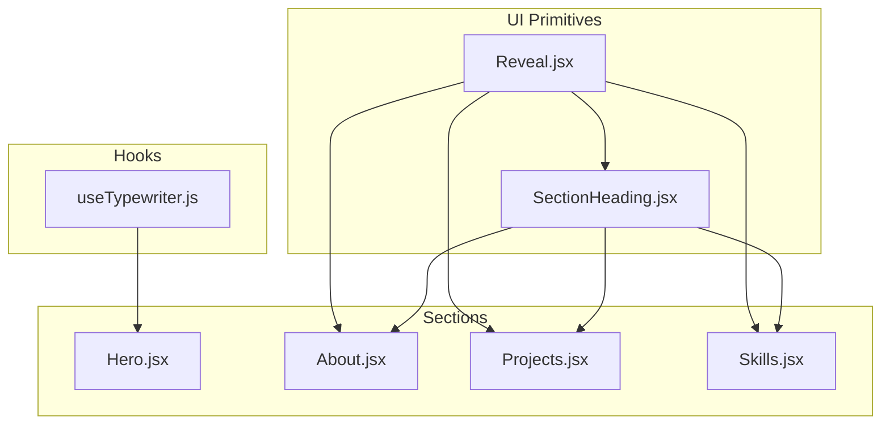
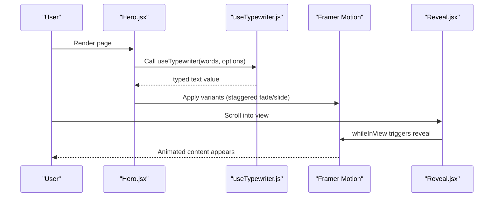
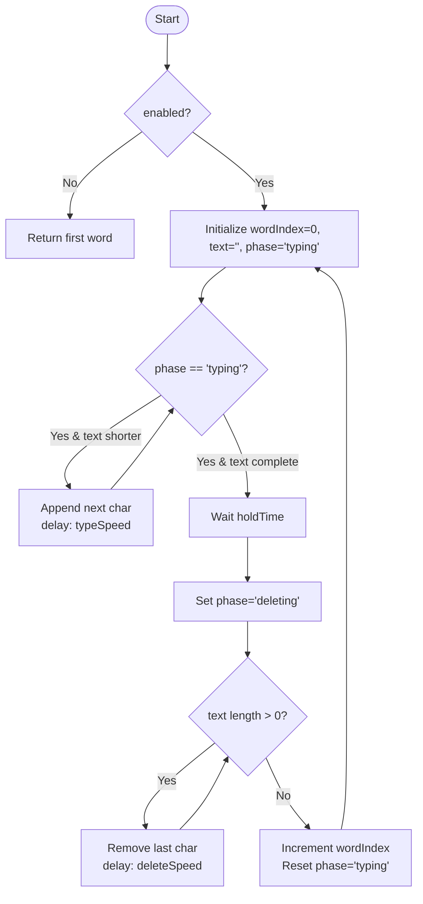
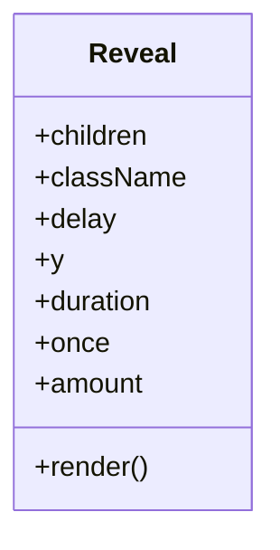
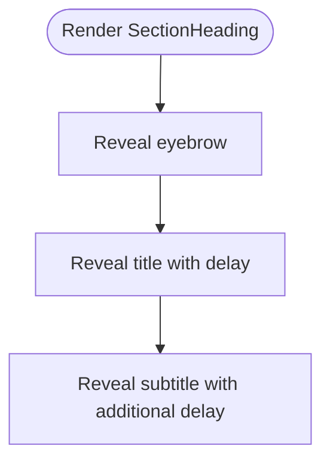
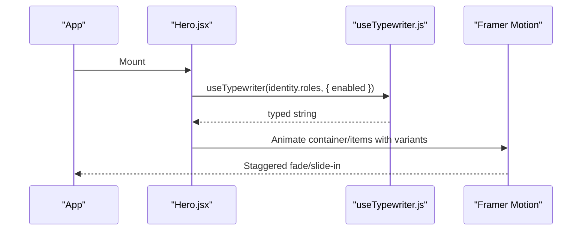
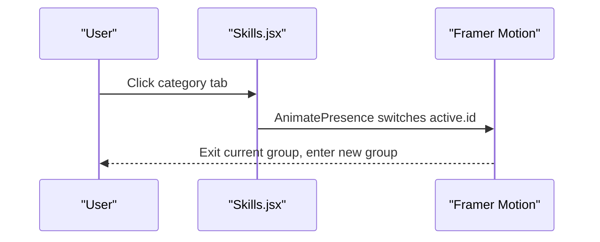
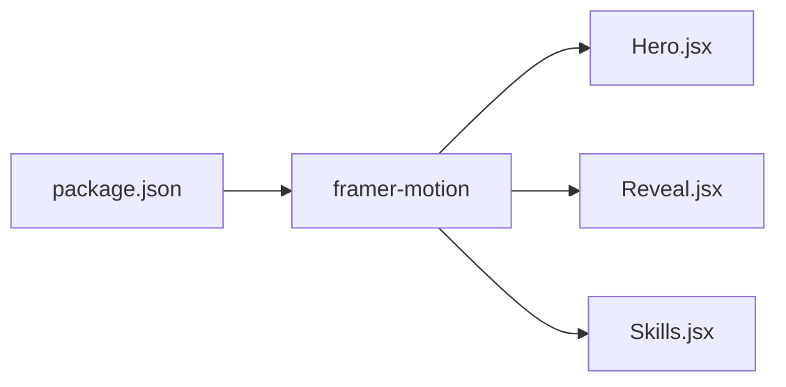

# Animation System

<cite>
**Referenced Files in This Document**
- [useTypewriter.js](file://src/hooks/useTypewriter.js)
- [Hero.jsx](file://src/components/Hero.jsx)
- [Reveal.jsx](file://src/components/ui/Reveal.jsx)
- [SectionHeading.jsx](file://src/components/ui/SectionHeading.jsx)
- [About.jsx](file://src/components/About.jsx)
- [Projects.jsx](file://src/components/Projects.jsx)
- [Skills.jsx](file://src/components/Skills.jsx)
- [package.json](file://package.json)
</cite>

## Table of Contents
1. [Introduction](#introduction)
2. [Project Structure](#project-structure)
3. [Core Components](#core-components)
4. [Architecture Overview](#architecture-overview)
5. [Detailed Component Analysis](#detailed-component-analysis)
6. [Dependency Analysis](#dependency-analysis)
7. [Performance Considerations](#performance-considerations)
8. [Accessibility and Motion Preferences](#accessibility-and-motion-preferences)
9. [Troubleshooting Guide](#troubleshooting-guide)
10. [Conclusion](#conclusion)

## Introduction
This document explains the animation system built with Framer Motion across the portfolio application. It covers:
- The typewriter effect used in the Hero section
- Reveal animations for content sections
- Smooth transitions throughout the app
- Configuration options for the useTypewriter hook
- Performance considerations and best practices
- Accessibility guidelines for motion-sensitive users
- How to add custom animations consistently

## Project Structure
The animation system is implemented through a small set of reusable hooks and components, combined with Framer Motion primitives:
- A custom hook for rotating text animation
- A scroll-triggered reveal component
- Section-level components that orchestrate staggered entrance animations
- Consistent usage of reduced-motion preferences

**Diagram sources**
- [useTypewriter.js:1-44](file://src/hooks/useTypewriter.js#L1-L44)
- [Reveal.jsx:1-34](file://src/components/ui/Reveal.jsx#L1-L34)
- [SectionHeading.jsx:1-70](file://src/components/ui/SectionHeading.jsx#L1-L70)
- [Hero.jsx:1-149](file://src/components/Hero.jsx#L1-L149)
- [About.jsx:1-148](file://src/components/About.jsx#L1-L148)
- [Projects.jsx:1-143](file://src/components/Projects.jsx#L1-L143)
- [Skills.jsx:1-187](file://src/components/Skills.jsx#L1-L187)

**Section sources**
- [package.json:12-16](file://package.json#L12-L16)

## Core Components
- useTypewriter: Provides a rotating typewriter effect with configurable timing and an enabled flag to disable animation when needed.
- Reveal: A scroll-triggered reveal wrapper that fades and slides content into view; it falls back to a plain element under reduced motion.
- SectionHeading: Composes multiple Reveal instances to animate eyebrow, title, and subtitle with staggered delays.
- Hero: Orchestrates container/item variants for staggered entrance animations and integrates the typewriter effect.
- About, Projects, Skills: Use Reveal and Framer Motion primitives to animate lists, cards, and tabbed content.

Key responsibilities:
- Typing/deleting phases and word rotation are encapsulated in useTypewriter.
- Scroll-based reveals are centralized in Reveal.
- Staggered entrances and consistent easing are defined at the section level (e.g., Hero).

**Section sources**
- [useTypewriter.js:1-44](file://src/hooks/useTypewriter.js#L1-L44)
- [Reveal.jsx:1-34](file://src/components/ui/Reveal.jsx#L1-L34)
- [SectionHeading.jsx:1-70](file://src/components/ui/SectionHeading.jsx#L1-L70)
- [Hero.jsx:1-149](file://src/components/Hero.jsx#L1-L149)
- [About.jsx:1-148](file://src/components/About.jsx#L1-L148)
- [Projects.jsx:1-143](file://src/components/Projects.jsx#L1-L143)
- [Skills.jsx:1-187](file://src/components/Skills.jsx#L1-L187)

## Architecture Overview
The animation architecture follows a layered approach:
- Hook layer: useTypewriter manages state and timers for typing effects.
- UI primitive layer: Reveal provides scroll-triggered animations with accessibility fallbacks.
- Section layer: Sections compose primitives to create cohesive experiences.

**Diagram sources**
- [Hero.jsx:1-149](file://src/components/Hero.jsx#L1-L149)
- [useTypewriter.js:1-44](file://src/hooks/useTypewriter.js#L1-L44)
- [Reveal.jsx:1-34](file://src/components/ui/Reveal.jsx#L1-L34)

## Detailed Component Analysis

### Typewriter Effect (useTypewriter)
Purpose:
- Rotates through an array of words, typing each character, pausing, deleting, then moving to the next word.
- Supports disabling animation via an enabled flag, returning static initial text when disabled.

Configuration options:
- typeSpeed: Milliseconds between typed characters.
- deleteSpeed: Milliseconds between deleted characters.
- holdTime: Pause duration after finishing typing before deletion begins.
- enabled: Boolean to enable/disable animation; when false, returns the first word immediately.

Behavioral flow:
- When enabled, cycles through phases: typing -> holding -> deleting -> next word.
- Uses timeouts to schedule updates and clears them on re-render or cleanup.

**Diagram sources**
- [useTypewriter.js:1-44](file://src/hooks/useTypewriter.js#L1-L44)

Integration points:
- Used in Hero to display rotating roles with a blinking caret.
- Disabled automatically when user prefers reduced motion.

**Section sources**
- [useTypewriter.js:1-44](file://src/hooks/useTypewriter.js#L1-L44)
- [Hero.jsx:1-149](file://src/components/Hero.jsx#L1-L149)

### Reveal Component
Purpose:
- Wraps content to reveal it on scroll with opacity and vertical translation.
- Falls back to a plain div when reduced motion is preferred.

Props:
- children: Content to animate.
- className: Additional styles.
- delay: Transition delay.
- y: Initial vertical offset.
- duration: Transition duration.
- once: Whether to trigger only once.
- amount: Viewport threshold to trigger.

Behavior:
- If reduced motion is detected, renders children without animation.
- Otherwise, uses whileInView to animate from hidden to visible.

**Diagram sources**
- [Reveal.jsx:1-34](file://src/components/ui/Reveal.jsx#L1-L34)

Usage patterns:
- Applied to paragraphs, headings, cards, and lists to provide consistent scroll-based reveals.

**Section sources**
- [Reveal.jsx:1-34](file://src/components/ui/Reveal.jsx#L1-L34)

### SectionHeading
Purpose:
- Composes eyebrow, title, and subtitle with staggered Reveal animations.
- Supports tone and alignment variations.

Animation strategy:
- Eyebrow revealed first.
- Title revealed with a slight delay.
- Subtitle revealed with a further delay.

**Diagram sources**
- [SectionHeading.jsx:1-70](file://src/components/ui/SectionHeading.jsx#L1-L70)

**Section sources**
- [SectionHeading.jsx:1-70](file://src/components/ui/SectionHeading.jsx#L1-L70)

### Hero Section
Purpose:
- Presents identity, role labels, availability, intro text, CTAs, and social links.
- Implements staggered container/item animations and integrates the typewriter effect.

Animation details:
- Container defines staggerChildren and delayChildren for child items.
- Item defines initial hidden state (opacity and y) and show state with eased transition.
- Reduces motion by setting durations and offsets to zero when preferred.
- Right-side panel animates independently with its own initial/animate/transition.

**Diagram sources**
- [Hero.jsx:1-149](file://src/components/Hero.jsx#L1-L149)
- [useTypewriter.js:1-44](file://src/hooks/useTypewriter.js#L1-L44)

**Section sources**
- [Hero.jsx:1-149](file://src/components/Hero.jsx#L1-L149)

### About Section
Purpose:
- Displays profile image, bio paragraphs, interests, and principles.
- Uses Reveal to animate images, paragraphs, chips, and principle cards with staggered delays.

Animation highlights:
- Paragraphs animated sequentially using index-based delays.
- Principle cards revealed with incremental delays for a cascading effect.

**Section sources**
- [About.jsx:1-148](file://src/components/About.jsx#L1-L148)

### Projects Section
Purpose:
- Lists project cards with visuals, descriptions, tech stacks, and actions.
- Animates list entries with staggered delays.

Animation highlights:
- Each project card wrapped in Reveal with delay based on index.
- Header and external link also animated with Reveal.

**Section sources**
- [Projects.jsx:1-143](file://src/components/Projects.jsx#L1-L143)

### Skills Section
Purpose:
- Organizes skills into categories with tabs and animated content switching.
- Uses AnimatePresence and motion.div to transition between skill groups.

Animation highlights:
- Tab content fades and translates when active group changes.
- Reduced motion disables exit animations and sets duration to zero.

**Diagram sources**
- [Skills.jsx:1-187](file://src/components/Skills.jsx#L1-L187)

**Section sources**
- [Skills.jsx:1-187](file://src/components/Skills.jsx#L1-L187)

## Dependency Analysis
External dependencies relevant to animations:
- framer-motion: Provides motion primitives, AnimatePresence, and useReducedMotion.

**Diagram sources**
- [package.json:12-16](file://package.json#L12-L16)
- [Hero.jsx:1-149](file://src/components/Hero.jsx#L1-L149)
- [Reveal.jsx:1-34](file://src/components/ui/Reveal.jsx#L1-L34)
- [Skills.jsx:1-187](file://src/components/Skills.jsx#L1-L187)

**Section sources**
- [package.json:12-16](file://package.json#L12-L16)

## Performance Considerations
Guidelines to maintain smooth animations:
- Prefer transform and opacity animations; avoid layout-thrashing properties like width/height.
- Keep animation durations moderate (e.g., 0.3–0.9s) and use ease curves for natural motion.
- Limit concurrent animations; stagger rather than animate everything simultaneously.
- Use viewport-based triggers (whileInView) to defer animations until elements are visible.
- Disable animations for users who prefer reduced motion.
- Avoid heavy computations inside animation callbacks; keep logic minimal.
- Reuse animation definitions (variants) to reduce object churn.
- Debounce or throttle frequent state updates if necessary; here, timers are already scoped per hook lifecycle.

Practical examples in this codebase:
- Hero uses staggerChildren and delayChildren to sequence item entrances.
- Reveal defers animation until scrolled into view and falls back to no animation under reduced motion.
- Skills uses AnimatePresence with short durations for tab transitions.

[No sources needed since this section provides general guidance]

## Accessibility and Motion Preferences
- Respect user preferences: useReducedMotion is used in Hero, Reveal, and Skills to disable or simplify animations.
- Provide meaningful text alternatives:
  - The typewriter output includes a screen-reader-only label listing all roles.
  - Decorative elements use aria-hidden to avoid noise for assistive technologies.
- Ensure focus management: interactive controls (buttons, links) remain keyboard accessible.
- Do not rely solely on motion to convey information; ensure content is understandable without animations.

Best practices:
- Always check useReducedMotion before enabling complex animations.
- Offer static fallbacks (e.g., Reveal rendering a plain div).
- Announce dynamic changes where appropriate (e.g., ARIA attributes for toggles).

**Section sources**
- [Hero.jsx:1-149](file://src/components/Hero.jsx#L1-L149)
- [Reveal.jsx:1-34](file://src/components/ui/Reveal.jsx#L1-L34)
- [Skills.jsx:1-187](file://src/components/Skills.jsx#L1-L187)

## Troubleshooting Guide
Common issues and resolutions:
- Typewriter not appearing:
  - Verify enabled flag is true; when disabled, it returns the first word statically.
  - Ensure words array is non-empty.
- Animations not triggering:
  - Confirm elements are within viewport for Reveal; adjust amount or once props.
  - Check that parent containers do not clip overflow unexpectedly.
- Jitter or performance drops:
  - Reduce number of simultaneous animations; increase stagger gaps.
  - Shorten durations and avoid expensive transforms.
- Reduced motion not respected:
  - Ensure useReducedMotion is called and passed to motion components.
  - Validate that fallback branches render correctly.

**Section sources**
- [useTypewriter.js:1-44](file://src/hooks/useTypewriter.js#L1-L44)
- [Reveal.jsx:1-34](file://src/components/ui/Reveal.jsx#L1-L34)
- [Hero.jsx:1-149](file://src/components/Hero.jsx#L1-L149)
- [Skills.jsx:1-187](file://src/components/Skills.jsx#L1-L187)

## Conclusion
This animation system combines a lightweight typewriter hook, a scroll-triggered reveal primitive, and section-level orchestration to deliver engaging yet performant interactions. By respecting reduced motion, staggering animations, and keeping transitions subtle, the application maintains accessibility and performance while providing a polished user experience. To extend the system, follow existing patterns: define clear configuration options, leverage Framer Motion’s primitives, and always provide fallbacks for motion-sensitive users.

[No sources needed since this section summarizes without analyzing specific files]