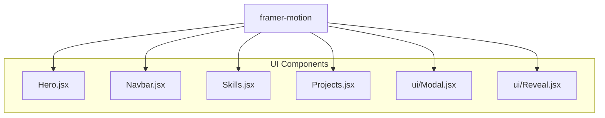
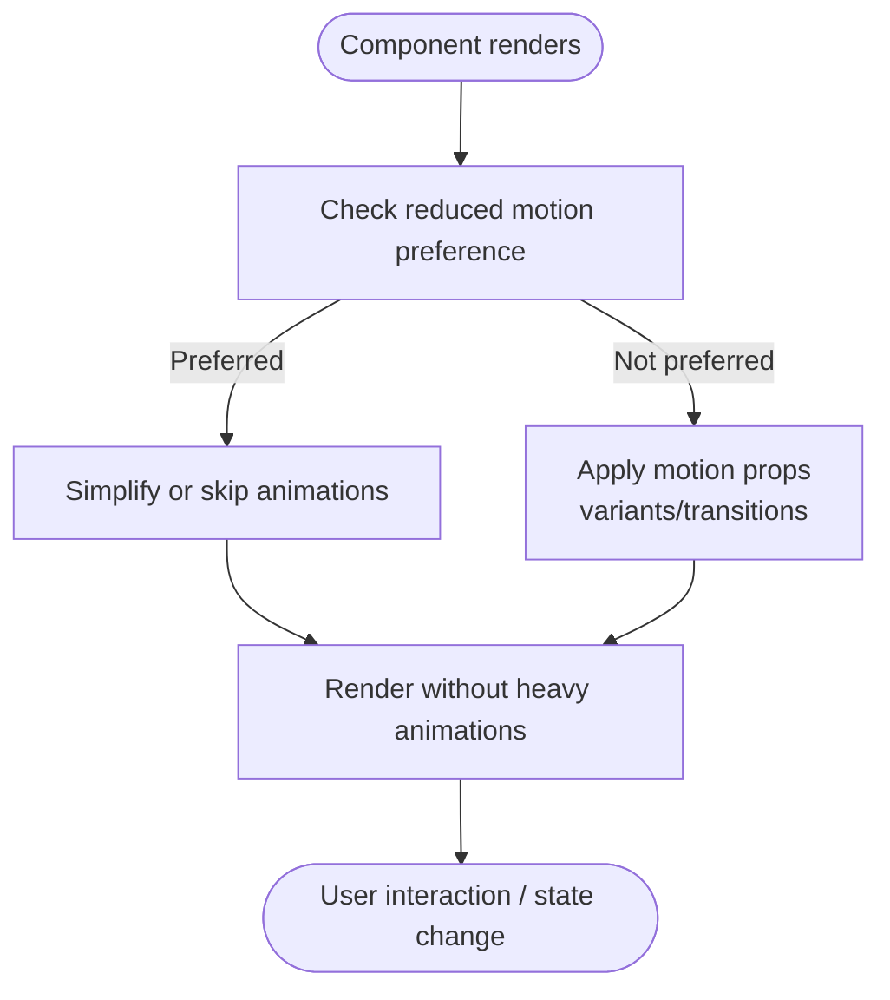
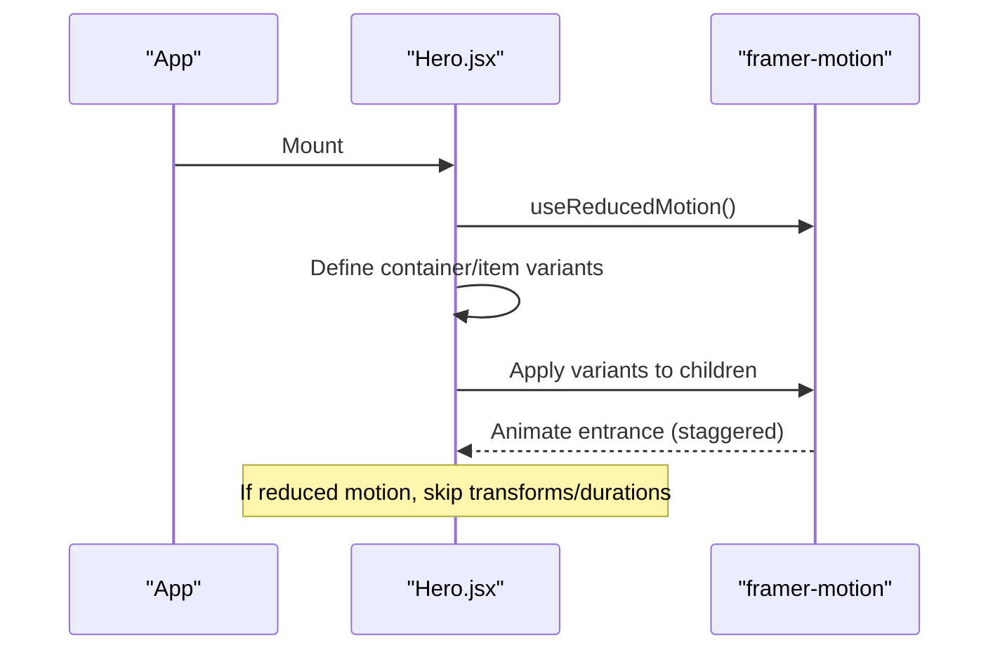
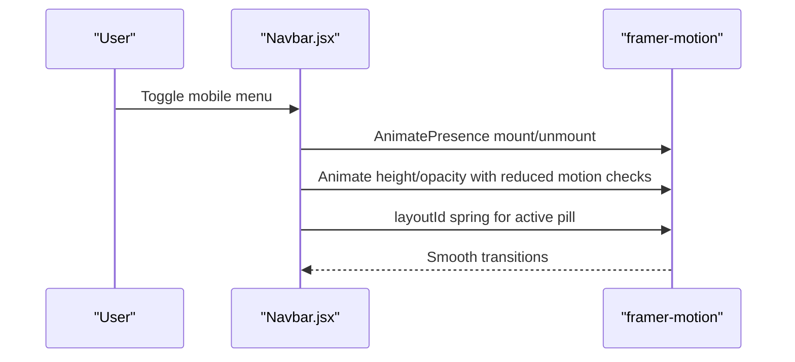
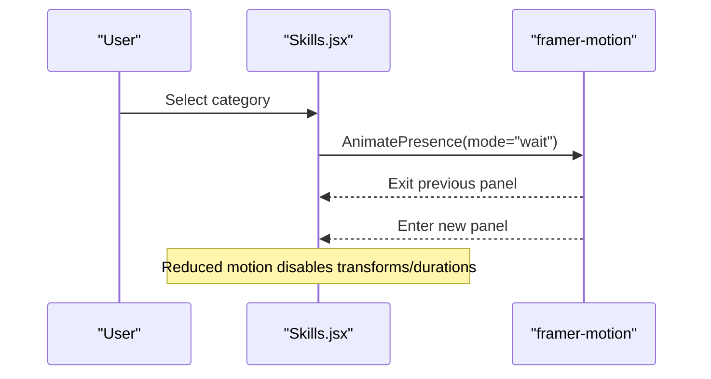
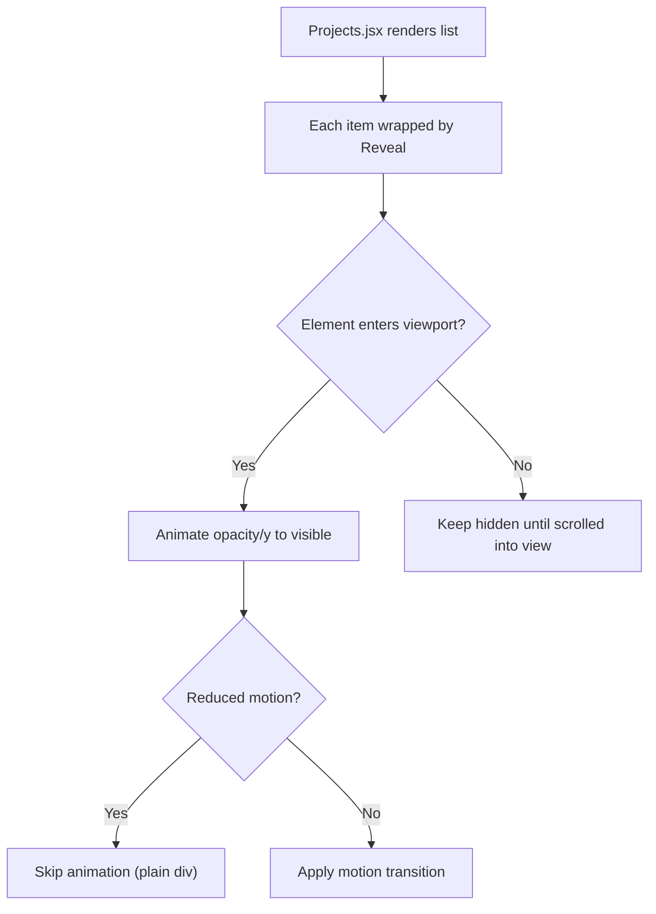
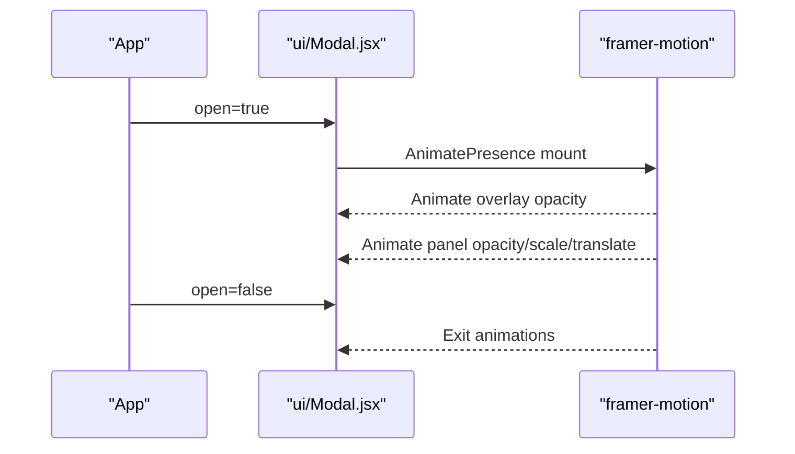
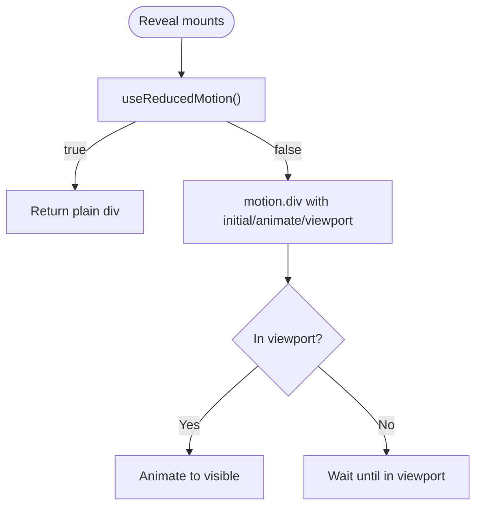
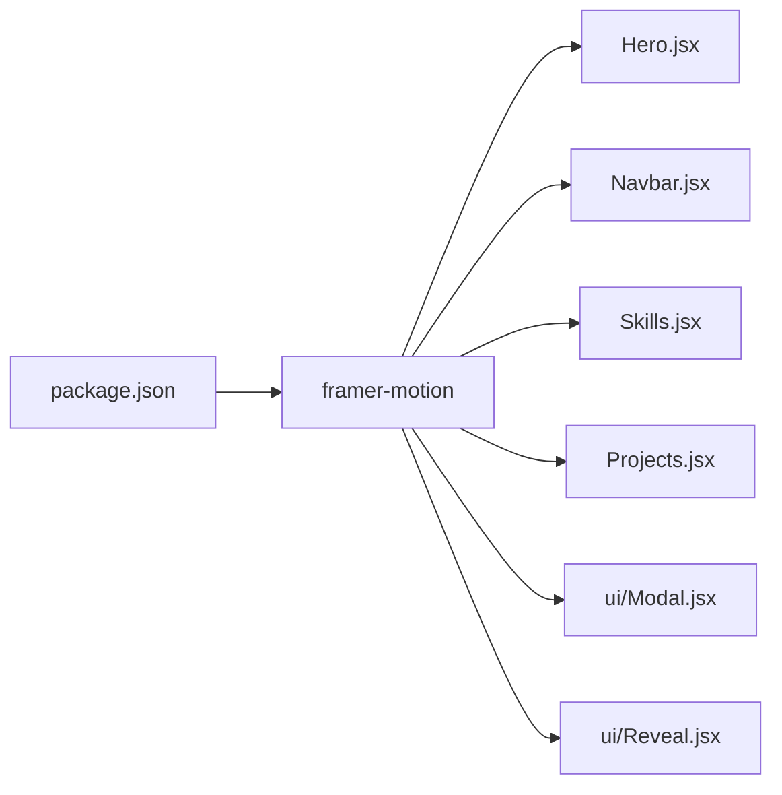

# Motion Configuration

<cite>
**Referenced Files in This Document**
- [package.json](file://package.json)
- [Hero.jsx](file://src/components/Hero.jsx)
- [Navbar.jsx](file://src/components/Navbar.jsx)
- [Skills.jsx](file://src/components/Skills.jsx)
- [Projects.jsx](file://src/components/Projects.jsx)
- [Modal.jsx](file://src/components/ui/Modal.jsx)
- [Reveal.jsx](file://src/components/ui/Reveal.jsx)
</cite>

## Table of Contents
1. [Introduction](#introduction)
2. [Project Structure](#project-structure)
3. [Core Components](#core-components)
4. [Architecture Overview](#architecture-overview)
5. [Detailed Component Analysis](#detailed-component-analysis)
6. [Dependency Analysis](#dependency-analysis)
7. [Performance Considerations](#performance-considerations)
8. [Troubleshooting Guide](#troubleshooting-guide)
9. [Conclusion](#conclusion)

## Introduction
This document explains how Framer Motion is configured and integrated across the application to deliver consistent, accessible, and performant animations. It covers:
- Container animations and item transitions using variants
- Responsive behavior and reduced motion support
- Animation variants system and transition configurations
- Performance optimizations for complex sequences
- Browser compatibility, debugging techniques, and best practices for timing and easing consistency

The project uses React with Vite and Tailwind CSS, and integrates Framer Motion for declarative animations.

**Section sources**
- [package.json:12-16](file://package.json#L12-L16)

## Project Structure
Framer Motion is used throughout UI components to animate entrances, exits, layout changes, and scroll-triggered reveals. Key integration points include:
- Hero section: container + item variants for staggered entrance
- Navbar: AnimatePresence for mobile menu and spring-based active indicator
- Skills: AnimatePresence for tab content transitions
- Projects: Reusable scroll-triggered reveal wrapper
- Modal: AnimatePresence for overlay and panel transitions
- Reveal: Scroll-triggered component with reduced motion fallback

**Diagram sources**
- [Hero.jsx:1-149](file://src/components/Hero.jsx#L1-L149)
- [Navbar.jsx:1-218](file://src/components/Navbar.jsx#L1-L218)
- [Skills.jsx:1-187](file://src/components/Skills.jsx#L1-L187)
- [Projects.jsx:1-143](file://src/components/Projects.jsx#L1-L143)
- [Modal.jsx:1-131](file://src/components/ui/Modal.jsx#L1-L131)
- [Reveal.jsx:1-34](file://src/components/ui/Reveal.jsx#L1-L34)

**Section sources**
- [Hero.jsx:1-149](file://src/components/Hero.jsx#L1-L149)
- [Navbar.jsx:1-218](file://src/components/Navbar.jsx#L1-L218)
- [Skills.jsx:1-187](file://src/components/Skills.jsx#L1-L187)
- [Projects.jsx:1-143](file://src/components/Projects.jsx#L1-L143)
- [Modal.jsx:1-131](file://src/components/ui/Modal.jsx#L1-L131)
- [Reveal.jsx:1-34](file://src/components/ui/Reveal.jsx#L1-L34)

## Core Components
- Hero.jsx: Uses container and item variants to orchestrate a staggered entrance; respects reduced motion by disabling transforms and durations.
- Navbar.jsx: Uses AnimatePresence for mobile menu transitions and a spring-based layoutId pill for the active navigation state; reduces motion where appropriate.
- Skills.jsx: Uses AnimatePresence with mode="wait" to transition between skill categories; applies reduced motion logic to initial/animate/exit states.
- Projects.jsx: Wraps items with Reveal for scroll-triggered animations; relies on Reveal’s reduced motion handling.
- ui/Modal.jsx: Uses AnimatePresence for overlay and panel transitions; computes duration based on reduced motion preference.
- ui/Reveal.jsx: Provides a scroll-triggered reveal that falls back to a plain element when reduced motion is preferred.

Key patterns:
- useReducedMotion() to detect user preference and adjust or disable animations
- Variants for container/item choreography
- AnimatePresence for mounting/unmounting transitions
- Consistent ease curve [0.22, 1, 0.36, 1] across components
- Staggered children via container variants

**Section sources**
- [Hero.jsx:1-149](file://src/components/Hero.jsx#L1-L149)
- [Navbar.jsx:1-218](file://src/components/Navbar.jsx#L1-L218)
- [Skills.jsx:1-187](file://src/components/Skills.jsx#L1-L187)
- [Projects.jsx:1-143](file://src/components/Projects.jsx#L1-L143)
- [Modal.jsx:1-131](file://src/components/ui/Modal.jsx#L1-L131)
- [Reveal.jsx:1-34](file://src/components/ui/Reveal.jsx#L1-L34)

## Architecture Overview
The animation architecture centers around shared principles:
- Reduced motion first: components check user preference and either simplify or skip animations
- Centralized easing: a consistent cubic-bezier curve ensures cohesive feel
- Declarative transitions: motion props (initial/animate/exit/whileInView) define state-driven animations
- Composition: reusable wrappers like Reveal encapsulate common behaviors

[No sources needed since this diagram shows conceptual workflow, not actual code structure]

## Detailed Component Analysis

### Hero Section: Container and Item Variants
- Defines container variants with staggerChildren and delayChildren
- Defines item variants with opacity and y translation
- Applies variants to nested motion elements for orchestrated entrance
- Disables transforms and durations when reduced motion is preferred
- Animates the right-side panel independently with tailored transition

**Diagram sources**
- [Hero.jsx:1-149](file://src/components/Hero.jsx#L1-L149)

**Section sources**
- [Hero.jsx:12-26](file://src/components/Hero.jsx#L12-L26)
- [Hero.jsx:43-143](file://src/components/Hero.jsx#L43-L143)

### Navbar: Mobile Menu and Active Indicator
- Uses AnimatePresence to animate mobile menu open/close
- Applies reduced motion to both initial/animate/exit and transition duration
- Uses layoutId for smooth active indicator movement with a spring configuration
- Disables spring animation when reduced motion is preferred

**Diagram sources**
- [Navbar.jsx:144-214](file://src/components/Navbar.jsx#L144-L214)
- [Navbar.jsx:86-95](file://src/components/Navbar.jsx#L86-L95)

**Section sources**
- [Navbar.jsx:144-214](file://src/components/Navbar.jsx#L144-L214)
- [Navbar.jsx:86-95](file://src/components/Navbar.jsx#L86-L95)

### Skills: Tabbed Content Transitions
- Uses AnimatePresence with mode="wait" to ensure one panel at a time
- Animates content entry/exit with reduced motion considerations
- Maintains consistent easing and duration scaling based on preference

**Diagram sources**
- [Skills.jsx:138-179](file://src/components/Skills.jsx#L138-L179)

**Section sources**
- [Skills.jsx:138-179](file://src/components/Skills.jsx#L138-L179)

### Projects: Scroll-Triggered Reveals
- Wraps each project card with Reveal to animate on viewport entry
- Leverages Reveal’s reduced motion fallback to avoid unnecessary work

**Diagram sources**
- [Projects.jsx:56-135](file://src/components/Projects.jsx#L56-L135)
- [Reveal.jsx:1-34](file://src/components/ui/Reveal.jsx#L1-L34)

**Section sources**
- [Projects.jsx:56-135](file://src/components/Projects.jsx#L56-L135)
- [Reveal.jsx:1-34](file://src/components/ui/Reveal.jsx#L1-L34)

### Modal: Overlay and Panel Transitions
- Uses AnimatePresence to manage overlay and dialog panel lifecycle
- Computes duration based on reduced motion preference
- Applies consistent easing curve and scale/translate transitions

**Diagram sources**
- [Modal.jsx:80-129](file://src/components/ui/Modal.jsx#L80-L129)

**Section sources**
- [Modal.jsx:78-129](file://src/components/ui/Modal.jsx#L78-L129)

### Reveal: Scroll-Triggered Wrapper
- Detects reduced motion and returns a plain div to avoid animations
- Uses whileInView to trigger entrance animations with configurable delay, distance, and viewport threshold
- Applies consistent easing curve

**Diagram sources**
- [Reveal.jsx:1-34](file://src/components/ui/Reveal.jsx#L1-L34)

**Section sources**
- [Reveal.jsx:1-34](file://src/components/ui/Reveal.jsx#L1-L34)

## Dependency Analysis
Framer Motion is a direct dependency used by multiple components. The following diagram highlights import relationships and usage patterns.

**Diagram sources**
- [package.json:12-16](file://package.json#L12-L16)
- [Hero.jsx:1-149](file://src/components/Hero.jsx#L1-L149)
- [Navbar.jsx:1-218](file://src/components/Navbar.jsx#L1-L218)
- [Skills.jsx:1-187](file://src/components/Skills.jsx#L1-L187)
- [Projects.jsx:1-143](file://src/components/Projects.jsx#L1-L143)
- [Modal.jsx:1-131](file://src/components/ui/Modal.jsx#L1-L131)
- [Reveal.jsx:1-34](file://src/components/ui/Reveal.jsx#L1-L34)

**Section sources**
- [package.json:12-16](file://package.json#L12-L16)

## Performance Considerations
- Reduced motion optimization: All key components respect user preferences via useReducedMotion(), disabling transforms and durations when needed.
- Staggered animations: Use container variants with staggerChildren to avoid jank and improve perceived performance.
- AnimatePresence mode: Use mode="wait" for sequential transitions to prevent overlapping animations.
- Spring vs linear: Prefer springs for natural motion where appropriate (e.g., active indicator), but keep durations short.
- Avoid heavy effects: Keep animations to transform and opacity for GPU acceleration.
- Conditional rendering: Wrap expensive animated sections with visibility checks to reduce render cost.

[No sources needed since this section provides general guidance]

## Troubleshooting Guide
Common issues and resolutions:
- Animations not playing: Ensure motion components are mounted inside AnimatePresence when using exit animations.
- Jittery animations: Verify you are animating transform and opacity only; avoid animating layout-affecting properties.
- Reduced motion not respected: Confirm useReducedMotion() is called and branches correctly in your components.
- Stagger not working: Ensure parent has variants with staggerChildren and children have matching variant names.
- LayoutId flicker: Make sure layoutId values are stable and unique per animated element.
- Debugging tips:
  - Temporarily set all durations to zero to isolate layout issues
  - Log reduced motion preference to verify environment detection
  - Use browser dev tools to inspect computed styles during transitions

**Section sources**
- [Hero.jsx:1-149](file://src/components/Hero.jsx#L1-L149)
- [Navbar.jsx:1-218](file://src/components/Navbar.jsx#L1-L218)
- [Skills.jsx:1-187](file://src/components/Skills.jsx#L1-L187)
- [Modal.jsx:1-131](file://src/components/ui/Modal.jsx#L1-L131)
- [Reveal.jsx:1-34](file://src/components/ui/Reveal.jsx#L1-L34)

## Conclusion
The application consistently applies Framer Motion through a clear pattern:
- Respect reduced motion preferences
- Use variants for coordinated container/item animations
- Employ AnimatePresence for robust enter/exit transitions
- Maintain a unified easing curve for visual coherence
- Optimize performance by limiting animated properties and leveraging GPU-friendly transforms

Following these guidelines will help maintain predictable, accessible, and high-performance animations across the portfolio.

[No sources needed since this section summarizes without analyzing specific files]