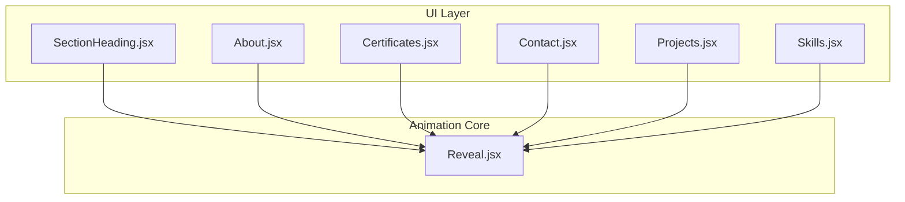
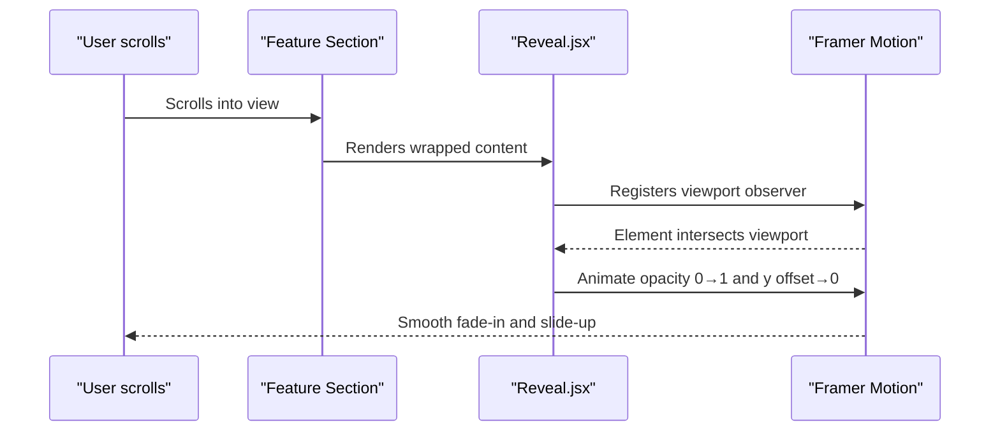
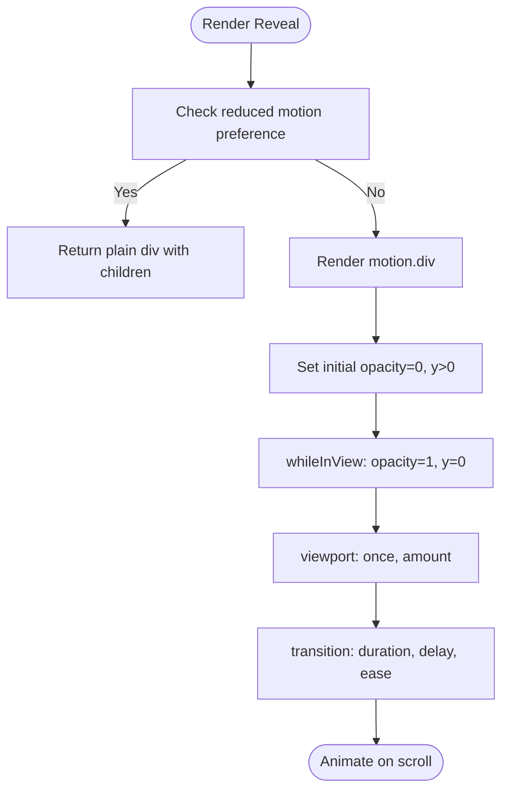
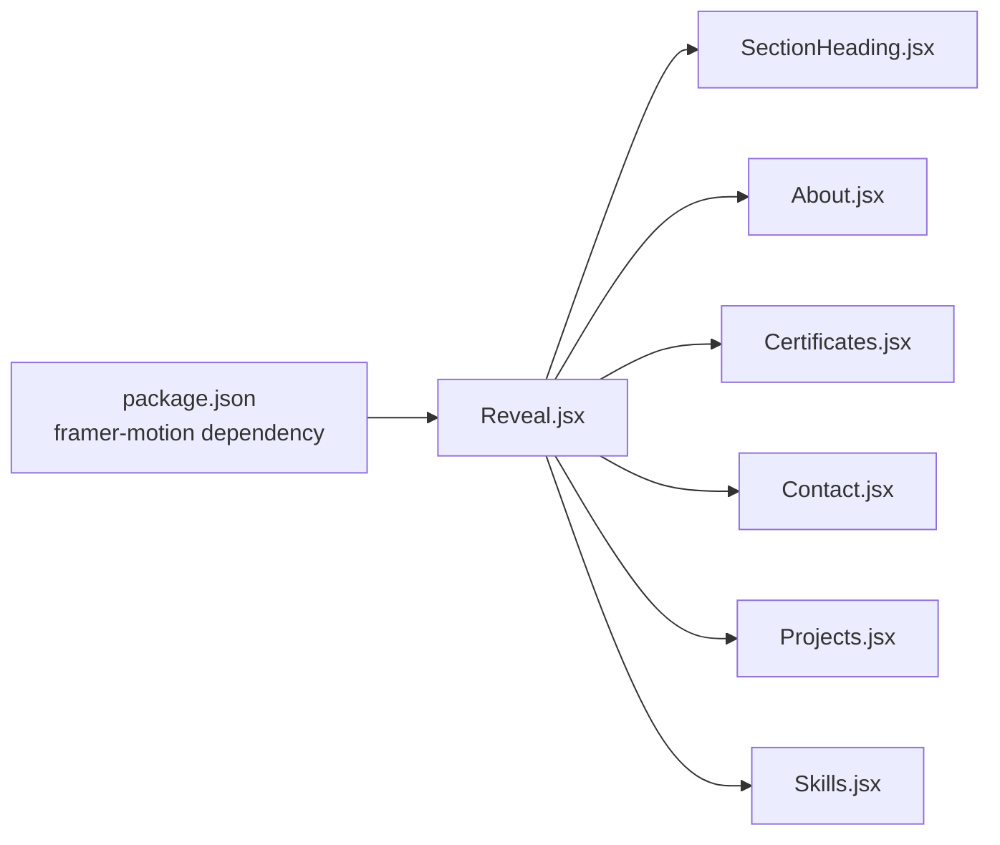

# Reveal Animations

<cite>
**Referenced Files in This Document**
- [Reveal.jsx](file://src/components/ui/Reveal.jsx)
- [About.jsx](file://src/components/About.jsx)
- [Certificates.jsx](file://src/components/Certificates.jsx)
- [Contact.jsx](file://src/components/Contact.jsx)
- [Projects.jsx](file://src/components/Projects.jsx)
- [Skills.jsx](file://src/components/Skills.jsx)
- [SectionHeading.jsx](file://src/components/ui/SectionHeading.jsx)
- [package.json](file://package.json)
</cite>

## Table of Contents
1. [Introduction](#introduction)
2. [Project Structure](#project-structure)
3. [Core Components](#core-components)
4. [Architecture Overview](#architecture-overview)
5. [Detailed Component Analysis](#detailed-component-analysis)
6. [Dependency Analysis](#dependency-analysis)
7. [Performance Considerations](#performance-considerations)
8. [Troubleshooting Guide](#troubleshooting-guide)
9. [Conclusion](#conclusion)

## Introduction
This document explains the reveal animation system built with Framer Motion. It focuses on the reusable Reveal component, how it triggers animations when elements enter the viewport, and how the application applies staggered effects across sections such as About, Certificates, Contact, Projects, Skills, and SectionHeading. You will learn how to configure timing, easing, scroll thresholds, and reduced motion support for accessibility while keeping performance smooth.

## Project Structure
The reveal system is centered around a small, focused UI component that wraps content with Framer Motion’s scroll-triggered animations. Other components import Reveal to animate their content consistently.

**Diagram sources**
- [SectionHeading.jsx:1-70](file://src/components/ui/SectionHeading.jsx#L1-L70)
- [About.jsx:1-148](file://src/components/About.jsx#L1-L148)
- [Certificates.jsx:1-153](file://src/components/Certificates.jsx#L1-L153)
- [Contact.jsx:1-343](file://src/components/Contact.jsx#L1-L343)
- [Projects.jsx:1-143](file://src/components/Projects.jsx#L1-L143)
- [Skills.jsx:1-187](file://src/components/Skills.jsx#L1-L187)
- [Reveal.jsx:1-34](file://src/components/ui/Reveal.jsx#L1-L34)

**Section sources**
- [Reveal.jsx:1-34](file://src/components/ui/Reveal.jsx#L1-L34)
- [SectionHeading.jsx:1-70](file://src/components/ui/SectionHeading.jsx#L1-L70)
- [About.jsx:1-148](file://src/components/About.jsx#L1-L148)
- [Certificates.jsx:1-153](file://src/components/Certificates.jsx#L1-L153)
- [Contact.jsx:1-343](file://src/components/Contact.jsx#L1-L343)
- [Projects.jsx:1-143](file://src/components/Projects.jsx#L1-L143)
- [Skills.jsx:1-187](file://src/components/Skills.jsx#L1-L187)

## Core Components
- Reveal: A lightweight wrapper that animates children when they enter the viewport. It supports configurable vertical offset, duration, delay, once-only behavior, and viewport threshold. It also respects user preferences for reduced motion by rendering a plain element instead of an animated one.

Key behaviors:
- Fade-in and slide-up: Elements start invisible and slightly below their final position, then fade to full opacity and slide into place.
- Scroll-triggered: Animations run when the element enters the viewport using Framer Motion’s viewport detection.
- Staggered reveals: Parent components apply incremental delays to create cascading entry effects.
- Reduced motion: When users prefer reduced motion, Reveal renders a non-animated container so animations do not run.

Configuration options used across the app:
- delay: Controls stagger timing between sibling elements.
- y: Vertical distance from which the element slides up.
- duration: Animation length.
- once: Whether to animate only the first time the element enters the viewport.
- amount: Viewport threshold at which the animation triggers.

**Section sources**
- [Reveal.jsx:1-34](file://src/components/ui/Reveal.jsx#L1-L34)

## Architecture Overview
The architecture is simple and composable:
- Reveal encapsulates all animation logic.
- Feature components (About, Certificates, Contact, Projects, Skills, SectionHeading) import Reveal and wrap content.
- Staggering is achieved by passing increasing delay values based on index or explicit offsets.
- Accessibility is handled via useReducedMotion, ensuring no jarring motion for sensitive users.

**Diagram sources**
- [Reveal.jsx:1-34](file://src/components/ui/Reveal.jsx#L1-L34)

## Detailed Component Analysis

### Reveal Component
Responsibilities:
- Provide a consistent reveal effect across the site.
- Respect reduced motion preferences.
- Expose props for fine-tuning animation behavior.

Implementation highlights:
- Uses Framer Motion’s motion.div for declarative animations.
- initial state sets opacity to 0 and a positive y offset.
- whileInView transitions to fully visible and zero offset.
- viewport controls trigger conditions (once and amount).
- transition defines duration, delay, and a custom ease curve.
- If reduced motion is detected, returns a plain div with children.

**Diagram sources**
- [Reveal.jsx:1-34](file://src/components/ui/Reveal.jsx#L1-L34)

Usage patterns in the app:
- About: Wraps paragraphs and cards with staggered delays to create a cascading reveal.
- Certificates: Applies staggered delays per card row and a slight y offset for subtle lift.
- Contact: Staggered reveal for contact channels and a larger y offset for the form panel.
- Projects: Staggered reveal for project rows.
- Skills: Combines Reveal with AnimatePresence for tab content transitions; still uses reduced motion checks.
- SectionHeading: Wraps eyebrow, title, and subtitle with staggered delays.

**Section sources**
- [Reveal.jsx:1-34](file://src/components/ui/Reveal.jsx#L1-L34)
- [About.jsx:89-142](file://src/components/About.jsx#L89-L142)
- [Certificates.jsx:57-137](file://src/components/Certificates.jsx#L57-L137)
- [Contact.jsx:176-231](file://src/components/Contact.jsx#L176-L231)
- [Projects.jsx:55-135](file://src/components/Projects.jsx#L55-L135)
- [Skills.jsx:131-181](file://src/components/Skills.jsx#L131-L181)
- [SectionHeading.jsx:17-66](file://src/components/ui/SectionHeading.jsx#L17-L66)

### Applying Reveal to Different UI Elements
- Text blocks: Wrap each paragraph or sentence with Reveal and increment delay to stagger lines.
- Cards and tiles: Apply a small y offset and stagger delays per item to create a grid entrance.
- Panels and forms: Use a larger y offset for prominent panels to emphasize their arrival.
- Headings and labels: Stagger eyebrow, title, and subtitle for a polished section header.

Examples in codebase:
- Paragraph staggering in About.
- Card staggering in Certificates and Projects.
- Channel list staggering in Contact.
- Tabbed content reveal in Skills alongside AnimatePresence.

**Section sources**
- [About.jsx:89-142](file://src/components/About.jsx#L89-L142)
- [Certificates.jsx:57-137](file://src/components/Certificates.jsx#L57-L137)
- [Contact.jsx:176-231](file://src/components/Contact.jsx#L176-L231)
- [Projects.jsx:55-135](file://src/components/Projects.jsx#L55-L135)
- [Skills.jsx:131-181](file://src/components/Skills.jsx#L131-L181)

### Configuring Timing and Easing
- Duration: Adjusts how long the animation takes. Longer durations feel smoother but can slow perceived responsiveness if overused.
- Delay: Creates staggered sequences. Use small increments (e.g., 0.05–0.1 seconds) for natural flow.
- Easing: The implementation uses a custom ease curve for a premium feel. Keep easing consistent across the site for cohesion.
- Thresholds: The amount prop controls when the animation triggers relative to the viewport. Smaller values trigger earlier; larger values require more visibility.

Best practices:
- Keep total animation time under ~1 second for most elements.
- Use stagger sparingly; too many overlapping animations can cause layout thrashing.
- Prefer once=true for large lists to avoid re-triggering on every scroll.

**Section sources**
- [Reveal.jsx:1-34](file://src/components/ui/Reveal.jsx#L1-L34)

### Reduced Motion Support
- The Reveal component detects user preferences for reduced motion and renders a plain div instead of an animated one.
- In Skills, additional motion logic also checks reduced motion to disable exit animations and shorten durations.

Accessibility guidance:
- Always respect reduced motion preferences.
- Avoid rapid or large movements.
- Ensure content remains readable and interactive without animations.

**Section sources**
- [Reveal.jsx:1-34](file://src/components/ui/Reveal.jsx#L1-L34)
- [Skills.jsx:138-145](file://src/components/Skills.jsx#L138-L145)

## Dependency Analysis
External dependencies relevant to animations:
- Framer Motion: Provides motion primitives, viewport detection, and reduced motion utilities.

Internal dependencies:
- Reveal is imported by multiple feature components to standardize animations.
- SectionHeading uses Reveal to animate its parts.

**Diagram sources**
- [package.json:12-16](file://package.json#L12-L16)
- [Reveal.jsx:1-34](file://src/components/ui/Reveal.jsx#L1-L34)
- [SectionHeading.jsx:1-70](file://src/components/ui/SectionHeading.jsx#L1-L70)
- [About.jsx:1-148](file://src/components/About.jsx#L1-L148)
- [Certificates.jsx:1-153](file://src/components/Certificates.jsx#L1-L153)
- [Contact.jsx:1-343](file://src/components/Contact.jsx#L1-L343)
- [Projects.jsx:1-143](file://src/components/Projects.jsx#L1-L143)
- [Skills.jsx:1-187](file://src/components/Skills.jsx#L1-L187)

**Section sources**
- [package.json:12-16](file://package.json#L12-L16)
- [Reveal.jsx:1-34](file://src/components/ui/Reveal.jsx#L1-L34)

## Performance Considerations
- Minimize heavy transforms: Prefer opacity and small translations (like y) to keep animations GPU-friendly.
- Limit concurrent animations: Stagger entries to avoid simultaneous heavy repaints.
- Use once:true for long lists: Prevent repeated animations on scroll.
- Avoid nested motion trees: Keep Reveal close to the leaf nodes you want to animate.
- Debounce expensive work: Do not perform heavy computations inside render paths triggered by scroll events.
- Profile with browser tools: Monitor frame drops during scrolling and adjust durations/delays accordingly.

[No sources needed since this section provides general guidance]

## Troubleshooting Guide
Common issues and resolutions:
- Animations not triggering:
  - Ensure the element is within the viewport and not clipped by overflow:hidden ancestors.
  - Verify viewport settings like once and amount are appropriate for your layout.
- Janky animations on low-end devices:
  - Reduce duration and delay counts.
  - Disable complex easing curves or simplify them.
- Accessibility concerns:
  - Confirm reduced motion is respected; verify that non-animated fallbacks render correctly.
- Stagger feels chaotic:
  - Lower delay increments and ensure parent containers are stable to prevent layout shifts.

**Section sources**
- [Reveal.jsx:1-34](file://src/components/ui/Reveal.jsx#L1-L34)
- [Skills.jsx:138-145](file://src/components/Skills.jsx#L138-L145)

## Conclusion
The Reveal component provides a consistent, accessible, and performant way to introduce content with fade-in and slide-up animations. By leveraging Framer Motion’s viewport detection and reduced motion support, the portfolio achieves smooth entry effects across sections while respecting user preferences. Use staggered delays thoughtfully, tune timing and easing for a cohesive experience, and profile performance to maintain fluid interactions.

[No sources needed since this section summarizes without analyzing specific files]