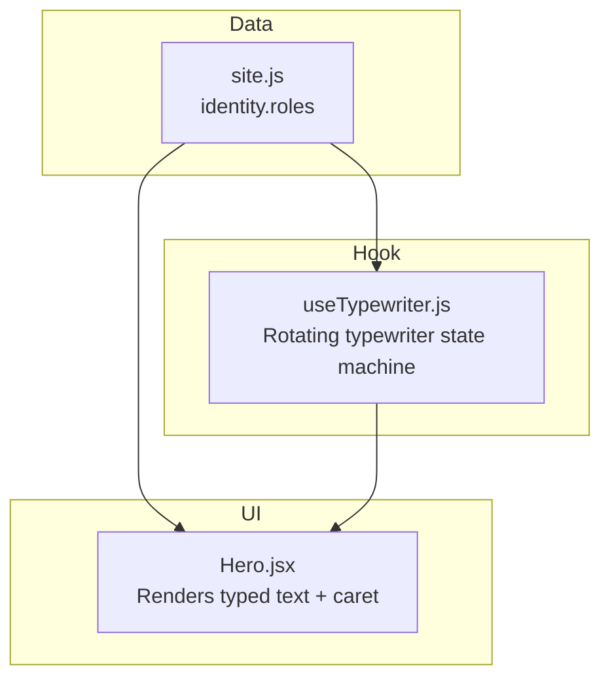
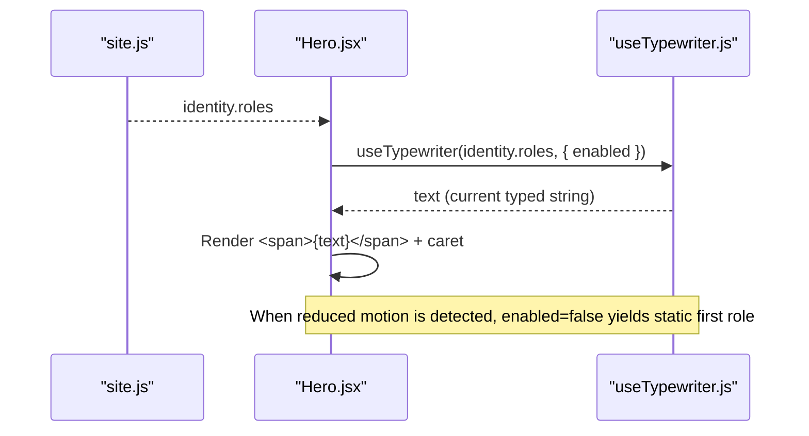
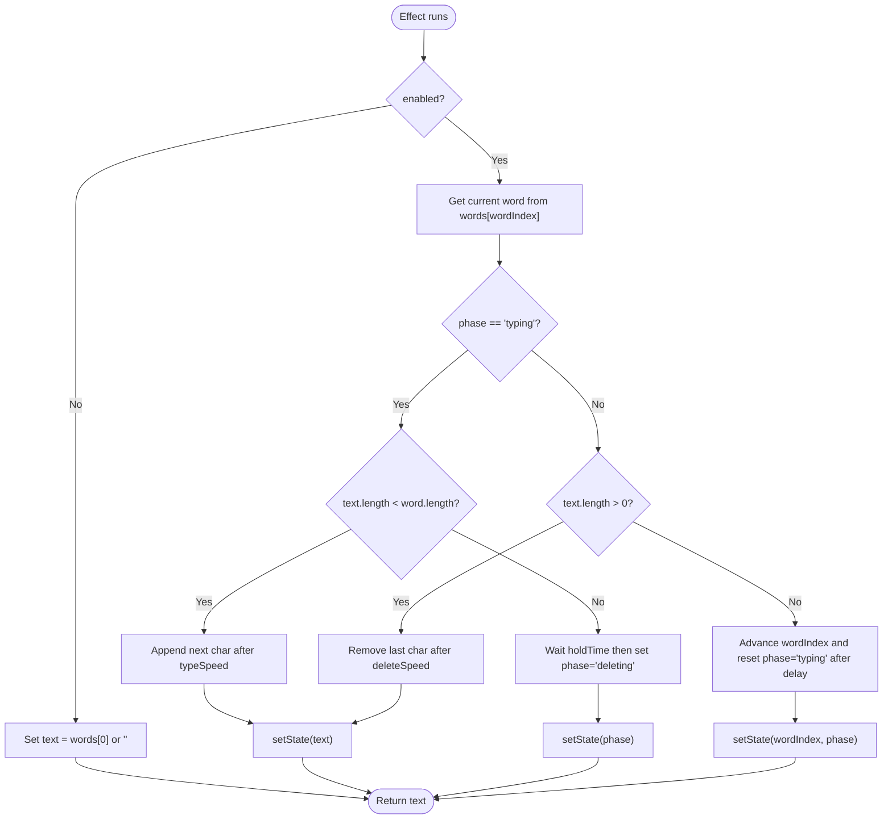
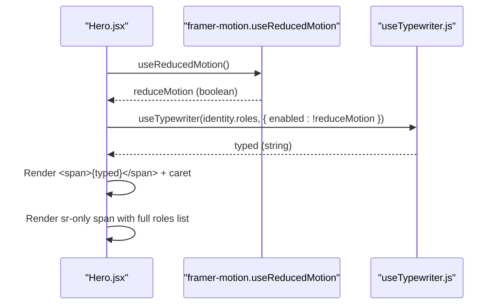
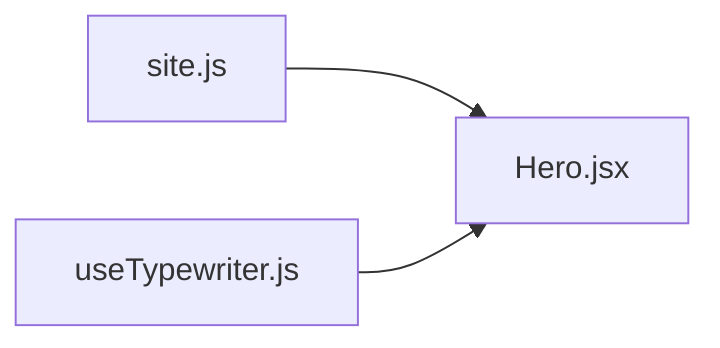

# Typewriter Effect

<cite>
**Referenced Files in This Document**
- [useTypewriter.js](file://src/hooks/useTypewriter.js)
- [Hero.jsx](file://src/components/Hero.jsx)
- [site.js](file://src/data/site.js)
</cite>

## Table of Contents
1. [Introduction](#introduction)
2. [Project Structure](#project-structure)
3. [Core Components](#core-components)
4. [Architecture Overview](#architecture-overview)
5. [Detailed Component Analysis](#detailed-component-analysis)
6. [Dependency Analysis](#dependency-analysis)
7. [Performance Considerations](#performance-considerations)
8. [Troubleshooting Guide](#troubleshooting-guide)
9. [Conclusion](#conclusion)

## Introduction
This document explains the typewriter effect implementation powered by the `useTypewriter` hook and its integration into the Hero component to animate role descriptions. It covers how text arrays are processed, how typing and deletion phases are managed, how cursor effects are rendered, and how configuration options control behavior. It also includes accessibility guidance, performance considerations, and customization tips for different typing behaviors.

## Project Structure
The typewriter feature spans three primary files:
- Hook: `src/hooks/useTypewriter.js`
- UI Integration: `src/components/Hero.jsx`
- Data Source: `src/data/site.js`

**Diagram sources**
- [site.js:6-17](file://src/data/site.js#L6-L17)
- [useTypewriter.js:1-44](file://src/hooks/useTypewriter.js#L1-L44)
- [Hero.jsx:1-10](file://src/components/Hero.jsx#L1-L10)

**Section sources**
- [useTypewriter.js:1-44](file://src/hooks/useTypewriter.js#L1-L44)
- [Hero.jsx:1-10](file://src/components/Hero.jsx#L1-L10)
- [site.js:6-17](file://src/data/site.js#L6-L17)

## Core Components
- `useTypewriter(words, options)`: A React hook that returns a string representing the current typed text. It cycles through an array of words, typing each character, pausing, deleting, and moving to the next word.
- `Hero.jsx`: Uses the hook to display rotating role labels with a blinking caret and provides accessibility support via screen-reader-only text.

Key responsibilities:
- Text processing: Iterates over characters using substring slicing.
- Animation phases: Manages typing, holding, deleting, and advancing to the next word.
- Cursor rendering: Renders a styled caret element alongside the typed text.
- Accessibility: Exposes full roles list to assistive technologies while visually animating only one role at a time.

**Section sources**
- [useTypewriter.js:1-44](file://src/hooks/useTypewriter.js#L1-L44)
- [Hero.jsx:8-11](file://src/components/Hero.jsx#L8-L11)
- [Hero.jsx:66-74](file://src/components/Hero.jsx#L66-L74)

## Architecture Overview
The typewriter system is a small, self-contained pipeline:
- Data source (`site.js`) defines the roles array.
- The hook (`useTypewriter.js`) computes the animated text based on configuration.
- The UI (`Hero.jsx`) renders the result and a caret indicator.

**Diagram sources**
- [site.js:6-17](file://src/data/site.js#L6-L17)
- [Hero.jsx:8-11](file://src/components/Hero.jsx#L8-L11)
- [Hero.jsx:66-74](file://src/components/Hero.jsx#L66-L74)
- [useTypewriter.js:1-44](file://src/hooks/useTypewriter.js#L1-L44)

## Detailed Component Analysis

### Hook: useTypewriter
Behavior summary:
- Inputs:
  - `words`: Array of strings to cycle through.
  - Options object:
    - `typeSpeed`: Milliseconds between typed characters.
    - `deleteSpeed`: Milliseconds between deleted characters.
    - `holdTime`: Pause duration after finishing typing a word before deleting.
    - `enabled`: Boolean to enable/disable animation; when disabled, shows the first word statically.
- State:
  - `wordIndex`: Current index in the words array.
  - `text`: Current displayed string.
  - `phase`: One of 'typing', 'deleting'.
- Lifecycle:
  - If `enabled` is false, sets `text` to the first word and skips animation.
  - Otherwise, uses timeouts to:
    - Type one character at a time until the word is complete.
    - Hold for `holdTime`.
    - Delete characters one by one until empty.
    - Advance to the next word and restart typing.
- Returns:
  - The current `text` value for rendering.

**Diagram sources**
- [useTypewriter.js:15-40](file://src/hooks/useTypewriter.js#L15-L40)

Configuration options:
- `typeSpeed`: Controls typing cadence. Lower values mean faster typing.
- `deleteSpeed`: Controls deletion cadence. Lower values mean faster deletion.
- `holdTime`: Controls pause between typing completion and deletion start.
- `enabled`: Disables animation to show a static label (useful for reduced motion).

Edge cases handled:
- Empty or undefined `words` array: safely falls back to an empty string or first available item.
- Reduced motion preference: disables animation entirely.

**Section sources**
- [useTypewriter.js:1-44](file://src/hooks/useTypewriter.js#L1-L44)

### UI Integration: Hero
Integration points:
- Imports the hook and data.
- Detects user’s reduced motion preference and passes it to the hook via `enabled`.
- Renders the typed text inside a badge-like span with a blinking caret.
- Provides a screen-reader-only span containing all roles for accessibility.

**Diagram sources**
- [Hero.jsx:1-11](file://src/components/Hero.jsx#L1-L11)
- [Hero.jsx:66-74](file://src/components/Hero.jsx#L66-L74)

Accessibility features:
- Screen readers receive the full list of roles via a visually hidden span.
- Visual caret is decorative and marked appropriately.
- Respects reduced motion preferences to avoid unnecessary animations.

Customization examples:
- Change typing speed: pass a different `typeSpeed` to the hook.
- Adjust deletion speed: pass a different `deleteSpeed`.
- Control pause length: adjust `holdTime`.
- Disable animation: set `enabled` to false (already done automatically when reduced motion is detected).

**Section sources**
- [Hero.jsx:8-11](file://src/components/Hero.jsx#L8-L11)
- [Hero.jsx:66-74](file://src/components/Hero.jsx#L66-L74)

### Data Source: site.js
The roles array drives the typewriter content:
- `identity.roles` contains multiple role strings that the hook cycles through.
- This centralizes content so components remain decoupled from copy changes.

**Section sources**
- [site.js:6-17](file://src/data/site.js#L6-L17)

## Dependency Analysis
- `Hero.jsx` depends on:
  - `useTypewriter.js` for animated text.
  - `site.js` for role data.
  - Framer Motion for motion utilities and reduced motion detection.
- `useTypewriter.js` has no external dependencies beyond React hooks.
- `site.js` is pure data and has no runtime dependencies.

**Diagram sources**
- [site.js:6-17](file://src/data/site.js#L6-L17)
- [useTypewriter.js:1-44](file://src/hooks/useTypewriter.js#L1-L44)
- [Hero.jsx:1-11](file://src/components/Hero.jsx#L1-L11)

**Section sources**
- [Hero.jsx:1-11](file://src/components/Hero.jsx#L1-L11)
- [useTypewriter.js:1-44](file://src/hooks/useTypewriter.js#L1-L44)
- [site.js:6-17](file://src/data/site.js#L6-L17)

## Performance Considerations
- Timer-based updates: The hook uses `setTimeout` per character. For long role strings or many concurrent typewriters, consider:
  - Reducing `typeSpeed` and `deleteSpeed` judiciously to balance smoothness and CPU usage.
  - Limiting the number of simultaneous typewriter instances.
- Reduced motion: Automatically disabling animation prevents unnecessary work for users who prefer reduced motion.
- Rendering cost: The caret is lightweight; ensure it remains minimal and avoids heavy CSS animations if performance becomes a concern.
- Memory leaks: The hook clears timers on cleanup, preventing stale timeouts.

[No sources needed since this section provides general guidance]

## Troubleshooting Guide
Common issues and resolutions:
- No animation appears:
  - Verify `enabled` is true. In Hero, it is tied to reduced motion; check the user’s preference.
  - Ensure `words` is a non-empty array.
- Text not updating:
  - Confirm the hook is called with the correct `words` array and that it re-runs when data changes.
- Cursor not visible:
  - Inspect the caret styling class and ensure it is applied next to the typed text.
- Performance lag:
  - Increase `typeSpeed`/`deleteSpeed` slightly or reduce the number of active typewriters.
- Accessibility concerns:
  - Ensure the screen-reader-only span still contains the full roles list even when animation is disabled.

**Section sources**
- [useTypewriter.js:15-40](file://src/hooks/useTypewriter.js#L15-L40)
- [Hero.jsx:66-74](file://src/components/Hero.jsx#L66-L74)

## Conclusion
The typewriter effect is implemented cleanly with a dedicated hook that manages animation phases and timing, integrated into the Hero component to present rotating role descriptions. It respects reduced motion preferences, exposes full context to screen readers, and offers flexible configuration for typing speed, deletion speed, and pause duration. By centralizing role data in `site.js`, the solution remains maintainable and easy to customize.

[No sources needed since this section summarizes without analyzing specific files]