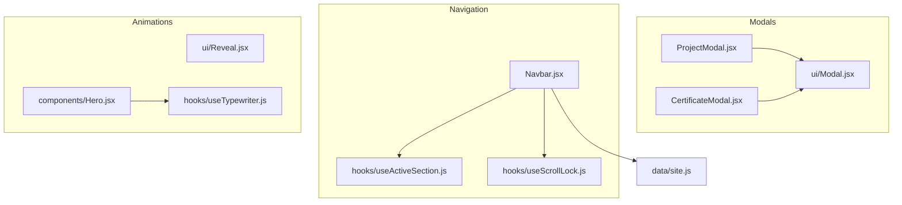
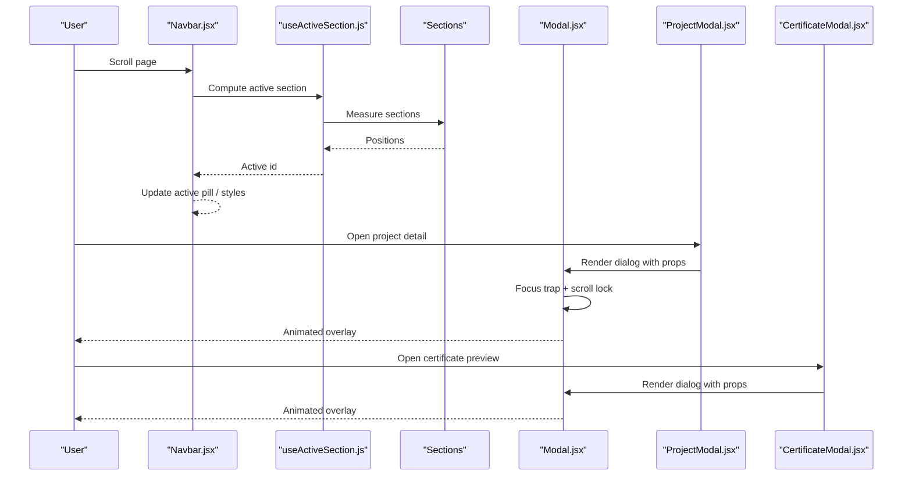
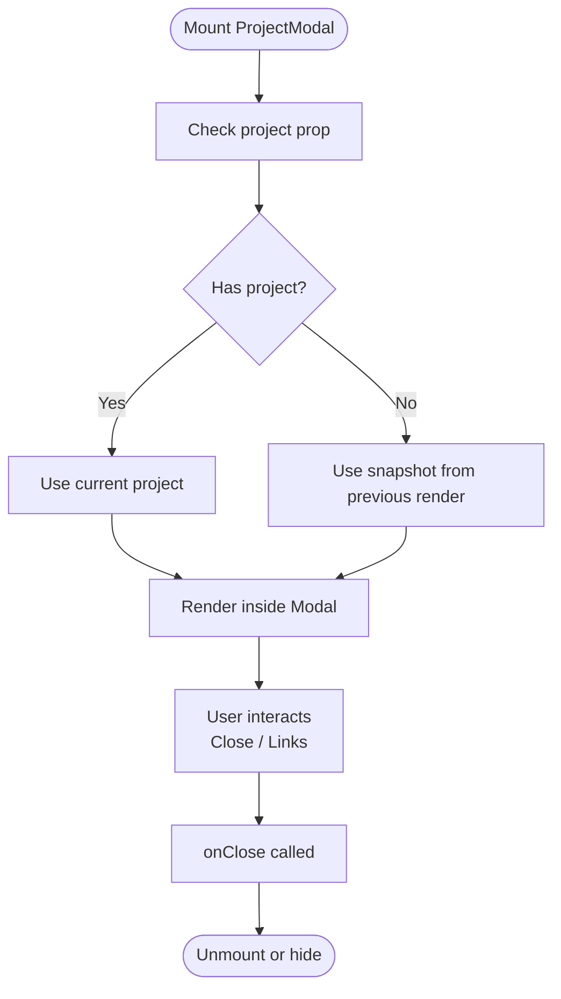
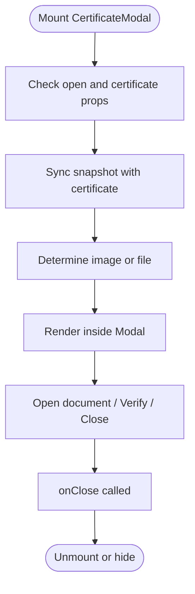
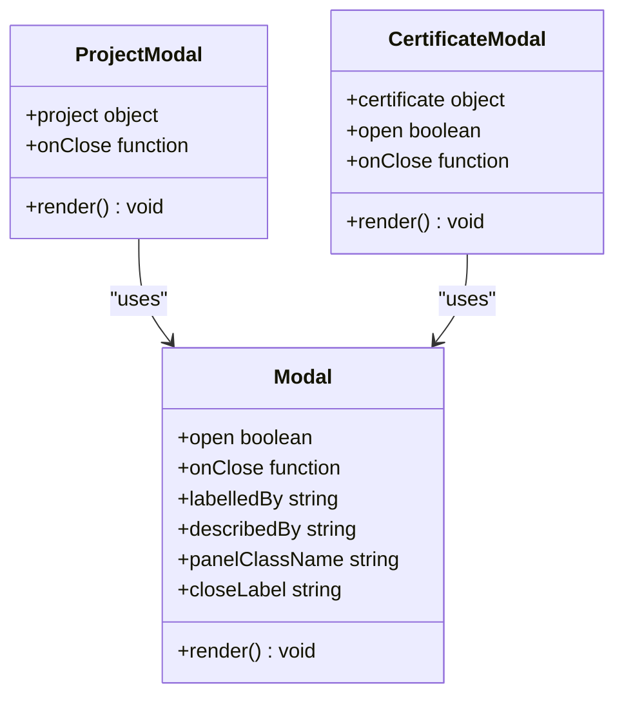
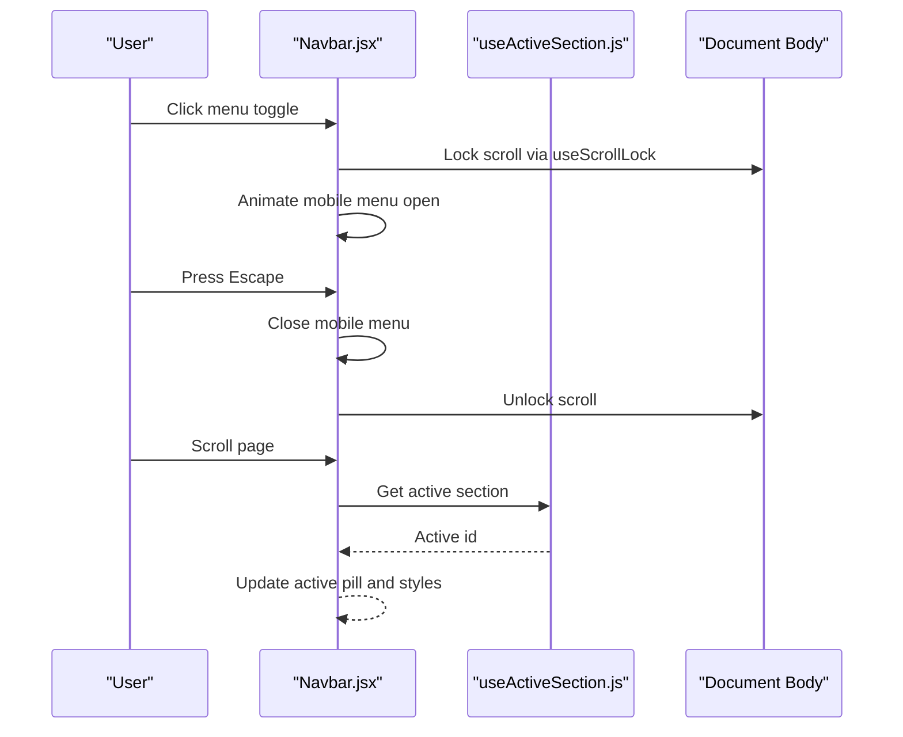
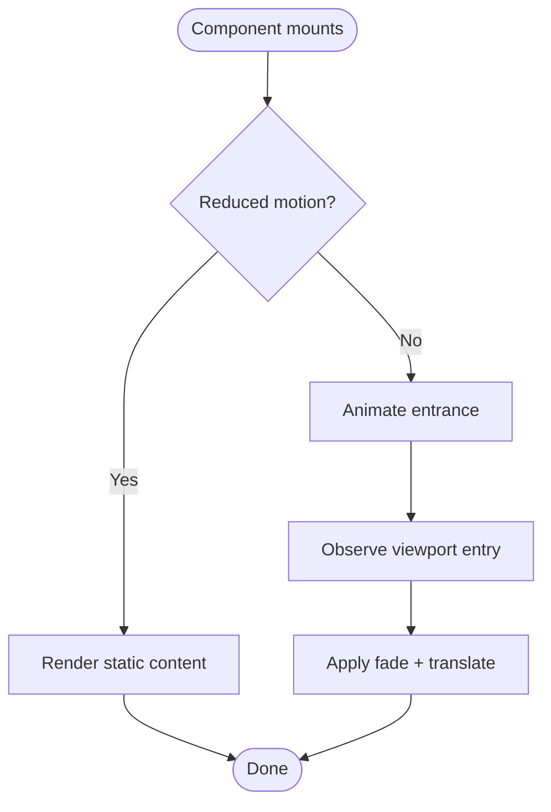
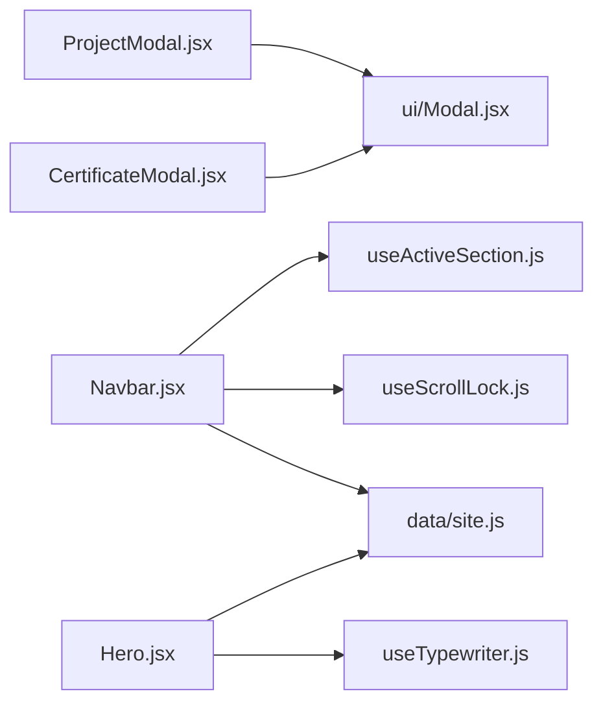

# Interactive Features

<cite>
**Referenced Files in This Document**
- [ProjectModal.jsx](file://src/components/ProjectModal.jsx)
- [CertificateModal.jsx](file://src/components/CertificateModal.jsx)
- [Modal.jsx](file://src/components/ui/Modal.jsx)
- [Navbar.jsx](file://src/components/Navbar.jsx)
- [useActiveSection.js](file://src/hooks/useActiveSection.js)
- [useScrollLock.js](file://src/hooks/useScrollLock.js)
- [useTypewriter.js](file://src/hooks/useTypewriter.js)
- [Reveal.jsx](file://src/components/ui/Reveal.jsx)
- [Hero.jsx](file://src/components/Hero.jsx)
- [site.js](file://src/data/site.js)
</cite>

## Table of Contents
1. [Introduction](#introduction)
2. [Project Structure](#project-structure)
3. [Core Components](#core-components)
4. [Architecture Overview](#architecture-overview)
5. [Detailed Component Analysis](#detailed-component-analysis)
6. [Dependency Analysis](#dependency-analysis)
7. [Performance Considerations](#performance-considerations)
8. [Accessibility Guide](#accessibility-guide)
9. [Troubleshooting Guide](#troubleshooting-guide)
10. [Guidelines for Adding New Interactive Elements](#guidelines-for-adding-new-interactive-elements)
11. [Conclusion](#conclusion)

## Introduction
This document explains the interactive features of the portfolio application with a focus on modal systems, navigation interactions, scroll-triggered behaviors, and animation effects. It covers:
- Modal implementations for project details and certificate previews
- Navbar active section tracking and mobile menu behavior
- Scroll-triggered reveal animations
- Typewriter text animation
- Performance and accessibility considerations
- Practical guidelines for extending the system with new interactive elements

## Project Structure
The interactive features are implemented across reusable components, hooks, and data configuration:
- Modals: `ProjectModal`, `CertificateModal`, and shared `Modal`
- Navigation: `Navbar` with active section tracking via `useActiveSection`
- Scroll lock utility: `useScrollLock`
- Animation utilities: `Reveal` component and `useTypewriter` hook
- Data source: `site.js` provides navigation items and identity information

**Diagram sources**
- [ProjectModal.jsx:1-172](file://src/components/ProjectModal.jsx#L1-L172)
- [CertificateModal.jsx:1-117](file://src/components/CertificateModal.jsx#L1-L117)
- [Modal.jsx:1-131](file://src/components/ui/Modal.jsx#L1-L131)
- [Navbar.jsx:1-218](file://src/components/Navbar.jsx#L1-L218)
- [useActiveSection.js:1-46](file://src/hooks/useActiveSection.js#L1-L46)
- [useScrollLock.js:1-24](file://src/hooks/useScrollLock.js#L1-L24)
- [Reveal.jsx:1-34](file://src/components/ui/Reveal.jsx#L1-L34)
- [useTypewriter.js:1-44](file://src/hooks/useTypewriter.js#L1-L44)
- [Hero.jsx:1-149](file://src/components/Hero.jsx#L1-L149)
- [site.js:62-69](file://src/data/site.js#L62-L69)

**Section sources**
- [ProjectModal.jsx:1-172](file://src/components/ProjectModal.jsx#L1-L172)
- [CertificateModal.jsx:1-117](file://src/components/CertificateModal.jsx#L1-L117)
- [Modal.jsx:1-131](file://src/components/ui/Modal.jsx#L1-L131)
- [Navbar.jsx:1-218](file://src/components/Navbar.jsx#L1-L218)
- [useActiveSection.js:1-46](file://src/hooks/useActiveSection.js#L1-L46)
- [useScrollLock.js:1-24](file://src/hooks/useScrollLock.js#L1-L24)
- [Reveal.jsx:1-34](file://src/components/ui/Reveal.jsx#L1-L34)
- [useTypewriter.js:1-44](file://src/hooks/useTypewriter.js#L1-L44)
- [Hero.jsx:1-149](file://src/components/Hero.jsx#L1-L149)
- [site.js:62-69](file://src/data/site.js#L62-L69)

## Core Components
- ProjectModal: Displays detailed project information using the shared accessible Modal. It maintains a snapshot to support exit animations without losing content during transitions.
- CertificateModal: Presents certificate previews (image or embedded PDF), supports verification links, and uses the same accessible Modal foundation.
- Modal: Provides portal rendering, scroll lock, focus trap, Escape-to-close, click-outside dismissal, and Framer Motion animations with reduced-motion support.
- Navbar: Tracks the active section based on scroll position, renders desktop and mobile navigation, and animates the mobile menu.
- useActiveSection: Computes the currently visible section by measuring element positions relative to viewport.
- useScrollLock: Locks body scrolling while overlays are open and preserves layout stability.
- Reveal: Scroll-triggered reveal wrapper that respects user motion preferences.
- useTypewriter: Rotating typewriter effect with configurable timing and reduced-motion fallback.

**Section sources**
- [ProjectModal.jsx:16-171](file://src/components/ProjectModal.jsx#L16-L171)
- [CertificateModal.jsx:6-116](file://src/components/CertificateModal.jsx#L6-L116)
- [Modal.jsx:15-130](file://src/components/ui/Modal.jsx#L15-L130)
- [Navbar.jsx:12-217](file://src/components/Navbar.jsx#L12-L217)
- [useActiveSection.js:7-44](file://src/hooks/useActiveSection.js#L7-L44)
- [useScrollLock.js:6-23](file://src/hooks/useScrollLock.js#L6-L23)
- [Reveal.jsx:7-33](file://src/components/ui/Reveal.jsx#L7-L33)
- [useTypewriter.js:7-43](file://src/hooks/useTypewriter.js#L7-L43)

## Architecture Overview
The interactive architecture centers around three pillars:
- Accessible modals: Shared base Modal ensures consistent behavior, accessibility, and animation.
- Navigation state: Active section detection drives visual feedback and smooth transitions.
- Animation layer: Framer Motion powers entrance, exit, and scroll-triggered animations with graceful degradation.

**Diagram sources**
- [Navbar.jsx:12-217](file://src/components/Navbar.jsx#L12-L217)
- [useActiveSection.js:7-44](file://src/hooks/useActiveSection.js#L7-L44)
- [Modal.jsx:15-130](file://src/components/ui/Modal.jsx#L15-L130)
- [ProjectModal.jsx:16-171](file://src/components/ProjectModal.jsx#L16-L171)
- [CertificateModal.jsx:6-116](file://src/components/CertificateModal.jsx#L6-L116)

## Detailed Component Analysis

### ProjectModal Lifecycle and State Management
- Purpose: Show rich project details including overview, problem statement, technical approach, architecture blocks, challenges, learnings, and external links.
- Lifecycle:
  - Mounts with a project prop; if absent, falls back to a snapshot from previous render to keep exit animations smooth.
  - Renders inside the shared Modal with an accessible title and close label.
  - On close, delegates to parent-managed state via onClose.
- State management:
  - Uses local snapshot state to preserve last rendered project during transition.
  - Derives display data from current project or snapshot.
- Interaction patterns:
  - Opens when a project is selected.
  - Closes via close button, Escape key, or backdrop click handled by Modal.
  - External links open in new tabs safely.

**Diagram sources**
- [ProjectModal.jsx:16-171](file://src/components/ProjectModal.jsx#L16-L171)
- [Modal.jsx:15-130](file://src/components/ui/Modal.jsx#L15-L130)

**Section sources**
- [ProjectModal.jsx:16-171](file://src/components/ProjectModal.jsx#L16-L171)
- [Modal.jsx:15-130](file://src/components/ui/Modal.jsx#L15-L130)

### CertificateModal Lifecycle and State Management
- Purpose: Preview certificates either as images or embedded documents, show issuer info, verification status, and optional notes.
- Lifecycle:
  - Controlled by open prop; internal snapshot mirrors certificate prop to avoid flicker during transitions.
  - Renders inside Modal with accessible title and close label.
- State management:
  - Snapshot state keeps last certificate displayed while closing.
  - Determines display asset from image or file fields.
- Interaction patterns:
  - Opens when a certificate is selected.
  - Supports opening the attached document or verifying with the issuer via external links.
  - Gracefully handles missing assets with a placeholder UI.

**Diagram sources**
- [CertificateModal.jsx:6-116](file://src/components/CertificateModal.jsx#L6-L116)
- [Modal.jsx:15-130](file://src/components/ui/Modal.jsx#L15-L130)

**Section sources**
- [CertificateModal.jsx:6-116](file://src/components/CertificateModal.jsx#L6-L116)
- [Modal.jsx:15-130](file://src/components/ui/Modal.jsx#L15-L130)

### Modal System: Accessibility and Animations
- Portal rendering: Ensures modal content is appended to the document body.
- Scroll lock: Prevents background scrolling while modal is open.
- Focus management:
  - Traps Tab/Shift+Tab within the modal panel.
  - Moves focus to the close button after opening.
  - Restores previous focus on close.
- Keyboard support: Escape closes the modal.
- Click-outside: Dismisses modal when clicking the backdrop.
- Reduced motion: Animations adapt to user preference.

**Diagram sources**
- [Modal.jsx:15-130](file://src/components/ui/Modal.jsx#L15-L130)
- [ProjectModal.jsx:16-171](file://src/components/ProjectModal.jsx#L16-L171)
- [CertificateModal.jsx:6-116](file://src/components/CertificateModal.jsx#L6-L116)

**Section sources**
- [Modal.jsx:15-130](file://src/components/ui/Modal.jsx#L15-L130)

### Navbar: Active Section Tracking and Mobile Menu
- Active section tracking:
  - Uses `useActiveSection` to compute the active section ID based on scroll position and viewport metrics.
  - Highlights the active link and animates the active pill using Framer Motion’s layoutId.
- Scroll-triggered header style:
  - Adds a solid background and blur when scrolled past a threshold.
- Mobile menu:
  - Toggle button controls visibility with AnimatePresence and motion.div.
  - Respects reduced motion settings.
  - Locks scroll while open and closes on resize above breakpoint.
- Keyboard handling:
  - Escape closes the mobile menu.

**Diagram sources**
- [Navbar.jsx:12-217](file://src/components/Navbar.jsx#L12-L217)
- [useActiveSection.js:7-44](file://src/hooks/useActiveSection.js#L7-L44)
- [useScrollLock.js:6-23](file://src/hooks/useScrollLock.js#L6-L23)

**Section sources**
- [Navbar.jsx:12-217](file://src/components/Navbar.jsx#L12-L217)
- [useActiveSection.js:7-44](file://src/hooks/useActiveSection.js#L7-L44)
- [useScrollLock.js:6-23](file://src/hooks/useScrollLock.js#L6-L23)

### Animation System: Typewriter and Reveal Effects
- Typewriter effect:
  - Rotates through role labels with typing, holding, and deleting phases.
  - Disables animation when reduced motion is preferred, showing static text instead.
  - Used in Hero to present dynamic role labels.
- Reveal animations:
  - Wraps content to animate opacity and vertical translation when entering the viewport.
  - Falls back to plain content when reduced motion is enabled.
  - Configurable delay, duration, and viewport thresholds.

**Diagram sources**
- [useTypewriter.js:7-43](file://src/hooks/useTypewriter.js#L7-L43)
- [Reveal.jsx:7-33](file://src/components/ui/Reveal.jsx#L7-L33)
- [Hero.jsx:8-143](file://src/components/Hero.jsx#L8-L143)

**Section sources**
- [useTypewriter.js:7-43](file://src/hooks/useTypewriter.js#L7-L43)
- [Reveal.jsx:7-33](file://src/components/ui/Reveal.jsx#L7-L33)
- [Hero.jsx:8-143](file://src/components/Hero.jsx#L8-L143)

## Dependency Analysis
Key relationships:
- ProjectModal and CertificateModal depend on Modal for accessibility and animation.
- Navbar depends on useActiveSection for active state and useScrollLock for scroll control.
- Hero uses useTypewriter for dynamic text.
- site.js provides navigation and identity data consumed by Navbar and Hero.

**Diagram sources**
- [ProjectModal.jsx:1-172](file://src/components/ProjectModal.jsx#L1-L172)
- [CertificateModal.jsx:1-117](file://src/components/CertificateModal.jsx#L1-L117)
- [Modal.jsx:1-131](file://src/components/ui/Modal.jsx#L1-L131)
- [Navbar.jsx:1-218](file://src/components/Navbar.jsx#L1-L218)
- [useActiveSection.js:1-46](file://src/hooks/useActiveSection.js#L1-L46)
- [useScrollLock.js:1-24](file://src/hooks/useScrollLock.js#L1-L24)
- [Hero.jsx:1-149](file://src/components/Hero.jsx#L1-L149)
- [useTypewriter.js:1-44](file://src/hooks/useTypewriter.js#L1-L44)
- [site.js:62-69](file://src/data/site.js#L62-L69)

**Section sources**
- [ProjectModal.jsx:1-172](file://src/components/ProjectModal.jsx#L1-L172)
- [CertificateModal.jsx:1-117](file://src/components/CertificateModal.jsx#L1-L117)
- [Modal.jsx:1-131](file://src/components/ui/Modal.jsx#L1-L131)
- [Navbar.jsx:1-218](file://src/components/Navbar.jsx#L1-L218)
- [useActiveSection.js:1-46](file://src/hooks/useActiveSection.js#L1-L46)
- [useScrollLock.js:1-24](file://src/hooks/useScrollLock.js#L1-L24)
- [Hero.jsx:1-149](file://src/components/Hero.jsx#L1-L149)
- [useTypewriter.js:1-44](file://src/hooks/useTypewriter.js#L1-L44)
- [site.js:62-69](file://src/data/site.js#L62-L69)

## Performance Considerations
- Prefer reduced motion:
  - All animated components check user preference and fall back to static or simplified animations.
- Avoid heavy re-renders:
  - Modals use snapshots to prevent content loss during exit animations.
- Efficient scroll listeners:
  - useActiveSection and Navbar use passive scroll listeners where appropriate.
- Lazy loading:
  - Certificate images use lazy loading to defer offscreen resources.
- Portal usage:
  - Modal renders via portal to minimize DOM traversal overhead and ensure correct stacking context.

[No sources needed since this section provides general guidance]

## Accessibility Guide
- Modals:
  - Role="dialog", aria-modal="true", labelledBy, and describedBy are set.
  - Focus trap ensures keyboard users remain within the modal.
  - Escape closes the modal; backdrop click dismisses it.
  - Close button has descriptive aria-label.
- Navbar:
  - Desktop and mobile nav have distinct aria-labels.
  - Active links set aria-current="true".
  - Mobile toggle sets aria-expanded and aria-controls.
- Content:
  - Decorative icons use aria-hidden="true".
  - Meaningful text is exposed to assistive technologies.

**Section sources**
- [Modal.jsx:15-130](file://src/components/ui/Modal.jsx#L15-L130)
- [Navbar.jsx:71-211](file://src/components/Navbar.jsx#L71-L211)

## Troubleshooting Guide
- Modal does not close on Escape:
  - Ensure the modal is mounted and open; verify that onKeyDown handler is attached.
  - Confirm no other global key handlers intercept Escape.
- Background still scrolls when modal is open:
  - Verify useScrollLock is invoked with the correct open state.
  - Check that the modal is rendered and the scroll lock effect runs.
- Active section not updating:
  - Confirm all target sections have unique IDs matching the navigation list.
  - Ensure useActiveSection receives the correct array of IDs.
- Typewriter not appearing:
  - If reduced motion is enabled, the hook returns static text; verify the expected behavior.
  - Ensure the words array is non-empty and passed correctly.
- Reveal animations not triggering:
  - Check viewport thresholds and that the element enters the viewport.
  - Verify reduced motion preference is not disabling animations.

**Section sources**
- [Modal.jsx:35-74](file://src/components/ui/Modal.jsx#L35-L74)
- [useScrollLock.js:6-23](file://src/hooks/useScrollLock.js#L6-L23)
- [useActiveSection.js:11-42](file://src/hooks/useActiveSection.js#L11-L42)
- [useTypewriter.js:15-40](file://src/hooks/useTypewriter.js#L15-L40)
- [Reveal.jsx:18-31](file://src/components/ui/Reveal.jsx#L18-L31)

## Guidelines for Adding New Interactive Elements
- Use the shared Modal for any new overlay:
  - Provide labelledBy and closeLabel for accessibility.
  - Manage open state at the parent level and pass onClose.
- Follow the snapshot pattern for smooth transitions:
  - Keep a snapshot of the last rendered data to avoid flicker during exit animations.
- Integrate with active section tracking:
  - Add new sections to the navigation array in site.js and ensure each section has a matching id.
- Respect reduced motion:
  - Wrap animations with useReducedMotion checks or use Reveal for scroll-triggered effects.
- Maintain keyboard and screen reader compatibility:
  - Set appropriate roles, aria attributes, and focus management.
- Keep external links safe:
  - Use target="_blank" with rel="noreferrer noopener" for outbound links.

**Section sources**
- [Modal.jsx:15-130](file://src/components/ui/Modal.jsx#L15-L130)
- [ProjectModal.jsx:16-171](file://src/components/ProjectModal.jsx#L16-L171)
- [CertificateModal.jsx:6-116](file://src/components/CertificateModal.jsx#L6-L116)
- [site.js:62-69](file://src/data/site.js#L62-L69)
- [Reveal.jsx:7-33](file://src/components/ui/Reveal.jsx#L7-L33)

## Conclusion
The interactive features are built around a robust, accessible modal system, reliable navigation state driven by scroll measurements, and a flexible animation layer powered by Framer Motion. By following the established patterns—snapshot-based transitions, reduced-motion awareness, and strong accessibility practices—you can extend the system with new interactive elements confidently and consistently.

[No sources needed since this section summarizes without analyzing specific files]