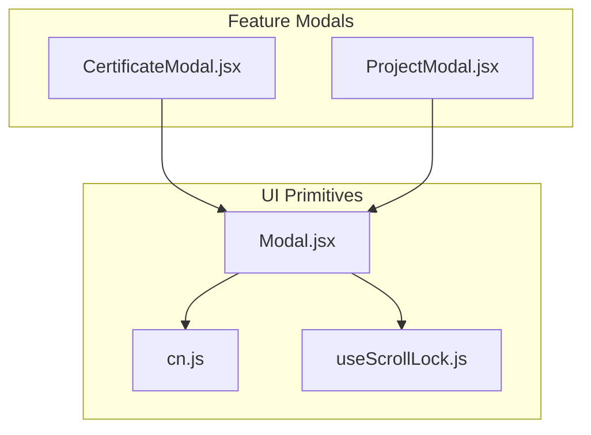
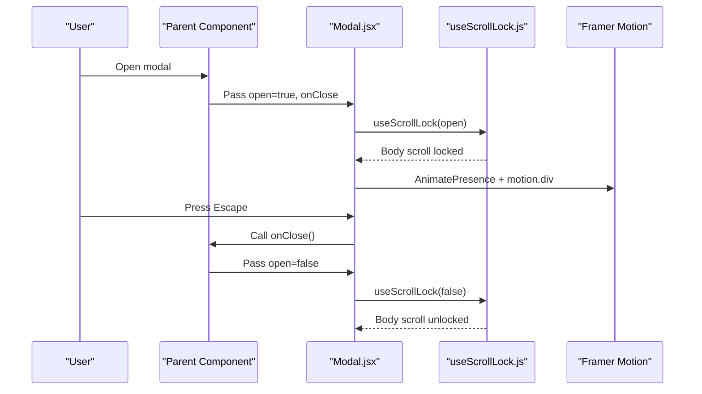
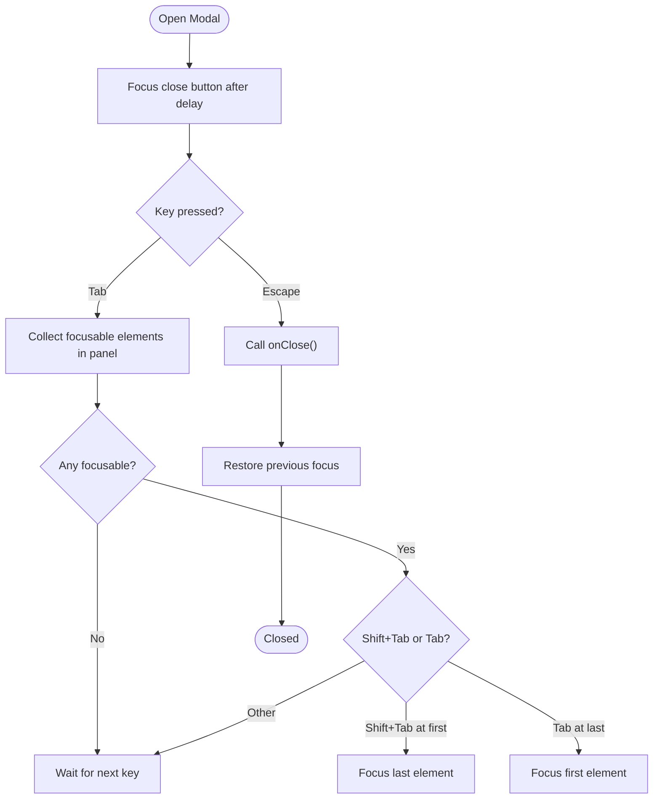
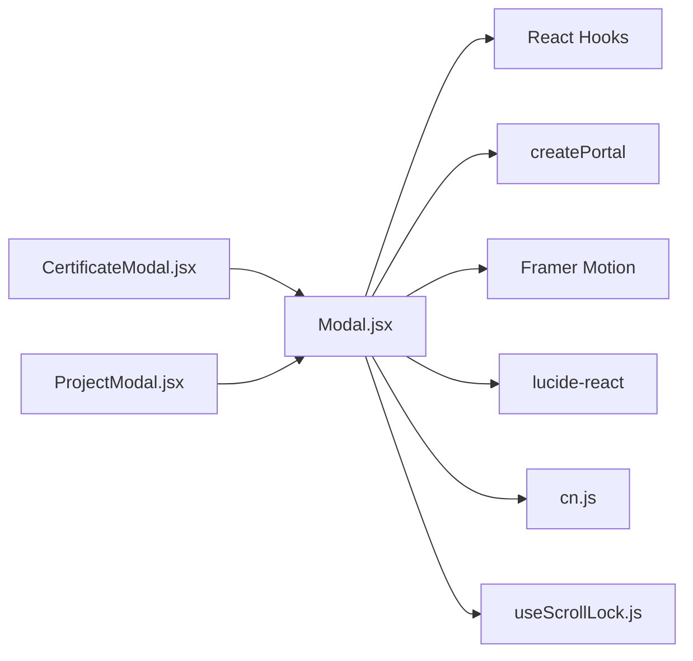

# Base Modal Component

<cite>
**Referenced Files in This Document**
- [Modal.jsx](file://src/components/ui/Modal.jsx)
- [useScrollLock.js](file://src/hooks/useScrollLock.js)
- [cn.js](file://src/lib/cn.js)
- [CertificateModal.jsx](file://src/components/CertificateModal.jsx)
- [ProjectModal.jsx](file://src/components/ProjectModal.jsx)
</cite>

## Table of Contents
1. [Introduction](#introduction)
2. [Project Structure](#project-structure)
3. [Core Components](#core-components)
4. [Architecture Overview](#architecture-overview)
5. [Detailed Component Analysis](#detailed-component-analysis)
6. [Dependency Analysis](#dependency-analysis)
7. [Performance Considerations](#performance-considerations)
8. [Troubleshooting Guide](#troubleshooting-guide)
9. [Conclusion](#conclusion)
10. [Appendices](#appendices)

## Introduction
This document explains the base Modal component that powers all modals in the application. It covers open/close state management, focus trapping for accessibility, keyboard navigation (Escape to close), click-outside-to-close behavior, and animation integration with Framer Motion. It also documents the props interface, scroll lock behavior, z-index layering, and provides usage examples and best practices for accessible modal interfaces.

## Project Structure
The Modal is implemented as a reusable UI primitive under components/ui and consumed by domain-specific modals such as CertificateModal and ProjectModal. A small hook manages scroll locking, and a utility merges class names.

**Diagram sources**
- [Modal.jsx:1-131](file://src/components/ui/Modal.jsx#L1-L131)
- [useScrollLock.js:1-24](file://src/hooks/useScrollLock.js#L1-L24)
- [cn.js:1-7](file://src/lib/cn.js#L1-L7)
- [CertificateModal.jsx:1-117](file://src/components/CertificateModal.jsx#L1-L117)
- [ProjectModal.jsx:1-172](file://src/components/ProjectModal.jsx#L1-L172)

**Section sources**
- [Modal.jsx:1-131](file://src/components/ui/Modal.jsx#L1-L131)
- [useScrollLock.js:1-24](file://src/hooks/useScrollLock.js#L1-L24)
- [cn.js:1-7](file://src/lib/cn.js#L1-L7)
- [CertificateModal.jsx:1-117](file://src/components/CertificateModal.jsx#L1-L117)
- [ProjectModal.jsx:1-172](file://src/components/ProjectModal.jsx#L1-L172)

## Core Components
- Modal: The core accessible dialog component providing portal rendering, animations, focus management, keyboard handling, and click-outside dismissal.
- useScrollLock: Hook that locks page scrolling while an overlay is active without causing layout shift.
- cn: Utility to join conditional class names safely.

Key responsibilities:
- Render via React Portal into document.body
- Manage open state and onClose callback
- Trap focus within the modal panel
- Support Escape key to close
- Close on backdrop click
- Integrate Framer Motion animations with reduced-motion support
- Lock body scroll when open
- Provide accessible attributes (role="dialog", aria-modal, labelledBy, describedBy)

**Section sources**
- [Modal.jsx:1-131](file://src/components/ui/Modal.jsx#L1-L131)
- [useScrollLock.js:1-24](file://src/hooks/useScrollLock.js#L1-L24)
- [cn.js:1-7](file://src/lib/cn.js#L1-L7)

## Architecture Overview
The Modal composes several behaviors:
- Rendering: Uses createPortal to render outside the normal DOM tree at document.body.
- Animation: Wraps content in AnimatePresence and motion.div for fade/scale transitions; respects user’s reduced motion preference.
- Accessibility: Sets role="dialog", aria-modal="true", and supports labelledBy/describedBy. Focus trap ensures Tab/Shift+Tab cycles within the panel. Escape closes the modal.
- Interaction: Backdrop click calls onClose. A close button inside the panel also calls onClose.
- Scroll lock: useScrollLock prevents background scrolling and preserves layout stability.

**Diagram sources**
- [Modal.jsx:29-74](file://src/components/ui/Modal.jsx#L29-L74)
- [Modal.jsx:80-129](file://src/components/ui/Modal.jsx#L80-L129)
- [useScrollLock.js:6-22](file://src/hooks/useScrollLock.js#L6-L22)

## Detailed Component Analysis

### Modal Props Interface
- open: boolean controlling visibility. When true, the modal renders and locks scroll.
- onClose: function invoked on Escape, backdrop click, or close button click.
- children: ReactNode rendered inside the modal panel.
- labelledBy: string id of an element that labels the dialog (aria-labelledby).
- describedBy: string id of an element that describes the dialog (aria-describedby).
- panelClassName: string appended to the panel container classes for customization.
- closeLabel: string used as aria-label for the close button (default provided).

Accessibility attributes applied:
- role="dialog"
- aria-modal="true"
- aria-labelledby={labelledBy}
- aria-describedby={describedBy}
- Close button has aria-label={closeLabel}

Styling and layering:
- Overlay uses fixed positioning and high z-index to cover the page.
- Panel uses rounded corners, border, background, and shadow utilities.
- panelClassName allows consumers to override width constraints and other styles.

Animation details:
- Backdrop fades in/out.
- Panel scales and translates slightly on open/close.
- Duration adapts based on reduced motion preference.

Focus management:
- On open, focuses the close button after a short delay.
- Traps Tab/Shift+Tab within the panel.
- Restores focus to the previously focused element on close.

Scroll lock:
- While open, sets body overflow to hidden and compensates for scrollbar width to avoid layout shift.

**Section sources**
- [Modal.jsx:15-23](file://src/components/ui/Modal.jsx#L15-L23)
- [Modal.jsx:35-74](file://src/components/ui/Modal.jsx#L35-L74)
- [Modal.jsx:80-129](file://src/components/ui/Modal.jsx#L80-L129)
- [useScrollLock.js:6-22](file://src/hooks/useScrollLock.js#L6-L22)

### Focus Trapping and Keyboard Navigation Flow

**Diagram sources**
- [Modal.jsx:35-74](file://src/components/ui/Modal.jsx#L35-L74)

### Click-Outside-to-Close Behavior
- The backdrop div listens for clicks and invokes onClose.
- The backdrop is visually present but not interactive beyond closing the modal.
- Consumers should ensure their own interactive elements do not bubble unintended events if they need custom behavior.

**Section sources**
- [Modal.jsx:91-95](file://src/components/ui/Modal.jsx#L91-L95)

### Animation Integration with Framer Motion
- AnimatePresence wraps conditional rendering to animate exit.
- motion.div handles opacity and transform transitions for both backdrop and panel.
- Reduced motion preference is respected using useReducedMotion to disable animations where appropriate.

**Section sources**
- [Modal.jsx:78-111](file://src/components/ui/Modal.jsx#L78-L111)

### Scroll Lock Implementation
- useScrollLock sets body.style.overflow to 'hidden' when active.
- It measures the scrollbar width and applies padding-right to prevent layout shift.
- Cleanup restores previous overflow and padding values.

**Section sources**
- [useScrollLock.js:6-22](file://src/hooks/useScrollLock.js#L6-L22)

### Usage Examples

#### Basic Modal Usage
A parent component controls open state and passes it to Modal along with onClose and accessibility props.

- Example consumer: CertificateModal
  - Passes labelledBy and panelClassName to customize width and labeling.
  - Provides closeLabel for screen readers.

- Example consumer: ProjectModal
  - Similar pattern with different panel width and descriptive label.

These examples demonstrate:
- Controlled open state from parent
- Passing labelledBy and closeLabel
- Customizing panel width via panelClassName

**Section sources**
- [CertificateModal.jsx:16-23](file://src/components/CertificateModal.jsx#L16-L23)
- [ProjectModal.jsx:26-33](file://src/components/ProjectModal.jsx#L26-L33)

#### Custom Styling Approaches
- Use panelClassName to adjust width, spacing, or theme tokens.
- Combine with Tailwind utilities already applied by Modal for consistent design.
- Ensure any additional interactive elements remain reachable via keyboard.

**Section sources**
- [Modal.jsx:104-107](file://src/components/ui/Modal.jsx#L104-L107)
- [cn.js:1-7](file://src/lib/cn.js#L1-L7)

### Best Practices for Accessible Modals
- Always provide labelledBy pointing to a visible heading or title element inside the modal.
- Optionally provide describedBy for additional context.
- Keep closeLabel meaningful for screen readers.
- Ensure all interactive elements inside the modal are focusable and logically ordered.
- Avoid nested dialogs; keep one modal per interaction flow.
- Respect reduced motion preferences by relying on the built-in behavior.

[No sources needed since this section provides general guidance]

## Dependency Analysis
Modal depends on:
- React hooks: useEffect, useRef
- React DOM: createPortal
- Framer Motion: AnimatePresence, motion, useReducedMotion
- Lucide React: X icon
- Local utility: cn for class merging
- Local hook: useScrollLock for scroll management

Consumers depend on Modal for:
- Consistent accessibility and UX across modals
- Simplified styling via panelClassName
- Predictable keyboard and focus behavior

**Diagram sources**
- [Modal.jsx:1-6](file://src/components/ui/Modal.jsx#L1-L6)
- [CertificateModal.jsx:1-5](file://src/components/CertificateModal.jsx#L1-L5)
- [ProjectModal.jsx:1-5](file://src/components/ProjectModal.jsx#L1-L5)

**Section sources**
- [Modal.jsx:1-6](file://src/components/ui/Modal.jsx#L1-L6)
- [CertificateModal.jsx:1-5](file://src/components/CertificateModal.jsx#L1-L5)
- [ProjectModal.jsx:1-5](file://src/components/ProjectModal.jsx#L1-L5)

## Performance Considerations
- Portal rendering avoids reflow issues by mounting outside the main DOM tree.
- Animations are lightweight and respect reduced motion preferences.
- Focus trap queries only visible focusable elements to minimize overhead.
- Scroll lock is applied once per open/close cycle and cleans up properly.

[No sources needed since this section provides general guidance]

## Troubleshooting Guide
- Modal does not close on Escape:
  - Verify onClose is passed correctly and not overridden.
  - Ensure no global keydown listeners intercept Escape before Modal.

- Focus not trapped:
  - Confirm the panel contains focusable elements.
  - Check that custom elements have proper tabindex or are naturally focusable.

- Background still scrolls:
  - Ensure useScrollLock is active and open is true.
  - Verify no other code resets body overflow.

- Animations feel off:
  - Check reduced motion settings in the browser or OS.
  - Confirm AnimatePresence is wrapping conditional rendering.

- Screen reader announces unexpected content:
  - Validate labelledBy points to a valid element id.
  - Ensure closeLabel is set appropriately.

**Section sources**
- [Modal.jsx:35-74](file://src/components/ui/Modal.jsx#L35-L74)
- [Modal.jsx:80-129](file://src/components/ui/Modal.jsx#L80-L129)
- [useScrollLock.js:6-22](file://src/hooks/useScrollLock.js#L6-L22)

## Conclusion
The base Modal component provides a robust, accessible foundation for all modals in the application. It centralizes critical behaviors like focus trapping, keyboard navigation, click-outside dismissal, scroll locking, and animations. By following the documented props and best practices, developers can build consistent and inclusive modal experiences with minimal effort.

[No sources needed since this section summarizes without analyzing specific files]

## Appendices

### Props Reference Summary
- open: boolean
- onClose: function
- children: ReactNode
- labelledBy: string
- describedBy: string
- panelClassName: string
- closeLabel: string

**Section sources**
- [Modal.jsx:15-23](file://src/components/ui/Modal.jsx#L15-L23)