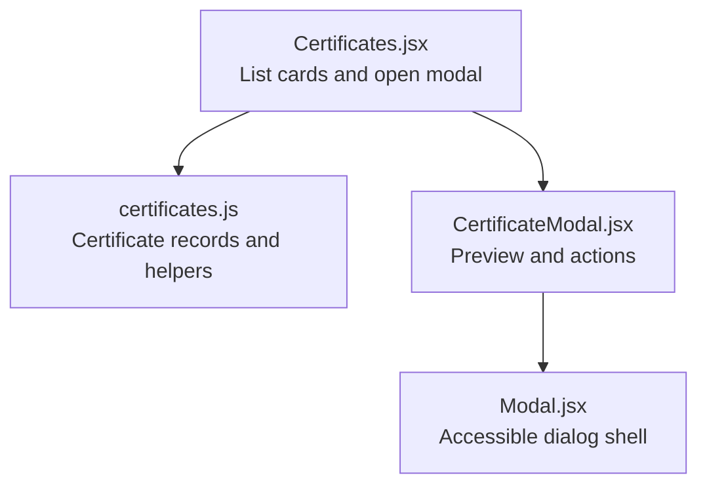
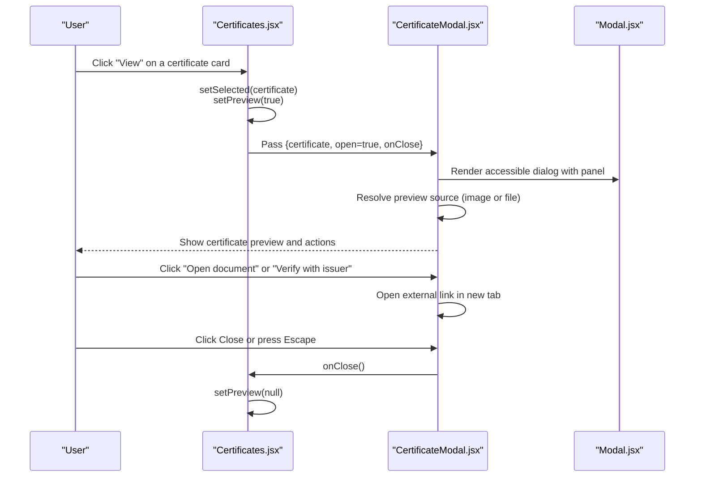
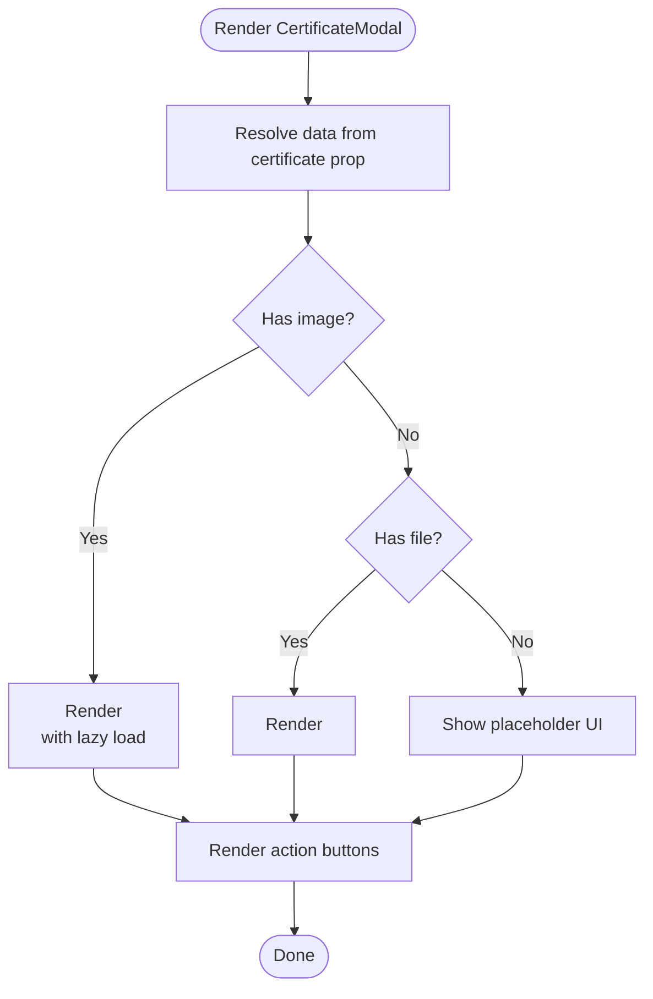
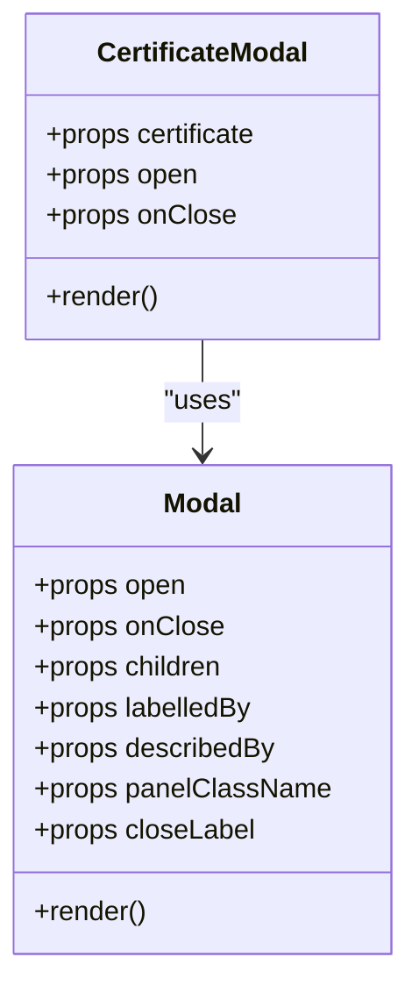
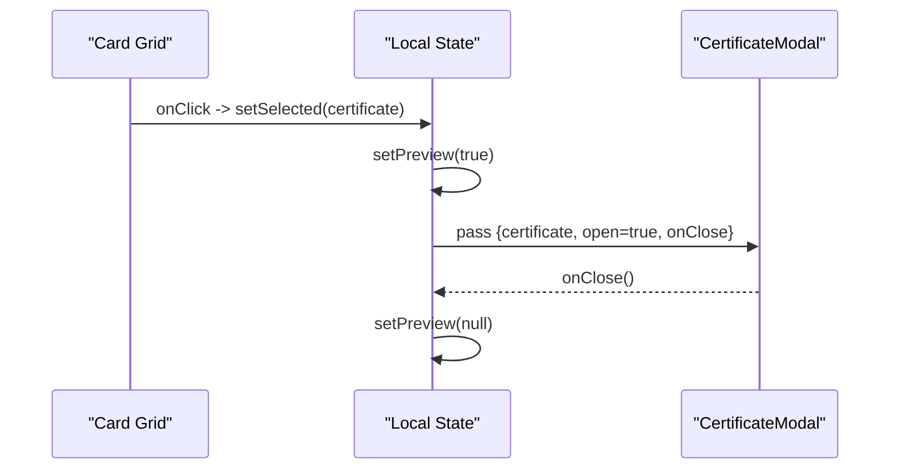
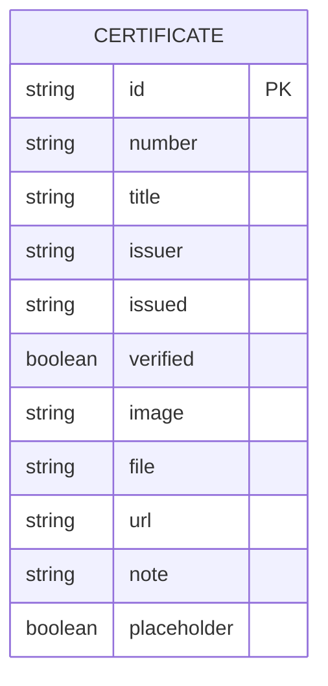
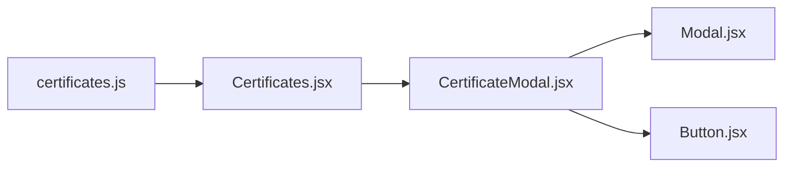

# Certificate Modal Component

<cite>
**Referenced Files in This Document**
- [CertificateModal.jsx](file://src/components/CertificateModal.jsx)
- [Modal.jsx](file://src/components/ui/Modal.jsx)
- [Certificates.jsx](file://src/components/Certificates.jsx)
- [certificates.js](file://src/data/certificates.js)
</cite>

## Table of Contents
1. [Introduction](#introduction)
2. [Project Structure](#project-structure)
3. [Core Components](#core-components)
4. [Architecture Overview](#architecture-overview)
5. [Detailed Component Analysis](#detailed-component-analysis)
6. [Dependency Analysis](#dependency-analysis)
7. [Performance Considerations](#performance-considerations)
8. [Troubleshooting Guide](#troubleshooting-guide)
9. [Conclusion](#conclusion)

## Introduction
This document explains the CertificateModal component and how it displays, previews, and manages certificates within a modal context. It covers certificate data requirements, image and PDF preview handling, integration with the base Modal component, accessibility considerations for document viewing, and usage patterns for verified credentials.

## Project Structure
The certificate feature is composed of:
- A data layer that defines certificate records and helper utilities.
- A section view that lists certificates and opens the modal.
- The CertificateModal component that renders the certificate preview inside an accessible dialog.
- A reusable Modal component providing portal rendering, focus management, keyboard navigation, and animations.

**Diagram sources**
- [Certificates.jsx:1-153](file://src/components/Certificates.jsx#L1-L153)
- [certificates.js:1-116](file://src/data/certificates.js#L1-L116)
- [CertificateModal.jsx:1-117](file://src/components/CertificateModal.jsx#L1-L117)
- [Modal.jsx:1-131](file://src/components/ui/Modal.jsx#L1-L131)

**Section sources**
- [Certificates.jsx:1-153](file://src/components/Certificates.jsx#L1-L153)
- [certificates.js:1-116](file://src/data/certificates.js#L1-L116)
- [CertificateModal.jsx:1-117](file://src/components/CertificateModal.jsx#L1-L117)
- [Modal.jsx:1-131](file://src/components/ui/Modal.jsx#L1-L131)

## Core Components
- CertificateModal: Renders a certificate’s metadata, preview (image or embedded PDF), and action buttons such as opening the document or verifying with the issuer. It synchronizes its internal snapshot with the incoming certificate prop and delegates presentation to the base Modal.
- Modal: Provides an accessible, animated dialog with focus trapping, Escape-to-close, click-outside dismissal, scroll lock, and reduced-motion support.
- Certificates: Displays a grid of certificate cards, determines whether a preview is available, and controls the modal’s open state by passing the selected certificate and close handler.
- certificates.js: Defines the certificate data structure and a hasPreview helper used to gate the “View” action.

Key responsibilities:
- Data binding and fallbacks in CertificateModal.
- Preview rendering for images and PDFs.
- Action buttons for external verification and document access.
- Accessibility via aria attributes, labels, and focus management.

**Section sources**
- [CertificateModal.jsx:1-117](file://src/components/CertificateModal.jsx#L1-L117)
- [Modal.jsx:1-131](file://src/components/ui/Modal.jsx#L1-L131)
- [Certificates.jsx:1-153](file://src/components/Certificates.jsx#L1-L153)
- [certificates.js:1-116](file://src/data/certificates.js#L1-L116)

## Architecture Overview
The certificate flow starts from the Certificates section, which holds the selected certificate and modal visibility state. When a user clicks “View,” the section sets the selected certificate and opens the modal. CertificateModal receives the certificate prop, resolves the preview source, and renders either an image or an iframe for PDFs. Actions allow opening the document in a new tab or verifying externally.

**Diagram sources**
- [Certificates.jsx:20-28](file://src/components/Certificates.jsx#L20-L28)
- [Certificates.jsx:118-132](file://src/components/Certificates.jsx#L118-L132)
- [Certificates.jsx:149-150](file://src/components/Certificates.jsx#L149-L150)
- [CertificateModal.jsx:6-15](file://src/components/CertificateModal.jsx#L6-L15)
- [CertificateModal.jsx:16-23](file://src/components/CertificateModal.jsx#L16-L23)
- [CertificateModal.jsx:61-85](file://src/components/CertificateModal.jsx#L61-L85)
- [CertificateModal.jsx:88-110](file://src/components/CertificateModal.jsx#L88-L110)
- [Modal.jsx:35-74](file://src/components/ui/Modal.jsx#L35-L74)
- [Modal.jsx:80-129](file://src/components/ui/Modal.jsx#L80-L129)

## Detailed Component Analysis

### CertificateModal
Responsibilities:
- Accepts certificate, open, and onClose props.
- Maintains a local snapshot synchronized with the certificate prop.
- Resolves the preview source using image or file fields.
- Renders header metadata (number, title, issuer, issued date, verified badge).
- Displays the certificate as an image or embeds a PDF via iframe.
- Provides action buttons to open the document or verify externally.
- Delegates all modal behavior to the base Modal component.

Preview logic:
- If image exists, render an img element with lazy loading and responsive sizing.
- Else if file exists, render an iframe with a fixed viewport height.
- Else show a placeholder indicating no attachment.

Actions:
- Open document: links directly to the resolved document URL.
- Verify with issuer: opens the optional url field in a new tab.
- Close: calls onClose.

Accessibility highlights:
- Uses labelledBy to associate the dialog title.
- Sets descriptive alt text for images.
- Provides aria-label for the close button through the base Modal.
- Keyboard interaction (Escape to close) is handled by the base Modal.

**Diagram sources**
- [CertificateModal.jsx:6-15](file://src/components/CertificateModal.jsx#L6-L15)
- [CertificateModal.jsx:61-85](file://src/components/CertificateModal.jsx#L61-L85)
- [CertificateModal.jsx:88-110](file://src/components/CertificateModal.jsx#L88-L110)

**Section sources**
- [CertificateModal.jsx:1-117](file://src/components/CertificateModal.jsx#L1-L117)

### Base Modal
Responsibilities:
- Portal rendering into document.body.
- Focus trap within the dialog panel.
- Escape key closes the dialog.
- Click-outside dismisses the dialog.
- Scroll lock while open.
- Reduced motion support for users who prefer less animation.
- Accessible role="dialog", aria-modal, aria-labelledby, and aria-describedby.

Integration points:
- CertificateModal passes labelledBy and closeLabel to customize the dialog’s accessibility.
- Panel styling is customized via panelClassName.

**Diagram sources**
- [Modal.jsx:15-23](file://src/components/ui/Modal.jsx#L15-L23)
- [Modal.jsx:35-74](file://src/components/ui/Modal.jsx#L35-L74)
- [Modal.jsx:80-129](file://src/components/ui/Modal.jsx#L80-L129)
- [CertificateModal.jsx:16-23](file://src/components/CertificateModal.jsx#L16-L23)

**Section sources**
- [Modal.jsx:1-131](file://src/components/ui/Modal.jsx#L1-L131)

### Certificates Section
Responsibilities:
- Renders a grid of certificate cards.
- Determines preview availability using hasPreview.
- Opens the modal with the selected certificate when “View” is clicked.
- Closes the modal by clearing the preview state.

Usage pattern:
- Maintain two states: selected certificate and preview boolean.
- Use hasPreview to conditionally enable the “View” action.
- Render CertificateModal at the bottom of the section with the selected certificate and close handler.

**Diagram sources**
- [Certificates.jsx:20-28](file://src/components/Certificates.jsx#L20-L28)
- [Certificates.jsx:57-138](file://src/components/Certificates.jsx#L57-L138)
- [Certificates.jsx:149-150](file://src/components/Certificates.jsx#L149-L150)

**Section sources**
- [Certificates.jsx:1-153](file://src/components/Certificates.jsx#L1-L153)

### Certificate Data Model
Requirements:
- id: unique identifier for the certificate.
- number: display number for ordering.
- title: human-readable title.
- issuer: organization or program name.
- issued: optional date string; may be null.
- verified: boolean indicating verified credential status.
- image: path to an image asset (e.g., under /public/certificates).
- file: path to a PDF asset (e.g., under /public/certificates).
- url: optional external verification link provided by the issuer.
- note: optional description shown in the modal.
- placeholder: optional flag to mark reserved slots.

Helper:
- hasPreview returns true if any of image, file, or url is present.

**Diagram sources**
- [certificates.js:1-116](file://src/data/certificates.js#L1-L116)

**Section sources**
- [certificates.js:1-116](file://src/data/certificates.js#L1-L116)

## Dependency Analysis
- Certificates depends on certificates.js for data and hasPreview.
- Certificates depends on CertificateModal for preview rendering.
- CertificateModal depends on Modal for dialog behavior and Button for action buttons.
- Modal depends on framer-motion for animations, lucide-react icons, and useScrollLock hook.

**Diagram sources**
- [certificates.js:1-116](file://src/data/certificates.js#L1-L116)
- [Certificates.jsx:1-153](file://src/components/Certificates.jsx#L1-L153)
- [CertificateModal.jsx:1-117](file://src/components/CertificateModal.jsx#L1-L117)
- [Modal.jsx:1-131](file://src/components/ui/Modal.jsx#L1-L131)

**Section sources**
- [certificates.js:1-116](file://src/data/certificates.js#L1-L116)
- [Certificates.jsx:1-153](file://src/components/Certificates.jsx#L1-L153)
- [CertificateModal.jsx:1-117](file://src/components/CertificateModal.jsx#L1-L117)
- [Modal.jsx:1-131](file://src/components/ui/Modal.jsx#L1-L131)

## Performance Considerations
- Image preview uses lazy loading to defer offscreen image loading.
- PDF preview uses an iframe with a fixed viewport height to avoid layout thrashing.
- Modal animations respect reduced motion preferences for performance and accessibility.
- Avoid heavy computations in render paths; keep certificate data static or memoized where possible.

[No sources needed since this section provides general guidance]

## Troubleshooting Guide
Common issues and resolutions:
- Empty preview shows placeholder: Ensure image or file is set in the certificate record. The modal will not open if neither exists unless url is provided.
- PDF does not render: Confirm the file path is correct and served from the public directory. Some browsers block cross-origin iframes.
- Modal does not close: Verify onClose is passed correctly and that Escape key handling is enabled by the base Modal.
- Accessibility warnings: Ensure labelledBy matches the heading id inside the modal and that images have meaningful alt text.

**Section sources**
- [CertificateModal.jsx:61-85](file://src/components/CertificateModal.jsx#L61-L85)
- [Modal.jsx:35-74](file://src/components/ui/Modal.jsx#L35-L74)

## Conclusion
CertificateModal provides a focused, accessible way to preview and interact with certificates. It integrates cleanly with the base Modal for robust dialog behavior and supports both image and PDF previews. By following the certificate data model and using hasPreview to gate interactions, teams can reliably display verified credentials and offer clear next steps for verification and document access.

[No sources needed since this section summarizes without analyzing specific files]