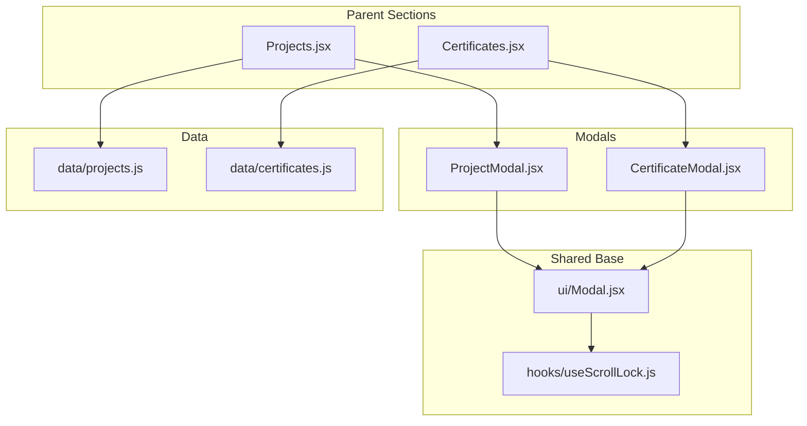
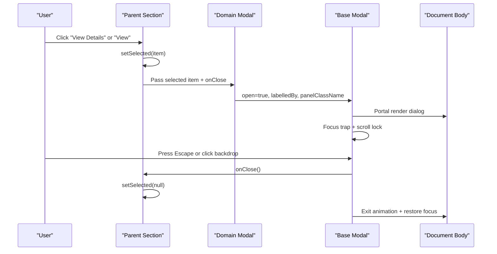
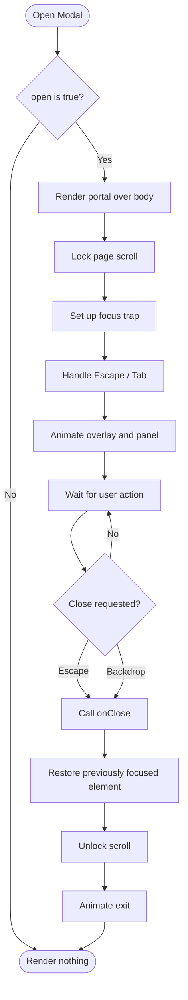
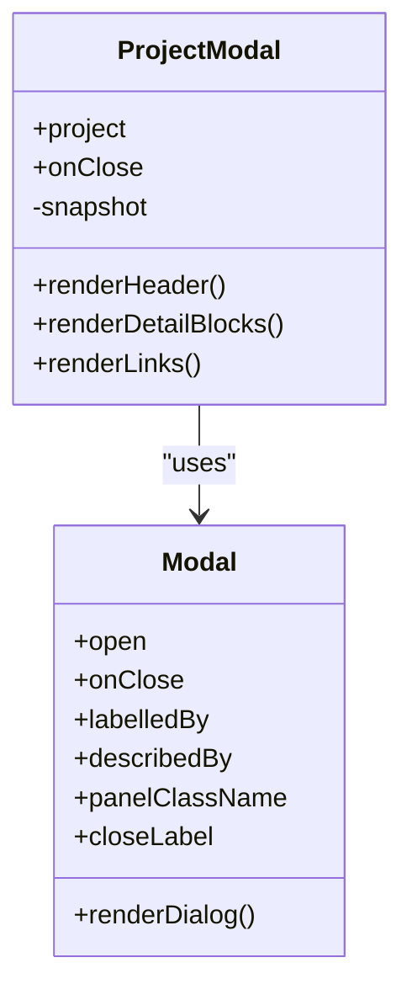
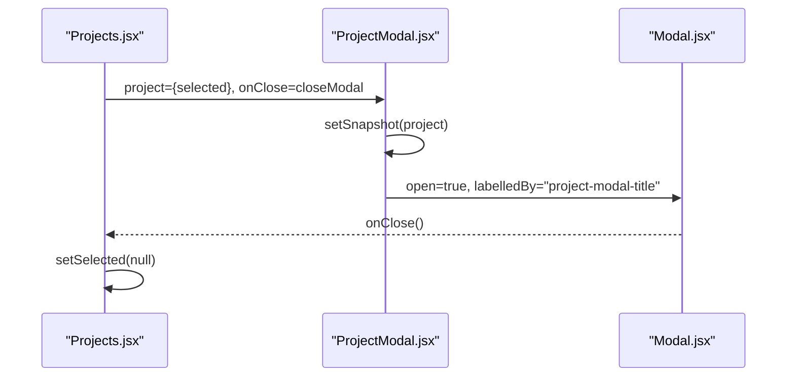
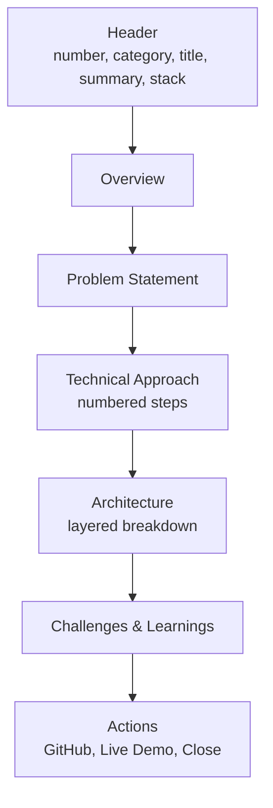
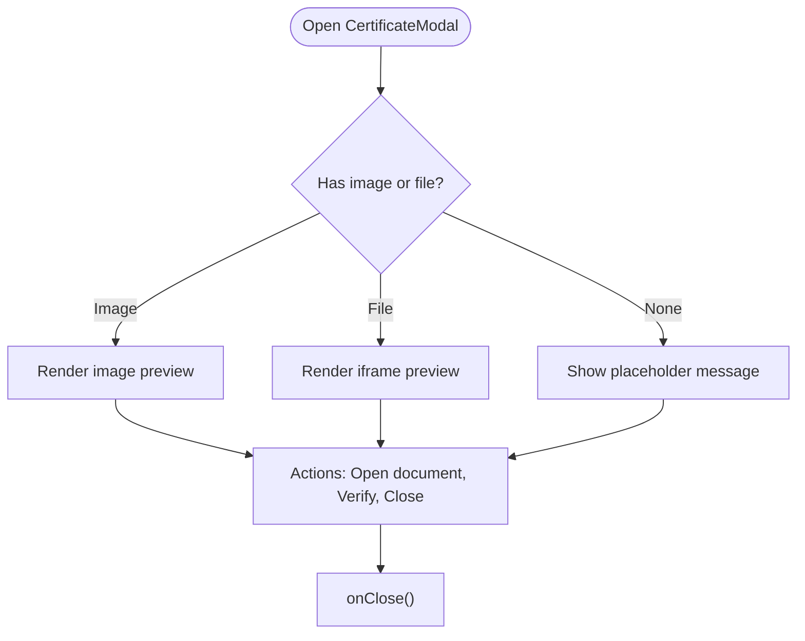
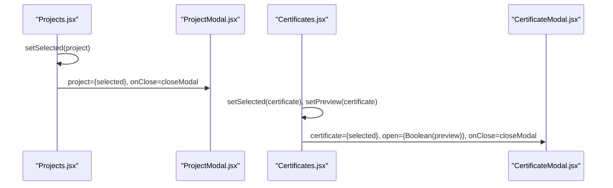
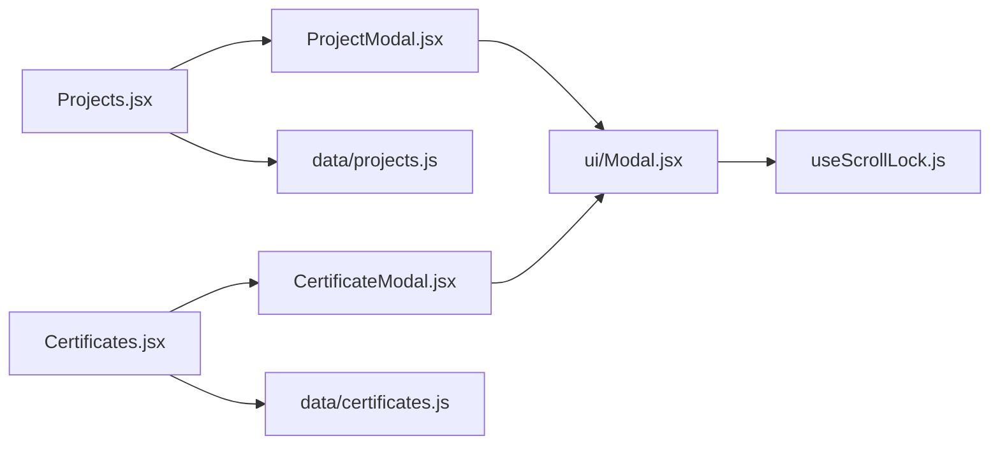

# Modal Systems

<cite>
**Referenced Files in This Document**
- [Modal.jsx](file://src/components/ui/Modal.jsx)
- [ProjectModal.jsx](file://src/components/ProjectModal.jsx)
- [CertificateModal.jsx](file://src/components/CertificateModal.jsx)
- [Projects.jsx](file://src/components/Projects.jsx)
- [Certificates.jsx](file://src/components/Certificates.jsx)
- [projects.js](file://src/data/projects.js)
- [certificates.js](file://src/data/certificates.js)
- [useScrollLock.js](file://src/hooks/useScrollLock.js)
</cite>

## Table of Contents
1. [Introduction](#introduction)
2. [Project Structure](#project-structure)
3. [Core Components](#core-components)
4. [Architecture Overview](#architecture-overview)
5. [Detailed Component Analysis](#detailed-component-analysis)
6. [Dependency Analysis](#dependency-analysis)
7. [Performance Considerations](#performance-considerations)
8. [Troubleshooting Guide](#troubleshooting-guide)
9. [Conclusion](#conclusion)

## Introduction
This document explains the modal system used across the portfolio application. It covers:
- The base accessible `Modal` component, including focus management, keyboard navigation, scroll locking, and animation integration.
- The `ProjectModal` component lifecycle, snapshot-based state pattern, and structured project detail layout.
- The `CertificateModal` implementation for certificate preview, including image, PDF, and placeholder handling.
- Data flow from parent components (`Projects` and `Certificates`) into modals.
- Best practices for opening, closing, organizing content, and maintaining accessibility.

## Project Structure
The modal system is composed of a shared base modal and two domain-specific modal components. Parent sections control when each modal opens by holding selected data in local state.

**Diagram sources**
- [Projects.jsx:1-143](file://src/components/Projects.jsx#L1-L143)
- [Certificates.jsx:1-153](file://src/components/Certificates.jsx#L1-L153)
- [ProjectModal.jsx:1-172](file://src/components/ProjectModal.jsx#L1-L172)
- [CertificateModal.jsx:1-117](file://src/components/CertificateModal.jsx#L1-L117)
- [Modal.jsx:1-131](file://src/components/ui/Modal.jsx#L1-L131)
- [useScrollLock.js:1-24](file://src/hooks/useScrollLock.js#L1-L24)
- [projects.js:1-262](file://src/data/projects.js#L1-L262)
- [certificates.js:1-116](file://src/data/certificates.js#L1-L116)

**Section sources**
- [Projects.jsx:1-143](file://src/components/Projects.jsx#L1-L143)
- [Certificates.jsx:1-153](file://src/components/Certificates.jsx#L1-L153)
- [Modal.jsx:1-131](file://src/components/ui/Modal.jsx#L1-L131)

## Core Components
- **Base Modal**: Provides portal rendering, backdrop click-to-close, Escape key support, focus trapping, scroll lock, reduced-motion support, and accessible dialog attributes.
- **ProjectModal**: Displays detailed project information with an overview, problem statement, technical approach, architecture visualization, challenges, learnings, and external links. Uses a snapshot pattern to keep content stable during exit animations.
- **CertificateModal**: Displays certificate metadata and previews images or embedded documents, with verification and issuer link actions. Also uses a snapshot pattern for smooth transitions.

**Section sources**
- [Modal.jsx:1-131](file://src/components/ui/Modal.jsx#L1-L131)
- [ProjectModal.jsx:1-172](file://src/components/ProjectModal.jsx#L1-L172)
- [CertificateModal.jsx:1-117](file://src/components/CertificateModal.jsx#L1-L117)

## Architecture Overview
The modal system follows a unidirectional data flow:
1. Parent section holds selected item state.
2. User interaction sets the selected item and opens the modal.
3. Modal receives props and renders its content inside the base accessible modal.
4. Closing clears the selected item, triggering the base modal’s exit animation and restoring focus.

**Diagram sources**
- [Projects.jsx:93-102](file://src/components/Projects.jsx#L93-L102)
- [Projects.jsx:139-140](file://src/components/Projects.jsx#L139-L140)
- [Certificates.jsx:118-127](file://src/components/Certificates.jsx#L118-L127)
- [Certificates.jsx:149-150](file://src/components/Certificates.jsx#L149-L150)
- [Modal.jsx:31-74](file://src/components/ui/Modal.jsx#L31-L74)
- [Modal.jsx:78-129](file://src/components/ui/Modal.jsx#L78-L129)

## Detailed Component Analysis

### Base Modal Accessibility and Behavior
Key behaviors:
- Portal rendering to `document.body`.
- Backdrop click closes the modal.
- Escape key closes the modal.
- Tab focus trapping within the dialog panel.
- Restores previous focus on close.
- Locks page scrolling while open without layout shift.
- Respects user motion preferences via reduced-motion.
- Accessible attributes: `role="dialog"`, `aria-modal="true"`, `aria-labelledby`, `aria-describedby`.

**Diagram sources**
- [Modal.jsx:31-74](file://src/components/ui/Modal.jsx#L31-L74)
- [Modal.jsx:78-129](file://src/components/ui/Modal.jsx#L78-L129)
- [useScrollLock.js:1-24](file://src/hooks/useScrollLock.js#L1-L24)

**Section sources**
- [Modal.jsx:1-131](file://src/components/ui/Modal.jsx#L1-L131)
- [useScrollLock.js:1-24](file://src/hooks/useScrollLock.js#L1-L24)

### ProjectModal Lifecycle and Snapshot Pattern
Lifecycle highlights:
- Receives `project` prop; if absent, falls back to internal `snapshot`.
- On mount or when `project` changes, updates `snapshot` to preserve last rendered project.
- Renders header with number, category, title, summary, and technology chips.
- Renders structured detail blocks: overview, problem statement, technical approach, architecture visualization, challenges, and learnings.
- Renders external links conditionally based on available URLs.
- Closes via provided `onClose`.

**Diagram sources**
- [ProjectModal.jsx:16-24](file://src/components/ProjectModal.jsx#L16-L24)
- [ProjectModal.jsx:26-170](file://src/components/ProjectModal.jsx#L26-L170)
- [Modal.jsx:15-23](file://src/components/ui/Modal.jsx#L15-L23)

**Diagram sources**
- [Projects.jsx:13-14](file://src/components/Projects.jsx#L13-L14)
- [Projects.jsx:93-102](file://src/components/Projects.jsx#L93-L102)
- [Projects.jsx:139-140](file://src/components/Projects.jsx#L139-L140)
- [ProjectModal.jsx:16-24](file://src/components/ProjectModal.jsx#L16-L24)
- [ProjectModal.jsx:26-33](file://src/components/ProjectModal.jsx#L26-L33)

**Section sources**
- [ProjectModal.jsx:1-172](file://src/components/ProjectModal.jsx#L1-L172)
- [Projects.jsx:1-143](file://src/components/Projects.jsx#L1-L143)

#### Project Detail Layout
The project detail view is organized into clear sections:
- Header: number badge, category, title, summary, and technology chips.
- Overview: narrative description of the project.
- Problem Statement: context and motivation.
- Technical Approach: numbered steps describing the solution process.
- Architecture Visualization: layered breakdown of system stages.
- Challenges & Learnings: difficulties encountered and insights gained.
- Actions: optional GitHub repository and live demo buttons, plus a close button.

**Diagram sources**
- [ProjectModal.jsx:36-65](file://src/components/ProjectModal.jsx#L36-L65)
- [ProjectModal.jsx:67-131](file://src/components/ProjectModal.jsx#L67-L131)
- [ProjectModal.jsx:133-165](file://src/components/ProjectModal.jsx#L133-L165)

**Section sources**
- [ProjectModal.jsx:36-165](file://src/components/ProjectModal.jsx#L36-L165)
- [projects.js:8-87](file://src/data/projects.js#L8-L87)
- [projects.js:89-173](file://src/data/projects.js#L89-L173)
- [projects.js:175-260](file://src/data/projects.js#L175-L260)

### CertificateModal Preview Implementation
Key behaviors:
- Receives `certificate`, `open`, and `onClose`.
- Uses snapshot pattern to retain certificate data during exit animation.
- Determines preview source: image or file (PDF).
- Renders certificate metadata: number, title, issuer, issued date, verified badge, and optional note.
- Renders preview area: image, embedded PDF iframe, or placeholder when no asset is attached.
- Provides actions: open document, verify with issuer, and close.

**Diagram sources**
- [CertificateModal.jsx:6-13](file://src/components/CertificateModal.jsx#L6-L13)
- [CertificateModal.jsx:24-85](file://src/components/CertificateModal.jsx#L24-L85)
- [CertificateModal.jsx:88-110](file://src/components/CertificateModal.jsx#L88-L110)

**Section sources**
- [CertificateModal.jsx:1-117](file://src/components/CertificateModal.jsx#L1-L117)
- [Certificates.jsx:1-153](file://src/components/Certificates.jsx#L1-L153)
- [certificates.js:1-116](file://src/data/certificates.js#L1-L116)

### Parent Component Patterns
- **Projects**: Holds `selected` project state; clicking “View Details” sets the selected project and renders `ProjectModal`.
- **Certificates**: Holds both `selected` and `preview` states; clicking “View” sets both and renders `CertificateModal`. Uses `hasPreview` helper to enable/disable preview actions.

**Diagram sources**
- [Projects.jsx:13-14](file://src/components/Projects.jsx#L13-L14)
- [Projects.jsx:93-102](file://src/components/Projects.jsx#L93-L102)
- [Projects.jsx:139-140](file://src/components/Projects.jsx#L139-L140)
- [Certificates.jsx:21-28](file://src/components/Certificates.jsx#L21-L28)
- [Certificates.jsx:118-127](file://src/components/Certificates.jsx#L118-L127)
- [Certificates.jsx:149-150](file://src/components/Certificates.jsx#L149-L150)

**Section sources**
- [Projects.jsx:1-143](file://src/components/Projects.jsx#L1-L143)
- [Certificates.jsx:1-153](file://src/components/Certificates.jsx#L1-L153)

## Dependency Analysis
The modal system has clear separation between shared UI primitives and domain-specific modals. Parents own selection state and pass it down.

**Diagram sources**
- [Projects.jsx:1-143](file://src/components/Projects.jsx#L1-L143)
- [Certificates.jsx:1-153](file://src/components/Certificates.jsx#L1-L153)
- [ProjectModal.jsx:1-172](file://src/components/ProjectModal.jsx#L1-L172)
- [CertificateModal.jsx:1-117](file://src/components/CertificateModal.jsx#L1-L117)
- [Modal.jsx:1-131](file://src/components/ui/Modal.jsx#L1-L131)
- [useScrollLock.js:1-24](file://src/hooks/useScrollLock.js#L1-L24)
- [projects.js:1-262](file://src/data/projects.js#L1-L262)
- [certificates.js:1-116](file://src/data/certificates.js#L1-L116)

**Section sources**
- [Modal.jsx:1-131](file://src/components/ui/Modal.jsx#L1-L131)
- [ProjectModal.jsx:1-172](file://src/components/ProjectModal.jsx#L1-L172)
- [CertificateModal.jsx:1-117](file://src/components/CertificateModal.jsx#L1-L117)
- [Projects.jsx:1-143](file://src/components/Projects.jsx#L1-L143)
- [Certificates.jsx:1-153](file://src/components/Certificates.jsx#L1-L153)

## Performance Considerations
- **Reduced Motion**: The base modal respects user motion preferences to minimize animations for users who prefer reduced motion.
- **Snapshot Pattern**: Both `ProjectModal` and `CertificateModal` use a snapshot to avoid re-rendering content during exit animations, improving perceived performance and preventing flicker.
- **Conditional Rendering**: External links and preview assets are conditionally rendered to avoid unnecessary work when not present.
- **Lazy Loading**: Certificate images use lazy loading to defer offscreen resource loading.

[No sources needed since this section provides general guidance]

## Troubleshooting Guide
Common issues and resolutions:
- **Modal does not close on Escape**: Ensure the base modal receives `open` and `onClose` correctly and that the event listener is active.
- **Focus not trapped**: Confirm the modal panel contains focusable elements and that the focus trap logic is running.
- **Page scrolls behind modal**: Verify scroll lock is enabled when the modal is open and restored on close.
- **Empty certificate preview**: Use the `hasPreview` helper to disable preview actions until an image or file is attached.
- **Missing aria labels**: Ensure `labelledBy` points to a visible heading id and consider adding `describedBy` for additional context.

**Section sources**
- [Modal.jsx:31-74](file://src/components/ui/Modal.jsx#L31-L74)
- [Modal.jsx:78-129](file://src/components/ui/Modal.jsx#L78-L129)
- [useScrollLock.js:1-24](file://src/hooks/useScrollLock.js#L1-L24)
- [certificates.js:113-115](file://src/data/certificates.js#L113-L115)

## Conclusion
The modal system combines a robust, accessible base component with domain-specific implementations for projects and certificates. It emphasizes:
- Clear data flow from parent sections to modals.
- Snapshot-based state patterns for smooth transitions.
- Strong accessibility features including focus management, keyboard navigation, and semantic attributes.
- Organized content structures that make complex details easy to scan and understand.

Adhering to these patterns ensures consistent behavior, better user experience, and maintainable code across the portfolio application.