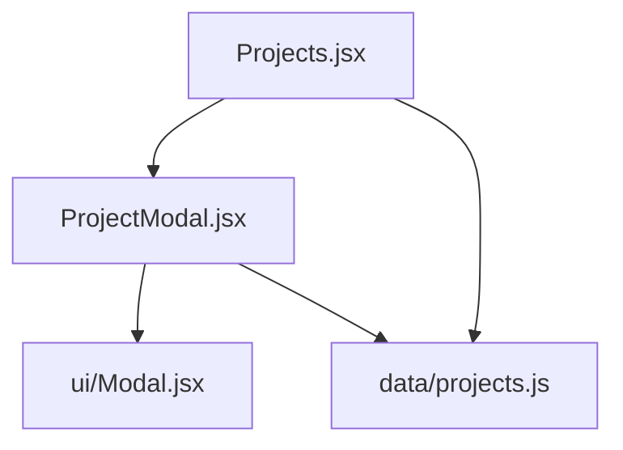
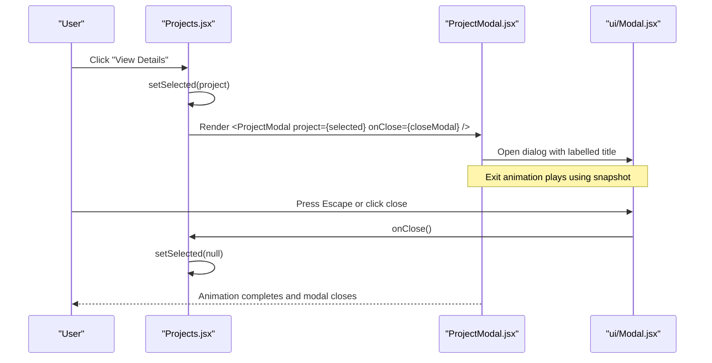
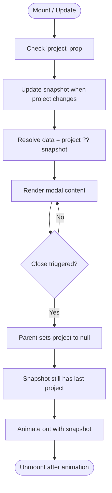
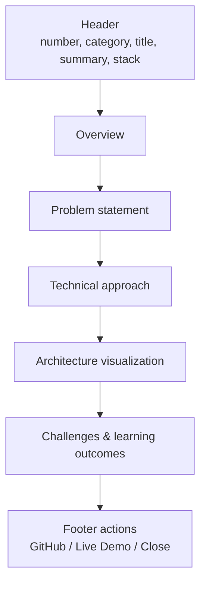
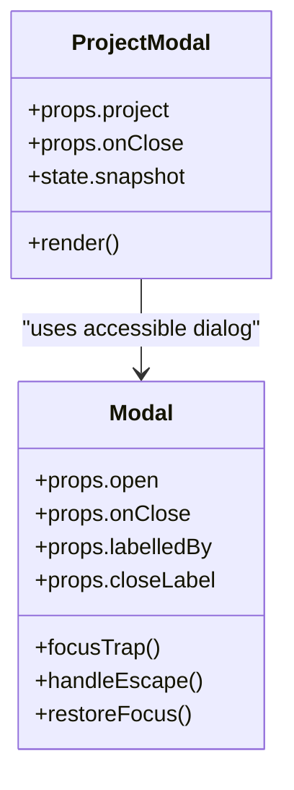
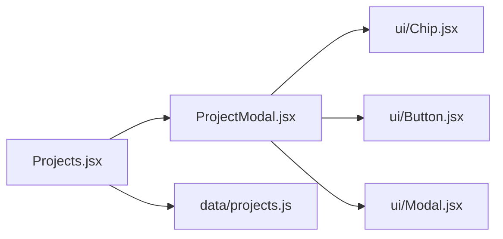

# Project Modal Component

<cite>
**Referenced Files in This Document**
- [ProjectModal.jsx](file://src/components/ProjectModal.jsx)
- [Projects.jsx](file://src/components/Projects.jsx)
- [projects.js](file://src/data/projects.js)
- [Modal.jsx](file://src/components/ui/Modal.jsx)
</cite>

## Table of Contents
1. [Introduction](#introduction)
2. [Project Structure](#project-structure)
3. [Core Components](#core-components)
4. [Architecture Overview](#architecture-overview)
5. [Detailed Component Analysis](#detailed-component-analysis)
6. [Dependency Analysis](#dependency-analysis)
7. [Performance Considerations](#performance-considerations)
8. [Troubleshooting Guide](#troubleshooting-guide)
9. [Conclusion](#conclusion)

## Introduction
This document explains the `ProjectModal` component used to display detailed information about a selected project. It focuses on:
- The snapshot pattern that keeps the last project visible during exit animations.
- The structured modal layout with header metadata and detail blocks.
- Conditional rendering of GitHub and live demo links.
- Integration with parent components.
- Data structure requirements.
- Accessibility features such as labeling, focus management, and keyboard navigation.

## Project Structure
The modal is part of a small React application organized by feature and layer:
- `src/components/ProjectModal.jsx` implements the modal UI and animation-safe data handling.
- `src/components/Projects.jsx` owns selection state and renders the modal.
- `src/data/projects.js` defines the project data model consumed by both the list and the modal.
- `src/components/ui/Modal.jsx` provides an accessible, animated dialog shell.

**Diagram sources**
- [Projects.jsx:1-143](file://src/components/Projects.jsx#L1-L143)
- [ProjectModal.jsx:1-172](file://src/components/ProjectModal.jsx#L1-L172)
- [projects.js:1-262](file://src/data/projects.js#L1-L262)
- [Modal.jsx:1-131](file://src/components/ui/Modal.jsx#L1-L131)

**Section sources**
- [Projects.jsx:1-143](file://src/components/Projects.jsx#L1-L143)
- [ProjectModal.jsx:1-172](file://src/components/ProjectModal.jsx#L1-L172)
- [projects.js:1-262](file://src/data/projects.js#L1-L262)
- [Modal.jsx:1-131](file://src/components/ui/Modal.jsx#L1-L131)

## Core Components
- `ProjectModal`: Displays project details, maintains a snapshot for smooth exit animations, and renders structured sections.
- `Projects`: Owns the selected project state and passes it down to `ProjectModal`.
- `Modal` (UI primitive): Provides portal rendering, focus trap, Escape-to-close, reduced-motion support, and Framer Motion transitions.
- `projects.js`: Defines the shape of project data including metadata, tech stack, detail blocks, and optional links.

Key responsibilities:
- State ownership lives in `Projects.jsx`, while `ProjectModal.jsx` focuses on presentation and animation safety.
- `Modal.jsx` centralizes accessibility and animation behavior so `ProjectModal.jsx` can stay content-focused.

**Section sources**
- [ProjectModal.jsx:16-172](file://src/components/ProjectModal.jsx#L16-L172)
- [Projects.jsx:12-140](file://src/components/Projects.jsx#L12-L140)
- [Modal.jsx:15-131](file://src/components/ui/Modal.jsx#L15-L131)
- [projects.js:8-262](file://src/data/projects.js#L8-L262)

## Architecture Overview
The modal follows a unidirectional data flow:
1. User clicks “View Details” on a project card.
2. `Projects.jsx` sets the selected project in local state.
3. `ProjectModal.jsx` receives the project prop and opens via `Modal.jsx`.
4. While closing, `ProjectModal.jsx` keeps a snapshot of the last project so the exit animation completes smoothly.
5. When closed, `Projects.jsx` clears the selected project, hiding the modal.

**Diagram sources**
- [Projects.jsx:94-139](file://src/components/Projects.jsx#L94-L139)
- [ProjectModal.jsx:16-33](file://src/components/ProjectModal.jsx#L16-L33)
- [Modal.jsx:31-74](file://src/components/ui/Modal.jsx#L31-L74)

## Detailed Component Analysis

### Snapshot Pattern for Exit Animations
`ProjectModal` uses a local snapshot state to keep the last rendered project visible while the modal’s exit animation runs.

- A `snapshot` state holds the previous project object.
- A `useEffect` updates the snapshot whenever the incoming `project` prop changes.
- During close, the parent clears `project`, but the modal continues rendering from `snapshot` until the animation finishes.
- The effective data source is `project ?? snapshot`, ensuring no blank content during transition.

**Diagram sources**
- [ProjectModal.jsx:17-24](file://src/components/ProjectModal.jsx#L17-L24)

**Section sources**
- [ProjectModal.jsx:17-24](file://src/components/ProjectModal.jsx#L17-L24)

### Modal Layout and Sections
The modal presents a consistent, readable layout:

- Header section:
  - Project number badge.
  - Category label.
  - Title and summary paragraph.
  - Tech stack chips.
- Detail blocks:
  - Overview: descriptive paragraph.
  - Problem statement: context and motivation.
  - Technical approach: numbered steps.
  - Architecture visualization: layered cards describing system stages.
  - Challenges & learning outcomes: challenges list and learnings list.
- Footer actions:
  - Conditional GitHub repository button.
  - Conditional live demo button.
  - Fallback message when neither link exists.
  - Close action.

**Diagram sources**
- [ProjectModal.jsx:36-165](file://src/components/ProjectModal.jsx#L36-L165)

**Section sources**
- [ProjectModal.jsx:36-165](file://src/components/ProjectModal.jsx#L36-L165)

### Conditional Rendering of Links
The footer conditionally renders external links based on available URLs:
- If `links.github` exists, render the GitHub button.
- If `links.live` exists, render the Live Demo button.
- If neither exists, show a placeholder message indicating future availability.

This ensures users are not presented with broken or empty links.

**Section sources**
- [ProjectModal.jsx:133-152](file://src/components/ProjectModal.jsx#L133-L152)
- [projects.js:30-33](file://src/data/projects.js#L30-L33)

### Accessibility Features
Accessibility is implemented at two layers:

- `ProjectModal.jsx`:
  - Passes `labelledBy="project-modal-title"` to the underlying modal.
  - Uses an `<h2>` with matching id for the modal title.
  - Uses semantic headings and lists for structure.
  - Decorative icons use `aria-hidden="true"`.
- `Modal.jsx`:
  - Renders a proper `role="dialog"` with `aria-modal="true"` and `aria-labelledby`.
  - Focus trap cycles through focusable elements inside the panel.
  - Supports Escape key to close.
  - Restores focus to the previously focused element on close.
  - Respects reduced motion preferences.
  - Locks background scroll while open.

**Diagram sources**
- [ProjectModal.jsx:27-33](file://src/components/ProjectModal.jsx#L27-L33)
- [Modal.jsx:31-74](file://src/components/ui/Modal.jsx#L31-L74)

**Section sources**
- [ProjectModal.jsx:27-33](file://src/components/ProjectModal.jsx#L27-L33)
- [Modal.jsx:31-74](file://src/components/ui/Modal.jsx#L31-L74)

### Integration with Parent Components
To integrate `ProjectModal` into a parent component:

- Maintain a single piece of state for the selected project.
- Provide a close handler that resets the selected project to null.
- Render `<ProjectModal project={selected} onClose={closeModal} />`.
- Ensure the parent passes a valid project object conforming to the required schema.

Example integration points:
- Selection trigger: set selected project on user interaction.
- Close trigger: clear selected project to hide the modal.

**Section sources**
- [Projects.jsx:12-14](file://src/components/Projects.jsx#L12-L14)
- [Projects.jsx:94-139](file://src/components/Projects.jsx#L94-L139)

### Data Structure Requirements
The modal expects a project object with this structure:

- Top-level fields:
  - `number`: string identifier displayed in the header.
  - `category`: string category label.
  - `title`: string main title.
  - `summary`: string short description.
  - `stack`: array of strings representing technologies.
  - `links`: object with optional `github` and `live` URL strings.
- Nested `detail` object:
  - `overview`: string overview paragraph.
  - `problem`: string problem statement.
  - `approach`: array of strings describing technical steps.
  - `architecture`: array of objects with `step`, `title`, and `text`.
  - `challenges`: array of objects with `title` and `text`.
  - `learnings`: array of strings summarizing lessons learned.

Optional links:
- Empty strings for `links.github` or `links.live` hide the corresponding buttons.
- Only include real, public URLs when available.

**Section sources**
- [projects.js:8-262](file://src/data/projects.js#L8-L262)
- [ProjectModal.jsx:39-130](file://src/components/ProjectModal.jsx#L39-L130)

## Dependency Analysis
`ProjectModal` depends on:
- `ui/Chip` for technology tags.
- `ui/Button` for interactive controls.
- `ui/Modal` for accessible dialog behavior and animations.
- `lucide-react` icons for visual cues.

`Projects.jsx` depends on:
- `data/projects.js` for project definitions.
- `ProjectModal` for detail view.
- `visuals/ProjectVisual` for project artwork.

**Diagram sources**
- [ProjectModal.jsx:1-5](file://src/components/ProjectModal.jsx#L1-L5)
- [Projects.jsx:1-10](file://src/components/Projects.jsx#L1-L10)

**Section sources**
- [ProjectModal.jsx:1-5](file://src/components/ProjectModal.jsx#L1-L5)
- [Projects.jsx:1-10](file://src/components/Projects.jsx#L1-L10)

## Performance Considerations
- Snapshot pattern avoids re-render flicker during exit animations by preserving the last project instance.
- Modal content is only rendered when a project is present, reducing unnecessary work.
- Using `framer-motion` with reduced-motion support improves performance and accessibility for sensitive users.
- Keeping large detail content within a scrollable container prevents layout thrashing.

[No sources needed since this section provides general guidance]

## Troubleshooting Guide
Common issues and resolutions:

- Modal does not close on Escape:
  - Verify the parent’s close handler is passed correctly.
  - Ensure the modal is receiving `open={Boolean(project)}` and calling `onClose`.
- Links not showing:
  - Confirm `links.github` or `links.live` contain non-empty strings.
  - Avoid inventing URLs; leave them empty if unavailable.
- Missing content during close:
  - Ensure the snapshot logic remains intact and the parent clears `project` only after triggering close.
- Accessibility warnings:
  - Ensure `labelledBy` matches the id of the modal title element.
  - Keep decorative icons marked with `aria-hidden="true"`.

**Section sources**
- [ProjectModal.jsx:17-24](file://src/components/ProjectModal.jsx#L17-L24)
- [ProjectModal.jsx:133-152](file://src/components/ProjectModal.jsx#L133-L152)
- [Modal.jsx:31-74](file://src/components/ui/Modal.jsx#L31-L74)

## Conclusion
`ProjectModal` provides a robust, accessible, and animation-safe way to present detailed project information. Its snapshot pattern guarantees smooth exits, its structured layout communicates rich technical context, and its conditional link rendering respects data availability. Integrating it requires minimal state plumbing in the parent and adherence to the documented data schema. With built-in accessibility features, it offers a strong foundation for portfolio project showcases.

[No sources needed since this section summarizes without analyzing specific files]