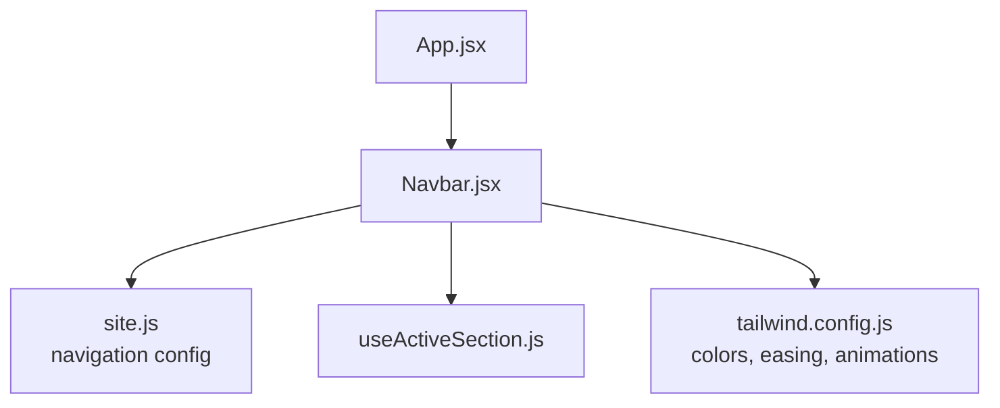
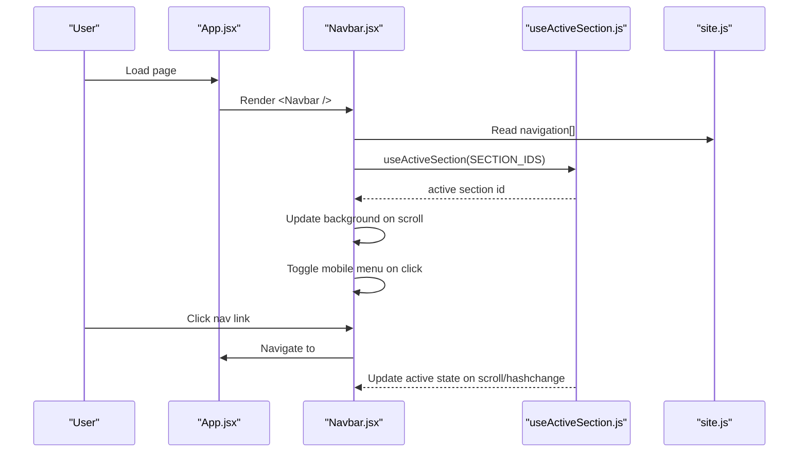
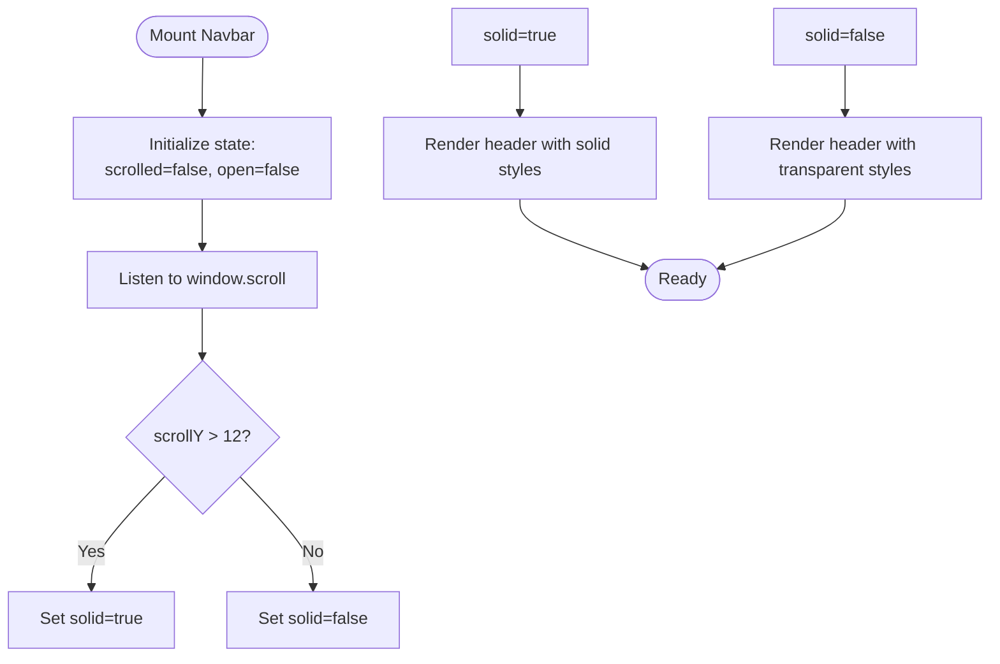
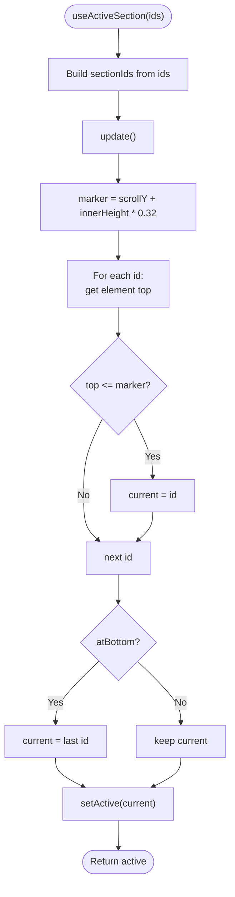
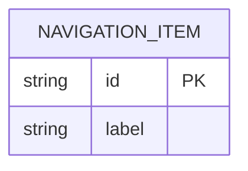
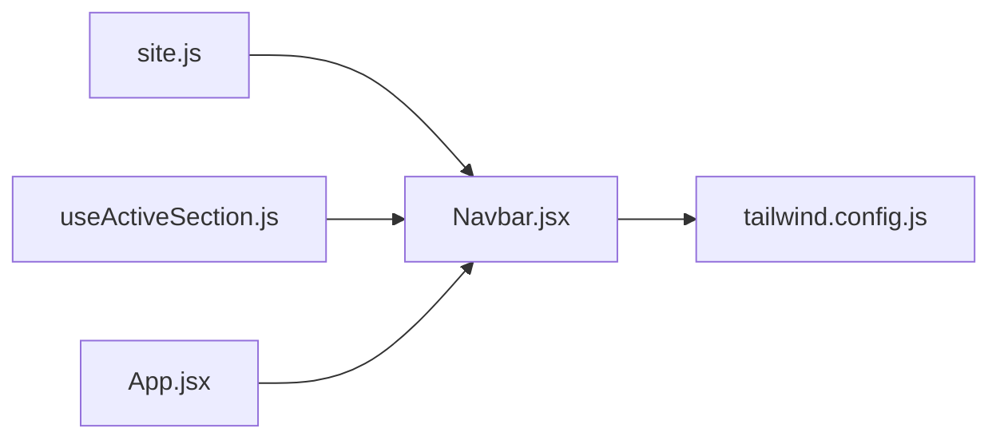

# Navigation Interactions

<cite>
**Referenced Files in This Document**
- [Navbar.jsx](file://src/components/Navbar.jsx)
- [useActiveSection.js](file://src/hooks/useActiveSection.js)
- [site.js](file://src/data/site.js)
- [App.jsx](file://src/App.jsx)
- [tailwind.config.js](file://tailwind.config.js)
</cite>

## Table of Contents
1. [Introduction](#introduction)
2. [Project Structure](#project-structure)
3. [Core Components](#core-components)
4. [Architecture Overview](#architecture-overview)
5. [Detailed Component Analysis](#detailed-component-analysis)
6. [Dependency Analysis](#dependency-analysis)
7. [Performance Considerations](#performance-considerations)
8. [Troubleshooting Guide](#troubleshooting-guide)
9. [Conclusion](#conclusion)
10. [Appendices](#appendices)

## Introduction
This document explains the navigation interaction patterns used across the application, focusing on:
- Desktop and mobile menu implementations in the Navbar component
- Active section tracking using the useActiveSection hook
- Scroll-triggered background changes and smooth scrolling behavior
- Hamburger menu toggle functionality
- Responsive design considerations
- Accessibility features including keyboard navigation and screen reader support
- Practical examples for adding new navigation items, customizing active states, and implementing scroll-based animations

The goal is to help you understand how the navigation works end-to-end and how to extend it safely while preserving performance and accessibility.

## Project Structure
The navigation system spans a few focused files:
- Navbar.jsx: Renders desktop links, mobile menu, hamburger toggle, and scroll-driven visual changes
- useActiveSection.js: Tracks which section is currently visible based on scroll position
- site.js: Central configuration for navigation items and identity assets
- App.jsx: Root layout that mounts sections and provides a skip link for accessibility
- tailwind.config.js: Defines colors, typography, easing, and animation utilities used by the UI

**Diagram sources**
- [App.jsx:10-29](file://src/App.jsx#L10-L29)
- [Navbar.jsx:1-218](file://src/components/Navbar.jsx#L1-L218)
- [site.js:62-69](file://src/data/site.js#L62-L69)
- [useActiveSection.js:1-46](file://src/hooks/useActiveSection.js#L1-L46)
- [tailwind.config.js:12-84](file://tailwind.config.js#L12-L84)

**Section sources**
- [App.jsx:10-29](file://src/App.jsx#L10-L29)
- [Navbar.jsx:1-218](file://src/components/Navbar.jsx#L1-L218)
- [site.js:62-69](file://src/data/site.js#L62-L69)
- [useActiveSection.js:1-46](file://src/hooks/useActiveSection.js#L1-L46)
- [tailwind.config.js:12-84](file://tailwind.config.js#L12-L84)

## Core Components
- Navbar component
  - Renders a fixed header with desktop navigation and a collapsible mobile menu
  - Uses scroll state to switch between transparent and solid backgrounds
  - Integrates with useActiveSection to highlight the current section
  - Implements a hamburger menu toggle with accessible attributes
- useActiveSection hook
  - Computes the active section ID based on scroll position and viewport metrics
  - Updates on scroll, resize, and hashchange events
- site.js configuration
  - Provides the navigation array (id and label pairs) consumed by Navbar
  - Supplies identity and asset references used by the navbar’s social links and CV download

Key behaviors:
- Desktop menu: horizontal list with active pill indicator
- Mobile menu: slide-down panel with vertical links and actions
- Background change: becomes solid when scrolled or when mobile menu is open
- Smooth scrolling: achieved via native anchor links to section IDs
- Accessibility: aria-labels, aria-expanded, aria-controls, aria-current, skip link, focus management through standard anchors

**Section sources**
- [Navbar.jsx:12-218](file://src/components/Navbar.jsx#L12-L218)
- [useActiveSection.js:7-44](file://src/hooks/useActiveSection.js#L7-L44)
- [site.js:62-69](file://src/data/site.js#L62-L69)

## Architecture Overview
The navigation architecture connects data, hooks, and UI into a cohesive flow:

**Diagram sources**
- [App.jsx:10-29](file://src/App.jsx#L10-L29)
- [Navbar.jsx:12-218](file://src/components/Navbar.jsx#L12-L218)
- [useActiveSection.js:11-42](file://src/hooks/useActiveSection.js#L11-L42)
- [site.js:62-69](file://src/data/site.js#L62-L69)

## Detailed Component Analysis

### Navbar Component
Responsibilities:
- Manage scroll state to switch header appearance
- Manage mobile menu open/close state
- Compute active section via useActiveSection
- Render desktop and mobile navigation lists
- Provide accessible controls for the hamburger menu
- Integrate with framer-motion for reduced motion preferences

Desktop menu:
- Horizontal list rendered from navigation[]
- Active item highlighted with a moving pill background
- aria-current set on the active link

Mobile menu:
- Controlled by a button with aria-expanded and aria-controls
- AnimatePresence animates opening/closing
- Links close the menu after navigation

Scroll-triggered background:
- Header becomes solid when scrolled past a small threshold or when mobile menu is open
- Uses transition classes and backdrop blur for a polished look

Smooth scrolling:
- Anchor links to section IDs provide native smooth scrolling behavior

Accessibility highlights:
- Skip link in App.jsx improves keyboard navigation
- aria-labels on logo, social links, and hamburger button
- aria-expanded and aria-controls on the hamburger button
- aria-current on active links
- Escape key closes the mobile menu
- Reduced motion respected via useReducedMotion

**Diagram sources**
- [Navbar.jsx:20-25](file://src/components/Navbar.jsx#L20-L25)
- [Navbar.jsx:44-53](file://src/components/Navbar.jsx#L44-L53)

**Section sources**
- [Navbar.jsx:12-218](file://src/components/Navbar.jsx#L12-L218)

### useActiveSection Hook
Responsibilities:
- Track the currently visible section based on scroll position
- Pin the last section at the bottom of the page
- React to scroll, resize, and hashchange events

Algorithm overview:
- Compute a marker at 32% down the viewport
- Iterate over section IDs and compare each element’s top position to the marker
- If at the very bottom, pin the last section as active
- Return the active ID to consumers

**Diagram sources**
- [useActiveSection.js:11-42](file://src/hooks/useActiveSection.js#L11-L42)

**Section sources**
- [useActiveSection.js:1-46](file://src/hooks/useActiveSection.js#L1-L46)

### Data Model: Navigation Configuration
The navigation array defines all top-level sections. Each item has:
- id: matches the target section’s DOM id
- label: displayed text in both desktop and mobile menus

Extending this array automatically updates both desktop and mobile navigation.

**Diagram sources**
- [site.js:62-69](file://src/data/site.js#L62-L69)

**Section sources**
- [site.js:62-69](file://src/data/site.js#L62-L69)

### Responsive Design Considerations
- Desktop breakpoint: large screens show the horizontal nav; mobile menu button is hidden
- Mobile breakpoint: smaller screens hide the desktop nav and reveal the hamburger button
- The mobile menu uses a full-width panel with internal scrolling capped below the header height
- Tailwind utility classes control visibility and layout across breakpoints

Practical implications:
- Ensure every section has a unique id matching the navigation item
- Keep mobile menu content concise for better usability on small screens

**Section sources**
- [Navbar.jsx:71-102](file://src/components/Navbar.jsx#L71-L102)
- [Navbar.jsx:127-141](file://src/components/Navbar.jsx#L127-L141)
- [Navbar.jsx:144-214](file://src/components/Navbar.jsx#L144-L214)
- [tailwind.config.js:47-51](file://tailwind.config.js#L47-L51)

### Accessibility Features
- Skip link: provided in App.jsx to jump directly to main content
- Semantic landmarks: header and nav elements with appropriate labels
- Keyboard support:
  - Escape key closes the mobile menu
  - Standard anchor links allow Tab navigation and Enter activation
- Screen reader support:
  - aria-label on logo, social links, and hamburger button
  - aria-expanded and aria-controls on the hamburger button
  - aria-current on active links
- Reduced motion: respects user preference via useReducedMotion

Best practices:
- Always keep aria attributes in sync with state
- Avoid hiding interactive elements without providing alternative access paths
- Test with keyboard-only navigation and screen readers

**Section sources**
- [App.jsx:12-19](file://src/App.jsx#L12-L19)
- [Navbar.jsx:27-34](file://src/components/Navbar.jsx#L27-L34)
- [Navbar.jsx:104-141](file://src/components/Navbar.jsx#L104-L141)
- [Navbar.jsx:155-181](file://src/components/Navbar.jsx#L155-L181)

### Smooth Scrolling Behavior
- Native anchor links (#sectionId) are used throughout the navigation
- Browsers handle smooth scrolling when navigating to anchors
- No additional JavaScript is required for basic smooth scrolling

If you need programmatic control:
- Use window.scrollTo({ top, behavior: 'smooth' })
- Or leverage IntersectionObserver-based libraries for advanced effects

**Section sources**
- [Navbar.jsx:77-79](file://src/components/Navbar.jsx#L77-L79)
- [Navbar.jsx:164-166](file://src/components/Navbar.jsx#L164-L166)

### Adding New Navigation Items
Steps:
1. Open site.js and add a new object to the navigation array with a unique id and label
2. Ensure the corresponding section component renders an element with that id
3. Verify that the active state highlights correctly when scrolling to the new section

Example reference:
- See the existing navigation array structure for guidance

**Section sources**
- [site.js:62-69](file://src/data/site.js#L62-L69)

### Customizing Active States
Options:
- Change the active link color and background pill styling in Navbar.jsx
- Adjust the active indicator’s animation timing and spring parameters
- Modify the active detection threshold in useActiveSection.js if needed

References:
- Active link styles and pill animation: [Navbar.jsx:73-100](file://src/components/Navbar.jsx#L73-L100)
- Active detection logic: [useActiveSection.js:14-29](file://src/hooks/useActiveSection.js#L14-L29)

**Section sources**
- [Navbar.jsx:73-100](file://src/components/Navbar.jsx#L73-L100)
- [useActiveSection.js:14-29](file://src/hooks/useActiveSection.js#L14-L29)

### Implementing Scroll-Based Animations
Approaches:
- Use IntersectionObserver to trigger animations when sections enter the viewport
- Combine with CSS transitions or framer-motion for smooth effects
- Respect reduced motion preferences where applicable

Integration points:
- Apply intersection logic around section components
- Use the same id values defined in navigation for targeting

[No sources needed since this section provides general guidance]

## Dependency Analysis
The navigation system has clear boundaries:
- Navbar depends on site.js for navigation data and on useActiveSection for active state
- useActiveSection depends only on DOM APIs and the provided ids
- App orchestrates the layout and includes a skip link for accessibility
- Tailwind config supplies consistent design tokens used across the UI

**Diagram sources**
- [site.js:62-69](file://src/data/site.js#L62-L69)
- [useActiveSection.js:1-46](file://src/hooks/useActiveSection.js#L1-L46)
- [Navbar.jsx:1-218](file://src/components/Navbar.jsx#L1-L218)
- [App.jsx:10-29](file://src/App.jsx#L10-L29)
- [tailwind.config.js:12-84](file://tailwind.config.js#L12-L84)

**Section sources**
- [site.js:62-69](file://src/data/site.js#L62-L69)
- [useActiveSection.js:1-46](file://src/hooks/useActiveSection.js#L1-L46)
- [Navbar.jsx:1-218](file://src/components/Navbar.jsx#L1-L218)
- [App.jsx:10-29](file://src/App.jsx#L10-L29)
- [tailwind.config.js:12-84](file://tailwind.config.js#L12-L84)

## Performance Considerations
- Passive scroll listeners: Navbar and useActiveSection attach passive scroll handlers to avoid blocking the main thread
- Minimal re-renders: State updates are scoped to necessary variables (scrolled, open, active)
- Reduced motion: Respects user preferences to avoid unnecessary animations
- Efficient active detection: Iterates only over configured section ids and short-circuits missing elements

Recommendations:
- Keep the number of tracked sections reasonable
- Debounce heavy computations if extending active detection logic
- Avoid expensive operations inside scroll handlers

**Section sources**
- [Navbar.jsx:20-25](file://src/components/Navbar.jsx#L20-L25)
- [useActiveSection.js:33-40](file://src/hooks/useActiveSection.js#L33-L40)

## Troubleshooting Guide
Common issues and resolutions:
- Active section not updating
  - Verify that each section has a unique id matching the navigation item
  - Check that useActiveSection receives the correct ids array
  - Ensure no other script interferes with scroll or hashchange events
- Mobile menu not closing
  - Confirm that the hamburger button toggles open state
  - Verify that Escape key listener is attached when the menu is open
  - Check that links inside the mobile menu call setOpen(false)
- Background not changing on scroll
  - Ensure the scroll listener is attached and sets scrolled state correctly
  - Confirm that the header class conditions reflect scrolled or open state
- Accessibility warnings
  - Validate aria-expanded and aria-controls on the hamburger button
  - Ensure aria-current is present on the active link
  - Confirm skip link exists and focuses main content

**Section sources**
- [Navbar.jsx:27-34](file://src/components/Navbar.jsx#L27-L34)
- [Navbar.jsx:127-141](file://src/components/Navbar.jsx#L127-L141)
- [Navbar.jsx:164-166](file://src/components/Navbar.jsx#L164-L166)
- [Navbar.jsx:20-25](file://src/components/Navbar.jsx#L20-L25)
- [App.jsx:12-19](file://src/App.jsx#L12-L19)

## Conclusion
The navigation system combines a clean data model, a robust active section tracker, and accessible UI patterns to deliver a responsive and performant experience. By following the guidelines in this document, you can confidently extend navigation items, customize active states, and implement scroll-based animations while maintaining accessibility and performance.

[No sources needed since this section summarizes without analyzing specific files]

## Appendices

### Quick Reference: Key Behaviors
- Desktop menu: horizontal list with active pill
- Mobile menu: animated panel controlled by hamburger button
- Background change: solid when scrolled or menu open
- Smooth scrolling: native anchor links
- Accessibility: skip link, aria attributes, keyboard support, reduced motion

**Section sources**
- [Navbar.jsx:71-102](file://src/components/Navbar.jsx#L71-L102)
- [Navbar.jsx:127-141](file://src/components/Navbar.jsx#L127-L141)
- [Navbar.jsx:144-214](file://src/components/Navbar.jsx#L144-L214)
- [App.jsx:12-19](file://src/App.jsx#L12-L19)