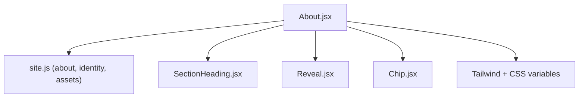
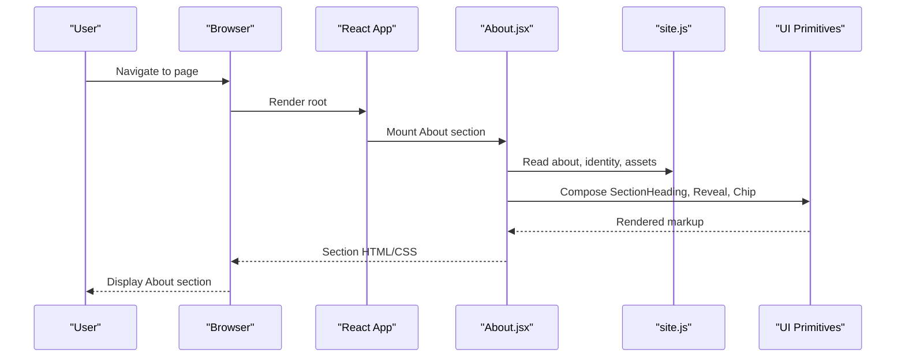
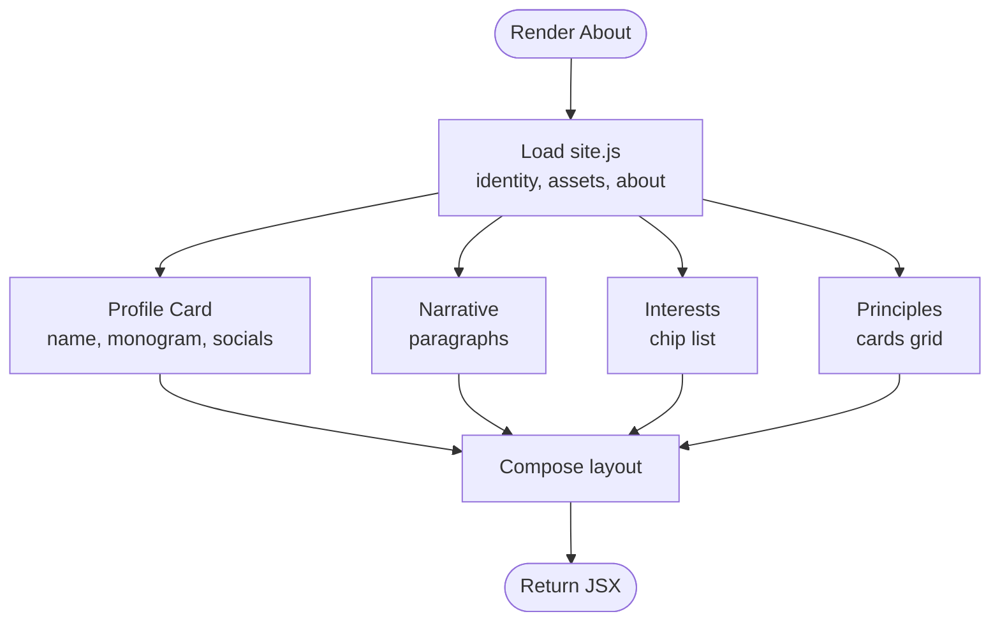
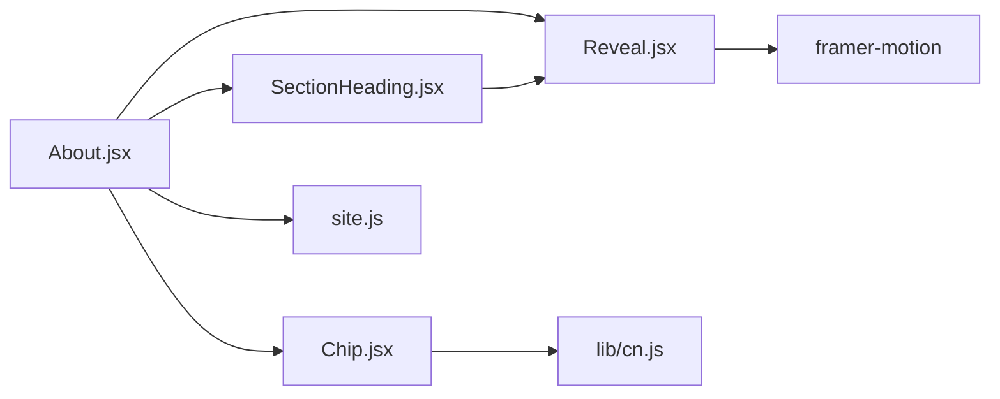

# About Section

<cite>
**Referenced Files in This Document**
- [About.jsx](file://src/components/About.jsx)
- [site.js](file://src/data/site.js)
- [Chip.jsx](file://src/components/ui/Chip.jsx)
- [Reveal.jsx](file://src/components/ui/Reveal.jsx)
- [SectionHeading.jsx](file://src/components/ui/SectionHeading.jsx)
- [index.css](file://src/index.css)
- [tailwind.config.js](file://tailwind.config.js)
</cite>

## Table of Contents
1. [Introduction](#introduction)
2. [Project Structure](#project-structure)
3. [Core Components](#core-components)
4. [Architecture Overview](#architecture-overview)
5. [Detailed Component Analysis](#detailed-component-analysis)
6. [Dependency Analysis](#dependency-analysis)
7. [Performance Considerations](#performance-considerations)
8. [Troubleshooting Guide](#troubleshooting-guide)
9. [Conclusion](#conclusion)

## Introduction
This document explains the About section component that displays personal information, interests, and professional principles. It covers how content is structured, how typography and visual presentation are applied, and how to update or customize the section safely while keeping consistent styling across screen sizes.

## Project Structure
The About section is implemented as a single React component that composes smaller UI primitives and reads its content from a central data file. The relevant files are:

- Component: `src/components/About.jsx`
- Data source: `src/data/site.js`
- Shared UI primitives: `src/components/ui/Chip.jsx`, `src/components/ui/Reveal.jsx`, `src/components/ui/SectionHeading.jsx`
- Global styles and design tokens: `src/index.css`, `tailwind.config.js`

**Diagram sources**
- [About.jsx:1-6](file://src/components/About.jsx#L1-L6)
- [site.js:6-52](file://src/data/site.js#L6-L52)
- [site.js:71-104](file://src/data/site.js#L71-L104)
- [SectionHeading.jsx:1-12](file://src/components/ui/SectionHeading.jsx#L1-L12)
- [Reveal.jsx:1-15](file://src/components/ui/Reveal.jsx#L1-L15)
- [Chip.jsx:1-12](file://src/components/ui/Chip.jsx#L1-L12)

**Section sources**
- [About.jsx:1-6](file://src/components/About.jsx#L1-L6)
- [site.js:6-52](file://src/data/site.js#L6-L52)
- [site.js:71-104](file://src/data/site.js#L71-L104)

## Core Components
- About.jsx: Renders the full About section, including profile image, social links, narrative paragraphs, technical interests, and principle cards.
- SectionHeading.jsx: Renders the eyebrow, title, and subtitle with reveal animation.
- Reveal.jsx: Provides scroll-triggered fade-up animations with reduced-motion support.
- Chip.jsx: Renders small badges for interests and other labels.
- site.js: Central configuration for identity, assets, navigation, and About content.

Key responsibilities:
- Content-driven rendering: All text and links come from `site.js`.
- Visual consistency: Uses shared components and Tailwind utility classes.
- Accessibility: Includes semantic headings, aria attributes, and keyboard-friendly focus styles.

**Section sources**
- [About.jsx:7-147](file://src/components/About.jsx#L7-L147)
- [SectionHeading.jsx:4-69](file://src/components/ui/SectionHeading.jsx#L4-L69)
- [Reveal.jsx:7-33](file://src/components/ui/Reveal.jsx#L7-L33)
- [Chip.jsx:6-24](file://src/components/ui/Chip.jsx#L6-L24)
- [site.js:71-104](file://src/data/site.js#L71-L104)

## Architecture Overview
The About section follows a simple data-to-view pattern:

**Diagram sources**
- [About.jsx:1-6](file://src/components/About.jsx#L1-L6)
- [site.js:6-52](file://src/data/site.js#L6-L52)
- [site.js:71-104](file://src/data/site.js#L71-L104)

## Detailed Component Analysis

### Content Model and Data Flow
The About section consumes three main data groups from `site.js`:

- Identity and assets: name, monogram, socials, profile image URL and alt text.
- About metadata: index, eyebrow, title, subtitle, paragraphs, interests, principles.
- Social links: GitHub and LinkedIn URLs used both in the profile card and call-to-action.

**Diagram sources**
- [About.jsx:20-143](file://src/components/About.jsx#L20-L143)
- [site.js:6-52](file://src/data/site.js#L6-L52)
- [site.js:71-104](file://src/data/site.js#L71-L104)

**Section sources**
- [About.jsx:20-143](file://src/components/About.jsx#L20-L143)
- [site.js:6-52](file://src/data/site.js#L6-L52)
- [site.js:71-104](file://src/data/site.js#L71-L104)

### Personal Information Display
- Profile image: Loaded from `assets.profileImage` with lazy loading and responsive aspect ratio.
- Name and role tags: Displayed on an overlay card using `identity.name` and a static tag line.
- Monogram badge: Static initials displayed beside the name.
- Social buttons: GitHub and LinkedIn links sourced from `identity.socials.*.url`.

Typography and visuals:
- Name uses display font with tight tracking.
- Role tags use mono font, uppercase, wide letter spacing.
- Buttons use rounded-full shape, subtle borders, hover lift, and brand accent colors.

Accessibility:
- Image includes descriptive alt text from `assets.profileImageAlt`.
- Links include `target="_blank"` with safe rel attributes.

**Section sources**
- [About.jsx:20-77](file://src/components/About.jsx#L20-L77)
- [site.js:6-52](file://src/data/site.js#L6-L52)

### Narrative Paragraphs
- The section renders each paragraph from `about.paragraphs` with staggered reveal animations.
- Typography: Base size scales from mobile to desktop; comfortable line height for readability.
- Animation: Each paragraph fades up slightly when scrolled into view.

Customization tips:
- Add or remove paragraphs by editing `about.paragraphs` in `site.js`.
- Adjust global paragraph style via Tailwind utilities or global CSS if needed.

**Section sources**
- [About.jsx:89-95](file://src/components/About.jsx#L89-L95)
- [site.js:76-81](file://src/data/site.js#L76-L81)

### Technical Interests
- Interests are rendered as chips inside a flex-wrap list.
- Chip tone is set to haze for a soft background.
- Each interest is a string from `about.interests`.

Styling:
- Chips use mono font, small size, and rounded-full shape.
- Hover behavior is minimal; focus states follow global focus styles.

Adding new interests:
- Append new strings to `about.interests` in `site.js`.

**Section sources**
- [About.jsx:97-110](file://src/components/About.jsx#L97-L110)
- [Chip.jsx:6-24](file://src/components/ui/Chip.jsx#L6-L24)
- [site.js:82-89](file://src/data/site.js#L82-L89)

### Professional Principles
- Principles are displayed as numbered cards in a responsive grid.
- Each card shows a numeric label, title, and description.
- Cards have hover elevation and border color changes.

Structure:
- Numbering is auto-generated based on array index.
- Titles use display font with tight tracking.
- Descriptions use readable body size and relaxed line height.

Updating principles:
- Edit the `about.principles` array in `site.js`.
- Keep titles concise and descriptions clear for best visual balance.

**Section sources**
- [About.jsx:129-143](file://src/components/About.jsx#L129-L143)
- [site.js:90-104](file://src/data/site.js#L90-L104)

### Typography Hierarchy and Visual Patterns
- Eyebrow and index: Mono font, uppercase, wide letter spacing.
- Title: Large, bold display font with clamp-based scaling.
- Subtitle: Body-sized paragraph with relaxed line height.
- Body text: Comfortable reading rhythm with muted ink color.
- Accent colors: Brand and accent palettes provide emphasis without overwhelming contrast.

Global tokens:
- Colors and fonts are defined in Tailwind config and CSS variables.
- Consistent spacing and shadows are provided through Tailwind utilities.

**Section sources**
- [SectionHeading.jsx:17-67](file://src/components/ui/SectionHeading.jsx#L17-L67)
- [tailwind.config.js:12-64](file://tailwind/config.js#L12-L64)
- [index.css:6-14](file://src/index.css#L6-L14)

### Responsive Behavior
- Two-column layout on large screens collapses to single column on smaller screens.
- Grid for principles adapts to multiple columns on medium and larger screens.
- Text sizes scale fluidly using clamp and responsive Tailwind breakpoints.
- Padding and gaps adjust per breakpoint for balanced spacing.

Best practices:
- Keep paragraphs concise to avoid excessive vertical scrolling on mobile.
- Limit the number of interests to maintain chip list readability.
- Use short principle titles to prevent cramped cards.

**Section sources**
- [About.jsx:18-19](file://src/components/About.jsx#L18-L19)
- [About.jsx:129-143](file://src/components/About.jsx#L129-L143)

## Dependency Analysis
The About section depends on shared UI primitives and centralized data.

**Diagram sources**
- [About.jsx:1-5](file://src/components/About.jsx#L1-L5)
- [SectionHeading.jsx:1-2](file://src/components/ui/SectionHeading.jsx#L1-L2)
- [Reveal.jsx:1](file://src/components/ui/Reveal.jsx#L1)
- [Chip.jsx:1](file://src/components/ui/Chip.jsx#L1)
- [site.js:71-104](file://src/data/site.js#L71-L104)

Coupling and cohesion:
- Low coupling: About only imports data and UI primitives.
- High cohesion: Each primitive has a focused responsibility (heading, reveal, chip).
- External dependencies: framer-motion for animations; lucide-react icons for social buttons.

Potential circular dependencies:
- None observed between About and its primitives.

External integration points:
- Social links open external sites with safe rel attributes.
- Images are loaded from public assets path.

**Section sources**
- [About.jsx:1-5](file://src/components/About.jsx#L1-L5)
- [SectionHeading.jsx:1-2](file://src/components/ui/SectionHeading.jsx#L1-L2)
- [Reveal.jsx:1](file://src/components/ui/Reveal.jsx#L1)
- [Chip.jsx:1](file://src/components/ui/Chip.jsx#L1)

## Performance Considerations
- Lazy image loading: Profile image uses lazy loading and async decoding to improve initial render performance.
- Reduced motion: Reveal respects user preferences and falls back to plain elements when motion is disabled.
- Minimal re-renders: Data is static; no unnecessary state updates within About.
- Animation cost: Staggered reveals are lightweight; consider reducing delays or removing animations for low-power devices if needed.

Optimization opportunities:
- Preload critical assets like profile image if above-the-fold importance is high.
- Defer non-critical animations until after first paint if perceived performance is a concern.

**Section sources**
- [About.jsx:28-36](file://src/components/About.jsx#L28-L36)
- [Reveal.jsx:16-20](file://src/components/ui/Reveal.jsx#L16-L20)

## Troubleshooting Guide
Common issues and resolutions:

- Profile image not showing:
  - Ensure the image path matches `assets.profileImage` in `site.js`.
  - Verify the file exists under `/public/images/`.

- Social links not opening:
  - Confirm URLs in `identity.socials.github.url` and `identity.socials.linkedin.url` are correct.
  - Check browser popup settings if links do not open in new tabs.

- Interests not displaying:
  - Verify `about.interests` contains valid strings.
  - Ensure no extra commas or missing quotes in the array.

- Principles not rendering:
  - Confirm `about.principles` entries have both `title` and `text`.
  - Check for syntax errors in the array structure.

- Animations feel heavy:
  - Reduce animation duration or delay values in Reveal usage.
  - Users with reduced motion preference will see no animations automatically.

- Styling inconsistencies:
  - Use existing Tailwind classes and tokens from `tailwind.config.js`.
  - Avoid overriding global focus styles unless necessary.

**Section sources**
- [site.js:48-52](file://src/data/site.js#L48-L52)
- [site.js:29-40](file://src/data/site.js#L29-L40)
- [site.js:82-104](file://src/data/site.js#L82-L104)
- [Reveal.jsx:16-20](file://src/components/ui/Reveal.jsx#L16-L20)

## Conclusion
The About section provides a clean, accessible, and data-driven presentation of personal information, interests, and professional principles. By centralizing content in `site.js` and composing reusable UI primitives, it remains easy to update and customize while maintaining consistent typography, spacing, and responsiveness across devices.