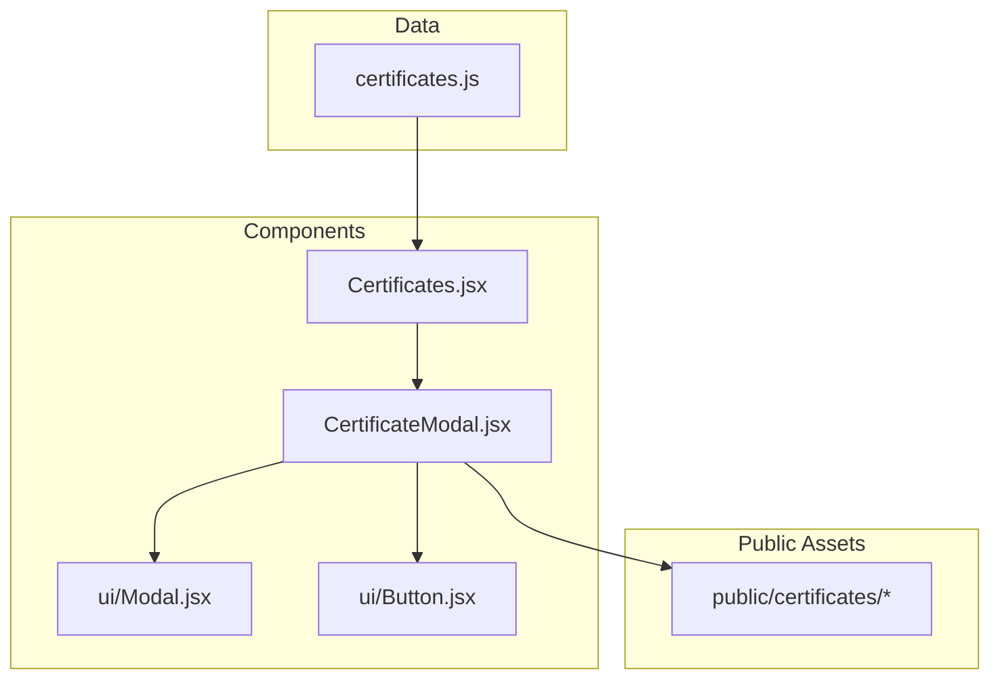
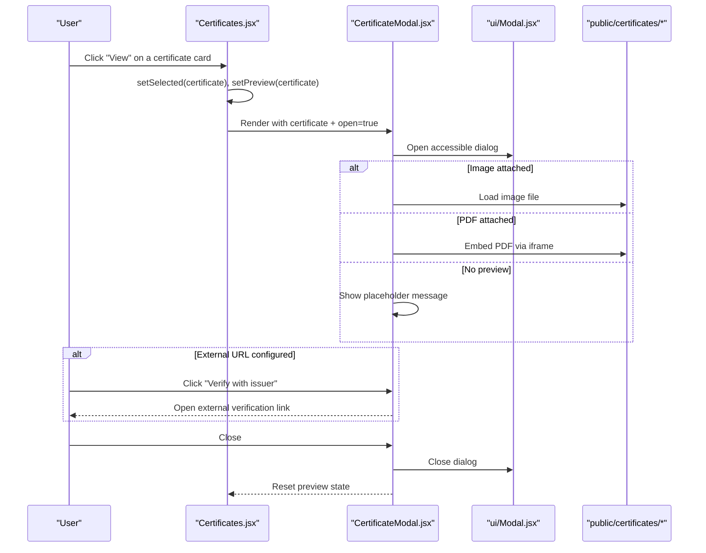
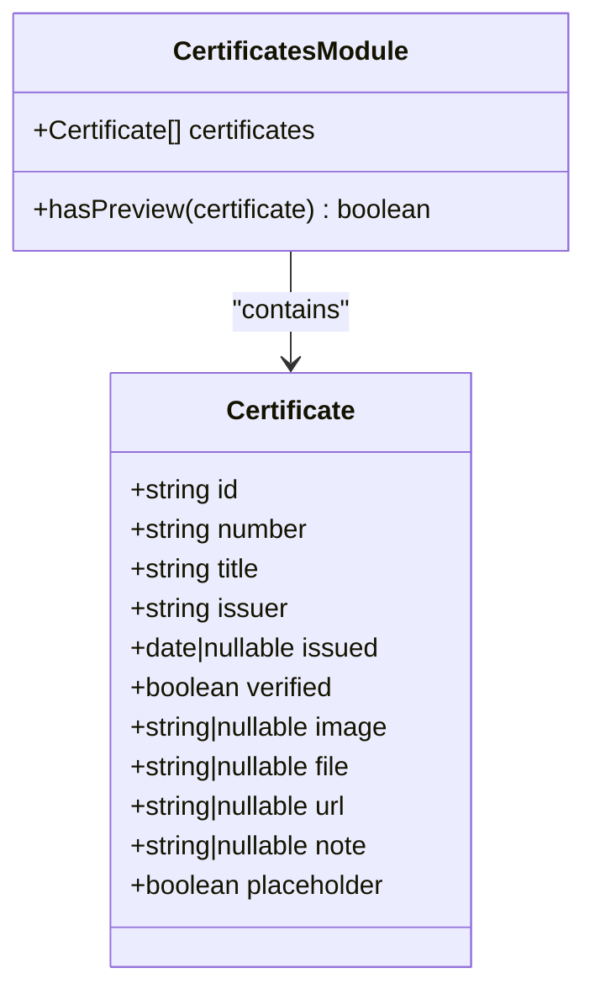
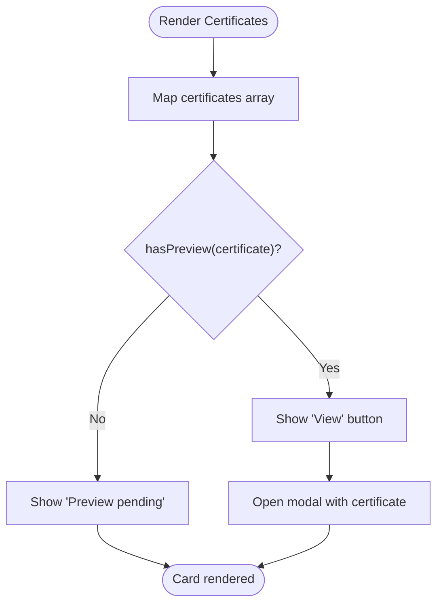
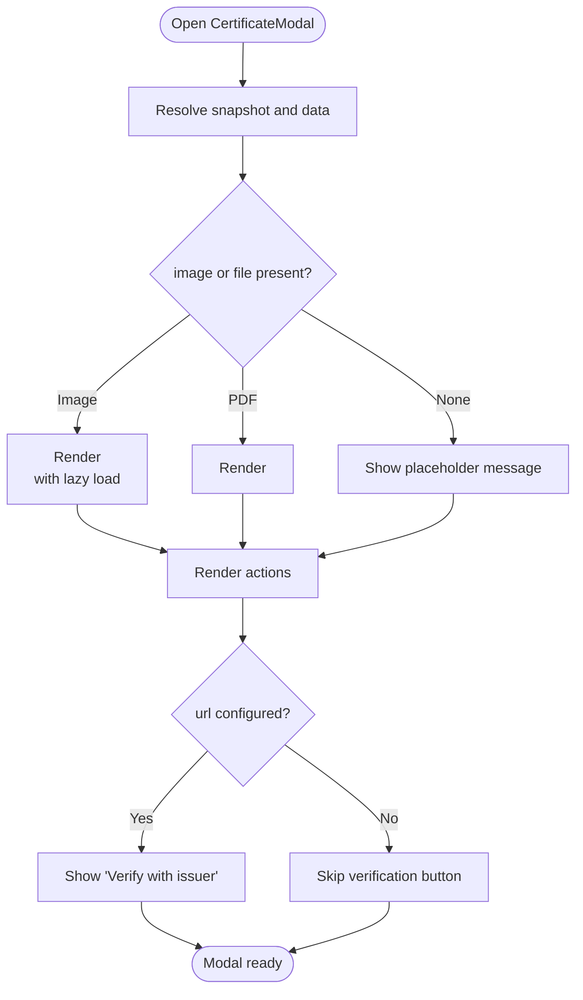
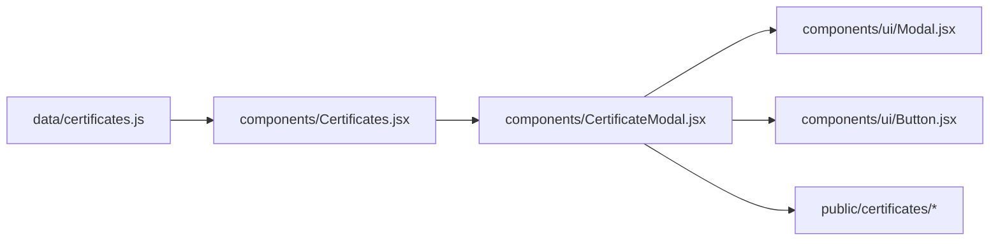

# Certificates Section

<cite>
**Referenced Files in This Document**
- [certificates.js](file://src/data/certificates.js)
- [Certificates.jsx](file://src/components/Certificates.jsx)
- [CertificateModal.jsx](file://src/components/CertificateModal.jsx)
- [Modal.jsx](file://src/components/ui/Modal.jsx)
- [Button.jsx](file://src/components/ui/Button.jsx)
- [README.txt](file://public/certificates/README.txt)
- [tailwind.config.js](file://tailwind.config.js)
</cite>

## Table of Contents
1. [Introduction](#introduction)
2. [Project Structure](#project-structure)
3. [Core Components](#core-components)
4. [Architecture Overview](#architecture-overview)
5. [Detailed Component Analysis](#detailed-component-analysis)
6. [Dependency Analysis](#dependency-analysis)
7. [Performance Considerations](#performance-considerations)
8. [Troubleshooting Guide](#troubleshooting-guide)
9. [Conclusion](#conclusion)
10. [Appendices](#appendices)

## Introduction
This document explains the Certificates section and its preview modal system. It covers the certificate gallery layout, verification link integration, modal preview behavior, certificate data structure, image optimization strategies, external verification URL handling, and practical guidance for adding new certificates, configuring verification links, customizing appearance, and managing metadata.

## Project Structure
The Certificates feature is implemented as a small React feature with:
- A data module defining certificate records and a helper to determine whether a preview is available.
- A gallery component that renders cards and opens a modal when a preview is available.
- A modal component that previews images, PDFs, or external verification links.
- Shared UI primitives (Modal, Button) and Tailwind configuration for consistent styling.

**Diagram sources**
- [certificates.js:12-115](file://src/data/certificates.js#L12-L115)
- [Certificates.jsx:1-153](file://src/components/Certificates.jsx#L1-L153)
- [CertificateModal.jsx:1-117](file://src/components/CertificateModal.jsx#L1-L117)
- [Modal.jsx:1-131](file://src/components/ui/Modal.jsx#L1-L131)
- [Button.jsx:1-41](file://src/components/ui/Button.jsx#L1-L41)
- [README.txt:1-9](file://public/certificates/README.txt#L1-L9)

**Section sources**
- [certificates.js:1-116](file://src/data/certificates.js#L1-L116)
- [Certificates.jsx:1-153](file://src/components/Certificates.jsx#L1-L153)
- [CertificateModal.jsx:1-117](file://src/components/CertificateModal.jsx#L1-L117)
- [Modal.jsx:1-131](file://src/components/ui/Modal.jsx#L1-L131)
- [Button.jsx:1-41](file://src/components/ui/Button.jsx#L1-L41)
- [README.txt:1-9](file://public/certificates/README.txt#L1-L9)

## Core Components
- Certificate data model: Defines up to eight certificate slots with fields for identification, issuer, dates, verification status, media assets, and an optional external verification URL.
- Gallery component: Renders a responsive grid of certificate cards, shows initials or placeholder indicators, and enables preview only when a valid asset or URL exists.
- Modal component: Presents a detailed preview of the selected certificate, supports image and PDF rendering, and provides actions to open the document or verify externally.

Key responsibilities:
- Data layer: Centralizes certificate metadata and exposes a helper to determine preview availability.
- Presentation layer: Builds the card grid and delegates preview to a reusable modal.
- Accessibility: Uses semantic headings, aria attributes, focus management, and keyboard support via the shared Modal primitive.

**Section sources**
- [certificates.js:1-116](file://src/data/certificates.js#L1-L116)
- [Certificates.jsx:1-153](file://src/components/Certificates.jsx#L1-L153)
- [CertificateModal.jsx:1-117](file://src/components/CertificateModal.jsx#L1-L117)

## Architecture Overview
The Certificates section follows a simple unidirectional flow:
- The gallery reads from the certificate data array.
- When a user clicks “View” on a card, the gallery sets the selected certificate and opens the modal.
- The modal renders either an image, an embedded PDF, or a placeholder if no preview is attached.
- If an external verification URL is present, the modal exposes a “Verify with issuer” action.

**Diagram sources**
- [Certificates.jsx:20-150](file://src/components/Certificates.jsx#L20-L150)
- [CertificateModal.jsx:6-116](file://src/components/CertificateModal.jsx#L6-L116)
- [Modal.jsx:15-130](file://src/components/ui/Modal.jsx#L15-L130)
- [README.txt:1-9](file://public/certificates/README.txt#L1-L9)

## Detailed Component Analysis

### Certificate Data Model
The certificate record is designed for clarity and maintainability:
- Identification: id and number provide stable keys and display ordering.
- Metadata: title, issuer, issued date, verified flag, and note describe the credential.
- Media and verification: image, file, and url are optional; at least one should be provided to enable preview or verification.
- Placeholder slot: placeholder indicates reserved slots awaiting real content.

Preview availability is determined by checking whether any of image, file, or url is present.

**Diagram sources**
- [certificates.js:12-115](file://src/data/certificates.js#L12-L115)

Practical implications:
- Cards without image/file/url show “Preview pending” and disable the preview button.
- Placeholders render with dashed borders and reduced opacity to signal upcoming content.
- Verified badges appear in both the gallery and modal when verified is true.

**Section sources**
- [certificates.js:1-116](file://src/data/certificates.js#L1-L116)

### Gallery Layout and Behavior
The gallery renders a responsive grid:
- Two columns on small screens, four columns on large screens.
- Each card displays the issuer initials or a plus sign for placeholders, the certificate number, title, issuer name, issued date, and a conditional “View” button.
- Hover effects and reveal animations enhance discoverability.
- The gallery passes the selected certificate to the modal and controls visibility through local state.

**Diagram sources**
- [Certificates.jsx:57-138](file://src/components/Certificates.jsx#L57-L138)
- [certificates.js:113-115](file://src/data/certificates.js#L113-L115)

Accessibility and UX notes:
- The gallery uses semantic article elements and aria-labelledby for the section heading.
- Screen-reader-only text is added to preview buttons for context.
- Reveal animations are staggered per card index.

**Section sources**
- [Certificates.jsx:1-153](file://src/components/Certificates.jsx#L1-L153)

### Modal Preview and Verification Integration
The modal composes the base accessible Modal primitive and renders:
- Header with certificate number, verified badge, title, issuer, and issued date.
- Optional note describing the credential.
- Preview area:
  - Image: displayed with lazy loading and object-fit containment.
  - PDF: embedded via iframe sized to viewport height.
  - Placeholder: shown when neither image nor file is attached.
- Actions:
  - “Open document”: opens the attached image or PDF in a new tab.
  - “Verify with issuer”: opens the external verification URL if configured.
  - Close control.

**Diagram sources**
- [CertificateModal.jsx:6-116](file://src/components/CertificateModal.jsx#L6-L116)

Accessibility and interaction details:
- The modal uses role="dialog", aria-modal, labelledBy, and a close label.
- Focus trapping and Escape-to-close are handled by the base Modal.
- Reduced motion preferences are respected for smoother transitions.

**Section sources**
- [CertificateModal.jsx:1-117](file://src/components/CertificateModal.jsx#L1-L117)
- [Modal.jsx:1-131](file://src/components/ui/Modal.jsx#L1-L131)

### Shared UI Primitives
- Modal: Provides portal-based overlay, scroll lock, focus trap, keyboard navigation, and animated entrance/exit with reduced-motion support.
- Button: Offers variants and sizes used across the modal’s actions.

These primitives ensure consistent behavior and accessibility across the site.

**Section sources**
- [Modal.jsx:1-131](file://src/components/ui/Modal.jsx#L1-L131)
- [Button.jsx:1-41](file://src/components/ui/Button.jsx#L1-L41)

## Dependency Analysis
The Certificates feature has clear boundaries:
- Certificates.jsx depends on the data module and shared UI components.
- CertificateModal.jsx depends on the base Modal and Button primitives.
- Public assets under public/certificates are referenced by paths defined in the data module.

**Diagram sources**
- [certificates.js:1-116](file://src/data/certificates.js#L1-L116)
- [Certificates.jsx:1-153](file://src/components/Certificates.jsx#L1-L153)
- [CertificateModal.jsx:1-117](file://src/components/CertificateModal.jsx#L1-L117)
- [Modal.jsx:1-131](file://src/components/ui/Modal.jsx#L1-L131)
- [Button.jsx:1-41](file://src/components/ui/Button.jsx#L1-L41)
- [README.txt:1-9](file://public/certificates/README.txt#L1-L9)

**Section sources**
- [certificates.js:1-116](file://src/data/certificates.js#L1-L116)
- [Certificates.jsx:1-153](file://src/components/Certificates.jsx#L1-L153)
- [CertificateModal.jsx:1-117](file://src/components/CertificateModal.jsx#L1-L117)
- [Modal.jsx:1-131](file://src/components/ui/Modal.jsx#L1-L131)
- [Button.jsx:1-41](file://src/components/ui/Button.jsx#L1-L41)
- [README.txt:1-9](file://public/certificates/README.txt#L1-L9)

## Performance Considerations
- Lazy image loading: Images use lazy loading to defer offscreen resources.
- PDF embedding: PDFs are embedded via iframe; consider server-side caching headers for faster loads.
- Asset formats: Prefer modern formats like WebP for images to reduce payload size while maintaining quality.
- Grid responsiveness: The two-to-four column grid balances density and readability across devices.
- Animation performance: Framer Motion respects reduced motion preferences to avoid unnecessary work.

[No sources needed since this section provides general guidance]

## Troubleshooting Guide
Common issues and resolutions:
- Preview not opening:
  - Ensure at least one of image, file, or url is set for the certificate.
  - Verify the path points to a file under public/certificates.
- Blank modal preview:
  - Confirm the image/PDF path is correct and the file exists.
  - For PDFs, check browser compatibility and MIME types.
- External verification link not appearing:
  - Set the url field to a valid HTTPS link.
  - Ensure the issuer provides a public verification page.
- Placeholder cards still interactive:
  - Placeholder cards intentionally do not show the “View” button; confirm placeholder is set and no previewable asset exists.
- Styling inconsistencies:
  - Verify Tailwind theme tokens (brand, mist, haze) are applied consistently.
  - Check that custom classes align with the design system.

**Section sources**
- [certificates.js:1-116](file://src/data/certificates.js#L1-L116)
- [Certificates.jsx:57-138](file://src/components/Certificates.jsx#L57-L138)
- [CertificateModal.jsx:62-101](file://src/components/CertificateModal.jsx#L62-L101)
- [README.txt:1-9](file://public/certificates/README.txt#L1-L9)

## Conclusion
The Certificates section provides a clean, accessible gallery with robust preview and verification capabilities. By centralizing certificate metadata, enforcing preview availability checks, and leveraging shared UI primitives, the feature remains easy to extend and maintain. Follow the guidance below to add new certificates, configure verification links, customize appearance, and manage metadata effectively.

[No sources needed since this section summarizes without analyzing specific files]

## Appendices

### How to Add a New Certificate
Steps:
1. Prepare your certificate asset:
   - Place the image or PDF under public/certificates.
   - Use supported formats: .jpg, .jpeg, .png, .webp for images; .pdf for documents.
2. Update the data module:
   - Add a new entry to the certificates array with id, number, title, issuer, issued, verified, and at least one of image, file, or url.
   - Optionally include a note describing the credential.
3. Validate preview availability:
   - Ensure hasPreview returns true by setting image, file, or url.
4. Test the gallery and modal:
   - Confirm the card shows “View”.
   - Open the modal and verify the image/PDF or external link works.

**Section sources**
- [README.txt:1-9](file://public/certificates/README.txt#L1-L9)
- [certificates.js:1-116](file://src/data/certificates.js#L1-L116)
- [Certificates.jsx:57-138](file://src/components/Certificates.jsx#L57-L138)
- [CertificateModal.jsx:62-101](file://src/components/CertificateModal.jsx#L62-L101)

### Configuring Verification Links
- Set the url field to the issuer’s public verification page.
- The modal will automatically show a “Verify with issuer” button when url is present.
- Use HTTPS links for security and reliability.

**Section sources**
- [certificates.js:12-115](file://src/data/certificates.js#L12-L115)
- [CertificateModal.jsx:96-101](file://src/components/CertificateModal.jsx#L96-L101)

### Customizing the Gallery Appearance
- Colors and typography:
  - Adjust brand, ink, paper, haze, and mist colors in the Tailwind config.
  - Modify font families for display, sans, and mono.
- Card styling:
  - Update border radius, shadows, and hover transitions in the gallery component.
- Responsive grid:
  - Change grid breakpoints and column counts to fit your layout needs.

**Section sources**
- [tailwind.config.js:10-88](file://tailwind.config.js#L10-L88)
- [Certificates.jsx:57-138](file://src/components/Certificates.jsx#L57-L138)

### Managing Certificate Metadata
Recommended fields:
- id: Unique identifier for programmatic access.
- number: Display order indicator.
- title: Human-readable certificate name.
- issuer: Organization or platform that issued the credential.
- issued: Date of issuance (optional).
- verified: Boolean indicating whether the details are verified.
- image: Path to a static image preview.
- file: Path to a downloadable or embeddable PDF.
- url: External verification link.
- note: Short description of skills or topics covered.
- placeholder: Reserved slot marker for future content.

Best practices:
- Keep unknown values as null rather than guessing.
- Reserve placeholder slots until real assets are available.
- Maintain consistent naming conventions for ids and file paths.

**Section sources**
- [certificates.js:1-116](file://src/data/certificates.js#L1-L116)