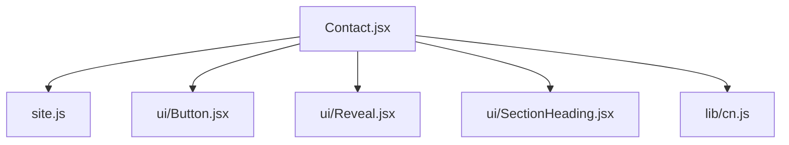
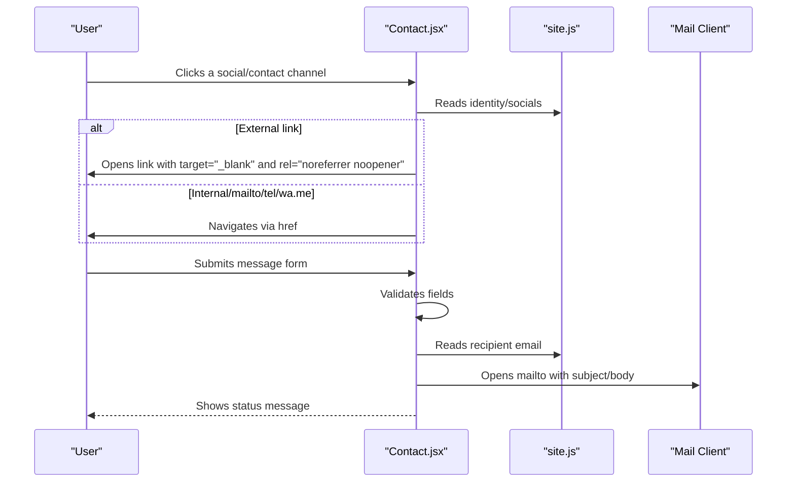
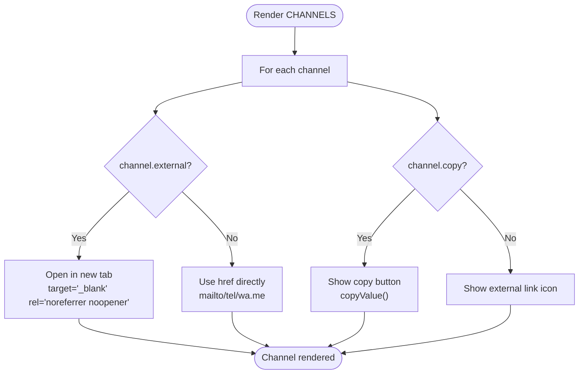
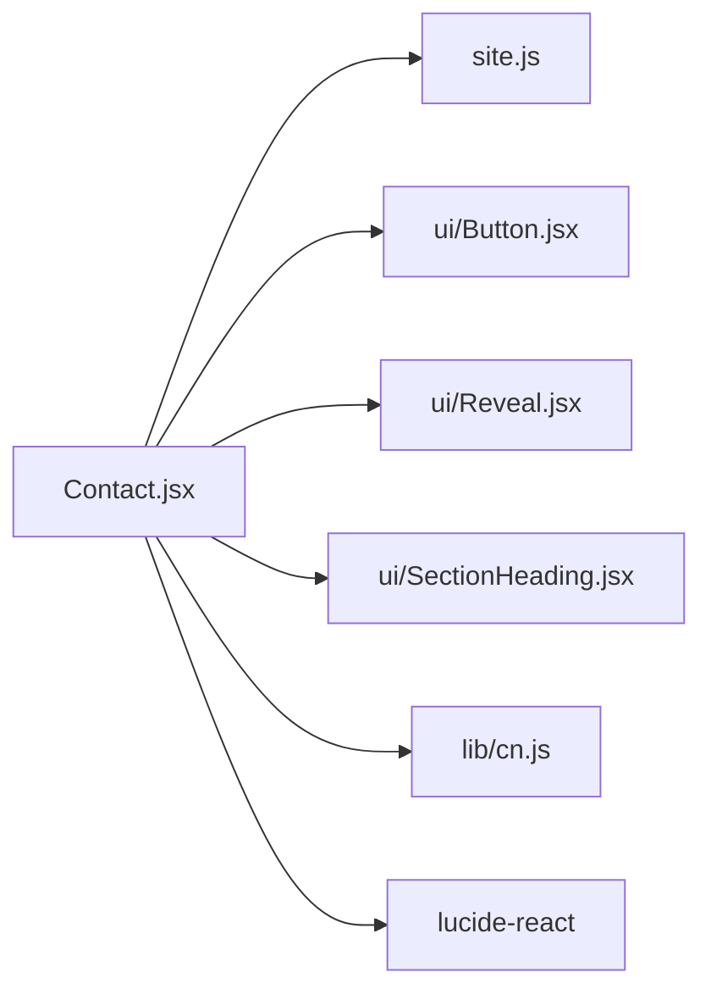

# Contact Section

<cite>
**Referenced Files in This Document**
- [Contact.jsx](file://src/components/Contact.jsx)
- [site.js](file://src/data/site.js)
- [Button.jsx](file://src/components/ui/Button.jsx)
- [Reveal.jsx](file://src/components/ui/Reveal.jsx)
- [SectionHeading.jsx](file://src/components/ui/SectionHeading.jsx)
- [cn.js](file://src/lib/cn.js)
</cite>

## Table of Contents
1. [Introduction](#introduction)
2. [Project Structure](#project-structure)
3. [Core Components](#core-components)
4. [Architecture Overview](#architecture-overview)
5. [Detailed Component Analysis](#detailed-component-analysis)
6. [Dependency Analysis](#dependency-analysis)
7. [Performance Considerations](#performance-considerations)
8. [Troubleshooting Guide](#troubleshooting-guide)
9. [Conclusion](#conclusion)
10. [Appendices](#appendices)

## Introduction
This document explains the Contact section component, focusing on social media integration, contact information display, and interactive elements. It provides guidance for configuring social links, updating contact details, customizing visual presentation, adding new platforms, maintaining link security with proper rel attributes, and ensuring accessibility compliance.

## Project Structure
The Contact section is implemented as a React component that reads configuration from a central site data file and composes reusable UI primitives.

**Diagram sources**
- [Contact.jsx:1-18](file://src/components/Contact.jsx#L1-L18)
- [site.js:6-41](file://src/data/site.js#L6-L41)
- [site.js:110-115](file://src/data/site.js#L110-L115)

**Section sources**
- [Contact.jsx:1-18](file://src/components/Contact.jsx#L1-L18)
- [site.js:6-41](file://src/data/site.js#L6-L41)
- [site.js:110-115](file://src/data/site.js#L110-L115)

## Core Components
- Contact.jsx: Renders the full Contact section, including contact channels, copy-to-clipboard actions, external link handling, and an email form that opens the user’s mail client.
- site.js: Central configuration for identity (email, phone, WhatsApp), social profiles, and section headings.
- ui/Button.jsx: Primary button used to submit the message form.
- ui/Reveal.jsx: Animation wrapper for progressive reveal effects.
- ui/SectionHeading.jsx: Displays the section eyebrow, title, and index.
- lib/cn.js: Utility for conditional class composition.

Key responsibilities:
- Social and contact channel rendering with icons, labels, values, and optional copy actions.
- Secure external link behavior using target and rel attributes.
- Form validation and mailto-based submission.
- Accessibility attributes for inputs, errors, and live regions.

**Section sources**
- [Contact.jsx:20-60](file://src/components/Contact.jsx#L20-L60)
- [Contact.jsx:64-84](file://src/components/Contact.jsx#L64-L84)
- [Contact.jsx:108-148](file://src/components/Contact.jsx#L108-L148)
- [site.js:6-41](file://src/data/site.js#L6-L41)
- [site.js:110-115](file://src/data/site.js#L110-L115)

## Architecture Overview
The Contact section composes configuration-driven data into interactive UI elements. External links are explicitly marked secure; internal or protocol-specific links open directly. The form validates input locally and triggers the system mail client.

**Diagram sources**
- [Contact.jsx:188-193](file://src/components/Contact.jsx#L188-L193)
- [Contact.jsx:121-138](file://src/components/Contact.jsx#L121-L138)
- [site.js:6-41](file://src/data/site.js#L6-L41)

## Detailed Component Analysis

### Social Media Integration and Contact Channels
The component defines a CHANNELS array that maps each platform to its label, value, href, icon, and optional behaviors such as copying or opening externally.

- Email: Uses mailto with the configured email address and supports copy-to-clipboard.
- Phone: Uses tel protocol and supports copy-to-clipboard.
- WhatsApp: Uses wa.me URL and displays the configured number.
- LinkedIn and GitHub: External links with handle and url from site configuration. These are opened in a new tab with secure rel attributes.

Configuration is centralized in site.js under identity.socials and identity.phone/whatsapp.

**Diagram sources**
- [Contact.jsx:20-60](file://src/components/Contact.jsx#L20-L60)
- [Contact.jsx:188-226](file://src/components/Contact.jsx#L188-L226)

**Section sources**
- [Contact.jsx:20-60](file://src/components/Contact.jsx#L20-L60)
- [Contact.jsx:176-231](file://src/components/Contact.jsx#L176-L231)
- [site.js:6-41](file://src/data/site.js#L6-L41)

### Contact Information Display
- Each channel shows an icon, label, and value.
- Values are sourced from site.js identity properties.
- Visual feedback includes hover states and subtle animations via Reveal.

Customization tips:
- Update identity.email, identity.phone, identity.whatsapp, and identity.socials in site.js to change displayed values and destinations.
- Adjust channel order by editing CHANNELS in Contact.jsx if you need different layout priority.

**Section sources**
- [Contact.jsx:176-231](file://src/components/Contact.jsx#L176-L231)
- [site.js:6-41](file://src/data/site.js#L6-L41)

### Interactive Elements
- Copy-to-clipboard: Available for email and phone. Uses navigator.clipboard.writeText and shows a temporary success indicator.
- External links: LinkedIn and GitHub open in a new tab with security best practices applied.
- Message form: Validates name, email, subject, and message length, then opens the mail client with pre-filled subject and body.

Accessibility highlights:
- Inputs use aria-invalid and aria-describedby to associate error messages.
- Error messages use role="alert".
- Status updates use role="status" and aria-live="polite".
- Icons use aria-hidden="true" where appropriate.

**Section sources**
- [Contact.jsx:64-84](file://src/components/Contact.jsx#L64-L84)
- [Contact.jsx:140-148](file://src/components/Contact.jsx#L140-L148)
- [Contact.jsx:246-321](file://src/components/Contact.jsx#L246-L321)

### Adding New Social Platforms
To add a new platform:
1. Add the platform entry to identity.socials in site.js with label, handle, and url.
2. Import the corresponding icon from lucide-react.
3. Add a new object to CHANNELS in Contact.jsx referencing the new site.js property and setting external: true if it opens an external website.
4. Ensure the icon is imported and used consistently with other channels.

Security note:
- Always set external: true for third-party websites so the component applies target="_blank" and rel="noreferrer noopener".

**Section sources**
- [site.js:29-40](file://src/data/site.js#L29-L40)
- [Contact.jsx:20-60](file://src/components/Contact.jsx#L20-L60)
- [Contact.jsx:188-193](file://src/components/Contact.jsx#L188-L193)

### Maintaining Link Security with Proper rel Attributes
- External links automatically receive target="_blank" and rel="noreferrer noopener" when channel.external is true.
- This prevents potential reverse-tabnabbing and avoids leaking referrer information to untrusted sites.
- Do not manually override these attributes; rely on the component’s conditional logic.

**Section sources**
- [Contact.jsx:188-193](file://src/components/Contact.jsx#L188-L193)

### Ensuring Accessibility Compliance
- Use semantic HTML and ARIA attributes already present in the component:
  - aria-labelledby on the section.
  - aria-invalid and aria-describedby on inputs.
  - role="alert" for inline errors.
  - role="status" and aria-live="polite" for dynamic status text.
  - aria-hidden="true" on decorative icons.
- Keep focus management predictable by relying on native form controls.
- Provide descriptive aria-labels for copy buttons.

**Section sources**
- [Contact.jsx:151-154](file://src/components/Contact.jsx#L151-L154)
- [Contact.jsx:246-321](file://src/components/Contact.jsx#L246-L321)
- [Contact.jsx:208-226](file://src/components/Contact.jsx#L208-L226)

### Customizing Visual Presentation
- Styling uses Tailwind classes throughout the component.
- You can adjust spacing, colors, typography, and borders by modifying className strings in Contact.jsx.
- Reusable components like Button, Reveal, and SectionHeading provide consistent design tokens.
- The cn utility helps compose conditional classes cleanly.

Recommendations:
- Prefer updating shared theme variables or Tailwind config rather than scattering ad-hoc styles.
- Keep animation delays and transforms minimal to maintain performance.

**Section sources**
- [Contact.jsx:105-106](file://src/components/Contact.jsx#L105-L106)
- [Contact.jsx:151-158](file://src/components/Contact.jsx#L151-L158)
- [Contact.jsx:187-228](file://src/components/Contact.jsx#L187-L228)

## Dependency Analysis
The Contact component depends on:
- Data layer: site.js for identity and contact metadata.
- UI primitives: Button, Reveal, SectionHeading.
- Utilities: cn for class composition.
- Icons: lucide-react for platform icons.

**Diagram sources**
- [Contact.jsx:1-18](file://src/components/Contact.jsx#L1-L18)
- [site.js:6-41](file://src/data/site.js#L6-L41)

**Section sources**
- [Contact.jsx:1-18](file://src/components/Contact.jsx#L1-L18)
- [site.js:6-41](file://src/data/site.js#L6-L41)

## Performance Considerations
- The component renders a small grid of channels and a simple form; overhead is minimal.
- Reveal animations introduce slight DOM transitions; keep delay increments modest.
- Clipboard operations are asynchronous and guarded by try/catch to avoid blocking the UI.
- Avoid heavy computations inside render; current logic is straightforward and efficient.

[No sources needed since this section provides general guidance]

## Troubleshooting Guide
- Social links do not open in a new tab:
  - Ensure the channel has external: true so the component applies target="_blank" and rel="noreferrer noopener".
- Copy button does not work:
  - Confirm the browser supports navigator.clipboard and that the page is served over HTTPS.
- Form does not open mail client:
  - Verify identity.email is correctly set in site.js.
  - Check that the user agent allows mailto links.
- Validation errors not showing:
  - Ensure inputs have aria-invalid and aria-describedby bound to their error IDs.
- Accessibility warnings:
  - Verify all interactive elements have appropriate roles and labels.
  - Ensure decorative icons use aria-hidden="true".

**Section sources**
- [Contact.jsx:188-193](file://src/components/Contact.jsx#L188-L193)
- [Contact.jsx:140-148](file://src/components/Contact.jsx#L140-L148)
- [Contact.jsx:121-138](file://src/components/Contact.jsx#L121-L138)
- [Contact.jsx:246-321](file://src/components/Contact.jsx#L246-L321)

## Conclusion
The Contact section provides a secure, accessible, and configurable way to share contact information and social profiles while offering a lightweight email form experience. Configuration is centralized in site.js, making updates straightforward without touching component code. Follow the guidance here to add platforms, maintain security, and ensure accessibility.

[No sources needed since this section summarizes without analyzing specific files]

## Appendices

### How to Configure Social Media Links
- Edit identity.socials in site.js to update labels, handles, and URLs.
- Add new entries following the existing structure.
- Reference them in CHANNELS within Contact.jsx and mark external: true for third-party sites.

**Section sources**
- [site.js:29-40](file://src/data/site.js#L29-L40)
- [Contact.jsx:20-60](file://src/components/Contact.jsx#L20-L60)

### How to Update Contact Details
- Change identity.email, identity.phone, and identity.whatsapp in site.js.
- The Contact section will reflect these changes immediately.

**Section sources**
- [site.js:6-41](file://src/data/site.js#L6-L41)

### How to Customize Visual Presentation
- Modify Tailwind classes in Contact.jsx for layout, spacing, colors, and typography.
- Leverage Button, Reveal, and SectionHeading for consistent styling.
- Use cn.js for conditional class composition.

**Section sources**
- [Contact.jsx:105-106](file://src/components/Contact.jsx#L105-L106)
- [Contact.jsx:151-158](file://src/components/Contact.jsx#L151-L158)
- [Contact.jsx:187-228](file://src/components/Contact.jsx#L187-L228)