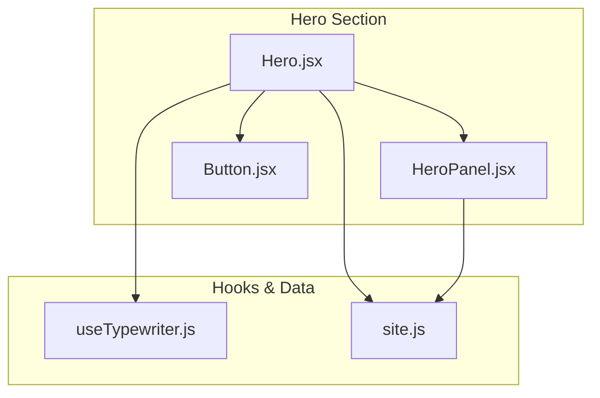
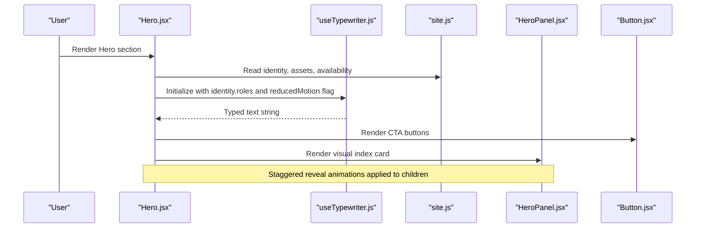
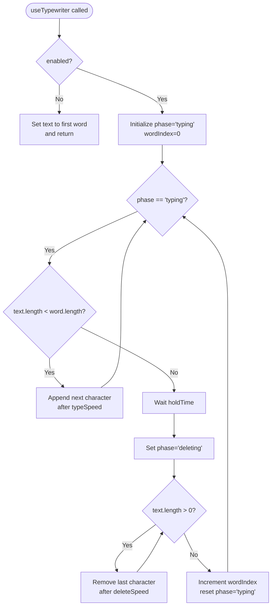
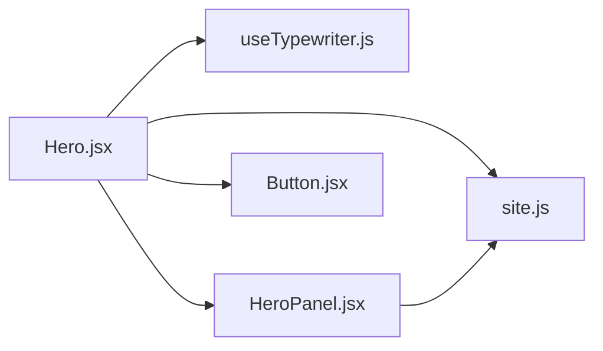

# Hero Section

<cite>
**Referenced Files in This Document**
- [Hero.jsx](file://src/components/Hero.jsx)
- [useTypewriter.js](file://src/hooks/useTypewriter.js)
- [site.js](file://src/data/site.js)
- [HeroPanel.jsx](file://src/components/visuals/HeroPanel.jsx)
- [Button.jsx](file://src/components/ui/Button.jsx)
</cite>

## Table of Contents
1. [Introduction](#introduction)
2. [Project Structure](#project-structure)
3. [Core Components](#core-components)
4. [Architecture Overview](#architecture-overview)
5. [Detailed Component Analysis](#detailed-component-analysis)
6. [Dependency Analysis](#dependency-analysis)
7. [Performance Considerations](#performance-considerations)
8. [Troubleshooting Guide](#troubleshooting-guide)
9. [Conclusion](#conclusion)

## Introduction
This document explains the Hero section component, focusing on:
- Typewriter animation powered by the useTypewriter hook
- Staggered content reveals using Framer Motion
- Responsive layout structure
- Identity data integration, social links, CV download, and availability badge
- Customization guidance for text, timing, and visuals
- Accessibility features including aria-labels and screen reader support

## Project Structure
The Hero section is implemented as a React component that composes smaller UI primitives and reads configuration from a central site data file.

**Diagram sources**
- [Hero.jsx:1-149](file://src/components/Hero.jsx#L1-L149)
- [useTypewriter.js:1-44](file://src/hooks/useTypewriter.js#L1-L44)
- [site.js:1-116](file://src/data/site.js#L1-L116)
- [HeroPanel.jsx:1-92](file://src/components/visuals/HeroPanel.jsx#L1-L92)
- [Button.jsx:1-41](file://src/components/ui/Button.jsx#L1-L41)

**Section sources**
- [Hero.jsx:1-149](file://src/components/Hero.jsx#L1-L149)
- [site.js:1-116](file://src/data/site.js#L1-L116)

## Core Components
- Hero.jsx: Main section orchestrating layout, animations, identity display, actions, and links.
- useTypewriter.js: Hook implementing rotating typewriter effect with configurable speeds and phases.
- HeroPanel.jsx: Visual “index card” panel showing monogram, name, and metadata; includes a subtle sweep animation.
- Button.jsx: Reusable button primitive used for primary and outline calls to action.
- site.js: Centralized configuration for identity, assets (including CV), availability status, and social links.

Key responsibilities:
- Typewriter roles display with caret animation
- Staggered reveal of headline, tagline, role badge, intro paragraph, CTAs, and links
- Availability badge rendering based on configuration
- Social links and CV download via centralized assets
- Respect for reduced motion preferences

**Section sources**
- [Hero.jsx:1-149](file://src/components/Hero.jsx#L1-L149)
- [useTypewriter.js:1-44](file://src/hooks/useTypewriter.js#L1-L44)
- [HeroPanel.jsx:1-92](file://src/components/visuals/HeroPanel.jsx#L1-L92)
- [Button.jsx:1-41](file://src/components/ui/Button.jsx#L1-L41)
- [site.js:1-116](file://src/data/site.js#L1-L116)

## Architecture Overview
The Hero section composes multiple layers:
- Data layer: site.js provides identity, assets, and availability.
- Animation layer: Framer Motion handles staggered reveals and motion preferences.
- Interaction layer: Buttons and anchor links navigate or trigger downloads.
- Visual layer: HeroPanel presents an editorial index card with subtle motion.

**Diagram sources**
- [Hero.jsx:1-149](file://src/components/Hero.jsx#L1-L149)
- [useTypewriter.js:1-44](file://src/hooks/useTypewriter.js#L1-L44)
- [site.js:1-116](file://src/data/site.js#L1-L116)
- [HeroPanel.jsx:1-92](file://src/components/visuals/HeroPanel.jsx#L1-L92)
- [Button.jsx:1-41](file://src/components/ui/Button.jsx#L1-L41)

## Detailed Component Analysis

### Hero.jsx
Responsibilities:
- Imports Framer Motion utilities and icons, plus site data and the typewriter hook.
- Reads user motion preference via useReducedMotion and disables animations when preferred.
- Initializes useTypewriter with identity.roles and disabled state when reduced motion is enabled.
- Defines container and item variants for staggered reveals.
- Renders:
  - A visually rich background grid and gradients
  - Headline, name, tagline, and animated role badge
  - Optional availability badge
  - Intro paragraph
  - Primary and outline call-to-action buttons
  - Links for CV download and social profiles
  - HeroPanel visual on the right side

Animation details:
- Container uses staggerChildren and delayChildren to sequence child reveals.
- Item variant fades in and slides up with a custom ease curve.
- The visual panel has its own entrance animation respecting reduced motion.

Accessibility:
- Section has id="home" and aria-labelledby pointing to the h1 title.
- Decorative elements are marked aria-hidden="true".
- Screen readers receive the full list of roles via sr-only span.
- Icons use aria-hidden="true" where appropriate.

Responsive behavior:
- Uses Tailwind classes to adjust padding, font sizes, and grid columns across breakpoints.
- Grid switches from stacked to two-column layout at lg breakpoint.

Customization points:
- Animated text: update identity.roles in site.js.
- Timing: adjust staggerChildren, delayChildren, duration, and ease in container/item variants.
- Visual design: modify Tailwind classes or add new decorative elements.

**Section sources**
- [Hero.jsx:1-149](file://src/components/Hero.jsx#L1-L149)

#### Typewriter Animation Flow

**Diagram sources**
- [useTypewriter.js:1-44](file://src/hooks/useTypewriter.js#L1-L44)

**Section sources**
- [useTypewriter.js:1-44](file://src/hooks/useTypewriter.js#L1-L44)

### useTypewriter.js
Behavior:
- Rotates through an array of words with typing, holding, deleting, and advancing phases.
- Supports configuration:
  - typeSpeed: milliseconds per typed character
  - deleteSpeed: milliseconds per deleted character
  - holdTime: pause after completing a word before deletion
  - enabled: boolean to disable animation and show static text
- Returns the current text string for rendering.

Complexity:
- Time complexity per frame is O(1) aside from string slicing operations proportional to the current word length.
- Space complexity is O(n) for storing the current text and word references.

Edge cases:
- Empty words array defaults to empty string or first available word depending on enabled state.
- Cleanup clears timers on unmount or dependency changes.

**Section sources**
- [useTypewriter.js:1-44](file://src/hooks/useTypewriter.js#L1-L44)

### HeroPanel.jsx
Purpose:
- Presents an editorial index card with monogram, name, and metadata.
- Includes a sweeping gradient line animation that respects reduced motion.

Data usage:
- Reads identity.monogram and identity.name from site.js.

Visuals:
- Corner marks, grid lines, and gradient overlays create a polished look.
- Meta fields are defined locally and rendered as a definition list.

**Section sources**
- [HeroPanel.jsx:1-92](file://src/components/visuals/HeroPanel.jsx#L1-L92)

### Button.jsx
Purpose:
- Provides consistent styling for interactive elements with variants and sizes.
- Used by Hero for primary and outline CTAs.

Styling:
- Base styles include focus rings, hover transforms, and disabled states.
- Variants include primary, outline, dark, ghostDark, quiet, and quietDark.
- Sizes include sm, md, lg, icon.

**Section sources**
- [Button.jsx:1-41](file://src/components/ui/Button.jsx#L1-L41)

### site.js
Role:
- Centralizes identity, assets, availability, navigation, and other site-wide content.

Relevant exports for Hero:
- identity: name, monogram, logo, role, headline, roles, intro, email, phone, whatsapp, socials (GitHub and LinkedIn).
- assets: profileImage, profileImageAlt, cv path.
- availability: enabled flag and label.

Usage in Hero:
- identity.roles drives the typewriter animation.
- identity.intro renders the introductory paragraph.
- assets.cv provides the downloadable CV link.
- identity.socials.* supplies GitHub and LinkedIn URLs.
- availability.* controls the presence and label of the availability badge.

**Section sources**
- [site.js:1-116](file://src/data/site.js#L1-L116)

## Dependency Analysis

Observations:
- Hero depends on useTypewriter for dynamic text and on site.js for all content.
- HeroPanel also depends on site.js for identity data.
- Button is a presentational primitive with no external data dependencies.

Potential coupling:
- Hero tightly couples to site.js shape; changes there require alignment with Hero’s expectations.
- useTypewriter is decoupled and reusable beyond Hero.

**Diagram sources**
- [Hero.jsx:1-149](file://src/components/Hero.jsx#L1-L149)
- [useTypewriter.js:1-44](file://src/hooks/useTypewriter.js#L1-L44)
- [site.js:1-116](file://src/data/site.js#L1-L116)
- [HeroPanel.jsx:1-92](file://src/components/visuals/HeroPanel.jsx#L1-L92)
- [Button.jsx:1-41](file://src/components/ui/Button.jsx#L1-L41)

**Section sources**
- [Hero.jsx:1-149](file://src/components/Hero.jsx#L1-L149)
- [site.js:1-116](file://src/data/site.js#L1-L116)

## Performance Considerations
- Reduced motion: Both Hero and HeroPanel respect useReducedMotion to minimize animations for users who prefer reduced motion.
- Staggered reveals: Use moderate stagger values to avoid jank on low-end devices.
- Timers: useTypewriter cleans up timeouts; ensure arrays passed to it are stable or memoized to prevent unnecessary re-runs.
- Assets: Keep CV and images optimized; lazy-load if necessary.

[No sources needed since this section provides general guidance]

## Troubleshooting Guide
Common issues and resolutions:
- Typewriter not animating:
  - Ensure enabled is true and not overridden by reduced motion.
  - Verify identity.roles contains at least one entry.
- Availability badge missing:
  - Set availability.enabled to true in site.js and confirm the label is set.
- CV download not working:
  - Confirm assets.cv points to a valid file under /public/cv.
  - Ensure the file exists and is accessible at runtime.
- Social links not opening correctly:
  - Verify identity.socials.github.url and identity.socials.linkedin.url are correct.
  - External links should open in new tabs with safe attributes.
- Animations feel too fast/slow:
  - Adjust staggerChildren, delayChildren, duration, and ease in Hero’s container and item variants.
  - Tune typeSpeed, deleteSpeed, and holdTime in useTypewriter if you customize the hook.

**Section sources**
- [Hero.jsx:1-149](file://src/components/Hero.jsx#L1-L149)
- [useTypewriter.js:1-44](file://src/hooks/useTypewriter.js#L1-L44)
- [site.js:1-116](file://src/data/site.js#L1-L116)

## Conclusion
The Hero section combines a clean responsive layout, thoughtful animations, and centralized data to deliver a polished introduction. By leveraging useTypewriter for dynamic roles, Framer Motion for staggered reveals, and site.js for content, it remains easy to customize while maintaining accessibility and performance. Adjusting identity data, animation timings, and visual styles allows tailoring the experience without altering core logic.

[No sources needed since this section summarizes without analyzing specific files]