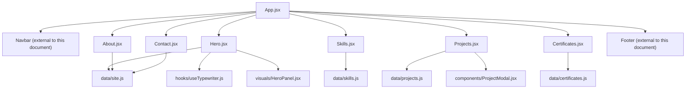
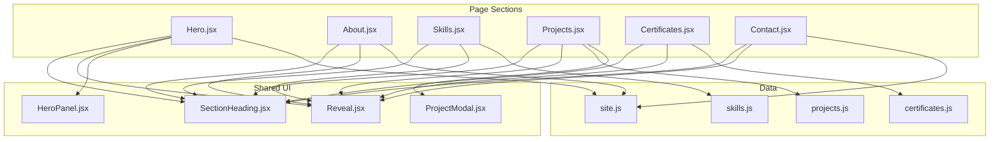
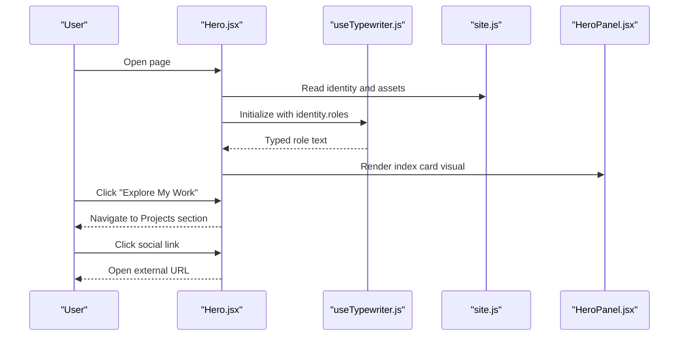
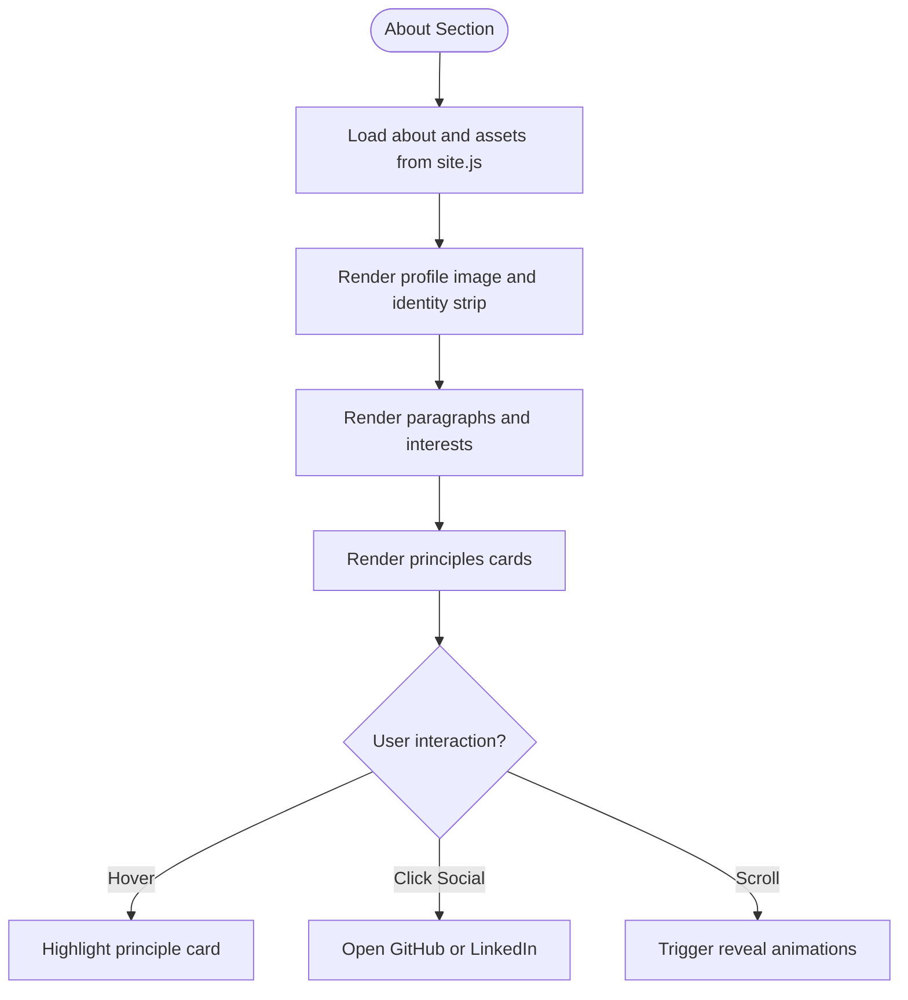
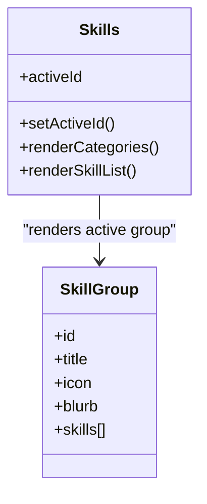
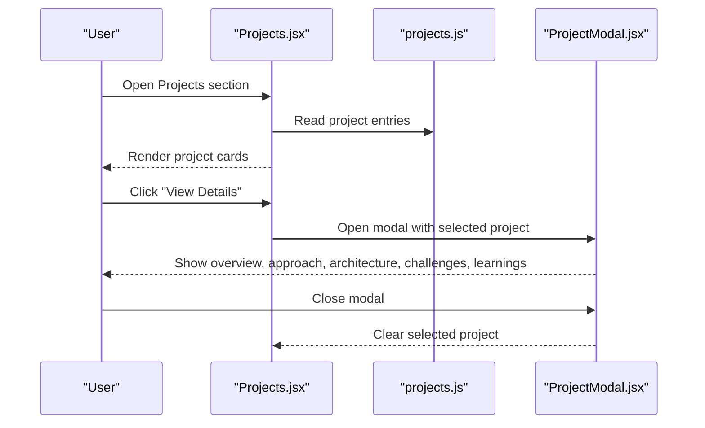
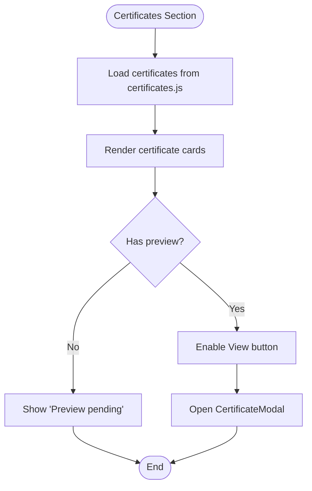
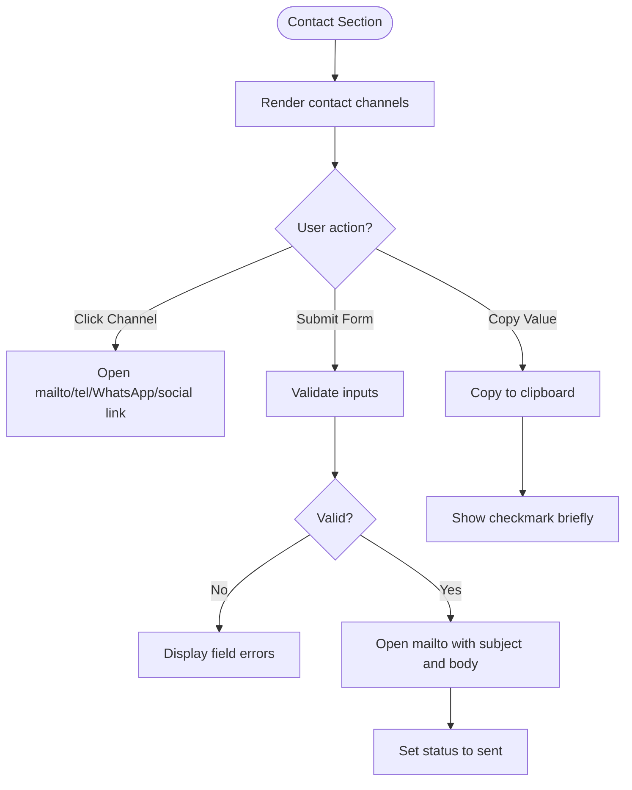
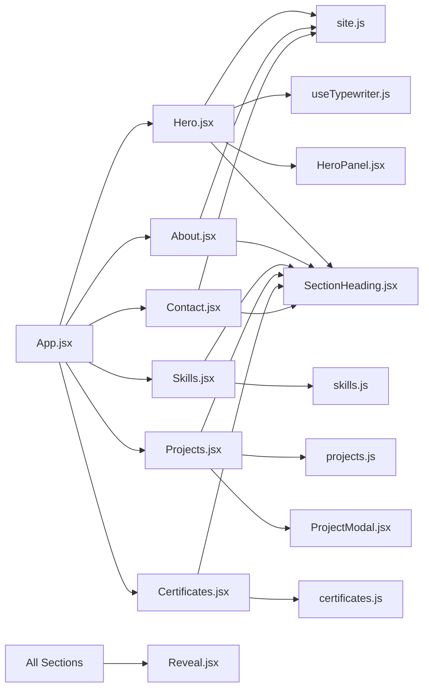

# Page Sections

<cite>
**Referenced Files in This Document**
- [App.jsx](file://src/App.jsx)
- [site.js](file://src/data/site.js)
- [Hero.jsx](file://src/components/Hero.jsx)
- [About.jsx](file://src/components/About.jsx)
- [Skills.jsx](file://src/components/Skills.jsx)
- [Projects.jsx](file://src/components/Projects.jsx)
- [Certificates.jsx](file://src/components/Certificates.jsx)
- [Contact.jsx](file://src/components/Contact.jsx)
- [skills.js](file://src/data/skills.js)
- [projects.js](file://src/data/projects.js)
- [certificates.js](file://src/data/certificates.js)
- [useTypewriter.js](file://src/hooks/useTypewriter.js)
- [SectionHeading.jsx](file://src/components/ui/SectionHeading.jsx)
- [Reveal.jsx](file://src/components/ui/Reveal.jsx)
- [HeroPanel.jsx](file://src/components/visuals/HeroPanel.jsx)
- [ProjectModal.jsx](file://src/components/ProjectModal.jsx)
</cite>

## Table of Contents
1. [Introduction](#introduction)
2. [Project Structure](#project-structure)
3. [Core Components](#core-components)
4. [Architecture Overview](#architecture-overview)
5. [Detailed Component Analysis](#detailed-component-analysis)
6. [Dependency Analysis](#dependency-analysis)
7. [Performance Considerations](#performance-considerations)
8. [Troubleshooting Guide](#troubleshooting-guide)
9. [Conclusion](#conclusion)
10. [Appendices](#appendices)

## Introduction
This document explains the major page sections of the portfolio: Hero, About, Skills, Projects, Certificates, and Contact. For each section, it describes the data structure, visual presentation, interactive behavior, scroll and responsiveness behavior, and customization options. It also provides guidance for adding new sections or modifying existing ones.

The site is a React application where App composes all page sections. Each section reads content from centralized data files under src/data and uses shared UI components for headings, animations, modals, and layout helpers.

## Project Structure
The portfolio follows a feature-based component layout with separate data modules:

- App composes the top-level layout and page sections.
- Each section lives under src/components as a single-purpose component.
- Data is centralized under src/data for identity, about text, skills, projects, certificates, and contact copy.
- Shared UI primitives live under src/components/ui.
- Visual decorations are isolated under src/components/visuals.
- Hooks encapsulate reusable behaviors such as typewriter animation and motion preferences.

**Diagram sources**
- [App.jsx:10-29](file://src/App.jsx#L10-L29)
- [Hero.jsx:1-149](file://src/components/Hero.jsx#L1-L149)
- [About.jsx:1-148](file://src/components/About.jsx#L1-L148)
- [Skills.jsx:1-187](file://src/components/Skills.jsx#L1-L187)
- [Projects.jsx:1-143](file://src/components/Projects.jsx#L1-L143)
- [Certificates.jsx:1-153](file://src/components/Certificates.jsx#L1-L153)
- [Contact.jsx:1-343](file://src/components/Contact.jsx#L1-L343)
- [site.js:1-116](file://src/data/site.js#L1-L116)
- [skills.js:1-62](file://src/data/skills.js#L1-L62)
- [projects.js:1-262](file://src/data/projects.js#L1-L262)
- [certificates.js:1-116](file://src/data/certificates.js#L1-L116)
- [useTypewriter.js:1-44](file://src/hooks/useTypewriter.js#L1-L44)
- [HeroPanel.jsx:1-92](file://src/components/visuals/HeroPanel.jsx#L1-L92)
- [ProjectModal.jsx:1-172](file://src/components/ProjectModal.jsx#L1-L172)

**Section sources**
- [App.jsx:10-29](file://src/App.jsx#L10-L29)

## Core Components
- SectionHeading: Provides consistent section titles, eyebrow labels, optional subtitles, and dark/light tone support.
- Reveal: Scroll-triggered fade-in wrapper that respects reduced-motion preferences.
- useTypewriter: Rotating typewriter effect used by the Hero section.
- HeroPanel: Editorial index card visual used beside the Hero headline.
- ProjectModal: Detailed case study modal for project entries.

These shared components keep the page sections focused on content and interaction rather than repetitive styling.

**Section sources**
- [SectionHeading.jsx:1-70](file://src/components/ui/SectionHeading.jsx#L1-L70)
- [Reveal.jsx:1-34](file://src/components/ui/Reveal.jsx#L1-L34)
- [useTypewriter.js:1-44](file://src/hooks/useTypewriter.js#L1-L44)
- [HeroPanel.jsx:1-92](file://src/components/visuals/HeroPanel.jsx#L1-L92)
- [ProjectModal.jsx:1-172](file://src/components/ProjectModal.jsx#L1-L172)

## Architecture Overview
Each page section is a self-contained React component that:
- Reads content from data files.
- Uses SectionHeading for consistent headers.
- Wraps content with Reveal for scroll animations.
- Adds interactivity through local state (for example, active skill category, selected project, certificate preview).
- Integrates external links for social profiles, repositories, live demos, and verification URLs.

**Diagram sources**
- [Hero.jsx:1-149](file://src/components/Hero.jsx#L1-L149)
- [About.jsx:1-148](file://src/components/About.jsx#L1-L148)
- [Skills.jsx:1-187](file://src/components/Skills.jsx#L1-L187)
- [Projects.jsx:1-143](file://src/components/Projects.jsx#L1-L143)
- [Certificates.jsx:1-153](file://src/components/Certificates.jsx#L1-L153)
- [Contact.jsx:1-343](file://src/components/Contact.jsx#L1-L343)
- [SectionHeading.jsx:1-70](file://src/components/ui/SectionHeading.jsx#L1-L70)
- [Reveal.jsx:1-34](file://src/components/ui/Reveal.jsx#L1-L34)
- [HeroPanel.jsx:1-92](file://src/components/visuals/HeroPanel.jsx#L1-L92)
- [ProjectModal.jsx:1-172](file://src/components/ProjectModal.jsx#L1-L172)
- [site.js:1-116](file://src/data/site.js#L1-L116)
- [skills.js:1-62](file://src/data/skills.js#L1-L62)
- [projects.js:1-262](file://src/data/projects.js#L1-L262)
- [certificates.js:1-116](file://src/data/certificates.js#L1-L116)

## Detailed Component Analysis

### Hero Section
Purpose: Introduce the developer, display a rotating role label, provide quick actions, and showcase an editorial index card visual.

Data structure:
- Identity fields come from site.js: name, monogram, logo, role, headline, roles array, intro, email, phone, WhatsApp, and social links.
- Assets include profile image path and CV path.
- Availability badge can be toggled via configuration.

Visual presentation:
- Headline and tagline with responsive typography.
- Typewriter badge showing rotating roles with a blinking caret.
- Optional availability badge.
- Call-to-action buttons linking to Projects and Contact.
- Quick links to download CV and open GitHub and LinkedIn.
- HeroPanel displays monogram, focus areas, core stack, and approach.

Interactive elements:
- Typewriter animation cycles through roles; disabled when reduced motion is preferred.
- Buttons navigate to other sections or open external links.
- Social links open in new tabs with safe attributes.

Scroll and screen size behavior:
- Staggered entrance animations for text blocks.
- Grid layout adapts from stacked to two-column on larger screens.
- Background gradients and grid lines are decorative and non-interactive.

Customization options:
- Update identity.roles to change the rotating labels.
- Toggle availability.enabled to show or hide the availability badge.
- Replace assets.profileImage and assets.cv paths to update portrait and resume.
- Edit identity.socials to change GitHub and LinkedIn links.

**Diagram sources**
- [Hero.jsx:1-149](file://src/components/Hero.jsx#L1-L149)
- [useTypewriter.js:1-44](file://src/hooks/useTypewriter.js#L1-L44)
- [site.js:1-116](file://src/data/site.js#L1-L116)
- [HeroPanel.jsx:1-92](file://src/components/visuals/HeroPanel.jsx#L1-L92)

**Section sources**
- [Hero.jsx:1-149](file://src/components/Hero.jsx#L1-L149)
- [site.js:1-116](file://src/data/site.js#L1-L116)
- [useTypewriter.js:1-44](file://src/hooks/useTypewriter.js#L1-L44)
- [HeroPanel.jsx:1-92](file://src/components/visuals/HeroPanel.jsx#L1-L92)

### About Section
Purpose: Present personal background, technical interests, and guiding principles.

Data structure:
- about object from site.js includes index, eyebrow, title, subtitle, paragraphs, interests, and principles.
- Profile image and alt text come from assets.
- Social links reuse identity.socials.

Visual presentation:
- Left column shows a framed profile image with a floating identity strip and social buttons.
- Right column contains the section heading, narrative paragraphs, interest chips, and a link to explore repositories.
- Principles are displayed as hoverable cards with numbered markers.

Interactive elements:
- Paragraphs and principle cards reveal on scroll.
- Social buttons open GitHub and LinkedIn in new tabs.
- Hover effects lift cards and highlight borders.

Scroll and screen size behavior:
- Two-column layout on large screens; stacked on smaller screens.
- Reveal animations trigger as the section enters the viewport.

Customization options:
- Edit about.paragraphs to update biography text.
- Add or remove items in about.interests to reflect current interests.
- Modify about.principles to adjust values and descriptions.
- Change assets.profileImage and assets.profileImageAlt to update the portrait.

**Diagram sources**
- [About.jsx:1-148](file://src/components/About.jsx#L1-L148)
- [site.js:1-116](file://src/data/site.js#L1-L116)

**Section sources**
- [About.jsx:1-148](file://src/components/About.jsx#L1-L148)
- [site.js:1-116](file://src/data/site.js#L1-L116)

### Skills Section
Purpose: Showcase categorized technology expertise without proficiency percentages.

Data structure:
- skillGroups from skills.js defines categories with id, title, icon key, blurb, and skills array.
- Icon mapping maps string keys to Lucide icons inside the component.

Visual presentation:
- Sticky navigation panel lists categories with counts.
- Main panel shows the active category’s description and numbered skill list.
- Mobile view uses horizontally scrollable pill buttons for category selection.

Interactive elements:
- Category selection updates the active panel with animated transitions.
- AnimatePresence handles smooth entry and exit animations.
- Reduced motion disables animations automatically.

Scroll and screen size behavior:
- Navigation becomes sticky on desktop.
- On mobile, category buttons scroll horizontally.
- Skill list switches from one to two columns on larger screens.

Customization options:
- Add new categories to skillGroups with a unique id, descriptive blurb, and skills list.
- Map a new icon key in ICONS if using a different Lucide icon.
- Adjust totalSkills calculation automatically reflects added categories.

**Diagram sources**
- [Skills.jsx:1-187](file://src/components/Skills.jsx#L1-L187)
- [skills.js:1-62](file://src/data/skills.js#L1-L62)

**Section sources**
- [Skills.jsx:1-187](file://src/components/Skills.jsx#L1-L187)
- [skills.js:1-62](file://src/data/skills.js#L1-L62)

### Projects Section
Purpose: Present selected projects with summaries, tech stacks, and detailed case studies.

Data structure:
- projects array from projects.js includes number, title, shortTitle, category, summary, description, stack, focus, highlight, visual variant, links, and detail object.
- detail contains overview, problem statement, approach steps, architecture layers, challenges, and learnings.

Visual presentation:
- Dark-themed section with alternating image/text order per project.
- Each project card shows category, title, description, stack chips, and action buttons.
- ProjectVisual renders abstract artwork based on the visual variant.

Interactive elements:
- "View Details" opens ProjectModal with full case study content.
- GitHub and Live Demo buttons appear conditionally when links exist.
- Modal preserves last project snapshot during exit animation.

Scroll and screen size behavior:
- Cards reveal sequentially with staggered delays.
- Image and text swap order on desktop for visual rhythm.
- Responsive typography scales across breakpoints.

Customization options:
- Add new project entries following the existing schema.
- Use links.github and links.live only when real public URLs exist.
- Choose visual variants: vision, api, workflow.
- Expand detail.overview, approach, architecture, challenges, and learnings to deepen case studies.

**Diagram sources**
- [Projects.jsx:1-143](file://src/components/Projects.jsx#L1-L143)
- [projects.js:1-262](file://src/data/projects.js#L1-L262)
- [ProjectModal.jsx:1-172](file://src/components/ProjectModal.jsx#L1-L172)

**Section sources**
- [Projects.jsx:1-143](file://src/components/Projects.jsx#L1-L143)
- [projects.js:1-262](file://src/data/projects.js#L1-L262)
- [ProjectModal.jsx:1-172](file://src/components/ProjectModal.jsx#L1-L172)

### Certificates Section
Purpose: Display verified certificates with optional previews and verification links.

Data structure:
- certificates array from certificates.js includes id, number, title, issuer, issued date, verified flag, image path, file path, url, and note.
- hasPreview helper returns true when any preview asset exists.

Visual presentation:
- Grid of certificate cards with initials or placeholder indicator.
- Placeholder cards indicate reserved slots awaiting real content.
- Verified credentials badge emphasizes authenticity.

Interactive elements:
- Preview button opens CertificateModal when an image, file, or url exists.
- If no preview is available, the card shows "Preview pending".
- Issued date displays when provided; otherwise shows a default message.

Scroll and screen size behavior:
- Cards reveal with staggered delays.
- Grid adapts from two columns on small screens to four columns on large screens.

Customization options:
- Fill image, file, or url to enable preview functionality.
- Mark placeholder entries until real certificates are ready.
- Keep verified flag accurate; only verified details should be listed.

**Diagram sources**
- [Certificates.jsx:1-153](file://src/components/Certificates.jsx#L1-L153)
- [certificates.js:1-116](file://src/data/certificates.js#L1-L116)

**Section sources**
- [Certificates.jsx:1-153](file://src/components/Certificates.jsx#L1-L153)
- [certificates.js:1-116](file://src/data/certificates.js#L1-L116)

### Contact Section
Purpose: Provide multiple contact channels and a form that opens the user’s email client with pre-filled content.

Data structure:
- CHANNELS array defines Email, Phone, WhatsApp, LinkedIn, and GitHub with href, icon, copy value, and external link flags.
- contact and identity objects supply copy text, email, phone, WhatsApp, and social links.

Visual presentation:
- Left column contains section heading, introductory copy, and channel cards.
- Right column contains a validated form styled with accessible error messages.
- Copy-to-clipboard feedback replaces the copy icon temporarily.

Interactive elements:
- Channel cards either open mailto/tel/WhatsApp links or external profiles.
- Copy button copies email or phone to clipboard with success feedback.
- Form validates required fields and email format before opening mailto link.
- Status message informs users that their email client should open.

Scroll and screen size behavior:
- Two-column layout on large screens; stacked on smaller screens.
- Channel cards reveal with staggered delays.
- Form inputs adapt to screen width with consistent spacing.

Customization options:
- Update identity.email, identity.phone, identity.whatsapp, and identity.socials to change contact details.
- Extend CHANNELS to add new contact methods.
- Customize validation rules in validate function if needed.

**Diagram sources**
- [Contact.jsx:1-343](file://src/components/Contact.jsx#L1-L343)
- [site.js:1-116](file://src/data/site.js#L1-L116)

**Section sources**
- [Contact.jsx:1-343](file://src/components/Contact.jsx#L1-L343)
- [site.js:1-116](file://src/data/site.js#L1-L116)

## Dependency Analysis
The following diagram highlights how page sections depend on data and shared components.

**Diagram sources**
- [App.jsx:10-29](file://src/App.jsx#L10-L29)
- [Hero.jsx:1-149](file://src/components/Hero.jsx#L1-L149)
- [About.jsx:1-148](file://src/components/About.jsx#L1-L148)
- [Skills.jsx:1-187](file://src/components/Skills.jsx#L1-L187)
- [Projects.jsx:1-143](file://src/components/Projects.jsx#L1-L143)
- [Certificates.jsx:1-153](file://src/components/Certificates.jsx#L1-L153)
- [Contact.jsx:1-343](file://src/components/Contact.jsx#L1-L343)
- [site.js:1-116](file://src/data/site.js#L1-L116)
- [skills.js:1-62](file://src/data/skills.js#L1-L62)
- [projects.js:1-262](file://src/data/projects.js#L1-L262)
- [certificates.js:1-116](file://src/data/certificates.js#L1-L116)
- [SectionHeading.jsx:1-70](file://src/components/ui/SectionHeading.jsx#L1-L70)
- [Reveal.jsx:1-34](file://src/components/ui/Reveal.jsx#L1-L34)
- [useTypewriter.js:1-44](file://src/hooks/useTypewriter.js#L1-L44)
- [HeroPanel.jsx:1-92](file://src/components/visuals/HeroPanel.jsx#L1-L92)
- [ProjectModal.jsx:1-172](file://src/components/ProjectModal.jsx#L1-L172)

**Section sources**
- [App.jsx:10-29](file://src/App.jsx#L10-L29)

## Performance Considerations
- Respect reduced motion: The Hero, Reveal, and Skills components disable animations when the user prefers reduced motion.
- Lazy loading images: The About section uses lazy loading and async decoding for the profile image.
- Conditional rendering: Project and Certificate modals render only when needed, reducing unnecessary DOM.
- Lightweight animations: Framer Motion is used sparingly with simple opacity and transform transitions.
- Avoid heavy computations: Data structures are plain arrays and objects; no complex runtime processing occurs in components.

[No sources needed since this section provides general guidance]

## Troubleshooting Guide
- Typewriter not animating: Ensure enabled is true and the user does not have reduced motion preferences. Check useTypewriter initialization in Hero.
- Missing social links: Verify identity.socials in site.js and ensure href values are correct.
- Empty project links: Only set links.github or links.live when real public URLs exist; otherwise, buttons will not render.
- Certificate preview unavailable: Confirm that at least one of image, file, or url is present; otherwise, the card shows "Preview pending".
- Contact form validation errors: Check input values against validate rules and ensure required fields are filled.
- Accessibility issues: Ensure aria-labels and aria-describedby attributes are present for interactive controls and error messages.

**Section sources**
- [useTypewriter.js:1-44](file://src/hooks/useTypewriter.js#L1-L44)
- [site.js:1-116](file://src/data/site.js#L1-L116)
- [projects.js:1-262](file://src/data/projects.js#L1-L262)
- [certificates.js:1-116](file://src/data/certificates.js#L1-L116)
- [Contact.jsx:64-84](file://src/components/Contact.jsx#L64-L84)

## Conclusion
The portfolio’s page sections are modular, data-driven, and accessible. Hero introduces identity and actions; About shares personal context; Skills categorizes technologies; Projects presents case studies; Certificates showcases verified achievements; Contact provides multiple communication channels. Customization is centralized in data files, while shared components handle consistent visuals and interactions. Adding new sections follows the same pattern: define data, create a component, compose it in App, and use SectionHeading and Reveal for consistency.

[No sources needed since this section summarizes without analyzing specific files]

## Appendices

### How to Add a New Section
- Create a new component under src/components.
- Define its data under src/data if it is content-heavy.
- Use SectionHeading for the header and Reveal for scroll animations.
- Compose the component in App.jsx alongside existing sections.
- Test accessibility, responsiveness, and reduced motion behavior.

**Section sources**
- [App.jsx:10-29](file://src/App.jsx#L10-L29)
- [SectionHeading.jsx:1-70](file://src/components/ui/SectionHeading.jsx#L1-L70)
- [Reveal.jsx:1-34](file://src/components/ui/Reveal.jsx#L1-L34)

### How to Modify Existing Sections
- Update content in data files: site.js, skills.js, projects.js, certificates.js.
- Adjust component props or state for interactive changes.
- Preserve semantic HTML and aria attributes for accessibility.
- Keep external links safe with target="_blank" and rel="noreferrer noopener".

**Section sources**
- [site.js:1-116](file://src/data/site.js#L1-L116)
- [skills.js:1-62](file://src/data/skills.js#L1-L62)
- [projects.js:1-262](file://src/data/projects.js#L1-L262)
- [certificates.js:1-116](file://src/data/certificates.js#L1-L116)