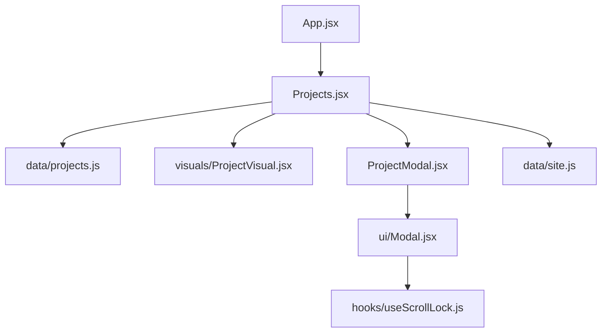
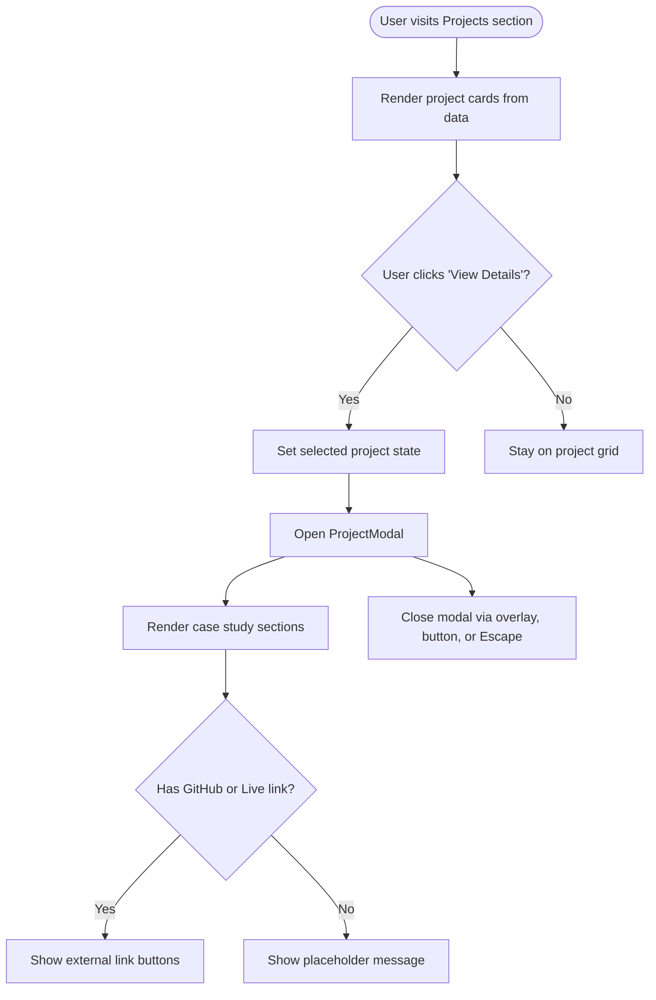
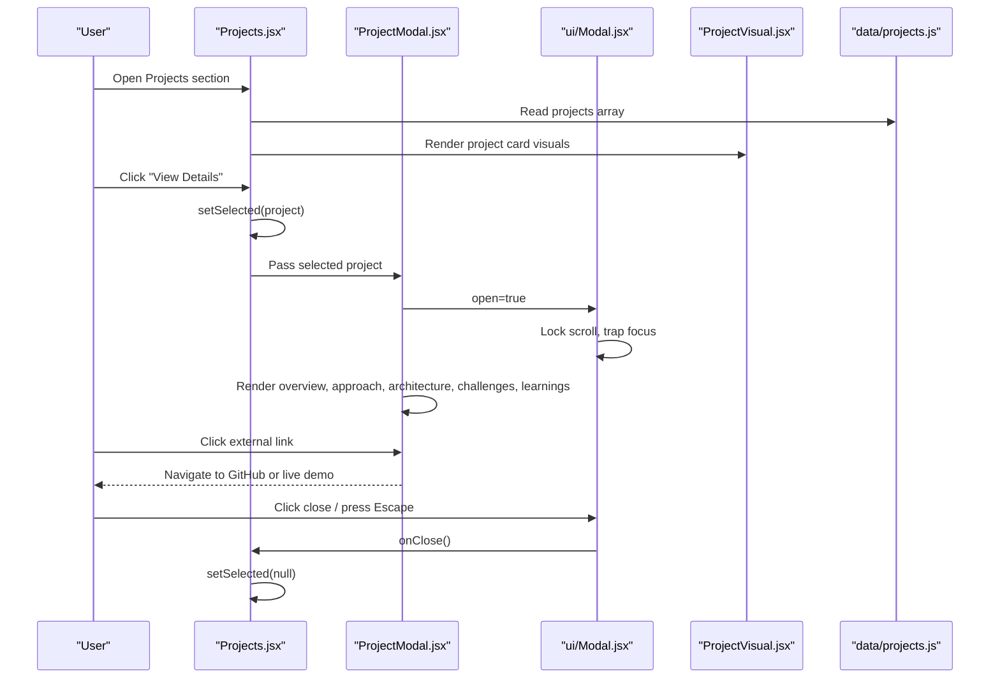
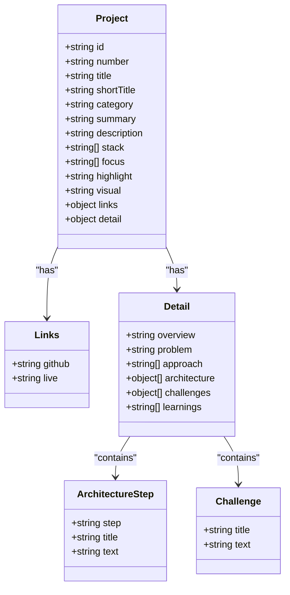
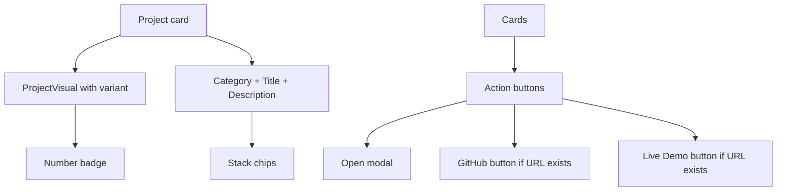
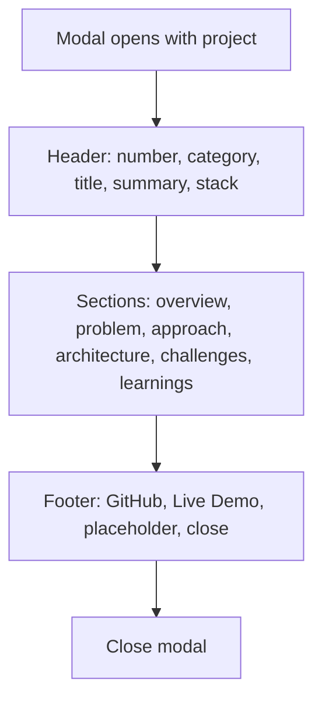
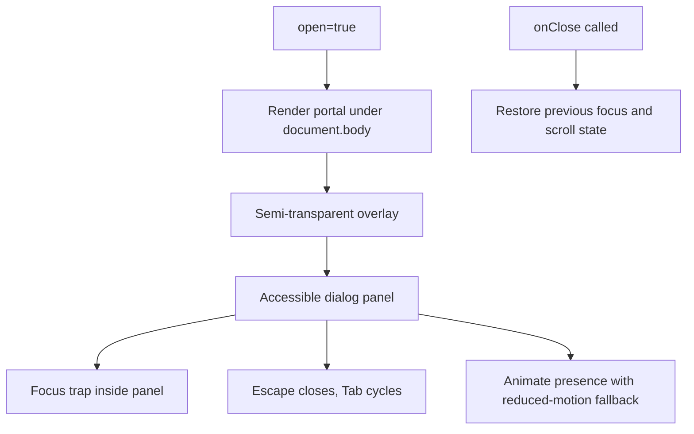
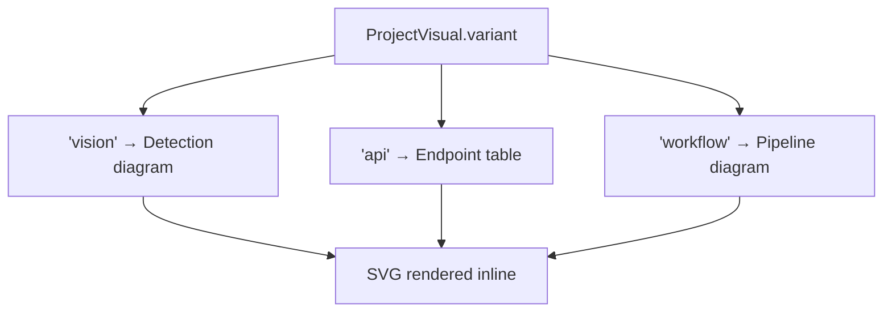
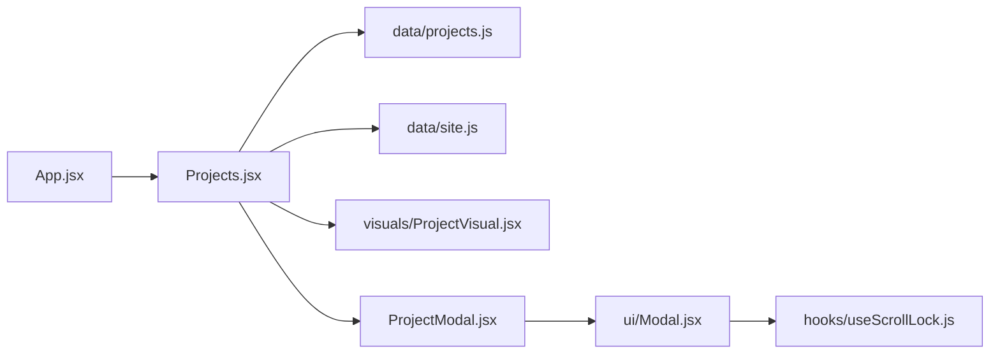

# Projects Section

<cite>
**Referenced Files in This Document**
- [projects.js](file://src/data/projects.js)
- [Projects.jsx](file://src/components/Projects.jsx)
- [ProjectModal.jsx](file://src/components/ProjectModal.jsx)
- [Modal.jsx](file://src/components/ui/Modal.jsx)
- [ProjectVisual.jsx](file://src/components/visuals/ProjectVisual.jsx)
- [site.js](file://src/data/site.js)
- [useScrollLock.js](file://src/hooks/useScrollLock.js)
- [App.jsx](file://src/App.jsx)
</cite>

## Table of Contents
1. [Introduction](#introduction)
2. [Project Structure](#project-structure)
3. [Core Components](#core-components)
4. [Architecture Overview](#architecture-overview)
5. [Detailed Component Analysis](#detailed-component-analysis)
6. [Dependency Analysis](#dependency-analysis)
7. [Performance Considerations](#performance-considerations)
8. [Troubleshooting Guide](#troubleshooting-guide)
9. [Conclusion](#conclusion)
10. [Appendices](#appendices)

## Introduction
The Projects section is the portfolio’s project showcase area. It renders a list of case-study-style project cards and opens an interactive modal that presents detailed technical context, architecture steps, challenges, learnings, and external links. The section uses generated abstract visuals instead of static screenshots, keeping the focus on engineering concepts rather than polished UI mockups.

Key goals:
- Present projects as structured case studies.
- Provide rich detail through a modal without leaving the page.
- Keep metadata centralized so adding or editing projects is predictable.
- Support external links to GitHub repositories and live demos.
- Maintain accessibility, responsive layout, and smooth animations.

## Project Structure
The Projects feature spans data, presentation, and shared UI layers:

- Data layer: `src/data/projects.js` defines the project catalog.
- Presentation layer: `src/components/Projects.jsx` renders the project grid and controls modal state.
- Modal layer: `src/components/ProjectModal.jsx` renders the case study content inside a reusable modal.
- Shared UI: `src/components/ui/Modal.jsx` provides accessible dialog behavior.
- Visuals: `src/components/visuals/ProjectVisual.jsx` renders SVG-based abstract diagrams per project type.
- Site configuration: `src/data/site.js` supplies global identity and social links used by the Projects header.
- App shell: `src/App.jsx` includes the Projects component in the main application route.

**Diagram sources**
- [App.jsx:1-32](file://src/App.jsx#L1-L32)
- [Projects.jsx:1-143](file://src/components/Projects.jsx#L1-L143)
- [projects.js:1-262](file://src/data/projects.js#L1-L262)
- [ProjectModal.jsx:1-172](file://src/components/ProjectModal.jsx#L1-L172)
- [Modal.jsx:1-131](file://src/components/ui/Modal.jsx#L1-L131)
- [ProjectVisual.jsx:1-257](file://src/components/visuals/ProjectVisual.jsx#L1-L257)
- [site.js:1-116](file://src/data/site.js#L1-L116)
- [useScrollLock.js:1-24](file://src/hooks/useScrollLock.js#L1-L24)

**Section sources**
- [App.jsx:1-32](file://src/App.jsx#L1-L32)
- [Projects.jsx:1-143](file://src/components/Projects.jsx#L1-L143)
- [projects.js:1-262](file://src/data/projects.js#L1-L262)

## Core Components
This section explains how the project showcase works at a high level.

- Project catalog: A single exported array holds all projects. Each project contains identification fields, summary text, technology tags, visual variant, external links, and a nested detail object for the case study.
- Project card: Each project renders a responsive card with a generated visual, category, title, description, stack chips, and action buttons.
- Modal system: Clicking “View Details” sets selected project state; `ProjectModal` renders the full case study inside an accessible modal.
- Generated visuals: `ProjectVisual` chooses an abstract SVG diagram based on the project’s `visual` field.
- External links: GitHub and live demo buttons are conditionally rendered when URLs exist.

**Diagram sources**
- [Projects.jsx:12-140](file://src/components/Projects.jsx#L12-L140)
- [ProjectModal.jsx:16-169](file://src/components/ProjectModal.jsx#L16-L169)
- [Modal.jsx:15-129](file://src/components/ui/Modal.jsx#L15-L129)

**Section sources**
- [Projects.jsx:12-140](file://src/components/Projects.jsx#L12-L140)
- [ProjectModal.jsx:16-169](file://src/components/ProjectModal.jsx#L16-L169)
- [Modal.jsx:15-129](file://src/components/ui/Modal.jsx#L15-L129)

## Architecture Overview
The Projects feature follows a clear separation between data and presentation:

- Data-first design: All project content lives in `projects.js`. Components read this data and never hardcode project details.
- State-driven modal: `Projects.jsx` owns the selected project state and passes it to `ProjectModal.jsx`.
- Reusable modal: `Modal.jsx` handles portal rendering, scroll lock, focus management, keyboard navigation, and motion transitions.
- Visual abstraction: `ProjectVisual.jsx` renders SVG diagrams keyed by the project’s `visual` value, avoiding heavy image assets.

**Diagram sources**
- [Projects.jsx:12-140](file://src/components/Projects.jsx#L12-L140)
- [ProjectModal.jsx:16-169](file://src/components/ProjectModal.jsx#L16-L169)
- [Modal.jsx:15-129](file://src/components/ui/Modal.jsx#L15-L129)
- [ProjectVisual.jsx:6-257](file://src/components/visuals/ProjectVisual.jsx#L6-L257)
- [projects.js:8-261](file://src/data/projects.js#L8-L261)

## Detailed Component Analysis

### Project Data Model
The project data model is designed for clarity and extensibility. Each project entry includes:

- Identification: `id`, `number`, `title`, `shortTitle`, `category`.
- Summary: `summary` for short preview text and `description` for the card body.
- Technology tags: `stack` array displayed as chips.
- Focus areas: `focus` array describing key technical themes.
- Highlight: `highlight` summarizing the project’s emphasis.
- Visual variant: `visual` selects one of the generated diagrams.
- External links: `links.github` and `links.live`; empty strings hide buttons.
- Detail object: `detail.overview`, `detail.problem`, `detail.approach`, `detail.architecture`, `detail.challenges`, `detail.learnings`.

**Diagram sources**
- [projects.js:8-261](file://src/data/projects.js#L8-L261)

**Section sources**
- [projects.js:1-262](file://src/data/projects.js#L1-L262)

### Project Card Layout
Each project card is a responsive article composed of:

- A generated visual panel using `ProjectVisual`.
- A numbered badge derived from `project.number`.
- Category label, title, and description.
- Stack chips rendered via a shared chip component.
- Action buttons: “View Details”, optional GitHub button, optional Live Demo button.
- Hover effects and reveal animations for polish.

External links are conditional:
- If `project.links.github` exists, render the GitHub button.
- If `project.links.live` exists, render the Live Demo button.
- Empty strings intentionally hide buttons.

**Diagram sources**
- [Projects.jsx:55-135](file://src/components/Projects.jsx#L55-L135)
- [ProjectVisual.jsx:6-257](file://src/components/visuals/ProjectVisual.jsx#L6-L257)

**Section sources**
- [Projects.jsx:55-135](file://src/components/Projects.jsx#L55-L135)

### Case Study Modal
The modal presents a structured case study with these sections:

- Header: project number, category, title, summary, and stack chips.
- Overview: narrative explanation of the project.
- Problem statement: why the project exists.
- Technical approach: ordered steps describing methodology.
- Architecture: grid of layered components or pipeline stages.
- Challenges & learning outcomes: difficulties encountered and lessons learned.
- Footer: external links and close control.

The modal keeps the last rendered project snapshot while closing animations play, ensuring smooth exit transitions even as React updates state.

**Diagram sources**
- [ProjectModal.jsx:16-169](file://src/components/ProjectModal.jsx#L16-L169)

**Section sources**
- [ProjectModal.jsx:16-169](file://src/components/ProjectModal.jsx#L16-L169)

### Accessible Modal Shell
The shared modal component provides:

- Portal rendering into `document.body`.
- Scroll lock to prevent background scrolling.
- Focus trapping within the dialog.
- Keyboard support: Escape closes, Tab cycles focus.
- Click-outside-to-dismiss behavior.
- Reduced-motion support for users who prefer minimal animation.
- Accessible attributes: `role="dialog"`, `aria-modal`, `aria-labelledby`, `aria-describedby`.

**Diagram sources**
- [Modal.jsx:15-129](file://src/components/ui/Modal.jsx#L15-L129)
- [useScrollLock.js:6-22](file://src/hooks/useScrollLock.js#L6-L22)

**Section sources**
- [Modal.jsx:15-129](file://src/components/ui/Modal.jsx#L15-L129)
- [useScrollLock.js:1-24](file://src/hooks/useScrollLock.js#L1-L24)

### Generated Project Visuals
Instead of static images, each project uses an abstract SVG diagram chosen by the `visual` field:

- `vision`: Computer-vision-style detection diagram with bounding boxes and labels.
- `api`: API endpoint table showing methods, paths, and status codes.
- `workflow`: Pipeline diagram showing intake, extraction, AI processing, normalization, and JSON output.

These visuals are lightweight, scalable, and consistent across devices.

**Diagram sources**
- [ProjectVisual.jsx:6-257](file://src/components/visuals/ProjectVisual.jsx#L6-L257)

**Section sources**
- [ProjectVisual.jsx:1-257](file://src/components/visuals/ProjectVisual.jsx#L1-L257)

## Dependency Analysis
The following diagram shows how the Projects feature depends on shared modules and data:

**Diagram sources**
- [App.jsx:1-32](file://src/App.jsx#L1-L32)
- [Projects.jsx:1-143](file://src/components/Projects.jsx#L1-L143)
- [projects.js:1-262](file://src/data/projects.js#L1-L262)
- [site.js:1-116](file://src/data/site.js#L1-L116)
- [ProjectModal.jsx:1-172](file://src/components/ProjectModal.jsx#L1-L172)
- [Modal.jsx:1-131](file://src/components/ui/Modal.jsx#L1-L131)
- [useScrollLock.js:1-24](file://src/hooks/useScrollLock.js#L1-L24)

**Section sources**
- [Projects.jsx:1-143](file://src/components/Projects.jsx#L1-L143)
- [ProjectModal.jsx:1-172](file://src/components/ProjectModal.jsx#L1-L172)
- [Modal.jsx:1-131](file://src/components/ui/Modal.jsx#L1-L131)

## Performance Considerations
- Prefer generated visuals over large images: `ProjectVisual` uses inline SVG, which scales well and avoids heavy asset loading.
- Avoid unnecessary re-renders: keep project data immutable and avoid creating new objects on every render.
- Use lazy loading for heavy content outside the modal: the current modal renders all case study sections when opened; consider splitting heavy sections if performance becomes an issue.
- Respect reduced motion: the modal respects user preferences through reduced-motion handling.
- Optimize external links: only render buttons when URLs exist to reduce DOM nodes.

[No sources needed since this section provides general guidance]

## Troubleshooting Guide

Common issues and resolutions:

- External links not appearing:
  - Ensure `links.github` or `links.live` contain real public URLs.
  - Empty strings intentionally hide buttons.
  - Verify the site’s global GitHub link in `site.js` if the “All repositories” link is missing.

- Modal does not close:
  - Check that `onClose` is passed correctly from `Projects.jsx` to `ProjectModal.jsx`.
  - Confirm that clicking the overlay or pressing Escape triggers `onClose`.
  - Validate that focus trapping is working inside the modal panel.

- Scroll remains locked after closing:
  - Verify `useScrollLock` receives the correct `active` prop.
  - Ensure the modal’s open state is properly cleared.

- Visuals do not match project intent:
  - Update the project’s `visual` field to `vision`, `api`, or `workflow`.
  - Extend `ProjectVisual.jsx` if a new visual variant is required.

- Responsive layout looks broken:
  - Inspect Tailwind classes controlling grid columns, spacing, and typography.
  - Confirm that the container and section padding scale appropriately across breakpoints.

**Section sources**
- [projects.js:30-33](file://src/data/projects.js#L30-L33)
- [projects.js:111-114](file://src/data/projects.js#L111-L114)
- [projects.js:197-200](file://src/data/projects.js#L197-L200)
- [Projects.jsx:104-130](file://src/components/Projects.jsx#L104-L130)
- [ProjectModal.jsx:133-152](file://src/components/ProjectModal.jsx#L133-L152)
- [Modal.jsx:35-74](file://src/components/ui/Modal.jsx#L35-L74)
- [useScrollLock.js:6-22](file://src/hooks/useScrollLock.js#L6-L22)

## Conclusion
The Projects section delivers a clean, data-driven showcase with rich case study modals and lightweight generated visuals. Its architecture separates concerns clearly: data lives in a single source, presentation components remain focused, and shared UI primitives provide accessibility and motion consistency. Adding new projects is straightforward: extend the project array with the expected structure, choose a visual variant, and optionally add external links. For future growth, consider introducing project galleries, richer media handling, and progressive disclosure of modal sections to balance depth with performance.

[No sources needed since this section summarizes without analyzing specific files]

## Appendices

### How to Add a New Project
Steps:
1. Open `src/data/projects.js`.
2. Add a new object to the exported `projects` array.
3. Include required fields:
   - `id`, `number`, `title`, `shortTitle`, `category`.
   - `summary`, `description`, `stack`, `focus`, `highlight`.
   - `visual` set to `vision`, `api`, or `workflow`.
   - `links.github` and `links.live` (empty strings hide buttons).
   - `detail` with `overview`, `problem`, `approach`, `architecture`, `challenges`, `learnings`.
4. Save and verify:
   - The project appears in the grid.
   - “View Details” opens the modal.
   - External buttons appear only when URLs exist.

**Section sources**
- [projects.js:8-261](file://src/data/projects.js#L8-L261)

### How to Customize Project Cards
Options:
- Change card layout by adjusting Tailwind classes in `Projects.jsx`.
- Modify chip styling through the shared Chip component.
- Adjust hover effects, shadows, and spacing for visual polish.
- Add new metadata fields to the project data model and render them in the card.

**Section sources**
- [Projects.jsx:55-135](file://src/components/Projects.jsx#L55-L135)

### How to Implement Modal Behaviors
Guidelines:
- Control modal visibility through selected project state in `Projects.jsx`.
- Pass `onClose` down to `ProjectModal.jsx`.
- Use the shared `Modal.jsx` for accessibility and motion.
- Keep modal content readable and scannable with clear headings and sections.
- Handle external links safely with `target="_blank"` and `rel="noreferrer noopener"`.

**Section sources**
- [Projects.jsx:12-140](file://src/components/Projects.jsx#L12-L140)
- [ProjectModal.jsx:16-169](file://src/components/ProjectModal.jsx#L16-L169)
- [Modal.jsx:15-129](file://src/components/ui/Modal.jsx#L15-L129)

### Managing Project Metadata
Best practices:
- Keep all project text in `projects.js` to avoid scattered content.
- Use concise `summary` for previews and detailed `description` for cards.
- Use `stack` for technology tags and `focus` for deeper technical themes.
- Use `detail.architecture` for step-by-step system breakdowns.
- Use `detail.challenges` and `detail.learnings` to show reflection and maturity.

**Section sources**
- [projects.js:8-261](file://src/data/projects.js#L8-L261)

### Optimizing Images and Handling Galleries
Current approach:
- Uses generated SVG visuals instead of static images.
- Keeps assets lightweight and scalable.

If you later introduce real images or galleries:
- Compress images and use modern formats like WebP or AVIF.
- Serve responsive images with appropriate sizes.
- Lazy-load gallery images below the fold.
- Keep alt text descriptive and meaningful.
- Consider a lightbox component for gallery interactions.

[No sources needed since this section provides general guidance]

### Ensuring Responsive Design Across Devices
Recommendations:
- Test the project grid on mobile, tablet, and desktop breakpoints.
- Ensure modal panels scroll vertically when content exceeds viewport height.
- Keep touch targets large enough for mobile interaction.
- Verify focus order and keyboard navigation on small screens.
- Confirm that generated visuals scale cleanly without overflow.

**Section sources**
- [Projects.jsx:17-21](file://src/components/Projects.jsx#L17-L21)
- [ProjectModal.jsx:34-35](file://src/components/ProjectModal.jsx#L34-L35)
- [Modal.jsx:80-129](file://src/components/ui/Modal.jsx#L80-L129)