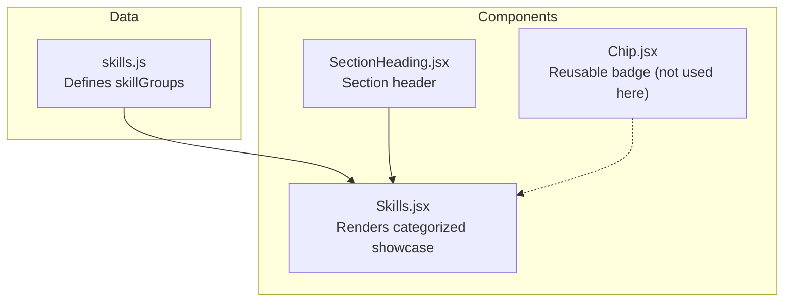
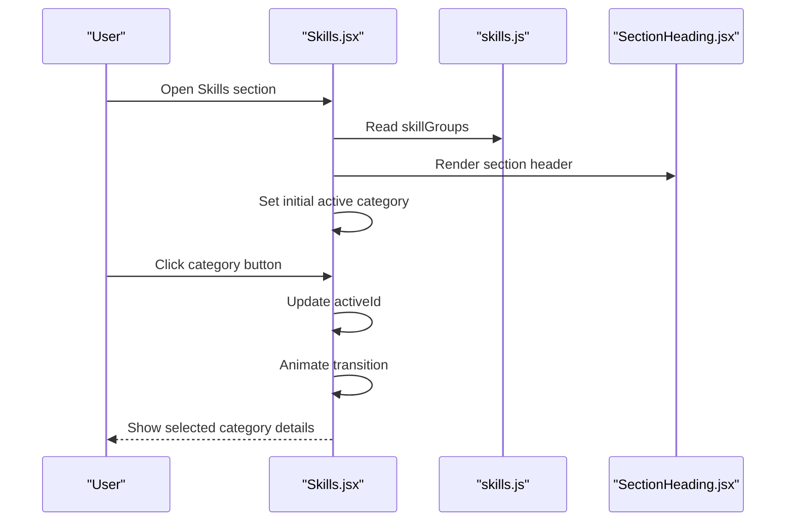
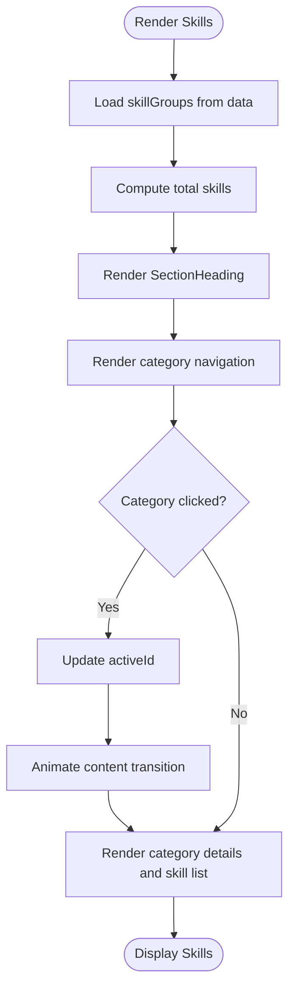
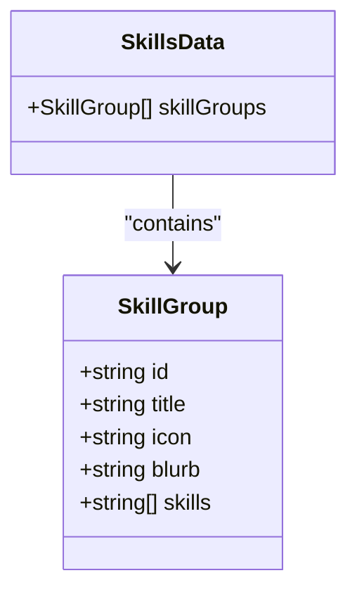
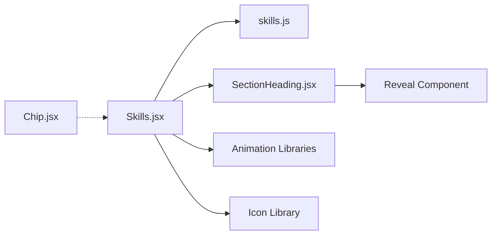

# Skills Section

<cite>
**Referenced Files in This Document**
- [Skills.jsx](file://src/components/Skills.jsx)
- [skills.js](file://src/data/skills.js)
- [SectionHeading.jsx](file://src/components/ui/SectionHeading.jsx)
- [Chip.jsx](file://src/components/ui/Chip.jsx)
</cite>

## Table of Contents
1. [Introduction](#introduction)
2. [Project Structure](#project-structure)
3. [Core Components](#core-components)
4. [Architecture Overview](#architecture-overview)
5. [Detailed Component Analysis](#detailed-component-analysis)
6. [Dependency Analysis](#dependency-analysis)
7. [Performance Considerations](#performance-considerations)
8. [Troubleshooting Guide](#troubleshooting-guide)
9. [Conclusion](#conclusion)
10. [Appendices](#appendices)

## Introduction
The Skills section is a categorized technology showcase that presents your technical expertise by grouping related technologies under meaningful categories. Instead of scoring skills with percentages, the system emphasizes capability descriptions and clear organization. Users can switch between categories to explore different areas of expertise, while the interface remains accessible, responsive, and visually consistent across devices.

This documentation explains:
- How the categorized technology showcase works
- The skill categorization structure and data model
- Visual presentation patterns and accessibility considerations
- How to add new categories and customize displays
- How to organize technologies by proficiency level conceptually
- How to update skill lists and maintain visual consistency on all screen sizes

## Project Structure
The Skills feature spans two primary layers:
- Data layer: A centralized skills dataset defines categories, icons, descriptions, and skill lists.
- Presentation layer: A React component renders category navigation and animated content panels. Supporting UI components provide headings and reusable badge styling.

**Diagram sources**
- [skills.js:1-62](file://src/data/skills.js#L1-L62)
- [Skills.jsx:1-187](file://src/components/Skills.jsx#L1-L187)
- [SectionHeading.jsx:1-70](file://src/components/ui/SectionHeading.jsx#L1-L70)
- [Chip.jsx:1-26](file://src/components/ui/Chip.jsx#L1-L26)

**Section sources**
- [Skills.jsx:1-187](file://src/components/Skills.jsx#L1-L187)
- [skills.js:1-62](file://src/data/skills.js#L1-L62)
- [SectionHeading.jsx:1-70](file://src/components/ui/SectionHeading.jsx#L1-L70)
- [Chip.jsx:1-26](file://src/components/ui/Chip.jsx#L1-L26)

## Core Components
- Skills.jsx: Main component that renders the categorized skills showcase, manages active category state, and animates transitions between categories.
- skills.js: Centralized data source defining skill groups, each with an id, title, icon key, blurb, and array of skills.
- SectionHeading.jsx: Reusable heading component used to render the section’s eyebrow, title, and subtitle consistently.
- Chip.jsx: Reusable badge component for small labels; not directly used in the Skills component but available for future use.

Key responsibilities:
- Skills.jsx handles user interaction (category switching), layout, animations, and accessibility attributes.
- skills.js provides a single source of truth for category metadata and skill lists.
- SectionHeading.jsx standardizes section headers.
- Chip.jsx offers consistent badge styling for potential future extensions.

**Section sources**
- [Skills.jsx:1-187](file://src/components/Skills.jsx#L1-L187)
- [skills.js:1-62](file://src/data/skills.js#L1-L62)
- [SectionHeading.jsx:1-70](file://src/components/ui/SectionHeading.jsx#L1-L70)
- [Chip.jsx:1-26](file://src/components/ui/Chip.jsx#L1-L26)

## Architecture Overview
The Skills section follows a simple data-driven architecture:
- Data flows from skills.js into Skills.jsx.
- Skills.jsx renders a category navigation panel and a content panel showing the selected category’s description and skill list.
- Animations are handled via motion libraries, with reduced-motion support for accessibility.
- Layout adapts to mobile and desktop using responsive classes.

**Diagram sources**
- [Skills.jsx:20-187](file://src/components/Skills.jsx#L20-L187)
- [skills.js:5-61](file://src/data/skills.js#L5-L61)
- [SectionHeading.jsx:4-69](file://src/components/ui/SectionHeading.jsx#L4-L69)

## Detailed Component Analysis

### Skills.jsx
Responsibilities:
- Imports and maps icon keys to Lucide icons.
- Computes total skills across all categories.
- Manages active category state and respects reduced motion preferences.
- Renders:
  - Section header via SectionHeading.jsx
  - Category navigation (horizontal scrollable pills on mobile, vertical list on desktop)
  - Animated content panel with category title, blurb, item count, and skill list

Visual presentation patterns:
- Responsive grid layout: sidebar navigation on large screens, horizontal pill navigation on small screens.
- Consistent typography and spacing using utility classes.
- Subtle hover states and focus-friendly interactions.
- Accessible attributes like aria-labelledby, aria-pressed, and aria-hidden where appropriate.

Animation behavior:
- Uses motion libraries to fade and slide content when switching categories.
- Respects user preference for reduced motion.

Accessibility:
- Keyboard navigable category buttons.
- Descriptive aria attributes for screen readers.
- Clear visual distinction between active and inactive categories.

Customization points:
- Icon mapping via ICONS object.
- Active category default via initial state.
- Styling through utility classes and conditional class composition.

**Diagram sources**
- [Skills.jsx:18-187](file://src/components/Skills.jsx#L18-L187)

**Section sources**
- [Skills.jsx:1-187](file://src/components/Skills.jsx#L1-L187)

### skills.js
Structure:
- Exports an array of skill groups.
- Each group includes:
  - id: Unique identifier for the category.
  - title: Display name of the category.
  - icon: Key mapped to an icon in Skills.jsx.
  - blurb: Short descriptive text explaining the category’s focus.
  - skills: Array of strings representing technologies or capabilities.

Design decisions:
- No proficiency percentages; capabilities are described rather than scored.
- Icons are string keys mapped to Lucide icons in the component.

Extensibility:
- Add new categories by appending objects to the skillGroups array.
- Ensure icon keys match those defined in Skills.jsx’s ICONS mapping.

**Diagram sources**
- [skills.js:5-61](file://src/data/skills.js#L5-L61)

**Section sources**
- [skills.js:1-62](file://src/data/skills.js#L1-L62)

### SectionHeading.jsx
Responsibilities:
- Renders a consistent section header with eyebrow, title, and optional subtitle.
- Supports tone and alignment variations.
- Integrates reveal animations for smooth entry.

Usage in Skills:
- Provides the “Technical Expertise” header with eyebrow “Skills” and a descriptive subtitle.

**Section sources**
- [SectionHeading.jsx:1-70](file://src/components/ui/SectionHeading.jsx#L1-L70)

### Chip.jsx
Responsibilities:
- Renders small label badges with configurable tones.
- Not currently used in the Skills component but available for future enhancements.

**Section sources**
- [Chip.jsx:1-26](file://src/components/ui/Chip.jsx#L1-L26)

## Dependency Analysis
Component relationships:
- Skills.jsx depends on:
  - skills.js for data
  - SectionHeading.jsx for header rendering
  - Utility functions and animation libraries
- SectionHeading.jsx depends on:
  - Reveal animation component (not analyzed here)
  - Utility function for class composition
- Chip.jsx is independent and reusable.

Coupling and cohesion:
- Low coupling between data and presentation: skills.js is consumed by Skills.jsx without direct implementation knowledge.
- High cohesion within Skills.jsx for category management and rendering logic.

External dependencies:
- Animation libraries for motion and reduced motion support.
- Icon library for category icons.

Potential circular dependencies:
- None observed; Skills.jsx imports data and UI components, but no reverse imports.

**Diagram sources**
- [Skills.jsx:1-187](file://src/components/Skills.jsx#L1-L187)
- [skills.js:1-62](file://src/data/skills.js#L1-L62)
- [SectionHeading.jsx:1-70](file://src/components/ui/SectionHeading.jsx#L1-L70)
- [Chip.jsx:1-26](file://src/components/ui/Chip.jsx#L1-L26)

**Section sources**
- [Skills.jsx:1-187](file://src/components/Skills.jsx#L1-L187)
- [skills.js:1-62](file://src/data/skills.js#L1-L62)
- [SectionHeading.jsx:1-70](file://src/components/ui/SectionHeading.jsx#L1-L70)
- [Chip.jsx:1-26](file://src/components/ui/Chip.jsx#L1-L26)

## Performance Considerations
- Rendering efficiency:
  - Category switching updates only the active content panel, minimizing re-renders.
  - Total skills computation is performed once at module load time.
- Animation performance:
  - Reduced motion support ensures smoother experiences for users who prefer minimal motion.
- Responsive design:
  - Grid layouts adapt to screen size, preventing layout thrashing.
- Accessibility:
  - Proper aria attributes reduce cognitive load for assistive technologies.

[No sources needed since this section provides general guidance]

## Troubleshooting Guide
Common issues and resolutions:
- Category icons not displaying:
  - Ensure the icon key in skills.js matches one of the keys in Skills.jsx’s ICONS mapping.
- Missing category data:
  - Verify that each skill group includes required fields: id, title, icon, blurb, skills.
- Animation glitches:
  - Check reduced motion settings and ensure motion libraries are properly imported.
- Inconsistent styling:
  - Confirm that utility classes and color tokens are correctly applied; avoid overriding global styles unintentionally.

Validation checklist:
- All skill groups have unique ids.
- Icon keys correspond to available icons.
- Blurb texts are concise and descriptive.
- Skill lists contain relevant technologies or capabilities.

**Section sources**
- [Skills.jsx:9-16](file://src/components/Skills.jsx#L9-L16)
- [skills.js:5-61](file://src/data/skills.js#L5-L61)

## Conclusion
The Skills section provides a clean, accessible, and responsive way to showcase categorized technologies. By centralizing data in skills.js and leveraging a well-structured component in Skills.jsx, the system remains easy to extend and maintain. Adding new categories involves updating the data file and ensuring icon mappings align. The design avoids proficiency scores in favor of descriptive capability statements, promoting clarity and professionalism. With thoughtful customization and adherence to the established patterns, you can keep the Skills section visually consistent and performant across devices.

[No sources needed since this section summarizes without analyzing specific files]

## Appendices

### How to Add a New Skill Category
Steps:
1. Open skills.js and append a new object to the skillGroups array.
2. Include required fields:
   - id: Unique identifier
   - title: Display name
   - icon: Key matching an icon in Skills.jsx’s ICONS mapping
   - blurb: Short description
   - skills: Array of technology or capability strings
3. If using a new icon, add it to the ICONS mapping in Skills.jsx.
4. Test category switching and verify animations and accessibility.

**Section sources**
- [skills.js:5-61](file://src/data/skills.js#L5-L61)
- [Skills.jsx:9-16](file://src/components/Skills.jsx#L9-L16)

### Organizing Technologies by Proficiency Level
Approach:
- Since the system does not use proficiency percentages, organize skills conceptually by grouping related technologies into categories that reflect problem domains.
- Use blurb text to convey depth of experience or focus areas.
- Maintain consistent ordering within each category to aid scanning.

**Section sources**
- [skills.js:1-4](file://src/data/skills.js#L1-L4)

### Updating Skill Lists
Guidelines:
- Keep skill names concise and recognizable.
- Avoid duplicating technologies across unrelated categories.
- Review regularly to remove outdated tools and add emerging ones.
- Ensure alphabetical or logical ordering within categories for readability.

**Section sources**
- [skills.js:5-61](file://src/data/skills.js#L5-L61)

### Maintaining Visual Consistency Across Devices
Best practices:
- Rely on responsive utility classes for layout adjustments.
- Preserve typography scale and spacing ratios.
- Test on mobile, tablet, and desktop breakpoints.
- Ensure interactive elements remain accessible and clearly distinguishable.

**Section sources**
- [Skills.jsx:25-187](file://src/components/Skills.jsx#L25-L187)