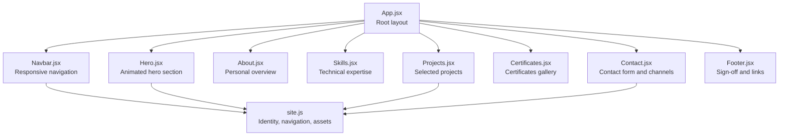
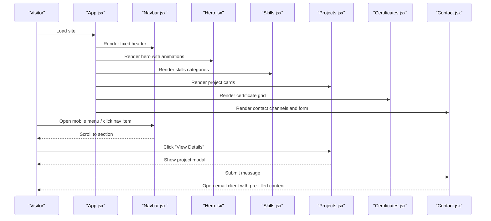
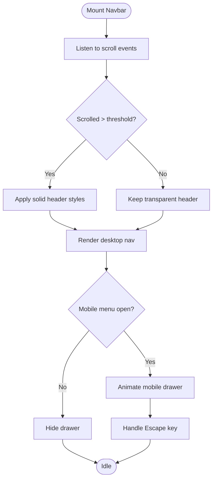
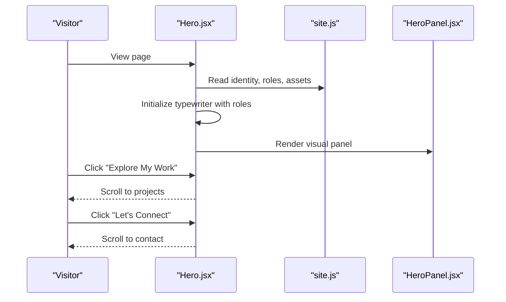
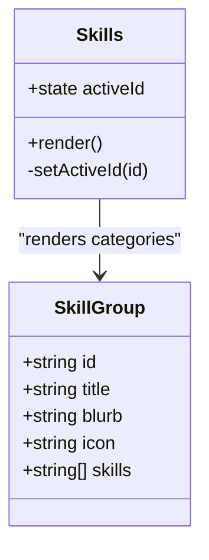
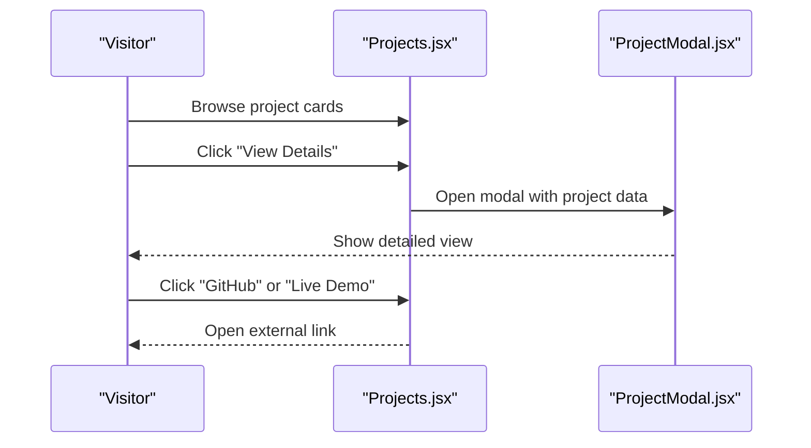
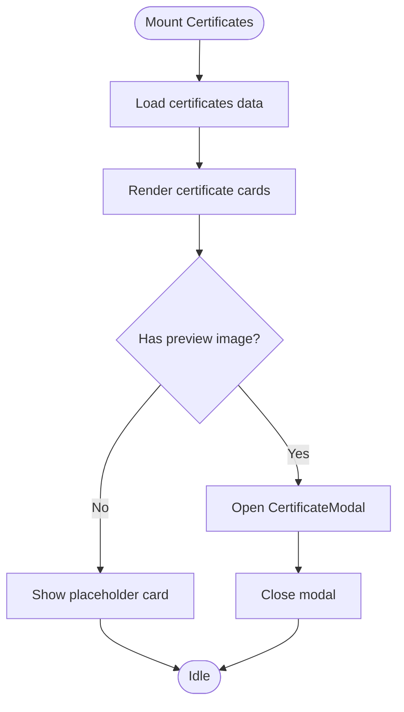
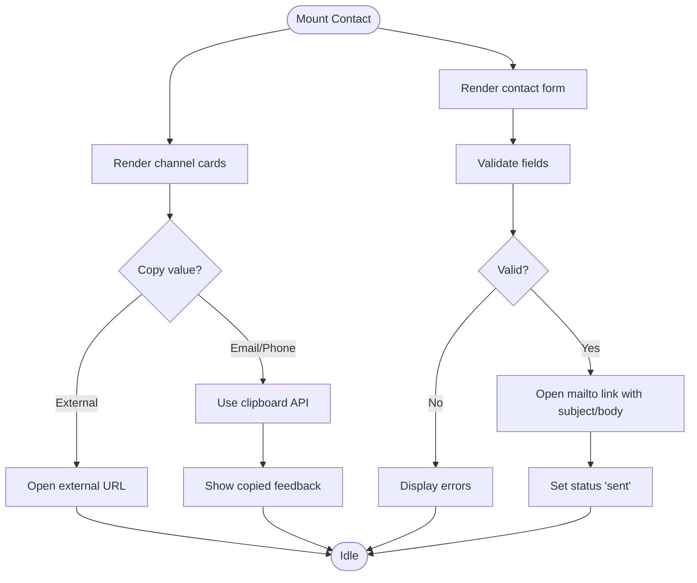
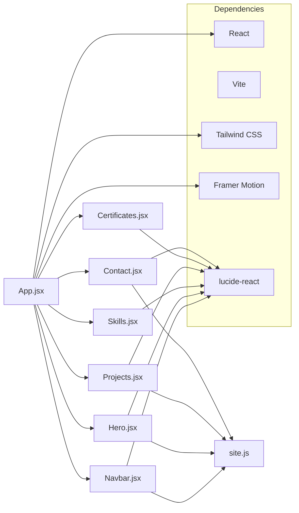

# Project Overview

<cite>
**Referenced Files in This Document**
- [package.json](file://package.json)
- [src/App.jsx](file://src/App.jsx)
- [src/data/site.js](file://src/data/site.js)
- [src/components/Navbar.jsx](file://src/components/Navbar.jsx)
- [src/components/Hero.jsx](file://src/components/Hero.jsx)
- [src/components/Skills.jsx](file://src/components/Skills.jsx)
- [src/components/Projects.jsx](file://src/components/Projects.jsx)
- [src/components/Certificates.jsx](file://src/components/Certificates.jsx)
- [src/components/Contact.jsx](file://src/components/Contact.jsx)
</cite>

## Table of Contents
1. [Introduction](#introduction)
2. [Project Structure](#project-structure)
3. [Core Components](#core-components)
4. [Architecture Overview](#architecture-overview)
5. [Detailed Component Analysis](#detailed-component-analysis)
6. [Dependency Analysis](#dependency-analysis)
7. [Performance Considerations](#performance-considerations)
8. [Troubleshooting Guide](#troubleshooting-guide)
9. [Conclusion](#conclusion)

## Introduction
Portfolio_2 is a premium personal portfolio website for M. Faizan Hassan, positioned as a Python Backend Developer & AI Engineer showcase. The site presents a polished, professional experience designed to attract employers, clients, and collaborators by highlighting technical expertise, practical projects, verified certificates, and clear contact pathways. It emphasizes intelligent backend systems, API design, automation, and AI-driven solutions through an elegant interface built with modern web technologies.

The primary goals are:
- Showcase identity, role, and professional positioning clearly.
- Demonstrate technical skills organized by problem domains.
- Present selected projects with context, technology stacks, and links.
- Display verified certificates and achievements.
- Provide accessible, frictionless ways to connect via email, phone, WhatsApp, GitHub, and LinkedIn.

Target audience:
- Employers seeking backend and AI talent.
- Clients looking for reliable engineering partners.
- Collaborators interested in joint technical initiatives.

## Project Structure
The project follows a React + Vite architecture with Tailwind CSS for styling and Framer Motion for animations. Data is centralized in configuration files, while UI components are modular and reusable.

**Diagram sources**
- [src/App.jsx:10-29](file://src/App.jsx#L10-L29)
- [src/components/Navbar.jsx:1-218](file://src/components/Navbar.jsx#L1-L218)
- [src/components/Hero.jsx:1-149](file://src/components/Hero.jsx#L1-L149)
- [src/components/Skills.jsx:1-187](file://src/components/Skills.jsx#L1-L187)
- [src/components/Projects.jsx:1-143](file://src/components/Projects.jsx#L1-L143)
- [src/components/Certificates.jsx:1-153](file://src/components/Certificates.jsx#L1-L153)
- [src/components/Contact.jsx:1-343](file://src/components/Contact.jsx#L1-L343)
- [src/data/site.js:1-116](file://src/data/site.js#L1-L116)

**Section sources**
- [src/App.jsx:10-29](file://src/App.jsx#L10-L29)
- [package.json:1-26](file://package.json#L1-L26)

## Core Components
This portfolio is composed of focused sections that work together to deliver a cohesive narrative:

- Responsive Navigation (Navbar): Fixed header with active section tracking, mobile drawer, social links, and CV download.
- Animated Hero Section (Hero): Staggered entrance animations, typewriter roles, availability badge, call-to-action buttons, and quick links.
- Skills Showcase (Skills): Category-based tabs with animated transitions, iconography, and counts for technologies.
- Projects Portfolio (Projects): Dark-themed cards with visuals, tech chips, detail modal, and external links.
- Certificates Gallery (Certificates): Verified credentials grid with preview modals and placeholder support.
- Contact Functionality (Contact): Channel cards with copy-to-clipboard, validated form opening the user’s email client, and accessibility attributes.

These components share common UI primitives (Button, Chip, Reveal, SectionHeading), data from site.js, and consistent motion patterns via Framer Motion.

**Section sources**
- [src/components/Navbar.jsx:1-218](file://src/components/Navbar.jsx#L1-L218)
- [src/components/Hero.jsx:1-149](file://src/components/Hero.jsx#L1-L149)
- [src/components/Skills.jsx:1-187](file://src/components/Skills.jsx#L1-L187)
- [src/components/Projects.jsx:1-143](file://src/components/Projects.jsx#L1-L143)
- [src/components/Certificates.jsx:1-153](file://src/components/Certificates.jsx#L1-L153)
- [src/components/Contact.jsx:1-343](file://src/components/Contact.jsx#L1-L343)
- [src/data/site.js:1-116](file://src/data/site.js#L1-L116)

## Architecture Overview
The application uses a single-page React app orchestrated by App.jsx. Each section is a self-contained component that reads shared configuration from site.js and renders with Tailwind classes and Framer Motion animations.

**Diagram sources**
- [src/App.jsx:10-29](file://src/App.jsx#L10-L29)
- [src/components/Navbar.jsx:1-218](file://src/components/Navbar.jsx#L1-L218)
- [src/components/Hero.jsx:1-149](file://src/components/Hero.jsx#L1-L149)
- [src/components/Skills.jsx:1-187](file://src/components/Skills.jsx#L1-L187)
- [src/components/Projects.jsx:1-143](file://src/components/Projects.jsx#L1-L143)
- [src/components/Certificates.jsx:1-153](file://src/components/Certificates.jsx#L1-L153)
- [src/components/Contact.jsx:1-343](file://src/components/Contact.jsx#L1-L343)

## Detailed Component Analysis

### Responsive Navigation (Navbar)
The navbar provides:
- Active section detection using a custom hook.
- Scroll-aware background and border changes.
- Mobile drawer with keyboard accessibility (Escape to close).
- Social links and CV download button.
- Smooth transitions and reduced-motion support.

**Diagram sources**
- [src/components/Navbar.jsx:1-218](file://src/components/Navbar.jsx#L1-L218)

**Section sources**
- [src/components/Navbar.jsx:1-218](file://src/components/Navbar.jsx#L1-L218)
- [src/data/site.js:62-69](file://src/data/site.js#L62-L69)

### Animated Hero Section (Hero)
The hero introduces M. Faizan Hassan with:
- Staggered reveal animations for text and panels.
- Typewriter effect cycling through roles defined in site.js.
- Optional availability badge controlled by configuration.
- Primary actions: explore projects and connect via contact.
- Quick links to CV, GitHub, and LinkedIn.

**Diagram sources**
- [src/components/Hero.jsx:1-149](file://src/components/Hero.jsx#L1-L149)
- [src/data/site.js:6-41](file://src/data/site.js#L6-L41)

**Section sources**
- [src/components/Hero.jsx:1-149](file://src/components/Hero.jsx#L1-L149)
- [src/data/site.js:6-41](file://src/data/site.js#L6-L41)

### Skills Showcase (Skills)
The skills section organizes technologies into groups:
- Category tabs on mobile; sticky sidebar on desktop.
- Animated transitions between categories.
- Counts and icons per category.
- Accessible state management for active tab.

**Diagram sources**
- [src/components/Skills.jsx:1-187](file://src/components/Skills.jsx#L1-L187)

**Section sources**
- [src/components/Skills.jsx:1-187](file://src/components/Skills.jsx#L1-L187)

### Projects Portfolio (Projects)
The projects section highlights selected work:
- Alternating visual/text layouts with hover effects.
- Technology chips and category labels.
- Detail modal for expanded information.
- Links to GitHub repositories and live demos.

**Diagram sources**
- [src/components/Projects.jsx:1-143](file://src/components/Projects.jsx#L1-L143)

**Section sources**
- [src/components/Projects.jsx:1-143](file://src/components/Projects.jsx#L1-L143)

### Certificates Gallery (Certificates)
The certificates section displays verified credentials:
- Grid layout with placeholders for pending previews.
- Preview modal when certificate images are available.
- Issuer initials and numbering for clarity.
- Note emphasizing only verified details are listed.

**Diagram sources**
- [src/components/Certificates.jsx:1-153](file://src/components/Certificates.jsx#L1-L153)

**Section sources**
- [src/components/Certificates.jsx:1-153](file://src/components/Certificates.jsx#L1-L153)

### Contact Functionality (Contact)
The contact section offers multiple communication channels:
- Email, phone, WhatsApp, LinkedIn, and GitHub cards.
- Copy-to-clipboard for email and phone values.
- Validated form that opens the user’s email client with pre-filled subject and body.
- Accessibility attributes for inputs and error messages.

**Diagram sources**
- [src/components/Contact.jsx:1-343](file://src/components/Contact.jsx#L1-L343)

**Section sources**
- [src/components/Contact.jsx:1-343](file://src/components/Contact.jsx#L1-L343)
- [src/data/site.js:6-41](file://src/data/site.js#L6-L41)

## Dependency Analysis
The project relies on React for componentization, Vite for build tooling, Tailwind CSS for utility-first styling, and Framer Motion for animations. Icons are provided by lucide-react.

**Diagram sources**
- [package.json:12-24](file://package.json#L12-L24)
- [src/App.jsx:1-8](file://src/App.jsx#L1-L8)

**Section sources**
- [package.json:1-26](file://package.json#L1-L26)
- [src/App.jsx:1-8](file://src/App.jsx#L1-L8)

## Performance Considerations
- Reduced motion: Components respect user preferences via useReducedMotion to disable animations when needed.
- Passive scroll listeners: Navbar uses passive event listeners for improved scroll performance.
- Staggered animations: Hero and other sections stagger children to avoid heavy simultaneous reflows.
- Conditional rendering: Modals and drawers render only when necessary to minimize DOM overhead.
- Lightweight assets: Icons are vector-based via lucide-react, reducing bundle size compared to raster images.

[No sources needed since this section provides general guidance]

## Troubleshooting Guide
Common issues and resolutions:
- Animations not appearing: Ensure Framer Motion is installed and check if reduced motion is enabled by the system.
- Mobile menu not closing: Verify Escape key listener and ensure no overlay blocks focus.
- Contact form does not open email client: Confirm browser allows mailto links and that validation passes.
- Missing CV download: Check public/cv path and ensure the PDF file exists at the configured asset location.
- Social links not working: Verify URLs in site.js and confirm target="_blank" behavior.

**Section sources**
- [src/components/Navbar.jsx:20-42](file://src/components/Navbar.jsx#L20-L42)
- [src/components/Contact.jsx:64-84](file://src/components/Contact.jsx#L64-L84)
- [src/data/site.js:48-52](file://src/data/site.js#L48-L52)

## Conclusion
Portfolio_2 delivers a refined, professional presentation of M. Faizan Hassan’s expertise as a Python Backend Developer & AI Engineer. Through responsive navigation, animated storytelling, structured skills, curated projects, verified certificates, and accessible contact options, the site effectively communicates technical depth and readiness for collaboration. Built with React, Vite, Tailwind CSS, and Framer Motion, it balances elegance with performance, making it suitable for engaging employers, clients, and collaborators.

[No sources needed since this section summarizes without analyzing specific files]