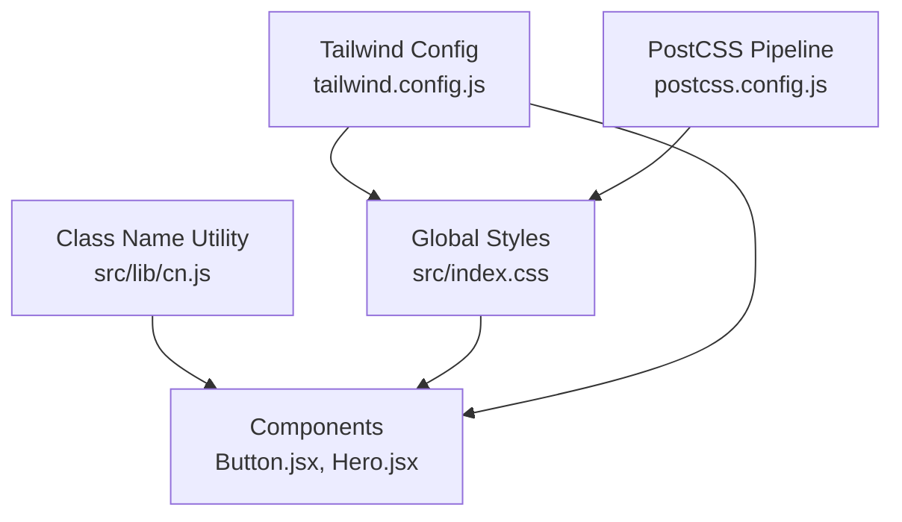
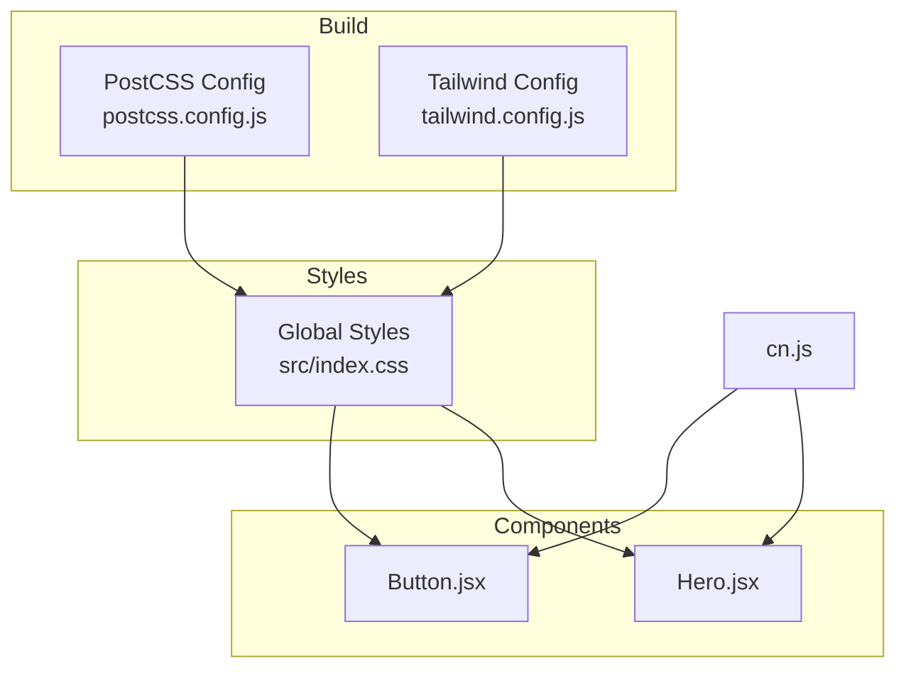
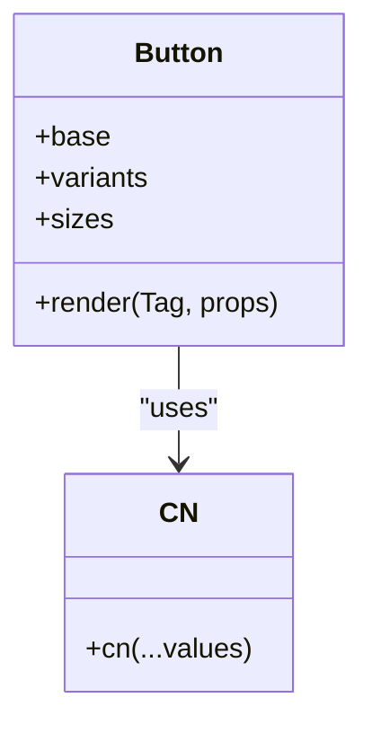
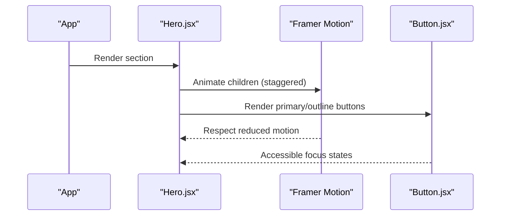
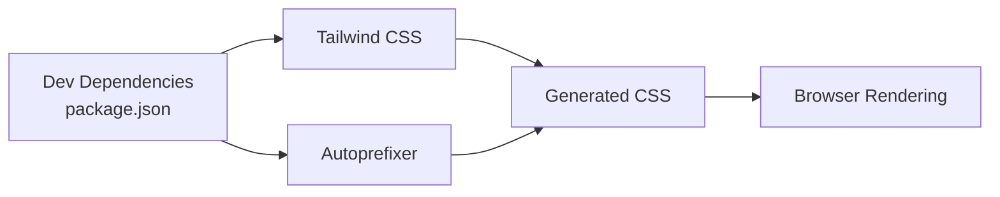

# Styling & Design System

<cite>
**Referenced Files in This Document**
- [tailwind.config.js](file://tailwind.config.js)
- [src/index.css](file://src/index.css)
- [src/lib/cn.js](file://src/lib/cn.js)
- [postcss.config.js](file://postcss.config.js)
- [package.json](file://package.json)
- [src/components/ui/Button.jsx](file://src/components/ui/Button.jsx)
- [src/components/Hero.jsx](file://src/components/Hero.jsx)
</cite>

## Table of Contents
1. [Introduction](#introduction)
2. [Project Structure](#project-structure)
3. [Core Components](#core-components)
4. [Architecture Overview](#architecture-overview)
5. [Detailed Component Analysis](#detailed-component-analysis)
6. [Dependency Analysis](#dependency-analysis)
7. [Performance Considerations](#performance-considerations)
8. [Troubleshooting Guide](#troubleshooting-guide)
9. [Conclusion](#conclusion)
10. [Appendices](#appendices)

## Introduction
This document describes the styling and design system for the project, focusing on Tailwind CSS configuration, global styles, custom CSS rules, and the utility-first approach used to maintain visual consistency across components. It explains how colors, typography, spacing, animations, and responsive patterns are defined and applied, and provides guidelines for extending the design system while preserving accessibility and cross-browser compatibility.

## Project Structure
The styling system is composed of:
- Tailwind configuration defining theme extensions (colors, fonts, shadows, transitions, keyframes, animations).
- Global CSS file with base styles, component layer utilities, and reduced-motion support.
- A small class name merging utility for composing conditional classes.
- PostCSS pipeline integrating Tailwind and Autoprefixer.
- React components that compose Tailwind utilities and design tokens consistently.

**Diagram sources**
- [tailwind.config.js:1-89](file://tailwind.config.js#L1-L89)
- [src/index.css:1-154](file://src/index.css#L1-L154)
- [postcss.config.js:1-7](file://postcss.config.js#L1-L7)
- [src/lib/cn.js:1-7](file://src/lib/cn.js#L1-L7)
- [src/components/ui/Button.jsx:1-41](file://src/components/ui/Button.jsx#L1-L41)
- [src/components/Hero.jsx:1-149](file://src/components/Hero.jsx#L1-L149)

**Section sources**
- [tailwind.config.js:1-89](file://tailwind.config.js#L1-L89)
- [src/index.css:1-154](file://src/index.css#L1-L154)
- [postcss.config.js:1-7](file://postcss.config.js#L1-L7)
- [src/lib/cn.js:1-7](file://src/lib/cn.js#L1-L7)
- [src/components/ui/Button.jsx:1-41](file://src/components/ui/Button.jsx#L1-L41)
- [src/components/Hero.jsx:1-149](file://src/components/Hero.jsx#L1-L149)

## Core Components
- Tailwind Theme Extensions:
  - Colors: semantic tokens (ink, paper, haze, mist), brand palette, accent palette.
  - Typography: display, sans, mono font stacks.
  - Spacing and sizing: extended border radius values.
  - Shadows: soft, lift, brand, panel.
  - Transitions: premium easing curve.
  - Animations: fade-up, caret, drift; keyframes definitions.
- Global Styles:
  - Base layer: color scheme, CSS variables, body defaults, headings, selection, focus-visible, scrollbars.
  - Components layer: container-page, skip-link.
  - Utilities layer: grid-lines, dot-grid, mask-fade-bottom/x, no-scrollbar, text-gradient-brand.
  - Reduced motion media query.
- Class Name Merging Utility:
  - Filters falsy values and joins strings to produce a single className.

**Section sources**
- [tailwind.config.js:12-85](file://tailwind.config.js#L12-L85)
- [src/index.css:5-153](file://src/index.css#L5-L153)
- [src/lib/cn.js:1-7](file://src/lib/cn.js#L1-L7)

## Architecture Overview
The design system follows a layered architecture:
- Configuration layer (Tailwind config) defines tokens and animation primitives.
- Global styles layer (index.css) applies base styles, reusable components, and utility classes.
- Component layer (React components) composes Tailwind utilities and design tokens using the cn utility for conditional styling.
- Build pipeline (PostCSS + Tailwind + Autoprefixer) generates optimized CSS with vendor prefixes.

**Diagram sources**
- [postcss.config.js:1-7](file://postcss.config.js#L1-L7)
- [tailwind.config.js:1-89](file://tailwind.config.js#L1-L89)
- [src/index.css:1-154](file://src/index.css#L1-L154)
- [src/components/ui/Button.jsx:1-41](file://src/components/ui/Button.jsx#L1-L41)
- [src/components/Hero.jsx:1-149](file://src/components/Hero.jsx#L1-L149)
- [src/lib/cn.js:1-7](file://src/lib/cn.js#L1-L7)

## Detailed Component Analysis

### Tailwind Theme Tokens
- Color Palette:
  - Semantic tokens: ink, paper, haze, mist.
  - Brand palette: DEFAULT and 50–900 scale.
  - Accent palette: DEFAULT and 50–900 scale.
- Typography:
  - display: Sora-based stack.
  - sans: Inter-based stack.
  - mono: JetBrains Mono-based stack.
- Border Radius:
  - Extended 4xl and 5xl radii.
- Shadows:
  - soft, lift, brand, panel.
- Transitions:
  - premium cubic-bezier easing.
- Animations:
  - fade-up, caret, drift with corresponding keyframes.

Guidelines:
- Use semantic tokens (ink, paper, haze, mist) for backgrounds and text to ensure contrast and consistency.
- Prefer brand/accent scales for interactive elements and highlights.
- Apply shadow tokens for elevation and depth rather than ad-hoc values.
- Use transitionTimingFunction.premium for consistent motion feel.

**Section sources**
- [tailwind.config.js:15-84](file://tailwind.config.js#L15-L84)

### Global Styles and Layers
- Base Layer:
  - Sets light color-scheme and CSS variables for tokens.
  - Applies smooth scrolling, antialiased body, balanced heading text-wrap, pretty paragraph wrapping.
  - Defines selection color and focus-visible outline for accessibility.
  - Customizes scrollbars for Firefox and WebKit.
- Components Layer:
  - container-page: responsive max-width container with padding.
  - skip-link: accessible skip-to-content link with focus behavior.
- Utilities Layer:
  - grid-lines and grid-lines-dark: subtle background grids.
  - dot-grid: dot pattern background.
  - mask-fade-bottom and mask-fade-x: gradient masks for fading edges.
  - no-scrollbar: hides scrollbars across browsers.
  - text-gradient-brand: gradient text using brand/accent colors.
- Reduced Motion:
  - Disables animations and transitions when prefers-reduced-motion is set.

Accessibility notes:
- Focus-visible outlines use brand color with sufficient contrast.
- Skip-link improves keyboard navigation.
- Reduced motion respects user preferences.

**Section sources**
- [src/index.css:5-153](file://src/index.css#L5-L153)

### Class Name Merging Utility
- Purpose: Compose conditional classes cleanly by filtering out falsy values and joining them into a single string.
- Usage: Import and pass multiple class arguments to avoid duplicates and improve readability.

Best practices:
- Always merge base, variant, size, and external className via the utility.
- Avoid inline concatenation of classes to reduce duplication risk.

**Section sources**
- [src/lib/cn.js:1-7](file://src/lib/cn.js#L1-L7)

### Button Component
- Structure:
  - Base class string defines layout, typography, transitions, focus ring, disabled state.
  - Variants define primary, outline, dark, ghostDark, quiet, quietDark styles.
  - Sizes define sm, md, lg, icon dimensions and typography.
  - Exports base, variants, sizes for reuse.
- Composition:
  - Uses cn utility to combine base, variant, size, and external className.
- Accessibility:
  - Focus-visible ring uses brand color with offset for visibility.
  - Disabled state reduces opacity and pointer events.

**Diagram sources**
- [src/components/ui/Button.jsx:1-41](file://src/components/ui/Button.jsx#L1-L41)
- [src/lib/cn.js:1-7](file://src/lib/cn.js#L1-L7)

**Section sources**
- [src/components/ui/Button.jsx:1-41](file://src/components/ui/Button.jsx#L1-L41)

### Hero Section
- Layout:
  - Responsive grid with column spans for desktop.
  - Container-page wrapper ensures consistent content width.
- Visuals:
  - Background grids and radial gradients using utility classes.
  - Animated text cursor using animate-caret.
- Motion:
  - Framer Motion orchestrates staggered reveals and respects reduced motion.
- Typography:
  - Fluid type via clamp() and tokenized colors.

**Diagram sources**
- [src/components/Hero.jsx:1-149](file://src/components/Hero.jsx#L1-L149)
- [src/components/ui/Button.jsx:1-41](file://src/components/ui/Button.jsx#L1-L41)

**Section sources**
- [src/components/Hero.jsx:1-149](file://src/components/Hero.jsx#L1-L149)

## Dependency Analysis
- Build-time dependencies:
  - Tailwind CSS compiles utility classes based on content globs.
  - Autoprefixer adds vendor prefixes for cross-browser compatibility.
- Runtime dependencies:
  - Framer Motion for animations.
  - Lucide React for icons.
- Style dependencies:
  - Tailwind config extends default theme.
  - Global CSS layers build upon Tailwind utilities.

**Diagram sources**
- [package.json:18-24](file://package.json#L18-L24)
- [postcss.config.js:1-7](file://postcss.config.js#L1-L7)

**Section sources**
- [package.json:1-26](file://package.json#L1-L26)
- [postcss.config.js:1-7](file://postcss.config.js#L1-L7)

## Performance Considerations
- Content scanning:
  - Tailwind scans only specified paths to generate minimal CSS.
- Animation performance:
  - Use transform and opacity for GPU-accelerated animations.
  - Respect prefers-reduced-motion to minimize unnecessary work.
- Scrollbar customization:
  - Keep scrollbar styles lightweight; avoid heavy gradients or complex effects.
- Font loading:
  - Ensure web fonts are loaded efficiently; consider preloading critical fonts.

[No sources needed since this section provides general guidance]

## Troubleshooting Guide
- Classes not applied:
  - Verify content paths include all files where classes are used.
  - Ensure Tailwind is configured and PostCSS pipeline includes tailwindcss and autoprefixer.
- Animations not working:
  - Check keyframe and animation names match between config and usage.
  - Confirm reduced motion settings do not disable intended animations unexpectedly.
- Focus styles missing:
  - Ensure focus-visible styles are present in base layer.
  - Validate that interactive elements receive focus and are not styled with outline-none without alternatives.
- Cross-browser issues:
  - Autoprefixer should handle most vendor prefixes; verify browser targets if issues persist.
  - Scrollbar styles may vary; test Firefox and WebKit-specific selectors.

**Section sources**
- [postcss.config.js:1-7](file://postcss.config.js#L1-L7)
- [src/index.css:48-79](file://src/index.css#L48-L79)
- [src/index.css:140-153](file://src/index.css#L140-L153)

## Conclusion
The design system leverages Tailwind’s utility-first approach with a well-defined theme extension, global style layers, and a small but powerful class name merging utility. Consistent tokens for colors, typography, shadows, and animations ensure visual coherence. Accessibility is addressed through focus-visible styles, skip links, and reduced motion support. The PostCSS pipeline guarantees cross-browser compatibility. Extending the system should follow established patterns to maintain clarity and consistency.

[No sources needed since this section summarizes without analyzing specific files]

## Appendices

### Guidelines for Extending the Design System

- Adding New Colors:
  - Define semantic tokens or extend brand/accent palettes in the Tailwind config.
  - Mirror the existing scale structure (DEFAULT and 50–900) for consistency.
  - Update CSS variables in the base layer if you need runtime access to tokens.

- Adding Fonts:
  - Extend fontFamily in the Tailwind config with a sensible fallback stack.
  - Ensure fonts are loaded appropriately (e.g., via CSS @font-face or external loaders).

- Adding Breakpoints:
  - Extend the theme breakpoints in the Tailwind config if custom responsive points are required.
  - Use existing responsive prefixes (sm:, md:, lg:) for standard breakpoints.

- Adding Animations:
  - Define keyframes under keyframes and map them to animation names in the animation section.
  - Provide a matching transitionTimingFunction for consistent motion curves.
  - Respect prefers-reduced-motion by providing non-animated fallbacks.

- Maintaining Visual Consistency:
  - Prefer tokens over arbitrary values.
  - Use component-level composition (base, variants, sizes) for reusable UI elements.
  - Keep global styles focused on base, components, and utilities layers.

- Accessibility Considerations:
  - Ensure sufficient color contrast for text and interactive elements.
  - Provide visible focus indicators and keyboard navigation.
  - Honor user motion preferences via reduced motion media queries.

- Cross-Browser Compatibility:
  - Rely on Autoprefixer for vendor prefixes.
  - Test scrollbar styles and mask-image properties across browsers.
  - Validate focus-visible behavior and outline rendering differences.

**Section sources**
- [tailwind.config.js:15-84](file://tailwind.config.js#L15-L84)
- [src/index.css:5-153](file://src/index.css#L5-L153)
- [postcss.config.js:1-7](file://postcss.config.js#L1-L7)